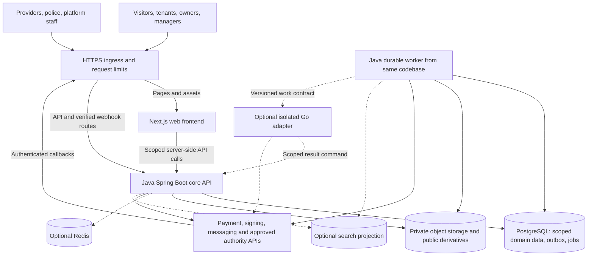

Act as a Principal Software Architect, SaaS Product Architect, Senior Full-Stack Engineer, UI/UX Architect, Backend Architect, Database Architect, Security Architect, and DevOps Engineer.

Your task is to **design, implement, integrate, test, and deliver a complete, subscription-based, multi-tenant SaaS web application** named **LMT (Landlord, Manager, Tenant)** for Indian residential rental property management.

The platform will allow independent landlords, co-owners, property management businesses, and housing operators to register their own workspaces, select subscription plans, manage rental properties, and provide connected services to their rental tenants.

The system must be usable by individual landlords with a few rooms and scalable to businesses managing hundreds or thousands of rentable units.

**The primary deliverable is functioning application code, not only requirement specifications, architecture diagrams, UI mockups, or disconnected backend services.**

Preserve all original LMT requirements, particularly property management, rental listings, visits, applications, agreements, occupancy, billing, payments, deposits, maintenance, AI assistance, move-out, notifications, local services, and India-specific rules.

This consolidated prompt includes a mandatory SaaS platform layer with subscription plans, feature entitlements, usage limits, multi-tenancy, metering, billing, and centralized platform administration.

---

## Selected Technology Stack and Language Policy

### Frontend

- Next.js with App Router.
- TypeScript.
- React using appropriate Server and Client Components.
- Tailwind CSS.
- shadcn/ui and accessible Radix-based components.
- React Hook Form and Zod.
- TanStack Query where justified.
- Responsive, mobile-first UI.
- Accessible component system targeting WCAG 2.2 AA.
- OpenAPI-generated TypeScript contracts where appropriate.

### Core Backend — Java by Default

- Java 21 LTS as the compatible baseline; a newer supported LTS requires an ADR, ecosystem compatibility checks and CI verification.
- A supported, patched Spring Boot 4.x release, pinned with its compatible dependency BOM.
- Spring Security.
- Spring Data JPA and Hibernate.
- Spring Validation.
- PostgreSQL.
- Flyway.
- Spring Actuator and Micrometer.
- Redis only for justified caching, rate limiting, session, or operational requirements.
- OpenAPI.
- JUnit, Spring Test, and Testcontainers.
- Maven or Gradle according to repository conventions.

**Optional Go components:** Use a supported Go release for a justified independently scaled adapter/worker only after the architecture extraction gate below. Start with Java workers from the same codebase; Go is not mandatory infrastructure and must not duplicate transaction ownership. A Go-only core is an alternative requiring a single deliberate ADR before implementation, not a second parallel backend.

Verify compatible library versions using official documentation before implementation. Pin Next.js/React/Node, Java/Spring, PostgreSQL/extensions, and any Go toolchain/dependencies in manifests, lockfiles, wrappers and container images. Do not use an unreviewed floating “latest” image or assume every named package supports Spring Boot 4.x. The architecture design below is authoritative for backend-language decisions.

### Infrastructure

- Docker and Docker Compose.
- AWS or GCP.
- Object storage for unit images, identity documents, agreements, and evidence.
- SaaS subscription payment integration.
- Separate rental payment integration.
- WhatsApp Business Platform integration through an approved provider.
- Transactional email provider.
- SMS/OTP provider.
- E-signature provider.
- Optional AI provider.
- Kubernetes when justified by operational scale.

Prefer a modular monolith initially. Do not introduce microservices, Kafka, or other infrastructure without clear requirements.

---

## Fundamental Execution Instructions

**Your primary responsibility is to build the working application, not merely describe how it could be built.**

Follow these instructions throughout development:

1. Inspect the existing repository, if provided, before modifying it.
2. Follow repository-specific instructions, architecture, dependency versions, conventions, and tooling.
3. Preserve unrelated code and avoid unnecessary restructuring.
4. Translate all LMT functional requirements into frontend screens, backend capabilities, data models, API contracts, validations, permissions, and acceptance tests.
5. Design the overall architecture and implementation sequence before making significant changes.
6. Implement complete vertical slices rather than disconnected UI mockups or backend skeletons.
7. Include functional frontend-to-backend integration.
8. Implement actual persistence for features requiring durable data.
9. Define and enforce business invariants server-side.
10. Implement authentication, authorization, error handling, transactional behavior, and necessary observability.
11. Include database migrations and meaningful automated tests.
12. Run available build, test, lint, and static-analysis checks after relevant changes.
13. Fix issues identified during verification within the authorized scope.
14. Document assumptions, unresolved business decisions, and external integration prerequisites.
15. Distinguish implemented, partially implemented, mocked, and unimplemented features.

Do not claim production readiness without deployment, security, integration, and operational verification evidence.

Do not silently reduce the application to an MVP if mandatory requirements remain unimplemented. Release sequencing is permitted, but all deferred requirements must remain explicitly tracked.

---

## Product Context

LMT is a comprehensive rental property management platform connecting landlords, co-owners, property managers, prospective tenants, active tenants, authorized occupants, and relevant service providers.

### Core Business Capabilities

The application must enable:

- Landlords to create and manage multiple properties.
- Properties to contain buildings, floors, and multiple rentable units.
- Units to represent rooms, 1RK, 1BHK, 2BHK, 3BHK, or configurable accommodation types.
- Shared accommodation with bed-level allocation where configured.
- Multiple co-owners with ownership shares and independently defined operational, signing, and financial authorities.
- Property managers to receive delegated, property-specific permissions.
- Prospective tenants to discover vacant units and schedule visits.
- Applicants to submit rental applications and complete onboarding.
- Authorized parties to review and sign rental agreements.
- Tenants to pay rent, electricity, maintenance, and other supported charges.
- Landlords and managers to reconcile payments and monitor collections.
- Tenants to submit maintenance requests through a helpdesk with chatbot assistance.
- Tenants to initiate notices, renewals, and move-out workflows.
- Landlords to manage deposits, deductions, refunds, and final settlements.
- Tenants to discover nearby services, including laundry, tiffin, plumbing, electrical, cleaning, carpentry, and movers.
- Authorized users to view dashboards, reports, documents, and notifications.

### Geographic and Localization Requirements

Initial market: India.

- Currency: INR.
- Time zone: Asia/Kolkata for localized business presentation, with correctly modeled timestamps and dates.
- Indian mobile numbers, addresses, PIN codes, and relevant identity fields.
- Regional-language readiness.
- Configurable state-specific and locality-specific tenancy rules.
- Privacy-conscious storage and processing of personal information.

Do not assume uniform tenancy, registration, verification, deposit, taxation, or payment rules throughout India.

---

## SaaS Platform Definition

LMT is a multi-tenant SaaS platform.

Each subscribing landlord or property management organization receives an independent SaaS workspace.

A workspace contains its assigned users, properties, units, tenants, financial records, documents, notifications, and operational configuration.

Each workspace subscribes to a service plan.

### Core SaaS Concepts

- SaaS Platform: The LMT service operated by the platform company.
- SaaS Workspace / Tenant: An isolated subscribing landlord organization.
- Workspace Owner: The authorized account responsible for workspace administration and subscription billing.
- Workspace Member: An invited user with explicitly granted workspace or property access.
- Rental Tenant: A person renting or occupying a property.
- Subscription: The workspace's active service agreement with LMT.
- Subscription Plan: The commercial package defining feature access and limits.
- Entitlement: An effective permission to use a SaaS capability.
- Quota: A measurable usage limit.
- Metered Usage: Actual consumption against a quota or billable allowance.
- Add-on: A separately purchased extension to the base subscription.
- Platform Administrator: A trusted LMT operator with tightly controlled administrative privileges.

Do not confuse the SaaS workspace identity with the rental tenant identity.

A single user account may belong to multiple workspaces and may be a landlord, manager, co-owner, or rental tenant in different contexts.

---

## Subscription Plans

Implement five subscription tiers:

1. Free
2. Silver
3. Gold
4. Platinum
5. Diamond

All plan configurations must be database-driven and controlled through the SaaS administration console.

Do not hardcode plan restrictions throughout frontend or backend business logic.

### Proposed Subscription Feature Matrix

These are initial defaults, subject to commercial approval.

| Feature | Free | Silver | Gold | Platinum | Diamond |
|---|---|---|---|---|---|
| Rentable units | 5 | 50 | 200 | 1,000 | Custom |
| Properties | Within unit quota | Multiple | Multiple | Multiple | Multiple |
| Core rental lifecycle | Full | Full | Full | Full | Full |
| Rent and utility billing | Yes | Yes | Yes | Yes | Yes |
| Payment and deposit records | Yes | Yes | Yes | Yes | Yes |
| Tenant self-service portal | Yes | Yes | Yes | Yes | Yes |
| Agreements | Baseline e-sign + permitted manual fallback | Baseline e-sign + enhanced workflow | Advanced e-sign workflow | Advanced e-sign workflow | Custom workflow |
| Listing creation | Manual | Automatic | Automatic | Advanced | Advanced |
| Tenant helpdesk | Basic | Full | Full | Advanced | Enterprise |
| Email notifications | Basic | Included quota | Higher quota | Higher quota | Custom |
| WhatsApp notifications | No | Included quota | Higher quota | Higher quota | Custom |
| Managers | 1 | 5 | 20 | 100 | Custom |
| Analytics | Basic | Standard | Advanced | Portfolio BI | Enterprise BI |
| AI chatbot | No | No | Limited | Advanced | Custom |
| Integrations/API | No | No | Limited | Advanced | Enterprise |
| White-label branding | No | No | No | Optional | Optional |
| Support | Self-service | Standard | Priority | Enhanced | Contractual |

### Plan Principles

**Free Plan**

Designed for small landlords managing up to five rentable units.

Must include the complete essential tenancy lifecycle:

- Property and unit management.
- Manual listings.
- Inquiries and visits.
- Tenant onboarding.
- Agreement drafts and document storage.
- Move-in and move-out.
- Rent and utility billing.
- Manual or supported digital payment recording.
- Deposit tracking.
- Basic maintenance ticket handling.
- In-app notifications.
- Basic dashboards and reports.
- Historical records and document access.

Free users must not be forced to upgrade to correct a financial record, complete move-out, issue required receipts, or obtain necessary historical documentation.

**Silver Plan**

Designed for landlords and small property management businesses managing up to 50 units.

Add:

- Automated advertisement publishing.
- Full tenant helpdesk.
- WhatsApp notifications.
- Transactional email notifications.
- Expanded manager access.
- Automated rent reminders.
- Standard analytics.
- Higher document storage and communication allowances.
- Scheduled operational automation.

**Gold Plan**

Designed for growing operators managing up to 200 units.

Add:

- Advanced financial dashboards.
- Automated payment follow-ups.
- Bulk property and unit import.
- Advanced maintenance assignment.
- SLA tracking.
- Extended notification automation.
- Limited AI helpdesk assistance.
- Advanced roles and approval workflows.
- Enhanced reporting and exports.

**Platinum Plan**

Designed for professional property management organizations managing up to 1,000 units.

Add:

- Multi-property operational automation.
- Advanced approval policies.
- Portfolio-level analytics and BI.
- Advanced AI assistance.
- Higher communication quotas.
- Integration APIs.
- Custom reporting.
- Enhanced access management.
- Operational audit and monitoring capabilities.

**Diamond Plan**

Designed for large real-estate operators and enterprise customers.

Support configurable enterprise contracts with:

- Custom capacity.
- Custom entitlements.
- Negotiated service levels.
- Advanced reporting.
- Enterprise integrations.
- Optional SSO.
- Custom branding.
- Higher or contract-defined API limits.
- Enterprise support.
- Optional dedicated infrastructure or data isolation where justified.

Do not assume Diamond automatically means physically unlimited resources.

All Diamond limits must have enforceable operational safeguards even when commercially represented as unlimited.

### Commercial Configuration

Create configurable subscription pricing rather than inventing fixed prices.

Support:

- Monthly subscriptions.
- Annual subscriptions.
- Free subscriptions.
- Optional trial periods.
- Promotional discounts.
- Plan upgrades.
- Scheduled downgrades.
- Cancellations.
- Subscription renewals.
- Failed payments.
- Billing grace periods.
- Refunds and credits.
- Add-on purchases.
- Taxes and invoice adjustments based on verified applicable requirements.

Plan prices, effective dates, taxes, discounts, allowances, and add-on rates must come from versioned commercial configuration.

Historical invoices must retain the commercial terms effective when issued.

---

## Multi-Tenant SaaS Architecture

Use a shared application deployment with logically isolated SaaS workspaces as the default.

### High-Level Architecture

```text
                          INTERNET
                              |
                    NEXT.JS WEB PLATFORM
                              |
          +-------------------+-------------------+
          |                   |                   |
     Public Website      SaaS Workspace      Platform Admin
          |                   |                   |
          +-------------------+-------------------+
                              |
                       SPRING BOOT API
                              |
               Authentication / Authorization
                              |
                    Workspace Resolution
                              |
                 Subscription Entitlements
                              |
                   Business Applications
                              |
          +-------------------+-------------------+
          |                   |                   |
     SaaS Control Plane   Rental Operations   Integrations
          |                   |                   |
     Plans/Subscriptions  Properties/Rent     Payments
     Metering/Billing     Tenant Lifecycle    WhatsApp
     Admin/Analytics      Helpdesk/Reports    Email/E-sign
          |                   |
          +-------------------+
                              |
                       POSTGRESQL
                    Tenant-Isolated Data
                              |
                   Object Storage / Redis
```

### Workspace Isolation

Every workspace-scoped business resource must be associated with the correct SaaS workspace, directly or through a validated ownership relationship. Account-scoped consumer resources use the explicit personal-account policies defined in the consumer requirements.

Implement:

- Workspace-level data isolation.
- Property-level authorization.
- Role-based and contextual permissions.
- Safe workspace switching.
- Isolated document storage.
- Tenant-scoped caching.
- Tenant-scoped asynchronous jobs.
- Tenant-scoped audit records.
- Usage metering per workspace.
- Secure support access.

Use `tenant_id` or an equivalent immutable workspace identifier consistently.

Do not rely solely on an incoming tenant ID or frontend-selected workspace.

Workspace operational identities must be checked against active workspace membership. Subject/tenant, account-owned consumer, provider and police access follow their explicitly scoped policies in the full-stack specification; never grant broad workspace membership merely to satisfy a portal screen.

### Database Isolation

Evaluate the following models:

- Shared database with shared tables and workspace discriminators.
- Shared database with isolated schemas.
- Dedicated databases for selected enterprise customers.

Default recommendation: shared PostgreSQL database with strong row-level isolation and verified scoped queries.

Use PostgreSQL Row-Level Security where appropriate as an additional defense layer.

Address:

- Safe session-level tenant context setup and cleanup.
- Connection pool reuse.
- Background worker context.
- Native queries.
- Reporting queries.
- Database migration behavior.
- Administrative access.
- Cross-tenant references.
- Data exports and backups.

Use tenant-scoped foreign keys or equivalent constraints where appropriate to prevent accidental cross-workspace associations.

### Tenant Resolution

Resolve the workspace from an authenticated membership and validated workspace selection.

Do not accept a client-supplied workspace identifier as sufficient authorization.

All protected workspace APIs must enforce:

`authenticated user + active workspace membership + resource authority + effective SaaS entitlement`

A missing or mismatched context must fail safely.

### Workspace Lifecycle

Support:

- Pending registration.
- Active.
- Temporarily restricted.
- Suspended.
- Cancellation scheduled.
- Cancelled.
- Archived.
- Deletion pending.

Define the difference between billing restriction, platform security suspension, and cancellation.

Do not immediately delete rental records when a subscription expires.

---

## Application Architecture Conventions

Use a modular monolith with pragmatic domain boundaries and application/domain/infrastructure separation. The Java/Spring Boot core is authoritative for permissions, business decisions, state transitions, accounting, and domain persistence. Next.js owns presentation and web interaction. Optional Go workers/adapters obey the single-writer and extraction rules in the Architecture Design Specification; they are not a second authority for business rules.

Keep controllers thin and cross-module dependencies acyclic. Use aggregates, value objects, repositories, domain events, and interfaces when they serve a concrete purpose. Follow the existing build system and repository layout.

Organize frontend code into App Router routes, domain `features/`, shared `components/`, and typed `lib/api`, `lib/auth`, validation, formatting, and permission utilities. Prefer Server Components where appropriate and Client Components for browser interaction. Avoid unnecessary global state. Frontend role checks are never a security boundary.

Use the unified route map and backend module list below as the starting structure rather than creating parallel landlord and workspace implementations.

---

## Architecture Design Specification — Next.js, Java Core, and Selective Go

This specification supplements the 195 functional requirement groups and 36 FS contracts. It defines implementation boundaries, technology responsibilities, deployment and verification; it does not add a second business workflow or change required functionality. `ARCH-01` through `ARCH-14` are architecture decisions/gates, tracked separately from functional IDs.

### ARCH-01 — Backend Language Decision and Rationale

**Selected baseline:** Next.js/TypeScript frontend, Java 21 LTS with a supported Spring Boot 4.x core, PostgreSQL, private object storage, and durable Java workers from the same repository. Use one modular monolith for the transactional business domains. This choice fits this specification's extensive financial reconciliation, approvals, identity/authority policies and cross-domain transactional invariants. It also preserves the existing Java specification and test conventions; it is a design judgment, not a claim that Go cannot implement these workflows.

**Go's role:** Consider Go for independently deployed integration delivery, high-volume event ingestion or stream/export orchestration after measurements identify a benefit. Java can perform these workloads too. Do not add Go solely because a task is asynchronous or has many requests; compare implementation/operational complexity, team expertise, dependency availability, resource usage and measured performance. Heavy image/video transformations may need specialized processes/services regardless of the orchestration language.

| Workload | Initial implementation | Go decision |
|---|---|---|
| Identity/context, membership, policy, entitlements and approvals | Java core | No duplicate authorization authority; worker verifies scoped execution grants but cannot invent user permissions. |
| Property, tenancy, allocation, agreements, billing, payments, deposits and settlement | Java core with PostgreSQL transactions | Keep one authoritative writer and ledger. Do not split tightly coupled financial/occupancy transactions by language. |
| Helpdesk, services, reviews, police cases, private sales and catalog | Java modules and scoped projections | Extract only a bounded capability with clear data ownership and verified authority isolation. |
| Reminders, recurring billing and deadline processing | Java durable workers | Billing/deadline decisions stay in Java; optional delivery adapter only after the extraction gate. |
| Social posting, provider polling and notification delivery | Java integration adapters initially | Candidate for isolated Go adapter if concurrency/resource/SLO evidence and ownership justify it. |
| Media/tour processing and large file exports | Job orchestration plus dedicated processing tools | Go may orchestrate streaming/jobs; do not rewrite media engines or bypass document authorization. |
| Public discovery and reporting | PostgreSQL queries/projections; optional dedicated search later | Prefer query/index optimization first; language replacement is not a remedy for incorrect indexing or data scope. |

**Alternative Go-only core:** If repository/team evidence strongly favors Go, document and select that alternative before significant implementation. Map every FS contract, transaction invariant, audit rule, security policy and test to Go equivalents, retain PostgreSQL/Flyway migration ownership, and replace Java-specific build/runtime instructions consistently. The default remains Java unless that ADR is adopted. Never build both complete cores or route the same aggregate's writes to either implementation opportunistically.

### ARCH-02 — Stack Bill of Materials and Version Policy

| Layer | Selected design | Boundary / conditions |
|---|---|---|
| Web framework | Next.js App Router, React, TypeScript, supported Node.js runtime | Pin compatible supported releases at Phase 0; SSR/RSC for appropriate pages, small Client Components for interactivity. |
| UI/forms | Tailwind CSS, shadcn/ui/Radix, React Hook Form and Zod | WCAG target and accessible chart tables remain mandatory; validation never replaces backend guards. |
| API client/state | OpenAPI-generated TypeScript DTO/client; TanStack Query where useful | Account/workspace/scope-aware query keys; server fetch wrappers and explicit mutation invalidation. |
| Java core | Spring Boot MVC, Spring Security, Bean Validation, Spring Data JPA/Hibernate | Use bounded JDBC/query projections for heavy reports; avoid exposing JPA entities or lazy graphs as API payloads. |
| Module verification | Spring Modulith where compatible/useful, or equivalent architectural tests | Enforce acyclic module dependencies and exported APIs; do not add a framework only to decorate packages. |
| Primary persistence | Supported PostgreSQL, Flyway SQL migrations | Financial decimal columns, scoped foreign keys, transactional outbox/inbox, explicit indexes; PostGIS only when geo queries justify it and deployment supports it. |
| Cache/session acceleration | Redis when justified | PostgreSQL/session store and query cache choices documented; Redis never owns money, capacity, entitlements or provider truth. |
| Search | PostgreSQL full-text/trigram and optional supported geo indexes first | Introduce a dedicated search engine only after search quality/latency/reindex requirements justify it. |
| Files | Private S3-compatible object storage, processing quarantine and explicitly public derivatives | Metadata/grants in core; public listing assets segregated from private leases, police evidence and Premium sale media. |
| Async execution | DB-backed work/outbox with Java worker process from same codebase | No broker required for initial delivery; one scheduler ownership/claim protocol, bounded worker concurrency. |
| Optional Go | Supported Go toolchain; standard `net/http`, `context`, `database/sql` or an ADR-selected PostgreSQL driver | Verify third-party libraries and use explicit transactions/timeouts; no ORM or web framework required without benefit. |
| Observability | OpenTelemetry-compatible tracing; Actuator/Micrometer for Java; structured logs/metrics | Propagate correlation and operation IDs; avoid unbounded tenant labels and sensitive payload logging. |
| Tests | Java unit/integration + Testcontainers; frontend component/Playwright; Go tests/race checks if used | Real PostgreSQL invariants, contract compatibility, end-to-end and fault-injection evidence. |
| Packaging | Docker/Compose locally; managed container runtime for production | AWS or GCP chosen in an ADR; no mandatory Kubernetes, Kafka, service mesh or workflow platform at launch. |

Keep a version/compatibility matrix with package/license/support source, exact version, runtime requirement, owner and upgrade checks. A future unsupported baseline must be updated deliberately, not retained solely because this prompt named it. Spring dependency versions follow its supported BOM unless a documented override is validated.

### ARCH-03 — System Context and Container Topology



The optional boxes are not deployment prerequisites. Initial deployables are Next.js, Java API and a Java worker entrypoint/profile from the same codebase, plus managed PostgreSQL/object storage. API and worker may run together only for development/low-load environments with the same durable claim discipline. Separate worker runtime protects web responsiveness without introducing a second business implementation.

Public users access only deliberate public projections. Police/provider/admin route separation improves organization but does not itself create a security boundary; backend scopes do. A later split into separate web deployments may reduce blast radius if operational needs justify it, while sharing UI/contracts without broadening permissions.

### ARCH-04 — Next.js Rendering, API Routing, Sessions, and Caching

Default ingress routes `/api/v1/*` to the Java API and application pages/assets to Next.js under one origin. Route provider callbacks explicitly to verified backend handlers. Next.js Server Components call the Java API over private service discovery with the user's authenticated context; the browser uses the same-origin API path. Next.js must not read/write core domain tables or implement a second invoice/entitlement/signing engine.

Use a backend-controlled opaque session in a Secure/HttpOnly, appropriately SameSite cookie, with a documented server-side shared session store, rotation and revocation policy. CSRF protections apply to cookie-authenticated mutations; same-origin routing is not an exemption. Only trusted ingress may set forwarded headers; do not trust browser-submitted actor/workspace headers. Federated identity/OTP proofs terminate in the backend-controlled identity flow. Mobile/public integration clients, if added, need separately scoped credentials rather than reusing browser cookies.

Server-side API helpers forward only approved identity/correlation context to the configured internal API, never to arbitrary user URLs. A Next.js route handler or Server Action is permitted as a thin web-specific adapter only where needed; it must call the same authorized use case and cannot bypass CSRF/session checks, turn into a second public API, or duplicate critical validation. Do not put access tokens or provider secrets in `NEXT_PUBLIC_*`, browser storage, generated clients or HTML.

Use public caching only for approved marketing/rental projections with defined invalidation. Personal dashboards, private documents, police/provider cases and restricted sale pages require request-specific authorized fetching and explicit no-shared-cache behavior. Verify RSC payloads, route prefetch, response headers, image optimization, CDN keys, error pages and social previews against privacy requirements. Public cache invalidation is not an immediate revocation guarantee for already downloaded media; sensitive content must not become public in the first place.

Start status updates with bounded authenticated polling and operation-status endpoints. Add SSE or WebSockets only for a demonstrated latency/load requirement with authorization on subscription/reconnect, expiry/revocation handling and deployment connection limits. Do not introduce a Go realtime gateway before this need is established.

### ARCH-05 — Java Modules, Ownership, and Dependency Direction

Use package-by-business-capability with `api`, `application`, `domain` and `infrastructure` boundaries where useful. Each module exposes deliberate application interfaces and immutable DTO/events. No module directly manipulates another module's JPA repositories/entities to bypass its rules. Keep shared code limited to technical IDs, error/clock/audit primitives and common security contracts, not a universal business service.

| Module group / owner | Authoritative records and behavior | FS coverage |
|---|---|---|
| Identity, workspace, membership, authorization | Account/session, scope, delegation and grants | FS-01/02/08 |
| Commercial control plane | Plan catalog, workspace subscription, entitlements, quotas, SaaS billing | FS-03/04/05/06 |
| Consumer membership | Personal subscription, consumer billing/grants and usage | FS-24 |
| Property and inventory | Hierarchy, physical inventory, readiness, assets and ownership evidence | FS-07/09 |
| Discovery and acquisition | Listing publication, leads, contact grants, offers, visits, applications | FS-10/11/12/13 |
| Tenancy and documents | Allocation/possession, renewal, agreement execution, consented evidence | FS-14/15/21 |
| Rental finance | Charge schedules, invoices, rental receipts/allocations, expenses, deposits and settlement | FS-16/17/18 |
| Operations and communications | Helpdesk, approvals, tasks, notifications and integration delivery | FS-08/19/22/32 |
| Media and consumer experience | Tours, personal vault/assistant/planner, services and restricted sales | FS-23/25/26/27 |
| Trust/authority | Police case grants and immutable decisions; review eligibility/moderation | FS-28/29 |
| Advertising and marketplace operations | Social approval/publication, promotion, broker/assistance, editorial/admin | FS-30/31/33 |
| Reporting | Read projections, metric definitions, snapshots, forecasts and alerts | FS-20/34 |
| AI assistance and recommendation | Scoped candidate retrieval/ranking, evidence-linked drafts, confirmed action proposals and evaluations | FS-35/36; authoritative writes remain with the original domain |

Separate modules may participate in one in-process PostgreSQL transaction when an explicit application use case requires atomicity, such as inventory creation plus quota reservation or approved settlement posting. Document the coordinating use case and maintain module APIs; “module separation” is not a reason to replace a needed local transaction with eventual consistency. Async projections/notifications follow committed domain events. Avoid circular calls by assigning one aggregate/use-case coordinator.

Reporting may read purpose-built scoped SQL views/projections across domain tables under controlled reporting interfaces, but cannot write source balances or bypass subject visibility. Cross-workspace platform metrics need separate privileged aggregation policies and minimum data exposure.

### ARCH-06 — PostgreSQL Isolation and Data Classification

Maintain explicit ownership classifications: public published projection, workspace-owned resource, account-owned consumer resource, requester/provider case, authority-assigned police case and restricted marketplace projection. Required classification controls schema relationships, repository filters, cache keys, object grants and export jobs. Do not attach global personal/provider/authority records to an arbitrary landlord workspace.

Use composite scoped foreign keys/unique constraints where appropriate to block cross-workspace references, plus query-level authorization. Add PostgreSQL RLS as defense in depth for selected private tables with tested policies for each access class. Application roles must not own tables or have superuser/BYPASSRLS privileges; migrations use a separate controlled role. Set validated request scope transaction-locally and test pooled-connection reuse/reset; a client-supplied workspace ID must never set a trusted DB scope unchecked. RLS does not replace action-level permission, entitlement or field-level disclosure policy.

Financial amounts use currency-aware decimal precision and documented rounding, not float; public API amounts remain decimal strings. Store local dates for contractual due periods and timezone-aware instants for events. Use optimistic versions for user edits and explicit locking/conditional SQL/exclusion constraints for occupancy intervals, quotas and financial allocation invariants. Test each selected strategy on the actual PostgreSQL engine.

Preserve immutable posted invoices, ledger entries, signatures, approval snapshots and issued authority outcomes. Correct through referenced adjustments/supersession. Prevent duplicate callbacks and generated charges with scoped unique keys. Keep security deposits, rent allocations, workspace subscription revenue, consumer membership revenue and ad/product purchases distinguishable by purpose and issuer.

Use Flyway as the core migration owner, applied by a controlled release job—not every replica racing schema changes. Plan expand/migrate/contract changes and data backfills with version compatibility, timeouts and rollback/forward-repair strategy. An optional Go worker cannot create or migrate Java-owned domain tables.

### ARCH-07 — REST Contracts, Internal Work Contracts, and Go Boundaries

Keep `/api/v1` and the 36 FS contracts as the functional API baseline. Maintain OpenAPI with schemas, enum/error codes, idempotency, pagination, authentication and operation IDs; generate frontend clients and any Go-facing clients/types where justified. A language change cannot silently change financial string precision, null semantics, date intervals or error behavior.

Use JSON/HTTPS for optional service-to-service commands/results initially. gRPC or a broker is conditional on measured interface requirements, not mandatory because Go is used. Authenticate internal callers using workload identity or short-lived scoped credentials; network location alone does not authorize a worker. Use a validated envelope with event/operation ID, schema version, correlation/causation IDs, owner scope, resource/version reference, creation/expiry time and permitted operation. Keep sensitive documents out of message bodies; provide narrowly scoped temporary access when required.

**Single writer:** Java owns core business writes and transitions. A Go adapter receives an authorized job, performs the narrowly approved transport/processing action, and returns evidence/result through a backend command. It cannot update invoice paid status, mutate quotas, publish unapproved ads or issue police decisions directly. Its optional inbox/checkpoint/delivery tables are service-owned with separate permissions/migrations; their result is not a second source of truth for the core business outcome.

Avoid copying the full domain model into Go. Use versioned contract DTOs, provider adapters and bounded processing. Implement request cancellation/timeouts, worker pool limits, backpressure, graceful shutdown, structured telemetry, deduplication and recovery. Go SQL access, if needed, uses explicit transactions and parameterized queries; isolate database credentials to its own operational state. No service may hold a database transaction open while waiting on an external provider.

### ARCH-08 — Durable Jobs, Scheduling, and Failure Semantics

Use a transactional outbox/inbox and PostgreSQL-backed job queue initially. Commit business mutation, required audit and dispatch intent atomically. Worker claims need a lease/expiry, attempt counter, next-attempt timestamp and fencing/version checks; use a tested concurrent-claim pattern such as locked row selection with skip-locked behavior where appropriate. Expired leases may be reclaimed, so handlers must tolerate repeat execution.

Promise **at-least-once execution with idempotent business effects**, not exactly-once external delivery. Reconcile an uncertain provider outcome before reissuing payment/signature/ad creation. Scheduled billing, ten-day signing reminders, quota expiry, subscription transitions and advertisement cleanup need unique business schedule keys and timezone-safe calculations. Do not rely on an in-memory cron or one web pod staying alive.

Retries are bounded with backoff/jitter; classify permanent authorization/validation failures separately from retryable outages. Expose dead/blocked jobs and reason-coded operator recovery. Cancellation stops uncommitted work and reports already committed effects; compensation is a domain action, not deletion of evidence. Entitlement/delegation/availability must be rechecked at final business commitment and before side effects according to the feature policy.

For a later managed queue, relay outbox entries durably, acknowledge only after reliable processing, retain idempotent inbox and document ordering scope. Introduce Kafka only when durable multi-consumer streams/replay/throughput requirements warrant its operations; a notification use case alone is insufficient.

### ARCH-09 — Critical End-to-End Transaction and Integration Flows

```mermaid
sequenceDiagram
    participant UI as Next.js / browser
    participant API as Java API
    participant DB as PostgreSQL
    participant W as Durable worker
    participant P as Payment provider
    UI->>API: Create payment intent with idempotency key
    API->>DB: Validate dues/payee; persist intent and outbox
    DB-->>API: Commit intent
    API-->>UI: Pending operation reference
    W->>DB: Claim provider-order job
    W->>P: Create/reconcile order with supported reference
    W->>API: Record authenticated provider-order evidence
    P->>API: Authenticated callback
    API->>DB: Deduplicate event; verify purpose; allocate in transaction
    DB-->>API: Commit receipt and notification outbox
    UI->>API: Read authoritative payment status
    API-->>UI: Verified/pending/failed with receipt reference
```

The order may be created synchronously after a durable intent when justified for checkout latency, but a timeout still leaves a reconcilable operation. Browser redirects never mark invoices paid, and refunds/payouts remain independent verified events.

**Move-in and signing:** Atomic possession event plus signing-obligation creation, preserving earlier legal prerequisites and already executed versions → worker reminders/provider requests → verified all-party signatures and separately retrieved evidence → dashboard projection. Retries do not reset the original ten-day deadline.

**Offboarding and ads:** Approved factual handover/capacity release → readiness job → one draft per vacancy episode → exact creative/account/budget approvals → final availability/authority check → provider publication/reconciliation → tracked pause/takedown on new allocation. Deposit settlement is a separate financial process.

**Premium private data:** Session verification → account membership/paid-through and required residence grant → publication visibility → safe projection/media grant → no-shared-cache response. Existing transaction-history exceptions use a distinct projection, not continued catalog access.

**Police/service cases:** Verified case participant/authority membership → assigned-case policy → purpose-limited document projection → audited action and versioned evidence. A platform support role or connected provider credential never implies general landlord/workspace data access.

### ARCH-10 — Storage, Search, Media, and Analytics Strategy

Upload through backend-issued short-lived intents tied to subject/resource/type/size; finalize after file validation/quarantine checks. Keep object IDs/metadata authoritative in PostgreSQL and immutable evidence versions in private storage. Derive separate approved public listing assets; do not make a private source bucket public for convenience. Delete/orphan cleanup follows retention/hold rules and accounts for cached/downloaded copies honestly.

Use lazy-loaded browser rendering for 360° tours, with accessible low-data image/text fallback. Media conversion/virus scan/PDF generation runs in bounded jobs or dedicated tools, not the API request thread. Strip unnecessary metadata and prohibit arbitrary server URL fetching. Private-sale media and police/lease evidence must not be routed through a public image optimizer cache.

Begin search with indexed PostgreSQL queries/projections, stable paging and scoped visibility. A dedicated engine later stores only approved projections, receives versioned updates and supports full reindex/reconciliation. Before booking/payment/publication, recheck the database source of truth. Map/location providers are adapters with licensed/current data and a text-search fallback.

Use transactional queries or purpose-built materialized/projection tables for dashboard metrics; large exports are background jobs with snapshot metadata and permission rechecks. Do not stream unbounded tables into frontend memory. Read replicas are a later option for tolerant reads, with replication lag disclosed; do not use a lagging replica for final availability, quota, payment, signature or entitlement authorization.

### ARCH-11 — Deployment, Environments, Recovery, and Secrets

**Local:** Docker Compose for Next.js, Java API/worker, PostgreSQL and a compatible development object store/mail sink as needed. Optional Redis/Go/search profiles remain opt-in. Provide `.env.example` with placeholders, deterministic synthetic fixtures and documented startup/migration/teardown. No real police/identity/payment documents in seed data.

**Production baseline:** Managed container service for web/API/workers, managed PostgreSQL with encrypted backups/PITR where available, private object storage, HTTPS ingress, secrets manager and centralized telemetry. Select AWS or GCP based on repository/organization constraints in a deployment ADR; an AWS mapping can use ECS/Fargate, RDS PostgreSQL and S3, while a GCP mapping can use an appropriate managed container runtime, Cloud SQL and Cloud Storage. Verify region features, runtime limits, costs, residency and provider connectivity before selecting exact services. Do not deploy both clouds by default.

Production web/API replicas are stateless apart from explicitly shared sessions/cache; drain connections and terminate workers gracefully. Separate liveness/readiness from external provider availability so an SMS outage does not restart healthy API pods. Pool database connections per process and budget total connections before autoscaling. Scale workers from queue age/backlog and API from measured latency/resource pressure, not arbitrary language preference.

Use distinct dev/test/staging/production accounts, databases, keys, provider modes and data. Secrets rotate via the deployment environment; never commit access tokens, session keys or webhook secrets. A migration job runs before compatible app rollout; use reversible traffic rollout/feature flags and additive database changes. External irreversible actions need operational recovery plans rather than fictional code rollback.

Define approved RPO/RTO, retention, restore frequency and recovery ownership before launch. Restore PostgreSQL and referenced object versions in exercises; reconcile jobs, provider callbacks and financial ledgers afterward. A backup existing is not evidence that restoration or private access controls work. Live police/social/signing/payment capabilities remain feature-gated until their own operational prerequisites pass.

### ARCH-12 — Performance Targets, Observability, and Verification

Create a Phase 0 load/data model covering workspaces, units/beds, occupants, monthly invoice growth, messages/media, reports and concurrent sessions. Set explicit test targets in `docs/architecture/nonfunctional-targets.md`; suggested initial engineering targets for review are p95 ordinary internal API reads ≤500 ms, indexed public search ≤1 s, bounded dashboard summary ≤2 s, and accepted background jobs visible to users within 5 s under the agreed representative load. These are proposed acceptance targets, not benchmark results or promised commercial SLAs. External provider completion and large exports have separate documented targets.

Measure API/worker latency, queue age, failed/unknown provider outcomes, duplicate suppression, reconciliation lag, quota conflicts, connection saturation, upload failures and report coverage. Use correlation/causation IDs across web/API/jobs/providers without logging OTPs, identifiers, agreement bodies, tokens or police evidence. Bound telemetry cardinality and keep sensitive tenant context in authorized audit trails rather than public metric labels.

Required verification: architecture dependency tests; OpenAPI consumer compatibility; real PostgreSQL transactions/RLS and connection-pool isolation; money/occupancy/approval property tests where useful; provider contract sandbox/failure tests; Playwright role journeys; accessibility checks; load/soak under defined data volume; restore/replay and secret/session revocation drills. If Go is introduced, add `go test`, race detection where supported, cancellation/leak/backpressure tests and cross-language wire-precision checks. Do not label a language faster or production-ready without measured evidence.

Capacity/rate limits must be per permitted account/workspace/provider operation as appropriate. Heavy work returns durable operation IDs instead of tying up interactive requests. Alert on operational failure signals and document runbooks for stuck signing, delayed settlement, late invoices, stale listings, expired integration credentials and police-case access incidents.

### ARCH-13 — Go Extraction Gate and Repository Layout

Before adding a Go process, record an ADR with: exact workload and owning FS/domain contract; profiling evidence; Java/SQL/configuration alternatives tried; expected gain and benchmark; API/event schemas; data ownership; least-privilege execution; idempotency/order policy; timeout/retry/cancellation; deployment/telemetry/cost; rollback and on-call owner. Prefer extracting a transport/processing boundary over a financial aggregate. Approving an architecture option does not approve publishing ads, making payments or granting authority privileges.

Initial same-repository structure, adapted to existing conventions:

```text
frontend/                    # Next.js, domain features and generated client
backend/                     # Java modular monolith and worker entrypoint/profile
  src/main/java/com/lmt/
    identity/ workspace/ authorization/
    plancatalog/ subscription/ entitlement/ metering/ saasbilling/
    consumersubscription/ consumerbilling/
    property/ inventory/ listing/ lead/ visit/ application/
    tenancy/ agreement/ rentalbilling/ rentalpayment/ deposit/
    maintenance/ document/ notification/ advertising/
    servicecatalog/ servicerequest/ sales/ policeverification/ review/
    reporting/ recommendation/ aiassistance/ platformadmin/ shared/
  src/main/resources/db/migration/
contracts/                   # OpenAPI, event/work schema versions and fixtures
workers/                     # Only created for a justified extraction
  <bounded-capability>-go/   # go.mod, cmd/, internal/, tests, own Dockerfile
infra/                       # Compose, deployment/IaC, environment templates
docs/                        # Documentation
  architecture/              # ADRs, context/container diagrams, targets/runbooks
  requirements-matrix.md
```

A Go component's directory must name its capability, not a generic second `backend/`. Core schema migrations stay with Java/Flyway. Service-owned Go operational tables, if any, use a separately named migration stream and restricted database role. Shared contracts are generated/versioned, not copied mutable source files. Do not create empty optional worker services solely to match this example.

For a deliberately selected Go-only core, rewrite the layout and implementation mapping consistently: `net/http`/chosen router, explicit application/domain/repository packages, supported PostgreSQL driver, authentication middleware/policy services, versioned migrations, equivalent observability and integration tests. All functional rules, FS contracts and operational gates survive the language choice; do not silently drop complex finance/authority behavior to simplify the rewrite.

### ARCH-14 — Architecture Deliverables, Source References, and Phase Gates

Deliver `docs/architecture/overview.md`, diagrams, module/data-ownership matrix, security/scope model, API/event schemas, deployment view, version compatibility matrix, nonfunctional targets and ADRs for backend language, session routing, database isolation, jobs, provider handling and any Go extraction. Map all FS-01 through FS-36 to module owners, deployment units, stores and acceptance evidence. Architecture documentation must reflect implemented state and label planned/conditional components distinctly.

Official implementation references (recheck at dependency selection/upgrade):

- [Next.js Server and Client Components](https://nextjs.org/docs/app/getting-started/server-and-client-components) and [self-hosting](https://nextjs.org/docs/app/guides/self-hosting): rendering and deployment considerations; this design keeps domain access behind the core API.
- [Spring Boot system requirements](https://docs.spring.io/spring-boot/system-requirements.html): validate the selected Java/Boot/toolchain compatibility; do not pin to a search-result version without build verification.
- [Spring Modulith fundamentals](https://docs.spring.io/spring-modulith/reference/fundamentals.html): optional module structure verification and integration-test support.
- [Go transaction handling](https://go.dev/doc/database/execute-transactions) and [cancellation](https://go.dev/doc/database/cancel-operations): explicit transaction and cancellation semantics for selected Go components.
- [PostgreSQL row-security policies](https://www.postgresql.org/docs/17/ddl-rowsecurity.html): owner/bypass considerations; consult the documentation for the actual selected database release.

**Phase 0:** Adopt language/default ADR, container topology, data ownership, provider gates, version matrix and workload targets. **Phase 1:** Build Next.js + Java API/worker foundation, routing/session isolation, migrations, contracts and CI. **Phases 2–6:** Keep core vertical slices transactionally coherent and verify isolation/accounting before extraction. **Phases 7–8:** Implement commerce/integration adapters and durable provider recovery; evaluate optional extraction only with measurements. **Phases 9–11:** Add justified search/reporting/Go/enterprise isolation components using ADR gates. **Phase 12:** Run performance, compatibility, restore/recovery and full FS coverage checks and document actual production readiness.

Do not claim that diagrams, an ADR or a Go service scaffold satisfies functional completion. This architecture remains subordinate to preserving the required user journeys, authority boundaries, financial correctness and documented conditional launch prerequisites.

---

## Integration Contracts, Modular Service Boundaries, and Compose Deployment

This section closes implementation gaps between the existing business requirements, ARCH-01 through ARCH-14 and FS-01 through FS-36. `INT-01` through `INT-12` are cross-cutting delivery specifications, not a duplicate functional catalogue. Preserve all 195 numbered functional requirements. Where earlier endpoint sketches or placeholder deployment guidance conflict with the concrete conventions below, use these conventions and update the final OpenAPI/generated clients consistently.

### INT-01 — Explicit Integration Gaps and Resolution

| Gap in the earlier specification | Required resolution |
|---|---|
| API names without consistent transport/error behavior | Canonical operation registry, typed OpenAPI seed, common errors, version/idempotency policy and complete schemas for all implemented operations. |
| Roles spread across page layouts and backend policies | Session bootstrap plus explicit account/workspace/provider/police scope and fresh action authorization. |
| Unclear Next.js-to-Java authentication and CSRF | One-origin edge routing, backend-owned sessions, explicit CSRF bootstrap/header and safe SSR forwarding. |
| Multiple example paths for one domain action | Canonical registry; aliases redirect/deprecate without duplicate business handlers or independent state. |
| “Modules” without enforceable dependencies | Aggregate/table owners, exported application APIs, top-level orchestration and dependency tests. |
| Async completion treated as UI success | Durable operation references, authoritative polling, explicit uncertain/partial outcome states and recovery. |
| Compose only named, not deployable as a contract | Defined service graph, migration job, script/image contract, secrets, persistent volumes, startup/release/restore procedures. |
| Tests validate isolated UI or API but not their connection | Generated-client checks plus real browser → ingress → API → PostgreSQL integration journeys and controlled provider simulation. |

The OpenAPI and Compose examples below are reference specifications to implement, not evidence that images, scripts, integrations or a running deployment already exist. Do not launch external side effects while merely validating this prompt.

### INT-02 — Modular Monolith Service Ownership and Dependency Rules

One Java codebase owns the transactional core. Internal services are in-process Java application interfaces; do not call sibling modules over HTTP or create one container/database per module. The API and worker are two runtime entrypoints/profiles of the same versioned application. Next.js calls the public application API, never JPA repositories or PostgreSQL directly. Go extraction follows ARCH-13 only.

| Owner module | Exclusive write ownership / exported interface | Allowed collaboration |
|---|---|---|
| `identity` | Accounts, verified identities, sessions; IdentityQueries/SessionCommands | Scope enforcement through exported identity contracts, not joins to private credentials. |
| `workspace` / `authorization` | Workspace membership, delegation, action grants; ScopeResolver/AuthorizationPolicy | Resolve authenticated actor and resource scope; ownership facts come from property API. |
| `commercial` | Catalog, subscriptions, effective grants, quota ledger; EntitlementQueries/QuotaCommands | Workspace and consumer billing remain distinct submodules/purposes; no rental ledger writes. |
| `property` / `inventory` | Physical hierarchy, units/beds, assets and readiness; PropertyQueries/InventoryCommands | Expose immutable inventory facts; occupancy facts come from tenancy events/queries. |
| `discovery` / `acquisition` | Published projections, leads, offers, applications, visits; ListingCommands/ApplicationCommands/VisitCommands | Read authorized property facts; request capacity reservations through tenancy API. |
| `tenancy` | Holds/allocation intervals, possession events, occupant relationships, notices; TenancyCommands/CapacityCommands | Own exclusive allocation; lease/finance effects coordinated above modules. |
| `agreement` | Document terms/version, signing requests and obligations; AgreementCommands | Read accepted terms/identity authority; provider results mapped by verified adapters. |
| `rentalbilling` | Charge schedules, issued invoices/adjustments, rent receivables; BillingCommands | Receives verified allocation requests from orchestration; never creates provider payment truth. |
| `rentalpayment` | Payment intents, provider evidence, receipts/refunds and allocation records; PaymentCommands | Own verified receipt/amount conservation; allocations to billing and deposits coordinated atomically. |
| `deposit` | Deposit liabilities, reservations, settlement applications/refund authorization; DepositCommands | No direct modification of invoice or provider receipt tables. |
| `maintenance` | Helpdesk cases, incident/assignment/resolution; TicketCommands | References asset/approval/expense IDs, not duplicated balances or availability flags. |
| `document` / `notification` | File versions/grants/access and delivery records; DocumentAccess/NotificationCommands | Receive purpose-scoped requests/events; do not gain automatic access to all domain evidence. |
| `services`, `sales`, `police`, `reviews` | Their own cases/publication decisions and scoped projections | Explicit subject/provider/authority grants; no blanket workspace membership. |
| `advertising` | Drafts/approvals/publication intents/channel outcomes | Read availability and entitlements, use approved external-delivery ports; cannot alter occupancy. |
| `reporting`, `aiassistance` | Read projections/scenarios/proposals, not domain source writes | Allowlisted read APIs/projections; accepted AI actions return to normal command authorization. |
| `orchestration` | Use-case coordination and operation/job metadata | May depend on exported module APIs; domain modules must not depend back on orchestration. |

Treat module names as canonical logical owners; adapt existing packages through an explicit ownership map rather than duplicating `commercial` and its already existing billing/catalog modules. Each table has exactly one owner even when a transaction touches several tables. Each public application method documents actor, scope, input, return, exceptions, transaction requirement and emitted events. Internal persistence entities/repositories are not exported.

Enforce an acyclic module dependency graph with compatible Spring Modulith/ArchUnit or equivalent tests. Controllers depend on application interfaces; application services depend on domain/persistence ports; infrastructure implements those ports. A module can consume an integration port it owns without importing another module's repository. Prohibit catch-all shared business services and reflective repository access that defeats the boundaries.

For cross-module invariants, an orchestration service starts one database transaction and invokes participating exported commands using the same datasource/transaction manager; avoid `REQUIRES_NEW` for constituent ledger/allocation writes that must roll back together. Purely observational subscribers run after commit through the outbox. No distributed transaction is needed merely because this is modular.

### INT-03 — Transaction and Event Contracts

| Coordinated use case | Atomic write set | Post-commit work |
|---|---|---|
| Free workspace provisioning | Workspace, owner membership, initial subscription/grants, idempotency result | Welcome/setup notification. |
| Counted unit creation/import row | Inventory + quota reservation/commit + audit | Search/readiness projection. |
| Final application/hold acceptance | Current offer version, valid capacity reservation/allocation, application decision | Agreement preparation task and participant notice. |
| Actual move-in | Possession event + required signing obligation and audit | Reminders/document delivery; no invented execution evidence. |
| Verified rental payment allocation | Deduplicated provider event, payment/receipt, allocation entries and affected obligation state under one coordinator | Receipt delivery/report projection. |
| Approved settlement posting | Settlement version, deposit conservation, permitted invoice adjustments/refund intent | Provider refund dispatch and later independent reconciliation. |
| Offboarding handover | Physical handover, eligible capacity release and readiness/outbox event | Ad draft only; approval and provider posting happen later. |

A verified provider event may first be persisted in a durable inbox and then processed atomically; a duplicate received event must still permit recovery of an unfinished processing attempt. Inbox uniqueness alone is not proof the business effect completed. Distinguish received, processing, applied and failed/retry-required status.

Every outbox envelope must carry `eventId`, `eventType`, `schemaVersion`, `occurredAt`, `aggregateType`, `aggregateId`, `aggregateVersion`, `scopeKind`, validated `scopeId`, `correlationId`, `causationId` and a minimal typed payload/reference. Examples: `tenancy.possession-recorded.v1`, `rentalpayment.receipt-verified.v1`, `inventory.availability-changed.v1`, `helpdesk.resolution-proposed.v1`. Consumers deduplicate by consumer/event ID and guard aggregate version/order where required. Do not put raw documents, OTPs, secrets, police findings or entire entity graphs into events.

Retries use durable leases/attempts and bounded backoff. Business commands execute once per accepted logical idempotency key; external transports remain at-least-once/uncertain until reconciled. Expose blocked operations with current owner and a safe retry/reconcile command, never an arbitrary replay of a financially irreversible action.

### INT-04 — Browser, SSR, Session, and CSRF Integration

1. Browser fetches `GET /api/v1/auth/session` (private/no-store) to resolve identity and authorized contexts. Anonymous views return `authenticated:false`; protected data endpoints still return 401 when unauthenticated.
2. Browser fetches `GET /api/v1/auth/csrf` before state-changing cookie requests, including login/challenge submission where applicable. Return a session-bound token and expected header name. Session creation is infrastructure state, not a domain mutation; never cache/share this response.
3. Send `credentials:include`, JSON content type, `X-CSRF-Token`, appropriate `Idempotency-Key`, and `If-Match` on protected commands. Regenerate/reload CSRF state after session rotation; never refresh tokens by silently repeating a financial command.
4. Ingress routes `/api/v1/*` to Java preserving the original path; other routes go to Next.js. Domain URLs are relative in browser code. Inside Compose, Next.js server code uses `http://api:8080`, not browser `localhost`; this origin is server-only.
5. Server Components forward only the allowlisted session cookie and correlation metadata to a fixed internal API origin; validate resource scope in Java. Do not forward all incoming headers or arbitrary user URLs. SSR reads do not acquire privileged service authority on behalf of the visitor.
6. If a Server Action/route handler proxies a mutation, it must preserve the session-bound CSRF/Origin checks and user confirmation/version/idempotency semantics. Prefer browser-to-core commands through the same-origin route unless a thin adapter has an explicit need.
7. On 401, preserve safe draft state and prompt reauthentication; do not retry mutations automatically. On 403/404, clear inaccessible cached records. Recheck active context after reauthentication. Never overwrite every-tab account context through a global mutable selected-workspace session variable; each request names its relevant resource scope and the server validates it.

Use `__Host-lmt_session` only with HTTPS, Secure, HttpOnly, Path=/ and no Domain attribute in production. An explicit local HTTP-only development profile may use a different cookie name/security setting and may not be enabled in production. Document the OpenAPI server/security overlay for that development profile; do not pretend a Secure cookie will work on an arbitrary HTTP deployment. Cookie sessions use CSRF protection and a restrictive origin policy; provider callbacks are separately authenticated and exempt only on their dedicated routes.

The current authorization version may drive client cache invalidation but is not a permission grant. Query keys include actor/context, resource, filters and representation version; logout/context switch invalidates incompatible queries and aborts in-flight requests. Do not store sensitive drafts or tokens in persistent browser storage by default.

### INT-05 — Canonical HTTP Semantics and DTO Rules

- Choose OpenAPI 3.1.1 or a deliberately documented tool-compatible equivalent; keep an authoritative `contracts/openapi/lmt-v1.json` and generate frontend types/client. Controller-derived checks must match that source. Generated files are not hand-edited. All implemented FS operations need full request/response/error schemas, auth, operation ID, owner and contract tests.
- `201 Created` means a committed new resource, with Location. `202 Accepted` means a durable asynchronous operation/intention, not provider success. Return the operation/resource ID and polling location. `200` returns authoritative state; `204` only where the contract expects no body.
- `400` is malformed transport/JSON, `422` is well-formed invalid input/business field validation, `401` missing/expired auth, `403` denied action, privacy-safe `404` missing/inaccessible resource, `409` domain conflict or changed idempotency payload, `412` stale `If-Match`, `428` missing required precondition, `429` throttled and `503` temporary dependency outage. Older FS shorthand “version conflict” maps to 412 for the canonical ETag contract.
- Mutations of existing aggregates require the documented strong ETag, e.g. `If-Match: "v7"`; missing/mismatched versions are not silently last-write-wins. The ETag must refer to the owning aggregate stated in the operation, not an arbitrary list projection. Create commands use idempotency and constraint guards; they need no nonexistent new-resource ETag.
- Define `Idempotency-Key` scope by actor, scope, operationId and normalized request hash. Same key/body returns the recorded outcome; changed body conflicts. Preserve keys/results for the documented business/provider retry horizon and retain ledger-level duplicate constraints after expiry. Refreshing a page creates no new payment intent; deliberate new logical commands get new keys.
- Public money is a decimal string/currency object. The seed below uses INR two-decimal totals; metered quantities/rates use separately named decimal schemas with documented higher precision, not this Money schema. No float financial arithmetic. Optional fields are omitted unless explicitly nullable; omission in PATCH means unchanged, while clearing a field requires a documented nullable value or explicit clear action.
- List responses use `{items,page:{limit,nextCursor},totalMatching?,asOf}`; cursors are opaque validated filters/scope-bound tokens, not authorization. Stable sort includes a unique tie-breaker. `totalMatching` may be omitted for an explicitly expensive query, not replaced by page length. Datetimes are RFC3339 with timezone/UTC; local billing dates use date format.
- `application/problem+json` includes stable `code`, safe `detail`, `fieldErrors`, `correlationId` and retry guidance. Never expose SQL, raw provider payloads, documents or secrets. Client displays field errors inline and business recovery actions; retry only safe reads or explicitly idempotent commands according to user intent.
- Poll operation endpoints with bounded backoff/Retry-After; authorize each read. `outcome_unknown` remains pending investigation, not failed collection or completed publication. Do not create a second operation merely because polling timed out.

### INT-06 — Canonical Operation Registry and Screen Binding

The table names principal operation families; final OpenAPI must enumerate every action in each linked FS contract. The concrete seed after this table fully specifies representative high-risk commands. Public detail projections, personal APIs, workspace operations, provider/police and platform APIs stay distinct even when sharing an aggregate.

| FS | Owner / screen | Canonical API family or representative operations |
|---|---|---|
| 01 | identity / login, account | `/auth/session`, `/auth/csrf`, `/auth/challenges`, `/me/profile`, `/me/sessions` |
| 02 | workspace / setup, members | `/workspaces`, `/workspaces/{workspaceId}/members`, `/me/invitations/{invitationId}/accept` |
| 03 | commercial / pricing, catalog | `/public/plans`, `/admin/plans`, `/admin/plan-versions/{versionId}/activate` |
| 04 | commercial / SaaS billing | `/workspaces/{workspaceId}/subscription`, `/subscription/change-quotes`, `/subscription/checkout`, workspace SaaS invoice/refund resources |
| 05 | commercial / usage | `/workspaces/{workspaceId}/entitlements`, `/usage`; quota mutation internal to owning business command |
| 06 | platformadmin / support | `/admin/workspaces`, `/admin/support-grants`, `/admin/billing-adjustment-requests` |
| 07 | property / property-unit editor | `/workspaces/{workspaceId}/properties`, property-scoped units/readiness/archive requests |
| 08 | authorization / approval inbox | `/workspaces/{workspaceId}/approvals/{approvalId}/decisions`, delegations, policy versions, tasks |
| 09 | inventory / matrix, handover | `/workspaces/{workspaceId}/inventory`, `/assets`, `/inventory-movements`, versioned assessments/snapshots |
| 10 | discovery / rental search | `/public/listings`, `/public/listings/{listingId}`, workspace listing submit/publication, admin review decisions |
| 11 | acquisition / messages, offers | `/me/inquiries`, `/inquiries/{inquiryId}/messages`, `/me/contact-access-requests`, `/offers/{offerId}/accept`, `/me/shortlists` |
| 12 | acquisition / visits | `/public/listings/{listingId}/availability`, `/me/appointments`, `/appointments/{appointmentId}/reschedule-proposals` |
| 13 | acquisition / applications | `/me/applications`, workspace-scoped review decisions, `/me/tenancy-invitations/{invitationId}/accept` |
| 14 | tenancy / occupied-unit views | `/workspaces/{workspaceId}/tenancies/{tenancyId}/move-in-records`, occupant-change/transfer/renewal commands |
| 15 | agreement / signing | `/agreements/{agreementId}/signature-requests`, `/execution-status`, `/correction-requests`, `/deadline-exceptions` |
| 16 | rentalbilling / invoices | workspace billing-run preview/approve/issue, `/me/invoices`, `/invoices/{invoiceId}/disputes` |
| 17 | rentalpayment / pay and receipt | `/me/rental-payment-quotes`, `/me/rental-payment-intents`, manual payment reports, `/me/receipts`, workspace expenses/statements |
| 18 | deposit / notice and exit | `/me/tenancies/{tenancyId}/notices`, `/settlements/{settlementId}/post`, `/deposit-accounts/{depositId}/refund-requests` |
| 19 | maintenance / helpdesk | `/me/helpdesk-tickets`, `/workspaces/{workspaceId}/helpdesk-tickets`, `/helpdesk-tickets/{ticketId}/messages`, `/resolution-proposals`, `/reopen` |
| 20 | reporting / dashboards | `/workspaces/{workspaceId}/dashboard/{metricView}`, `/report-exports` |
| 21 | document / files and privacy | `/documents/upload-intents`, `/documents/{documentId}/finalize`, `/access-links`, `/share-grants`, `/me/privacy-requests` |
| 22 | notification / inbox and rules | `/me/notifications`, `/me/notification-preferences`, workspace notification rules/deliveries |
| 23 | media / tours | workspace unit tours, `/tours/{tourId}/publication`, `/public/listings/{listingId}/tour`, `/me/tour-notes` |
| 24 | consumerbilling / Premium | `/me/membership/quotes`, `/checkout`, `/cancellation`, `/invoices`, `/me/usage` |
| 25 | personal tools / planner-vault | `/me/vault-grants`, `/me/rental-insights`, `/me/concierge-requests`, `/me/move-plans` |
| 26 | services / provider requests | `/public/services`, `/me/service-ads`, `/me/service-requests`, `/provider/requests/{requestId}/quotes` |
| 27 | sales / gated marketplace | `/me/sale-listings`, `/me/sale-inquiries`, workspace sale-listing review/publication |
| 28 | police / cases | `/me/verification-requests`, `/police/cases/{caseId}/assignments`, `/checks`, `/decision-proposals`, `/issue` |
| 29 | reviews / verified feedback | `/me/review-eligibility`, `/me/property-reviews`, `/public/properties/{propertyId}/reviews`, admin review cases |
| 30 | advertising / approval-delivery | workspace social connections, advertising drafts/approvals/schedule, publication pause/reconcile |
| 31 | growth / promotions-assistance | conditional `/broker/authority-requests`, workspace promotion quotes/orders, assigned assisted-search cases |
| 32 | operations / imports-jobs | workspace import preview/commit, `/operations/{operationId}`, retry-failed/cancel-request commands |
| 33 | platformadmin / content-referrals | `/admin/marketplace/cases`, `/admin/localities`, `/admin/content-versions`, conditional referrals |
| 34 | reporting / insights-forecasts | `/public/locality-insights`, workspace scenarios/alerts/analytics |
| 35 | recommendation / search assistant | `/me/search-interpretations`, `/me/search-preferences`, `/me/recommendation-sessions`, feedback |
| 36 | aiassistance / scoped assistant | `/me/assistant-requests`, workspace assistant requests, `/assistant-operations/{operationId}`, confirmed action commands |

All workspace-relative suffixes in this registry inherit `/workspaces/{workspaceId}`; resource-relative suffixes inherit their named resource. Expand them explicitly in OpenAPI, never ship literal ellipses. Canonical helpdesk mutation resource is `/helpdesk-tickets/{ticketId}`; earlier `/tickets/{id}` shorthand is not a separate case store/handler. Canonical personal billing intent payload references a server-authorized unexpired quote; legacy FS-17 allocation-request sketches belong to quote creation, not client-authoritative checkout prices.

### INT-07 — Machine-Readable Representative OpenAPI Contract

The following JSON is valid OpenAPI syntax with local references and defines session/bootstrap, helpdesk creation/read/resolution, rental payment intent, move-in and operation polling. It is a **contract seed**, not a falsely complete 195-requirement API. Extend it to every implemented registry action before feature completion, including provider-specific callback signatures and conditional error cases. Use the shared defaults above for response security/cache/headers and generate named TypeScript types from these schemas.

```json
{
  "openapi": "3.1.1",
  "info": {
    "title": "LMT canonical integration contract seed",
    "version": "1.0.0",
    "description": "Normative representative contracts, not the entire FS-01 through FS-36 API. Extend before claiming complete API implementation."
  },
  "servers": [
    {
      "url": "/api/v1"
    }
  ],
  "security": [
    {
      "sessionCookie": []
    }
  ],
  "paths": {
    "/auth/csrf": {
      "get": {
        "operationId": "getCsrfToken",
        "security": [],
        "description": "Issue/read an anonymous-or-authenticated session-bound CSRF token; response is private no-store. Origin policy applies.",
        "responses": {
          "200": {
            "description": "Success",
            "content": {
              "application/json": {
                "schema": {
                  "$ref": "#/components/schemas/CsrfToken"
                }
              }
            }
          },
          "default": {
            "$ref": "#/components/responses/Problem"
          }
        }
      }
    },
    "/auth/session": {
      "get": {
        "operationId": "getSession",
        "security": [],
        "description": "Return safe session view, including authenticated=false for anonymous visitors; no shared caching.",
        "responses": {
          "200": {
            "description": "Success",
            "content": {
              "application/json": {
                "schema": {
                  "$ref": "#/components/schemas/SessionView"
                }
              }
            }
          },
          "default": {
            "$ref": "#/components/responses/Problem"
          }
        }
      }
    },
    "/me/helpdesk-tickets": {
      "post": {
        "operationId": "createHelpdeskTicket",
        "security": [
          {
            "sessionCookie": [],
            "csrfHeader": []
          }
        ],
        "parameters": [
          {
            "$ref": "#/components/parameters/IdempotencyKey"
          }
        ],
        "requestBody": {
          "required": true,
          "content": {
            "application/json": {
              "schema": {
                "$ref": "#/components/schemas/CreateTicket"
              }
            }
          }
        },
        "responses": {
          "201": {
            "description": "Ticket and durable notification intent committed",
            "content": {
              "application/json": {
                "schema": {
                  "$ref": "#/components/schemas/TicketView"
                }
              }
            },
            "headers": {
              "ETag": {
                "schema": {
                  "type": "string"
                },
                "description": "Strong representation/aggregate ETag; use documented aggregate version on mutations."
              },
              "Location": {
                "schema": {
                  "type": "string",
                  "format": "uri-reference"
                },
                "description": "Relative resource or operation URL under /api/v1."
              }
            }
          },
          "default": {
            "$ref": "#/components/responses/Problem"
          }
        }
      }
    },
    "/me/helpdesk-tickets/{ticketId}": {
      "get": {
        "operationId": "getOwnHelpdeskTicket",
        "parameters": [
          {
            "name": "ticketId",
            "in": "path",
            "required": true,
            "schema": {
              "type": "string",
              "format": "uuid"
            }
          }
        ],
        "responses": {
          "200": {
            "description": "Success",
            "content": {
              "application/json": {
                "schema": {
                  "$ref": "#/components/schemas/TicketView"
                }
              }
            },
            "headers": {
              "ETag": {
                "schema": {
                  "type": "string"
                },
                "description": "Strong representation/aggregate ETag; use documented aggregate version on mutations."
              }
            }
          },
          "default": {
            "$ref": "#/components/responses/Problem"
          }
        }
      }
    },
    "/helpdesk-tickets/{ticketId}/resolution-proposals": {
      "post": {
        "operationId": "proposeTicketResolution",
        "security": [
          {
            "sessionCookie": [],
            "csrfHeader": []
          }
        ],
        "parameters": [
          {
            "name": "ticketId",
            "in": "path",
            "required": true,
            "schema": {
              "type": "string",
              "format": "uuid"
            }
          },
          {
            "$ref": "#/components/parameters/IdempotencyKey"
          },
          {
            "$ref": "#/components/parameters/IfMatch"
          }
        ],
        "requestBody": {
          "required": true,
          "content": {
            "application/json": {
              "schema": {
                "$ref": "#/components/schemas/ResolutionProposal"
              }
            }
          }
        },
        "responses": {
          "200": {
            "description": "Authorized proposal recorded; tenant acceptance remains separate",
            "content": {
              "application/json": {
                "schema": {
                  "$ref": "#/components/schemas/TicketView"
                }
              }
            },
            "headers": {
              "ETag": {
                "schema": {
                  "type": "string"
                },
                "description": "Strong representation/aggregate ETag; use documented aggregate version on mutations."
              }
            }
          },
          "default": {
            "$ref": "#/components/responses/Problem"
          }
        }
      }
    },
    "/me/rental-payment-intents": {
      "post": {
        "operationId": "createRentalPaymentIntent",
        "security": [
          {
            "sessionCookie": [],
            "csrfHeader": []
          }
        ],
        "parameters": [
          {
            "$ref": "#/components/parameters/IdempotencyKey"
          }
        ],
        "requestBody": {
          "required": true,
          "content": {
            "application/json": {
              "schema": {
                "$ref": "#/components/schemas/PaymentIntentCreate"
              }
            }
          }
        },
        "responses": {
          "202": {
            "description": "Durable intent accepted; money not yet verified",
            "content": {
              "application/json": {
                "schema": {
                  "$ref": "#/components/schemas/PaymentIntentView"
                }
              }
            },
            "headers": {
              "Location": {
                "schema": {
                  "type": "string",
                  "format": "uri-reference"
                },
                "description": "Relative resource or operation URL under /api/v1."
              }
            }
          },
          "default": {
            "$ref": "#/components/responses/Problem"
          }
        }
      }
    },
    "/workspaces/{workspaceId}/tenancies/{tenancyId}/move-in-records": {
      "post": {
        "operationId": "recordMoveIn",
        "security": [
          {
            "sessionCookie": [],
            "csrfHeader": []
          }
        ],
        "parameters": [
          {
            "name": "workspaceId",
            "in": "path",
            "required": true,
            "schema": {
              "type": "string",
              "format": "uuid"
            }
          },
          {
            "name": "tenancyId",
            "in": "path",
            "required": true,
            "schema": {
              "type": "string",
              "format": "uuid"
            }
          },
          {
            "$ref": "#/components/parameters/IdempotencyKey"
          },
          {
            "$ref": "#/components/parameters/IfMatch"
          }
        ],
        "requestBody": {
          "required": true,
          "content": {
            "application/json": {
              "schema": {
                "$ref": "#/components/schemas/MoveInCreate"
              }
            }
          }
        },
        "responses": {
          "201": {
            "description": "Possession event and signing obligation recorded atomically",
            "content": {
              "application/json": {
                "schema": {
                  "$ref": "#/components/schemas/MoveInView"
                }
              }
            },
            "headers": {
              "Location": {
                "schema": {
                  "type": "string",
                  "format": "uri-reference"
                },
                "description": "Relative resource or operation URL under /api/v1."
              }
            }
          },
          "default": {
            "$ref": "#/components/responses/Problem"
          }
        }
      }
    },
    "/operations/{operationId}": {
      "get": {
        "operationId": "getOperation",
        "parameters": [
          {
            "name": "operationId",
            "in": "path",
            "required": true,
            "schema": {
              "type": "string",
              "format": "uuid"
            }
          }
        ],
        "responses": {
          "200": {
            "description": "Success",
            "content": {
              "application/json": {
                "schema": {
                  "$ref": "#/components/schemas/OperationView"
                }
              }
            }
          },
          "default": {
            "$ref": "#/components/responses/Problem"
          }
        }
      }
    }
  },
  "components": {
    "securitySchemes": {
      "sessionCookie": {
        "type": "apiKey",
        "in": "cookie",
        "name": "__Host-lmt_session",
        "description": "Production HTTPS opaque HttpOnly session; development HTTP has explicitly separate cookie policy."
      },
      "csrfHeader": {
        "type": "apiKey",
        "in": "header",
        "name": "X-CSRF-Token",
        "description": "Session-bound CSRF token required in addition to authenticated cookie for protected browser mutations."
      }
    },
    "parameters": {
      "IdempotencyKey": {
        "name": "Idempotency-Key",
        "in": "header",
        "required": true,
        "schema": {
          "type": "string",
          "minLength": 16,
          "maxLength": 128
        },
        "description": "Opaque unique logical-command key; retries reuse key and identical payload."
      },
      "IfMatch": {
        "name": "If-Match",
        "in": "header",
        "required": true,
        "schema": {
          "type": "string",
          "pattern": "^\"v[0-9]+\"$"
        },
        "description": "Strong ETag of the authoritative aggregate; missing returns 428, mismatch returns 412."
      }
    },
    "responses": {
      "Problem": {
        "description": "Structured error: validation, authentication, authorization, stale version, domain conflict, throttling or outage.",
        "content": {
          "application/problem+json": {
            "schema": {
              "$ref": "#/components/schemas/Problem"
            }
          }
        }
      }
    },
    "schemas": {
      "Money": {
        "type": "object",
        "additionalProperties": false,
        "properties": {
          "amount": {
            "type": "string",
            "pattern": "^-?[0-9]+\\.[0-9]{2}$"
          },
          "currency": {
            "type": "string",
            "enum": [
              "INR"
            ]
          }
        },
        "required": [
          "amount",
          "currency"
        ]
      },
      "Problem": {
        "type": "object",
        "additionalProperties": false,
        "properties": {
          "type": {
            "type": "string",
            "format": "uri-reference"
          },
          "title": {
            "type": "string"
          },
          "status": {
            "type": "integer",
            "minimum": 400,
            "maximum": 599
          },
          "code": {
            "type": "string"
          },
          "detail": {
            "type": "string"
          },
          "instance": {
            "type": "string"
          },
          "correlationId": {
            "type": "string"
          },
          "fieldErrors": {
            "type": "array",
            "items": {
              "type": "object",
              "additionalProperties": false,
              "properties": {
                "field": {
                  "type": "string"
                },
                "code": {
                  "type": "string"
                },
                "message": {
                  "type": "string"
                }
              },
              "required": [
                "field",
                "code",
                "message"
              ]
            }
          }
        },
        "required": [
          "type",
          "title",
          "status",
          "code",
          "correlationId"
        ]
      },
      "CsrfToken": {
        "type": "object",
        "additionalProperties": false,
        "properties": {
          "token": {
            "type": "string"
          },
          "headerName": {
            "type": "string",
            "const": "X-CSRF-Token"
          }
        },
        "required": [
          "token",
          "headerName"
        ]
      },
      "SessionView": {
        "type": "object",
        "additionalProperties": false,
        "properties": {
          "authenticated": {
            "type": "boolean"
          },
          "accountId": {
            "type": "string",
            "format": "uuid"
          },
          "contexts": {
            "type": "array",
            "items": {
              "type": "object",
              "additionalProperties": false,
              "properties": {
                "kind": {
                  "type": "string",
                  "enum": [
                    "account",
                    "workspace",
                    "provider",
                    "police",
                    "platform"
                  ]
                },
                "id": {
                  "type": "string",
                  "format": "uuid"
                },
                "displayName": {
                  "type": "string"
                }
              },
              "required": [
                "kind",
                "id",
                "displayName"
              ]
            }
          },
          "authorizationVersion": {
            "type": "string"
          }
        },
        "required": [
          "authenticated",
          "contexts"
        ]
      },
      "CreateTicket": {
        "type": "object",
        "additionalProperties": false,
        "properties": {
          "tenancyId": {
            "type": "string",
            "format": "uuid"
          },
          "subject": {
            "type": "string",
            "minLength": 1,
            "maxLength": 160
          },
          "description": {
            "type": "string",
            "minLength": 1,
            "maxLength": 5000
          },
          "categoryCode": {
            "type": "string",
            "minLength": 1,
            "maxLength": 64
          },
          "reportedUrgency": {
            "type": "string",
            "enum": [
              "normal",
              "urgent"
            ]
          },
          "assetId": {
            "type": "string",
            "format": "uuid"
          },
          "attachmentIds": {
            "type": "array",
            "maxItems": 10,
            "uniqueItems": true,
            "items": {
              "type": "string",
              "format": "uuid"
            }
          }
        },
        "required": [
          "tenancyId",
          "subject",
          "description",
          "categoryCode",
          "reportedUrgency"
        ]
      },
      "TicketView": {
        "type": "object",
        "additionalProperties": false,
        "properties": {
          "id": {
            "type": "string",
            "format": "uuid"
          },
          "reference": {
            "type": "string"
          },
          "version": {
            "type": "integer",
            "minimum": 1
          },
          "status": {
            "type": "string",
            "enum": [
              "submitted",
              "acknowledged",
              "assigned",
              "awaiting_tenant",
              "awaiting_approval",
              "scheduled",
              "in_progress",
              "resolution_proposed",
              "resolved",
              "closed",
              "reopened",
              "cancelled",
              "duplicate_linked"
            ]
          },
          "subject": {
            "type": "string"
          },
          "description": {
            "type": "string"
          },
          "createdAt": {
            "type": "string",
            "format": "date-time"
          },
          "allowedActions": {
            "type": "array",
            "items": {
              "type": "string"
            }
          }
        },
        "required": [
          "id",
          "reference",
          "version",
          "status",
          "subject",
          "description",
          "createdAt",
          "allowedActions"
        ]
      },
      "ResolutionProposal": {
        "type": "object",
        "additionalProperties": false,
        "properties": {
          "summary": {
            "type": "string",
            "minLength": 1,
            "maxLength": 5000
          },
          "completedAt": {
            "type": "string",
            "format": "date-time"
          },
          "evidenceDocumentIds": {
            "type": "array",
            "maxItems": 10,
            "uniqueItems": true,
            "items": {
              "type": "string",
              "format": "uuid"
            }
          }
        },
        "required": [
          "summary",
          "completedAt"
        ]
      },
      "PaymentIntentCreate": {
        "type": "object",
        "additionalProperties": false,
        "properties": {
          "quoteId": {
            "type": "string",
            "format": "uuid"
          },
          "paymentMethodCode": {
            "type": "string",
            "minLength": 1,
            "maxLength": 64
          }
        },
        "required": [
          "quoteId",
          "paymentMethodCode"
        ]
      },
      "PaymentIntentView": {
        "type": "object",
        "additionalProperties": false,
        "properties": {
          "id": {
            "type": "string",
            "format": "uuid"
          },
          "version": {
            "type": "integer",
            "minimum": 1
          },
          "purpose": {
            "type": "string",
            "const": "RENT"
          },
          "status": {
            "type": "string",
            "enum": [
              "created",
              "provider_pending",
              "ready_for_checkout",
              "processing",
              "verified",
              "failed",
              "cancelled",
              "outcome_unknown"
            ]
          },
          "amount": {
            "$ref": "#/components/schemas/Money"
          },
          "operationId": {
            "type": "string",
            "format": "uuid"
          },
          "createdAt": {
            "type": "string",
            "format": "date-time"
          }
        },
        "required": [
          "id",
          "version",
          "purpose",
          "status",
          "amount",
          "operationId",
          "createdAt"
        ]
      },
      "MoveInCreate": {
        "type": "object",
        "additionalProperties": false,
        "properties": {
          "actualMoveInAt": {
            "type": "string",
            "format": "date-time"
          },
          "inspectionId": {
            "type": "string",
            "format": "uuid"
          },
          "inventorySnapshotId": {
            "type": "string",
            "format": "uuid"
          },
          "acknowledgmentIds": {
            "type": "array",
            "uniqueItems": true,
            "items": {
              "type": "string",
              "format": "uuid"
            }
          },
          "exceptionApprovalIds": {
            "type": "array",
            "uniqueItems": true,
            "items": {
              "type": "string",
              "format": "uuid"
            }
          }
        },
        "required": [
          "actualMoveInAt",
          "inspectionId",
          "inventorySnapshotId",
          "acknowledgmentIds"
        ]
      },
      "MoveInView": {
        "type": "object",
        "additionalProperties": false,
        "properties": {
          "id": {
            "type": "string",
            "format": "uuid"
          },
          "tenancyId": {
            "type": "string",
            "format": "uuid"
          },
          "tenancyVersion": {
            "type": "integer",
            "minimum": 1
          },
          "actualMoveInAt": {
            "type": "string",
            "format": "date-time"
          },
          "signatureObligationId": {
            "type": "string",
            "format": "uuid"
          },
          "signatureDueAt": {
            "type": "string",
            "format": "date-time"
          },
          "signatureObligationState": {
            "type": "string",
            "enum": [
              "satisfied",
              "pending",
              "overdue",
              "exception_review"
            ]
          }
        },
        "required": [
          "id",
          "tenancyId",
          "tenancyVersion",
          "actualMoveInAt",
          "signatureObligationState"
        ]
      },
      "OperationView": {
        "type": "object",
        "additionalProperties": false,
        "properties": {
          "id": {
            "type": "string",
            "format": "uuid"
          },
          "status": {
            "type": "string",
            "enum": [
              "queued",
              "running",
              "awaiting_provider",
              "succeeded",
              "partially_succeeded",
              "failed",
              "cancelled",
              "outcome_unknown"
            ]
          },
          "attempt": {
            "type": "integer",
            "minimum": 0
          },
          "updatedAt": {
            "type": "string",
            "format": "date-time"
          },
          "resultResource": {
            "type": "object",
            "additionalProperties": false,
            "properties": {
              "type": {
                "type": "string"
              },
              "id": {
                "type": "string",
                "format": "uuid"
              }
            },
            "required": [
              "type",
              "id"
            ]
          },
          "retryAllowed": {
            "type": "boolean"
          },
          "problem": {
            "$ref": "#/components/schemas/Problem"
          }
        },
        "required": [
          "id",
          "status",
          "attempt",
          "updatedAt",
          "retryAllowed"
        ]
      }
    }
  }
}
```

Additional mandatory command semantics for this seed:

- `getCsrfToken` may establish anonymous session state; origin controls and private/no-store responses apply before and after login. Do not expose tokens to an arbitrary Origin through permissive CORS.
- `createHelpdeskTicket` derives requester/property scope from the authenticated tenancy relationship, validates attachment ownership/scan and referenced asset. It writes ticket plus audit/outbox atomically; response excludes internal notes. The length/attachment maxima are initial documented API defaults, not client-only checks.
- `proposeTicketResolution` checks current assignment and authority, the ticket ETag and evidence scope. It updates the state to resolution_proposed, not tenant-accepted/closed. A duplicate identical command returns its original outcome.
- `createRentalPaymentIntent` checks the quote's subject, immutable amount/currency/payee/allocations, expiry and current obligations. An expired or stale quote requires a new preview. The `purpose: RENT` constant denotes rental-payment business domain; category allocations still distinguish actual rent, utilities and other charges, so the purpose field alone never feeds Rent collected KPIs. Return 202 with operation reference even when provider order creation is pending; obtain any checkout URL/token through an authorized ready-state response, not an unverified browser parameter.
- `recordMoveIn` uses the tenancy aggregate's If-Match, authority/availability guards and required acknowledged evidence or approved exceptions. Persist possession and signing obligation in the same transaction. `signatureDueAt` is omitted if no new pending obligation is needed; already-signed and legacy exceptions retain truthful state.
- `getOperation` derives access from operation owner/resource/scope and redacts provider details. Report per-item partial results through a paginated authorized operation-results endpoint for imports/bulk tasks, not an unlimited response body.

### INT-08 — Frontend Client Implementation and Integration Tests

Create one generated contract client plus handwritten transport adapters: `frontend/src/lib/api/browser.ts` for relative `/api/v1` requests and `server.ts` marked server-only for the fixed internal origin. Share response/error decoding, not secrets/cookie access. Feature modules own hooks/forms/query keys. Never call Java from the browser using a Compose DNS service name.

A command flow must be: load current record/version → collect/validate form → show material confirmation → create one logical idempotency key → send generated DTO with CSRF and If-Match as required → map Problem fields/codes → render committed or pending result → poll authorized operation if needed → invalidate exactly affected detail/list/metric queries. On 412, fetch/review current state and require a deliberate reapply; do not silently overwrite. Abort old queries on filter/context change and ignore stale responses.

Use Java-authoritative derived values and `allowedActions` as UI hints. Do not derive paid/signed/approved/verified from a redirect, timer, model output or disabled button. Client-side optimistic updates are limited to safe reversible UI choices; no optimistic financial/occupancy/signature success. Keep file uploads separate from domain mutation: request intent, upload, finalize/scan, then reference an authorized ready document ID.

Record and test these real-stack journeys through ingress: authentication/CSRF/context switch; property plus quota creation; application-to-possession and signing task; all-category invoice/payment/reconciliation; tenant ticket → manager response → tenant reopen; offboarding → approved ad draft; consumer Premium gated sale/service access; police case authority isolation; AI proposal confirmation. Include duplicate submit, expired session, stale ETag, slow provider, partial job and cross-scope denial. Frontend unit mocks supplement but do not replace these tests.

### INT-09 — Docker Compose Topology and File Deliverables

Deliver these files during implementation: `infra/compose/compose.yaml`, `runtime.env.example`, `migration.env.example`, `images.env.example`, `.gitignore` for real environment/secrets, database bootstrap scripts, `edge.conf`, optional development/production override files, multi-stage web/backend Dockerfiles, healthcheck/entrypoint scripts and a runbook. Do not add empty services only to match the diagram.

The default Compose topology contains edge, Next.js web, Java API, Java worker, PostgreSQL and a one-shot migration container. Core modules are not separate containers. API and worker use the same immutable backend image with different entrypoints and processing flags. Optional Redis, development storage emulator/mail sink and observability tooling use explicit override/profile files; optional Go services require the existing extraction ADR.

Use backend-owned PostgreSQL-backed shared sessions as the initial distributed-session implementation unless an ADR selects Redis. Web/API/worker container restart cannot drop all active sessions or lose durable jobs. Disable duplicate scheduler loops in API when a dedicated worker is enabled; worker claims remain concurrency-safe if scaled.

The reference below intentionally uses required image variables and implementation-owned scripts instead of invented public images or passwords. It becomes runnable only after those images/scripts/configurations are built and verified. PostgreSQL storage mount depends on the selected image major; set `LMT_PGDATA_MOUNT` from that image's documented layout and test persistence through recreation. Do not upgrade a database major by simply swapping the image tag.

```yaml
name: lmt

x-backend: &backend
  image: ${LMT_BACKEND_IMAGE:?Set immutable backend image tag or digest}
  env_file: ./runtime.env
  networks: [app, data]
  secrets: [db_app_password, session_key, provider_config]
  read_only: true
  tmpfs: [/tmp]
  security_opt: ["no-new-privileges:true"]
  cap_drop: [ALL]
  stop_grace_period: 45s
  restart: unless-stopped

services:
  db:
    image: ${LMT_POSTGRES_IMAGE:?Set validated PostgreSQL image digest}
    environment:
      POSTGRES_DB: lmt
      POSTGRES_USER: lmt_bootstrap
      POSTGRES_PASSWORD_FILE: /run/secrets/db_bootstrap_password
    secrets: [db_bootstrap_password, db_app_password, db_migration_password]
    volumes:
      - pgdata:${LMT_PGDATA_MOUNT:?Set persistent mount for selected image major}
      - ./db-init:/docker-entrypoint-initdb.d:ro
    networks: [data]
    healthcheck:
      test: [CMD-SHELL, 'pg_isready -U lmt_bootstrap -d lmt']
      interval: 5s
      timeout: 3s
      retries: 30
      start_period: 20s
    restart: unless-stopped

  migrate:
    image: ${LMT_BACKEND_IMAGE:?Set immutable backend image tag or digest}
    command: [/app/bin/lmt-migrate]
    env_file: ./migration.env
    secrets: [db_migration_password]
    networks: [data]
    depends_on:
      db:
        condition: service_healthy
    read_only: true
    tmpfs: [/tmp]
    cap_drop: [ALL]
    security_opt: ["no-new-privileges:true"]
    restart: "no"

  api:
    <<: *backend
    command: [/app/bin/lmt-api]
    environment:
      LMT_PROCESS_ROLE: api
      SPRING_FLYWAY_ENABLED: "false"
    depends_on:
      db:
        condition: service_healthy
      migrate:
        condition: service_completed_successfully
    healthcheck:
      test: [CMD, /app/bin/healthcheck, api]
      interval: 10s
      timeout: 5s
      retries: 12
      start_period: 30s

  worker:
    <<: *backend
    command: [/app/bin/lmt-worker]
    environment:
      LMT_PROCESS_ROLE: worker
      SPRING_FLYWAY_ENABLED: "false"
    depends_on:
      db:
        condition: service_healthy
      migrate:
        condition: service_completed_successfully
    healthcheck:
      test: [CMD, /app/bin/healthcheck, worker]
      interval: 15s
      timeout: 5s
      retries: 8
      start_period: 30s

  web:
    image: ${LMT_WEB_IMAGE:?Set immutable Next.js image tag or digest}
    environment:
      NODE_ENV: production
      HOSTNAME: 0.0.0.0
      PORT: "3000"
      INTERNAL_API_ORIGIN: http://api:8080
    networks: [app]
    depends_on:
      api:
        condition: service_healthy
    read_only: true
    tmpfs: [/tmp]
    volumes: ["nextcache:/app/.next/cache"]
    cap_drop: [ALL]
    security_opt: ["no-new-privileges:true"]
    healthcheck:
      test: [CMD, /app/bin/healthcheck, web]
      interval: 10s
      timeout: 5s
      retries: 12
      start_period: 20s
    stop_grace_period: 30s
    restart: unless-stopped

  edge:
    image: ${LMT_EDGE_IMAGE:?Set validated reverse proxy image digest}
    ports:
      - "${LMT_BIND_ADDRESS:-127.0.0.1}:${LMT_HTTP_PORT:-8080}:8080"
    volumes:
      - ./edge.conf:/etc/nginx/conf.d/default.conf:ro
    tmpfs: [/tmp, /var/cache/nginx, /var/run]
    networks: [app]
    depends_on:
      api:
        condition: service_healthy
      web:
        condition: service_healthy
    security_opt: ["no-new-privileges:true"]
    restart: unless-stopped

networks:
  app: {}
  data:
    internal: true

volumes:
  pgdata: {}
  nextcache: {}

secrets:
  db_bootstrap_password:
    file: ./secrets/db_bootstrap_password
  db_app_password:
    file: ./secrets/db_app_password
  db_migration_password:
    file: ./secrets/db_migration_password
  session_key:
    file: ./secrets/session_key
  provider_config:
    file: ./secrets/provider_config

```

**Required runtime/script contract:**

- `/app/bin/lmt-api` starts only HTTP/application command handling; `/app/bin/lmt-worker` starts only durable scheduling/processing and private management health. Both execute the same application release and fail if schema compatibility is not satisfied.
- `/app/bin/lmt-migrate` loads the migration-role secret and runs versioned Flyway migrations once, then exits 0 only on success. Never distribute database-owner/migration credentials to the API, worker or web. No runtime `ddl-auto=update` or automatic repair/clean in production.
- `/app/bin/healthcheck api|worker|web` must exist in its built image, use the actual local management endpoint/heartbeat and return nonzero on unavailable readiness. Do not assume curl exists in a minimal image. Worker liveness proves the loop heartbeat, while readiness also checks required DB access and schema; external SMS/social outages do not restart the whole system.
- `db-init` runs only for a fresh database volume and uses mounted secrets to create separate migration/schema owner and least-privilege application roles, session/job tables as appropriate, and default grants required by migrations. The application role has no SUPERUSER/BYPASSRLS/table-ownership privileges. Existing volumes need controlled role/password rotation, not reliance on rerunning init scripts.
- The backend entrypoint explicitly implements secret-file settings such as `LMT_DB_PASSWORD_FILE`, `LMT_SESSION_KEY_FILE` and `LMT_PROVIDER_CONFIG_FILE`. Map them to actual Spring configuration; they are not assumed built-in Boot properties. `runtime.env` carries nonsecret JDBC URL/user, store endpoints, public origin, trusted-proxy policy, provider mode and these file paths. `migration.env` supplies only the migration user/URL/password-file path and migration settings. Never print resolved secrets.
- `provider_config` stores only the providers this deployment uses; production uses real secret-management permissions/rotation. Mounted Compose secrets are not a replacement for encrypted host storage or a managed secret vault. A general application secret file must not grant unrestricted police database access or credentials to another workspace.
- `INTERNAL_API_ORIGIN` is Next.js server-only. Browser URLs remain relative. Configure a required reachable private object store through the backend settings; the minimal reference does not fake an object-store service. A local emulator override must initialize private buckets/idempotent policies before dependent upload work is declared ready, and expose a browser-reachable signed-upload URL with a narrowly allowed CORS origin.
- Rootless/non-root UIDs, writable paths and resource limits must be implemented in images/overrides and validated, including Next.js cache ownership. No Docker socket mount, host networking or database public port by default. DB-only network is internal; API/worker's app network permits approved provider egress. Restrict actual egress by environment capabilities, not an unenforced statement.
- `edge.conf` must listen on 8080, proxy `/api/v1/` to `http://api:8080` **without stripping `/api/v1`**, and `/` to `http://web:3000`. Set bounded body/header/timeout limits, overwrite trusted forwarded headers, strip client-supplied identity headers, and avoid shared caching of private/API responses. Permit streaming only where implemented. Management/actuator endpoints remain internal and are not forwarded by the public prefix.
- Loopback HTTP binding is a local default, not a production TLS setup. Production override binds an approved listener behind or with TLS termination, secure cookies, actual public origin/trusted-proxy settings, encrypted storage/backups and firewall policy. Separate public provider-callback exposure and secret verification; local tests use labeled stubs without live side effects.

### INT-10 — Build, Startup, Upgrade, Rollback, and Persistence Runbook

Keep Compose CLI variables (`images.env`: immutable image references, bind/port, PostgreSQL mount) separate from container `runtime.env`/`migration.env` and secret files. `.example` files contain placeholders only. Provide exact build scripts/commands for the selected Maven/Gradle wrapper and JS package manager; test container startup as non-root before release. A worker image and API image of different commits may not share a schema until compatibility has been explicitly tested.

Document commands using the actual repository paths. Reference command shapes (not assertions that artifacts already exist):

```sh
docker compose --env-file infra/compose/images.env -f infra/compose/compose.yaml config --quiet
docker compose --env-file infra/compose/images.env -f infra/compose/compose.yaml up -d db
docker compose --env-file infra/compose/images.env -f infra/compose/compose.yaml run --rm migrate
docker compose --env-file infra/compose/images.env -f infra/compose/compose.yaml up -d --wait api worker web edge
docker compose --env-file infra/compose/images.env -f infra/compose/compose.yaml ps
docker compose --env-file infra/compose/images.env -f infra/compose/compose.yaml logs --tail=100 api worker
docker compose --env-file infra/compose/images.env -f infra/compose/compose.yaml down
```

`depends_on` health/completion conditions protect startup ordering; they do not guarantee permanent dependency health or automatically recover application connections after every failure. Runtime reconnect/backoff and readiness remain necessary. A migration may be invoked again by the dependency graph after an explicit migration command; it must safely no-op when already at the target version and never repeat non-idempotent backfills. Specify the tested Compose CLI version supporting used fields and avoid scripts that rely on unverified flag availability.

Before upgrade: validate configuration without dumping secrets, back up/rehearse restoration, check schema compatibility, pause or safely drain irreversible jobs, pin image digests and run additive migrations. Roll out compatible API/worker/web, verify readiness and real ingress smoke journeys, then resume workers. Rollback application images only while schema remains compatible; destructive migration reversal requires a rehearsed recovery plan, not a blind down migration. Do not remove named volumes during ordinary stop/upgrade.

Document explicit destructive cleanup separately with confirmation; do not put `down -v` in normal instructions. Backup and restore PostgreSQL plus referenced object versions and access policies, then reconcile outbox/inbox/provider state before resuming side effects. Compose is appropriate for local/staging or a deliberately accepted single-host deployment, **not automatic multi-host HA**. Production Compose needs host failure recovery, off-host backups, TLS, monitoring, retention and approved RPO/RTO; the earlier managed-container production architecture remains available for scale/HA.

### INT-11 — Configuration, CI Gates, and Required Evidence

- Produce a configuration matrix with each variable/secret, owner, runtime/build-time usage, default/required flag, environment, rotation and validation. Fail startup on placeholder production secrets, missing payment/signing policy, inconsistent public/internal origin or disabled required authorization. Conditional providers may remain disabled without breaking unrelated core functions.
- CI validates OpenAPI syntax/references/operation IDs, schema examples, compatibility diff and generated frontend drift; compile clients and test controller responses against the same contract. Secret/cookie authorization cannot be fully proven by OpenAPI validation alone.
- CI verifies module graph/internal-package restrictions, JPA schema/migrations on real PostgreSQL, quota/occupancy/money invariants, scoped RLS/pool reuse, event replay and provider outcome uncertainty. No test double should replace the database in invariant tests.
- CI builds immutable images, checks vulnerabilities/licenses under the project policy, runs Compose config validation and starts the real ingress/web/API/worker/DB stack for browser smoke tests with synthetic fixtures and sandbox/stub providers. Test migration from empty and prior-release schemas, failed migration fail-closed startup, process restarts, health/readiness and volume persistence.
- Run tests for missing/bad CSRF, unauthenticated SSR, session rotation, stale ETags, changed idempotency bodies, duplicate callbacks, operation ownership, upload grant leaks, private cache exposure and provider-role revocation. Report exact commands/results and any skipped provider tests.
- Maintain a per-FS integration matrix: owning module, route/component, generated operationId, DTO/schema, auth/CSRF/version/idempotency, owning tables/migration, event/job, deployment process, acceptance scenario and evidence. A contract reference without working UI/API wiring is Pending/Partial, not Implemented.

### INT-12 — Delivery Sequencing and Source References

**Phase 0:** Finalize operation/module registry, transport semantics, deployment targets, secrets/config matrix and canonical OpenAPI. **Phase 1:** Implement session/CSRF/client transport, module graph tests, migration/bootstrap scripts and Compose foundation; prove one real browser-to-DB vertical slice. **Phases 2–6:** Extend complete contracts and generated clients alongside each domain, with transaction/negative-path tests. **Phases 7–10:** Add provider/consumer/AI integrations without changing core authority or callback semantics. **Phase 12:** Exercise full Compose release/restore, upgrade compatibility, all FS integration journeys and operational runbooks.

Implementation references: [OpenAPI 3.1.1](https://spec.openapis.org/oas/v3.1.1.html) for schemas/security declarations, [Docker Compose startup ordering](https://docs.docker.com/compose/how-tos/startup-order/) and [service configuration](https://docs.docker.com/reference/compose-file/services/) for health/completion conditions, and [Spring Modulith fundamentals](https://docs.spring.io/spring-modulith/reference/fundamentals.html) for enforceable module APIs/dependencies. Verify selected tool versions and actual deployment behavior rather than assuming documentation examples prove a running system.

---

## UI/UX Design Requirements

Build a modern, polished, intuitive SaaS-style web application suitable for Indian landlords, managers, and tenants.

### Visual Design

Establish a consistent design system with:

- Typography scale.
- Color tokens and semantic status colors.
- Spacing and layout scales.
- Border radius and elevation conventions.
- Accessible interaction and focus states.
- Consistent form controls and data tables.
- Responsive cards, dialogs, drawers, and navigation.
- Appropriate empty states and skeleton loaders.
- Consistent icons and illustrations where useful.
- Clear visual hierarchy and progressive disclosure.

Use shadcn/ui as a foundation, customizing it into a coherent LMT product design rather than leaving default components visually inconsistent.

Avoid unnecessary animations, excessive decorative elements, and visual clutter.

### Responsive Layout

Implement responsive layouts for:

- Mobile phones.
- Tablets.
- Laptops.
- Desktop monitors.

For desktop landlord/manager experiences, prioritize efficient portfolio and operational workflows.

For mobile browsers, prioritize clear actions, readable forms, touch-friendly controls, and compact navigation.

A responsive web application is the required baseline. Installable PWA functionality is conditional on an explicit product decision.

### Accessibility

Target WCAG 2.2 AA.

Include:

- Keyboard navigation.
- Visible focus indicators.
- Accessible labels.
- Screen-reader-friendly status announcements.
- Sufficient contrast.
- Error descriptions linked to fields.
- Accessible dialogs and menus.
- Non-color-only status indicators.
- Responsive text resizing.
- Touch targets suitable for mobile devices.

### Required UX States

Every important page and operation must handle:

- Initial loading.
- Empty results.
- Successful completion.
- Validation errors.
- Authorization failure.
- Expired session.
- Network failure.
- Server failure.
- Conflicting edits.
- Pending asynchronous operations.
- Retry and recovery.
- Unsaved changes.
- Partial completion.

Do not display fake financial, payment, occupancy, or availability data as actual records.

---

## User Roles and Authorization

Support the following roles:

1. Visitor / Prospective Tenant.
2. Rental Applicant.
3. Active Tenant.
4. Co-tenant / Authorized Occupant.
5. Landlord.
6. Co-owner.
7. Property Manager.
8. Maintenance Worker / Vendor, when enabled.
9. Platform Administrator / Support, where authorized.

A single account may hold multiple roles.

A person may simultaneously be a landlord for one property and a tenant in another.

Implement explicit account-context and property/tenancy switching.

### Authorization Requirements

Implement server-side RBAC combined with resource ownership and contextual authorization policies.

Permissions must be evaluated using relevant:

- User identity.
- Active role.
- Property.
- Unit.
- Tenancy.
- Ownership relationship.
- Delegated authority.
- Permission expiry.
- Approval threshold.
- Resource status.

Do not assume a co-owner can sign for all owners, change payout details, approve refunds, or access unrelated private information.

Separate ownership share, operational authority, signing authority, and financial authority.

Create a centralized permission model and implement tests against cross-property and cross-tenant data leakage.

---

## Requirements Specification Convention

Every functional requirement must provide:

- Stable requirement ID.
- Priority: Must / Should / Could.
- Applicable roles.
- Business objective.
- Frontend route and screen.
- Displayed data.
- Input fields and validations.
- User interactions.
- Backend API or application use case.
- Authorization and entitlement requirements.
- Persistence requirements.
- State transitions.
- Loading, error, empty, pending, and recovery states.
- Notifications.
- Acceptance criteria.
- Test coverage.

The requirements below establish mandatory behavior. Their inline FS references bind them to the Audited Frontend and Backend Functional Specification. Implement the requirement-specific rules together with those concrete interface/persistence contracts and the shared validation/error/access standards; refine final OpenAPI schemas without omitting any rental functionality.

---

## SAAS-REG — Workspace Registration and Onboarding

### SAAS-REG-001 — SaaS Customer Registration

**Required frontend/backend contract:** [FS-02](#fs-02). Apply the shared contract rules and this requirement's specific business rules together.

**Frontend**

Provide a registration experience collecting:

- Full name.
- Verified mobile number.
- Email address where required.
- Landlord or organization name.
- Customer type.
- City and state.
- Consent and required policy acknowledgments.

Use progressive onboarding and clear form validation.

**Backend**

- Validate registration inputs.
- Verify the mobile number through the configured identity provider.
- Create a user account or safely associate an existing account.
- Enforce unique workspace identity where applicable.
- Create a workspace registration record.
- Preserve the registration lifecycle and audit history.
- Prevent duplicate workspace creation on retried requests.

**Acceptance Criteria**

A registered landlord receives an isolated workspace and can proceed to subscription selection without gaining access to another workspace.

### SAAS-REG-002 — Free Workspace Provisioning

**Required frontend/backend contract:** [FS-02](#fs-02). Apply the shared contract rules and this requirement's specific business rules together.

**Frontend**

Display the Free plan as an actual selectable plan, without requiring a payment method unless a separately approved commercial policy requires it.

**Backend**

Atomically provision:

- Workspace.
- Owner membership.
- Free subscription.
- Default entitlements.
- Default workspace settings.

Handle partial provisioning and retry safely.

**Acceptance Criteria**

A new Free customer can create and manage rental units up to the configured allowance without purchasing a paid subscription.

### SAAS-REG-003 — Guided Setup

**Required frontend/backend contract:** [FS-02](#fs-02). Apply the shared contract rules and this requirement's specific business rules together.

**Frontend**

Provide onboarding steps for:

1. Workspace profile.
2. Subscription confirmation.
3. First property.
4. First unit.
5. Optional existing tenant.
6. Rent and charge configuration.
7. Notification preferences.

Allow saving progress and returning later.

**Backend**

Persist setup progress and enforce authorization at every step.

Do not mark incomplete steps complete based only on client-side events.

---

## SAAS-PLAN — Subscription Catalog and Pricing

### SAAS-PLAN-001 — Public Pricing Page

**Required frontend/backend contract:** [FS-03](#fs-03). Apply the shared contract rules and this requirement's specific business rules together.

**Frontend**

Create a responsive `/pricing` page with:

- Free, Silver, Gold, Platinum, Diamond cards.
- Monthly/annual billing selection.
- Unit limits.
- Feature comparisons.
- Included communication quotas.
- Overage/add-on disclosures.
- Tax and payment disclosures.
- Upgrade actions.
- Enterprise sales/contact action.
- Accessible feature explanations.

**Backend**

Provide an active, versioned public plan catalog with display-safe commercial details.

Do not expose internal contract discounts or unreleased pricing.

### SAAS-PLAN-002 — Plan Details

**Required frontend/backend contract:** [FS-03](#fs-03). Apply the shared contract rules and this requirement's specific business rules together.

**Frontend**

Display a detailed comparison of features and allowances.

**Backend**

Return effective plan definitions, entitlement features, quota limits, prices, and commercial conditions.

### SAAS-PLAN-003 — Plan Versioning

**Required frontend/backend contract:** [FS-03](#fs-03). Apply the shared contract rules and this requirement's specific business rules together.

**Backend**

Support new plan versions without silently modifying historical subscriptions or invoices.

Define grandfathering and migration rules.

Existing subscriptions must retain their contracted version until an explicitly authorized transition occurs.

---

## SAAS-SUB — Subscription Lifecycle

### SAAS-SUB-001 — Subscription Dashboard

**Required frontend/backend contract:** [FS-04](#fs-04); [FS-05](#fs-05). Apply the shared contract rules and this requirement's specific business rules together.

**Frontend Route**

`/workspace/billing/subscription`

Display:

- Current plan.
- Subscription status.
- Billing period.
- Next renewal.
- Next invoice estimate where determinable.
- Active add-ons.
- Unit usage.
- Email/WhatsApp usage.
- Available upgrades.
- Payment history.

**Backend**

Return authorized subscription state and calculated effective entitlements.

### SAAS-SUB-002 — Upgrade Subscription

**Required frontend/backend contract:** [FS-04](#fs-04); [FS-05](#fs-05). Apply the shared contract rules and this requirement's specific business rules together.

**Frontend**

Show:

- Current versus requested plan.
- New capacity.
- Newly available features.
- Effective date.
- Proration or credit.
- Taxes and final payable amount.
- Confirmation.

**Backend**

Create a priced change request against a specific subscription version.

Use idempotency and verified payment outcomes.

Apply upgrades at the configured effective time, normally after confirmed payment or through an explicitly approved credit policy.

### SAAS-SUB-003 — Downgrade Subscription

**Required frontend/backend contract:** [FS-04](#fs-04); [FS-05](#fs-05). Apply the shared contract rules and this requirement's specific business rules together.

**Frontend**

Display features and quotas that will change.

Warn about current usage exceeding the target plan.

**Backend**

Validate downgrade eligibility and schedule the change for the appropriate billing boundary.

Do not automatically delete excess properties, units, invoices, agreements, financial records, or documents.

### SAAS-SUB-004 — Subscription Cancellation

**Required frontend/backend contract:** [FS-04](#fs-04); [FS-05](#fs-05). Apply the shared contract rules and this requirement's specific business rules together.

**Frontend**

Provide cancellation details, effective date, access consequences, and confirmation.

**Backend**

Track cancellation requests, effective dates, retention requirements, refunds or credits, and eventual workspace access changes.

### SAAS-SUB-005 — Failed Subscription Payment

**Required frontend/backend contract:** [FS-04](#fs-04); [FS-05](#fs-05). Apply the shared contract rules and this requirement's specific business rules together.

**Frontend**

Display payment failure, retry options, grace-period status, and restrictions.

**Backend**

Persist authoritative payment and subscription states.

Apply grace periods and retry policies without duplicating charges.

### SAAS-SUB-006 — Subscription Recovery

**Required frontend/backend contract:** [FS-04](#fs-04); [FS-05](#fs-05). Apply the shared contract rules and this requirement's specific business rules together.

Handle:

- Successful charge with browser closed.
- Repeated payment callback.
- Payment pending.
- Payment reversed.
- Subscription payment succeeded but entitlement activation failed.
- Cancellation during renewal.
- Concurrent upgrade requests.

Subscription transitions must be idempotent and auditable.

---

## SAAS-ENT — Feature Entitlements

### SAAS-ENT-001 — Centralized Feature Evaluation

**Required frontend/backend contract:** [FS-05](#fs-05). Apply the shared contract rules and this requirement's specific business rules together.

Implement an entitlement engine.

Example capabilities:

```text
PROPERTY_MANAGEMENT
RENTAL_LIFECYCLE
AUTO_ADVERTISE
TENANT_HELPDESK_ADVANCED
EMAIL_NOTIFICATIONS
WHATSAPP_NOTIFICATIONS
AI_CHATBOT
ADVANCED_REPORTING
BULK_IMPORT
PUBLIC_API
CUSTOM_BRANDING
```

**Backend**

Create a centralized evaluation API accepting the authenticated workspace context and requested capability.

Compute effective access from:

- Active subscription.
- Plan version.
- Plan entitlements.
- Add-ons.
- Time-limited grants.
- Commercial overrides.
- Workspace restrictions.

Feature checks must not rely solely on frontend route visibility.

### SAAS-ENT-002 — Feature Lock UX

**Required frontend/backend contract:** [FS-05](#fs-05). Apply the shared contract rules and this requirement's specific business rules together.

**Frontend**

For unavailable capabilities:

- Display a clear limitation.
- Explain the required plan.
- Provide an upgrade action to an authorized workspace billing administrator.
- Avoid disrupting in-progress essential tenancy workflows.

**Backend**

Reject unauthorized entitlement use with stable, machine-readable error codes.

### SAAS-ENT-003 — Effective Entitlement Snapshot

**Required frontend/backend contract:** [FS-05](#fs-05). Apply the shared contract rules and this requirement's specific business rules together.

Provide a frontend-safe endpoint returning the effective feature and quota configuration.

Cache carefully and invalidate after subscription changes.

High-risk operations must re-evaluate entitlements server-side during the authoritative transaction.

---

## SAAS-QUOTA — Resource Quotas and Metering

### SAAS-QUOTA-001 — Unit Limit Enforcement

**Required frontend/backend contract:** [FS-05](#fs-05); [FS-32](#fs-32). Apply the shared contract rules and this requirement's specific business rules together.

Default allowances:

- Free: 5 rentable units.
- Silver: 50.
- Gold: 200.
- Platinum: 1,000.
- Diamond: Contract-defined.

**Frontend**

Show usage such as:

`4 of 5 units used`

Display limit warnings before users reach capacity.

**Backend**

Enforce quotas transactionally during unit creation, import, restoration, and other operations that increase counted capacity.

Two simultaneous creation requests must not both succeed if only one unit slot remains.

### SAAS-QUOTA-002 — Unit Counting Rules

**Required frontend/backend contract:** [FS-05](#fs-05); [FS-32](#fs-32). Apply the shared contract rules and this requirement's specific business rules together.

Define units separately from properties, floors, tenancies, and occupants.

For shared accommodation, define whether the billable quantity is:

- Physical rentable units.
- Separately rentable beds.
- A configurable weighted combination.

Document and consistently enforce the chosen commercial definition.

Recommended baseline: count each independently rentable inventory item once, with explicit rules for shared beds.

Define how draft, archived, inactive, and occupied inventory contributes to quotas.

Do not let users bypass limits through rapid archive/restore operations.

### SAAS-QUOTA-003 — Communication Allowances

**Required frontend/backend contract:** [FS-05](#fs-05); [FS-32](#fs-32). Apply the shared contract rules and this requirement's specific business rules together.

Meter:

- WhatsApp messages.
- Transactional emails.
- SMS where included.
- Other billable provider operations.

Define whether usage is measured by:

- Provider accepted.
- Successfully delivered.
- Attempted.
- Charged by provider.

Use the contractually selected metric consistently.

### SAAS-QUOTA-004 — Usage Dashboard

**Required frontend/backend contract:** [FS-05](#fs-05); [FS-32](#fs-32). Apply the shared contract rules and this requirement's specific business rules together.

**Frontend Route**

`/workspace/billing/usage`

Display resource consumption by billing period, including limits, remaining allowance, and projected overages where supported.

**Backend**

Provide aggregated authoritative usage records with identifiable billing windows.

### SAAS-QUOTA-005 — Quota Exhaustion

**Required frontend/backend contract:** [FS-05](#fs-05); [FS-32](#fs-32). Apply the shared contract rules and this requirement's specific business rules together.

Define behavior for exhausted quotas:

- Reject additional discretionary actions.
- Allow plan upgrades or add-ons.
- Preserve already committed operations.
- Permit critical administrative corrections.
- Avoid duplicate communication charges.
- Explain restrictions without exposing internal provider errors.

### SAAS-QUOTA-006 — Add-On Consumption

**Required frontend/backend contract:** [FS-05](#fs-05); [FS-32](#fs-32). Apply the shared contract rules and this requirement's specific business rules together.

Support optional resource packs such as:

- Additional units.
- WhatsApp message bundles.
- Email allowances.
- Document storage.
- AI usage credits.

Only enable add-ons approved in the commercial catalog.

---

## SAAS-BILL — SaaS Subscription Billing

**Mandatory architectural distinction: SaaS billing and rental billing are separate domains.**

Workspace SaaS billing handles money paid by landlords to the LMT platform. Consumer membership billing separately handles money paid by prospective or active rental tenants to LMT; it is neither workspace subscription billing nor rent.

Rental billing handles rent and charges paid by rental tenants to the authorized property payee.

### SAAS-BILL-001 — Subscription Checkout

**Required frontend/backend contract:** [FS-04](#fs-04). Apply the shared contract rules and this requirement's specific business rules together.

**Frontend**

Display subscription order summary, discount, applicable tax, final amount, supported payment methods, and payment status.

**Backend**

Create provider payment orders using server-authoritative prices.

Never trust prices or discounts supplied by the browser.

### SAAS-BILL-002 — Subscription Invoices

**Required frontend/backend contract:** [FS-04](#fs-04). Apply the shared contract rules and this requirement's specific business rules together.

**Frontend**

Allow authorized customers to view and download SaaS invoices and receipts.

**Backend**

Maintain immutable invoice records, invoice line items, tax amounts, payment allocations, credit notes, and refund references.

### SAAS-BILL-003 — Payment Reconciliation

**Required frontend/backend contract:** [FS-04](#fs-04). Apply the shared contract rules and this requirement's specific business rules together.

Verify provider signatures and reconcile callback and provider API statuses.

Do not mark a subscription paid solely because the browser returned from checkout.

### SAAS-BILL-004 — Subscription Renewal

**Required frontend/backend contract:** [FS-04](#fs-04). Apply the shared contract rules and this requirement's specific business rules together.

Support recurring renewal if the selected provider and merchant account allow it.

Otherwise support explicit renewal payments.

Model mandate consent, failures, cancellation, retries, and eligibility.

### SAAS-BILL-005 — Separation of Funds

**Required frontend/backend contract:** [FS-04](#fs-04). Apply the shared contract rules and this requirement's specific business rules together.

Do not mix SaaS subscription revenue with:

- Rental collections.
- Tenant security deposits.
- Property maintenance funds.
- Co-owner settlements.

Use distinct payment purposes, provider references, accounting records, and beneficiary configurations.

---

## SAAS-NOTIFY — WhatsApp and Email Services

### SAAS-NOTIFY-001 — WhatsApp Configuration

**Required frontend/backend contract:** [FS-22](#fs-22). Apply the shared contract rules and this requirement's specific business rules together.

**Frontend**

Provide an authorized settings page showing:

- WhatsApp availability by plan.
- Sender/provider status.
- Template and use-case availability.
- Opt-in/consent status.
- Message usage.
- Delivery history.

**Backend**

Integrate with an approved WhatsApp Business messaging provider.

Support approved templates, provider callbacks, delivery statuses, deduplication, rate limits, consent, opt-outs, and applicable message-category restrictions.

### SAAS-NOTIFY-002 — Transactional Email

**Required frontend/backend contract:** [FS-22](#fs-22). Apply the shared contract rules and this requirement's specific business rules together.

Support:

- Rent reminders.
- Due invoices.
- Receipts.
- Appointment notifications.
- Application updates.
- Agreement notifications.
- Maintenance updates.
- Move-out notices.

Use approved sender identities and an email provider integration.

### SAAS-NOTIFY-003 — Automated Notifications

**Required frontend/backend contract:** [FS-22](#fs-22). Apply the shared contract rules and this requirement's specific business rules together.

Allow eligible workspace users to configure supported notification rules.

Examples:

- Rent reminder before due date.
- Overdue reminder.
- Payment received notification.
- Visit confirmation.
- Ticket assignment.
- Agreement signing reminder.
- Renewal reminder.

**Backend**

Store notification rules and process events asynchronously with durable delivery tracking.

### SAAS-NOTIFY-004 — Failures and Recovery

**Required frontend/backend contract:** [FS-22](#fs-22). Apply the shared contract rules and this requirement's specific business rules together.

Handle provider downtime, expired consent, rejected templates, delivery failures, duplicate events, quota exhaustion, and subscription downgrade.

Notification failure must not roll back unrelated successful financial transactions.

---

## SAAS-ADS — Automatic Advertisement Publishing

### SAAS-ADS-001 — Auto-Publish Configuration

**Required frontend/backend contract:** [FS-10](#fs-10); [FS-30](#fs-30). Apply the shared contract rules and this requirement's specific business rules together.

**Frontend**

Provide a setting allowing eligible landlords to automatically publish vacant rentable units.

Require explicit workspace authorization and a selected publication policy.

**Backend**

Evaluate unit eligibility, plan entitlement, listing completeness, availability, and publication rules.

### SAAS-ADS-002 — Status-Driven Publishing

**Required frontend/backend contract:** [FS-10](#fs-10); [FS-30](#fs-30). Apply the shared contract rules and this requirement's specific business rules together.

Support controlled transitions such as:

- Unit becomes available: create or activate an eligible listing.
- Unit receives a valid hold: apply the configured listing policy.
- Unit becomes occupied: withdraw or mark the listing unavailable.
- Unit becomes available after move-out: republish when approved conditions are satisfied.

Prevent duplicate active listings for the same independently rentable inventory item.

### SAAS-ADS-003 — External Advertising

**Required frontend/backend contract:** [FS-10](#fs-10); [FS-30](#fs-30). Apply the shared contract rules and this requirement's specific business rules together.

Implement external Facebook and Instagram advertising orchestration as specified below, in addition to LMT discovery publication. Live channel activation remains dependent on verified supported APIs, account eligibility, app permissions/review and customer authorization. Other platforms use the same adapter model when explicitly configured.

Distinguish an organic property post from a paid advertising campaign. The offboarding workflow can prepare either, but organic-content approval must never authorize paid spend. Do not claim publication to unsupported destinations, personal profiles, groups or marketplaces simply because Facebook/Instagram integration exists. Unsupported channels remain clearly disabled or provide an explicitly manual export flow.

---

### SAAS-ADS-004 — Offboarding Trigger and Vacancy Advertising Draft

**Required frontend/backend contract:** [FS-10](#fs-10); [FS-30](#fs-30). Apply the shared contract rules and this requirement's specific business rules together.

**Priority/roles:** Must for workflow; eligible workspace owner/manager. **Phases:** 6 for offboarding events; 8 for external publishing automation.

**Flow:** Actual tenant possession handover → independently rentable unit/bed released → vacancy/readiness evaluation → draft advertisement package → manager/owner review → approved publication job → per-channel confirmation and live links.

Use the authoritative physical-handover/capacity-release event, not a notice submission, planned departure, account deactivation or completed deposit refund. Outstanding financial settlement does not alone prove continued occupancy or prevent recording a genuine vacancy. A co-tenant exit that leaves the same rentable unit occupied must not advertise the whole unit as vacant. For bed-level rentals, advertise only the released eligible bed under the configured inventory model.

Enable the automation per workspace/property with allowed channels, approver policy, default template, contact method and publication timing. An enabled trigger creates or updates a reviewable draft; **it does not immediately post externally**. Readiness checks must cover repairs/cleaning, safe access, authoritative availability, pricing, current amenities/media and authorized listing eligibility. If readiness fails, keep a blocked draft with tasks and reason codes.

Record a vacancy episode/cycle identifier and deduplicate events across retries. Repeated offboarding events cannot create duplicate active campaigns. If possession is corrected, the unit becomes held/allocated, or move-out is reversed before publication, cancel or re-evaluate the draft and notify reviewers.

**Acceptance:** A completed eligible move-out creates one advertising draft and an approval task. A future notice, partial co-tenant exit, disputed unconfirmed handover or blocked unit cannot silently launch an unavailable-unit ad.

### SAAS-ADS-005 — Channel Preview and Manager/Owner Approval

**Required frontend/backend contract:** [FS-10](#fs-10); [FS-30](#fs-30). Apply the shared contract rules and this requirement's specific business rules together.

**Priority/roles:** Must; authorized advertising preparer and property approver. **Phase:** 8.

Provide `/workspace/advertising` with Draft, Awaiting approval, Changes requested, Approved, Scheduled, Publishing, Live/Partially live, Failed, Paused and Closed views. Link drafts from move-out completion, vacancy tasks and unit records. Show a channel-specific preview of caption/headline, images/video, amenities, rent/deposit/disclosed charges, availability date, permitted location detail, public contact, landing URL and booking/tour calls to action.

Generate content from reviewed listing/inventory data, not from departing tenants' documents or assumptions. Exclude names, private contact details, possessions, verification results, access codes and sensitive interior information. Check media publication rights, current condition, stale tour captures and material price/amenity changes. Optional AI copy drafting must use approved facts and remain subject to human review; no fabricated amenities, availability, ratings or guarantees.

Configure whether an authorized manager **or** owner may approve, or whether both/another required signer must approve. A manager may approve only within explicit delegated advertising authority; otherwise route to the owner. Enforce requester/approver separation where configured. Provide approve, reject, request changes, schedule and withdraw actions with comments and audit history.

Approval binds to a specific immutable content/media version, property/unit/vacancy episode, channel/account, publication schedule/expiry and organic-versus-paid mode. For paid campaigns include the separate budget approval below. Changes to material content, destination, audience, spend or availability invalidate affected approvals. Recheck authority, plan entitlement, account connection, approval validity and unit availability immediately before dispatch.

**Acceptance:** Draft generation never publishes. Only an authorized approval of the exact package can enqueue it. An expired delegation, changed price/media, reassigned destination or new occupancy blocks stale approval use and surfaces the next action.

### SAAS-ADS-006 — Facebook/Instagram Connections and Supported Publishing

**Required frontend/backend contract:** [FS-10](#fs-10); [FS-30](#fs-30). Apply the shared contract rules and this requirement's specific business rules together.

**Priority/roles:** Must for adapters and connection UX; live publishing requires eligible accounts/permissions. **Phase:** 8.

Add `/workspace/settings/integrations/social` for authorized account connection, destination selection, connection health, granted capabilities, expiry/reconnection and disconnect. Use approved OAuth/business authorization flows; never request social-media passwords. Encrypt tokens server-side, redact them from logs and audit connection changes. Do not share tokens across workspaces or assume a connected account belongs to a property without explicit destination assignment.

Use official provider APIs and verify the selected API version, login model, eligible account type, app-review/access permissions, available media formats, quotas and supported publish/edit/delete/pause operations during implementation. Configure Facebook Page publishing and eligible Instagram professional-account publishing only where supported by the selected official integration. Paid placements use separately authorized advertising-account capabilities. A connection for one operation is not proof of permission for all operations.

Maintain a capability matrix per connected destination. Generate a supported payload for each channel, validate media/links and poll/reconcile asynchronous upload/processing jobs. Where a desired format or destination is unsupported, explain it before approval rather than pretending it was posted. Third-party marketplaces/groups and additional networks require their own supported adapter and permissions.

Provider documentation to verify during implementation: [Meta Instagram content publishing](https://developers.facebook.com/docs/instagram-platform/content-publishing/), [Meta Pages posts](https://developers.facebook.com/docs/pages-api/posts/), and [Meta Marketing API](https://developers.facebook.com/docs/marketing-api/). These are implementation verification references, not a claim that a live integration or current permission set has already been validated.

**Acceptance:** An authorized approved package publishes to each selected supported destination and stores its provider object ID and available permalink. Unsupported accounts, expired authorization, app-review restrictions and denied scopes produce truthful blocked/reconnect states. Disconnect prevents new dispatch and displays any external live content that still requires operator action.

### SAAS-ADS-007 — Paid Campaign Budget, Housing Policy, and Launch Controls

**Required frontend/backend contract:** [FS-10](#fs-10); [FS-30](#fs-30). Apply the shared contract rules and this requirement's specific business rules together.

**Priority/roles:** Must if paid ads are enabled; authorized property advertising approver and financial approver. **Phase:** 8; advanced optimization in 9–10 only if approved.

Keep organic publication and paid campaign launch visibly separate. Paid setup includes verified ad account/payee responsibility, campaign objective, eligible placements, approved geography/audience configuration, currency, daily/lifetime spending limits, schedule, total authorized commitment, billing ownership and an approval expiry. Defaults must not start billable campaigns. Do not debit tenant rent, security deposits or consumer membership balances for advertising.

Require explicit review/approval of the spend envelope before launch; a manager exceeding their limit routes to the authorized financial approver. Show that provider delivery review and billing are external processes; local approval does not guarantee acceptance or exact delivery time. Record provider spend reporting freshness and any billing variance rather than claiming a perfectly instantaneous hard stop where the provider cannot guarantee it.

Verify current housing-ad classification, prohibited/discriminatory targeting restrictions and required disclosures for the applicable geography and provider. Apply required categories and supported audience controls; do not invent a universal rule or allow workarounds around provider restrictions. Do not use police outcomes, tenant identity documents, sensitive traits or private rental-payment histories to target or exclude housing audiences.

Budget increases, expanded audience/scope, changed paid dates or new campaigns require the relevant refreshed approval. No autonomous paid boosting, budget optimization or extra-platform expansion from a prior organic approval. Provide authorized pause/cancel controls and reconciliation of actual spend against the approved envelope.

**Acceptance:** A zero/unapproved/missing budget cannot launch paid delivery. Repeated requests cannot create duplicate billable campaigns. Provider rejection, spend uncertainty and exceeded/approaching limits are visible and routed to an authorized operator, without silently purchasing more reach.

### SAAS-ADS-008 — Delivery Reliability, Availability Sync, and Takedown

**Required frontend/backend contract:** [FS-10](#fs-10); [FS-30](#fs-30). Apply the shared contract rules and this requirement's specific business rules together.

**Priority/roles:** Must; authorized owner/manager and integration operators. **Phase:** 8.

Persist each channel delivery independently: queued, preparing-media, awaiting-provider-review where applicable, publishing, live, outcome-unknown, failed, paused/withdrawal-requested, removed/unavailable, or action-required. Overall approval and per-channel outcomes are separate; Facebook success with Instagram failure is Partially live, not complete success or a rollback of the successful post.

Use a transactional outbox, bounded retries with jitter, rate-limit handling and reconciliation. Deduplicate locally by vacancy episode/content version/destination/mode. If a provider times out after possible success, reconcile by stored operation/reference and supported lookup before retry; do not assume all providers support idempotency keys or post exactly once automatically. Keep uncertain outcomes visible for manual resolution when necessary.

Before each dispatch, check current availability and authorization. After a unit is held, allocated, occupied, withdrawn or its material terms change, trigger the approved channel policy: pause paid delivery; edit/mark unavailable or remove organic content where the API permits; otherwise create an urgent manual action with the external link. A stop request is not confirmed provider removal. Confirm state through supported APIs and show last checked time.

Prevent stale in-flight jobs from reposting after cancellation or reoccupation through version/fencing checks and reconciliation. Race conditions with external providers must leave a tracked corrective action; do not claim that external posts vanish atomically with a local transaction. The LMT landing page must immediately reflect authoritative availability and prevent invalid bookings even if an external ad persists.

**Acceptance:** Replayed events do not create duplicate posts/campaigns; partial delivery retries only the unresolved channel; unknown outcomes are reconciled; occupied inventory stops new publication and initiates tracked takedown/pause. Inability to remove externally is visible rather than falsely marked successful.

### SAAS-ADS-009 — Advertising Dashboard, Leads, and Traceability

**Required frontend/backend contract:** [FS-10](#fs-10); [FS-30](#fs-30). Apply the shared contract rules and this requirement's specific business rules together.

**Priority/roles:** Must for status/audit; channel analytics and lead integrations depend on approved provider capabilities. **Phase:** 8; enhanced reporting in 9–10.

Show unit/property, vacancy date, readiness, preparer/approver, approved version, channels/accounts, mode, schedule, publication state, live links, last sync, provider error/rejection and next action. Cards cover drafts awaiting approval, vacancy-to-approval/publication delay, units with no live advertisement, channel failures, ads still live after allocation and paid spend where enabled.

Where authorized provider insights exist, display impressions, reach, clicks and spend with provider date range/attribution window and freshness. Do not sum cross-channel reach as unique people or fabricate unavailable metrics. Cost per lead requires verified spend and a defined deduplicated attributed-lead count; zero leads means N/A, not zero acquisition cost.

Link posts to LMT listing/tour/appointment pages with privacy-safe campaign attribution. Supported lead-form integrations require separate permissions/notice and deduplicate contacts through the existing inquiry/appointment workflow. A click is not a lead, an appointment is not a lease, and correlation is not proof the ad caused a move-in. Do not scrape social comments or profiles to create tenant records.

Extend existing listing/automation modules with `AdvertisingDraft`, `AdvertisementVersion`, `AdvertisingApproval`, `SocialConnection`, `ChannelDestination`, `PublicationJob`, `ChannelPublication`, optional `PaidCampaignBudget`, `CampaignSpendSnapshot` and `CampaignAttribution` where needed. Use workspace-scoped permissions, immutable approval snapshots, provider references, events, audit and retention. Add explicit draft/review/approve/schedule/publish-status/pause/reconcile endpoints rather than client-controlled “mark live” flags.

**Acceptance:** A manager can trace offboarding → readiness → draft → approval → provider result → lead/booking and eventual takedown. Paid analytics reconcile to provider statements within disclosed reporting delays; exports contain no social credentials or departing tenant private data.

### External Advertising Acceptance Scenarios

1. An actual eligible unit handover creates one draft, while future notice or a remaining co-tenant prevents a false whole-unit vacancy ad.
2. Repair-blocked inventory creates a blocked review task; once ready, it still requires explicit manager/owner approval before external publication.
3. Changed price, media, destination, delegation or availability invalidates stale approval before dispatch.
4. Facebook succeeds while Instagram fails; status is Partially live and retry does not duplicate the Facebook post.
5. Timeout after potential provider creation reconciles the uncertain outcome before another create request.
6. Unsupported accounts/formats, missing scopes, token expiry and disconnection produce truthful recovery paths without password collection.
7. Organic approval cannot initiate paid spend; unauthorized budget increases or duplicate jobs cannot create extra paid campaigns.
8. Allocation/occupancy occurring before, during or after publication prevents further dispatch and creates confirmed pause/removal or visible manual cleanup tasks.
9. Provider rejection, unavailable analytics and takedown limitations are shown honestly; landing-page availability stays authoritative.
10. Published copy/media/lead records exclude the departed tenant's identity, documents and belongings, and every action remains workspace/property authorized.

---

## SAAS-ADMIN — Platform Administration

Create a distinct platform administration console.

### SAAS-ADMIN-001 — Customer Management

**Required frontend/backend contract:** [FS-06](#fs-06). Apply the shared contract rules and this requirement's specific business rules together.

**Frontend**

Support:

- Customer directory.
- Workspace search.
- Workspace status.
- Current plan.
- Unit usage.
- Billing state.
- Customer activity summary.
- Audited administrative actions.

**Backend**

Expose privileged APIs with explicit platform authorization and auditing.

### SAAS-ADMIN-002 — Plan Management

**Required frontend/backend contract:** [FS-06](#fs-06). Apply the shared contract rules and this requirement's specific business rules together.

Allow authorized platform administrators to:

- Create plan definitions.
- Version entitlements.
- Configure limits.
- Manage prices.
- Activate/deactivate offerings.
- Configure add-ons.
- Control eligibility and effective dates.

Changes must not silently rewrite active contracts.

### SAAS-ADMIN-003 — Subscription Operations

**Required frontend/backend contract:** [FS-06](#fs-06). Apply the shared contract rules and this requirement's specific business rules together.

Support authorized manual adjustments, payment investigation, billing support, and promotional grants.

Require reason codes and audit history.

Sensitive adjustments should support additional authorization where appropriate.

### SAAS-ADMIN-004 — Platform Analytics

**Required frontend/backend contract:** [FS-06](#fs-06). Apply the shared contract rules and this requirement's specific business rules together.

Display:

- Total workspaces.
- Active Free workspaces.
- Paying workspaces by plan.
- Subscription revenue.
- Monthly recurring revenue.
- Annual recurring revenue.
- Upgrades.
- Downgrades.
- Churn.
- Trial conversion where applicable.
- Unit utilization.
- Communication usage.
- Subscription payment failures.

Define each metric precisely and distinguish confirmed revenue from estimates.

### SAAS-ADMIN-005 — Support Access

**Required frontend/backend contract:** [FS-06](#fs-06). Apply the shared contract rules and this requirement's specific business rules together.

Platform administrators must not automatically obtain unrestricted access to all landlord and rental tenant records.

Implement scoped, time-limited, reason-coded support access where authorized.

Protect sensitive financial and identity information.

---

## Rental Marketplace Catalogue Integration and Gap Requirements

Incorporate the user-supplied NoBroker/Magicbricks-style rental catalogue as **product requirements input**, not as independently verified claims about either vendor. Reuse the existing LMT capabilities and add the gaps below. Do not copy competitor branding, subscription names, prices, unsupported integrations, pasted UI artifacts or promotional text.

### Scope Reconciliation and Priority Rules

- The supplied catalogue's exclusion of sales applies to that catalogue only. Preserve the separately requested SALE-001 through SALE-005 restricted sale marketplace; keep it distinct from public rental discovery.
- Do not downgrade existing LMT Must requirements to optional because the catalogue calls property management, payments or lifecycle P1/P2. Its P0/P1/P2 labels are source priorities, not a replacement for LMT's requirements or phase gates.
- Default LMT to direct owner/authorized manager rental listings. Broker participation is an explicitly configurable conditional extension, disabled until the participation/authorization/disclosure policy is approved. Never advertise a broker-listed property as owner-direct.
- Keep core inquiry, ordinary visit booking, applications and essential tenancy functions usable on Free. Optional contact-access allowances, promotions and assisted-search packages must not silently paywall existing tenant/landlord communication or replace the consumer/workspace plan models.
- Maps, federated login, official stamping/registration, authorized employment/reference checks, physical document delivery, payment settlement integrations and other external capabilities require supported providers and approved configuration. Missing access must be visible as Conditional/Blocked, not mocked as live.
- Existing Premium service requests and explicitly agreed scheduling remain authorized; service checkout/commissions and automatic booking remain conditional. Referral rewards and locality community reviews also need explicit policies before activation.
- The modules below are logical additions to the modular monolith, not instructions to create separate microservices or a duplicate marketplace.

### Source Catalogue Coverage and Requirement Aliases

Retain every original `FR-xx.yy` identifier in `docs/requirements-matrix.md` as a source alias linked to an atomic LMT requirement. The ranges below are inclusive; expand them individually during implementation, with source priority, adopted interpretation, phase, conditional dependency and acceptance evidence. “Covered” here means specified by the consolidated prompt, never implemented or tested. Do not create duplicate APIs/tables for aliases.

| Source identifiers | Adopted destination and disposition |
|---|---|
| FR-01.01–FR-01.12 | AUTH/ROLE, workspace registration, consumer identity and MARKET-001. Email sign-in is added; Google/Apple are conditional; identity verification remains purpose-specific. |
| FR-02.01–FR-02.19 | PROP/UNIT/ADS, AMEN, TOUR, MARKET-002/004. Listing deletion means safe removal/retention, not deletion of tenancy or financial history. Broker authorship follows MARKET-007. |
| FR-03 (attribute table; no child IDs supplied) | PROP/UNIT/AMEN and MARKET-002/003. Add structured area units, building age/accessibility, negotiability, brokerage disclosure and permitted occupancy conditions. |
| FR-04.01–FR-04.20 | ADS and MARKET-003. Advanced filters, counts, ranking, geo search and index consistency; broker filter appears only if participation is enabled. |
| FR-05.01–FR-05.12 | ADS, TOUR, REVIEW, TEN-PREM-001 and MARKET-002/003/006/012. Public sharing must not expose restricted sale content or private workspace data. |
| FR-06.01–FR-06.08 | TEN-PREM-001 and MARKET-006. Basic/expanded allowances follow catalog; add cross-device/contact history and consented shortlist sharing. |
| FR-07.01–FR-07.14 | VISIT/APPLY and MARKET-005/007/009. Core inquiries are included; gated direct-contact expansion is conditional on catalog, with transactional usage rules. |
| FR-08.01–FR-08.10 | VISIT/APPT/MGR-WF and MARKET-005: existing scheduling plus private post-visit feedback. |
| FR-09.01–FR-09.12 | MARKET-004/007, PRIV and platform admin. Listing authenticity is separate from review residence verification and POL-VER. |
| FR-10.01–FR-10.10 | APPLY/OWN-WF/TEN-WF and MARKET-008: versioned offers/counteroffers supplement existing conflict-safe selection. |
| FR-11.01–FR-11.12 | SAAS-PLAN/SUB/BILL/ENT/QUOTA, TEN-SUB, MARKET-005/009/010. Promotion/contact/search services use distinct approved products and cannot double-charge existing entitlements. |
| FR-12.01–FR-12.16 | LEASE, LEASE-SIGN, EXIT and MARKET-013. Jurisdiction-specific duty calculation, official integrations and physical delivery are conditional; baseline lease signing remains mandatory under its defined exceptions. |
| FR-13.01–FR-13.16 | RENT-FIN, PAY/DEP and MARKET-014. Payment fees/payee/payout reconciliation are explicit; payout execution requires approved provider arrangements. |
| FR-14.01–FR-14.10 | POL-VER, applicant documents and MARKET-013. Employment/reference checks are conditional authorized services, not inferred police clearance or an automated rejection score. |
| FR-15.01–FR-15.20 | OWN-WF/MGR-WF/TEN-WF/OCC-WF/AMEN/HELP-WF/EXIT/RENT-FIN. Retain existing mandatory lifecycle scope; closure/relisting remains possession/readiness-based. |
| FR-16.01–FR-16.11 | SERVICE-PREM and MARKET-011. Add moving quotes and completed-service feedback; explicit scheduling is included, while checkout/automatic booking is conditional. |
| FR-17.01–FR-17.10 | MARKET-003/012. Map/provider and locality-review inputs conditional; recommendations and rent estimates require truthful sources and coverage. |
| FR-18.01–FR-18.12 | NOTIFY, SAAS-NOTIFY, APPT, LEASE-SIGN, POL-VER and MARKET-001/015. Browser push is optional opt-in; promotional preferences remain independent of necessary operational messages. |
| FR-19.01–FR-19.18 | SAAS-ADMIN, existing domain moderation, MARKET-004/007/009/015. Platform operations do not grant unrestricted tenant data access. |
| FR-20.01–FR-20.14 | PM-DASH, SAAS-ADMIN, SAAS-ADS-009 and MARKET-015. Distinguish platform marketplace funnel/revenue from workspace rental financial metrics. |

Additional unnumbered source modules map as follows: PG/co-living → MARKET-002; tenant matching/locality comparison → MARKET-012; broker management → MARKET-007; negotiation → MARKET-008; referral program and content management → MARKET-015; inventory, document vault, applications, lifecycle and disputes → their existing LMT modules. Optional source modules remain explicitly Conditional, not silently omitted.

### MARKET-001 — Email Identity, Optional Federation, and Browser Notifications

**Required frontend/backend contract:** [FS-01](#fs-01); [FS-22](#fs-22). Apply the shared contract rules and this requirement's specific business rules together.

**Priority:** Must for verified email sign-in; Conditional for Google/Apple federation and browser push. **Roles/phases:** All account users; Phase 1, optional push in 8.

Extend mobile OTP identity with verified email sign-in/recovery using the selected secure identity provider or a documented expiring single-use link/OTP flow. Define enumeration protection, retry limits, session revocation and reauthentication for sensitive changes. Never link two accounts solely because an unverified provider email matches: require verified identity proof and a safe explicit account-linking process. Preserve multiple tenant/owner contexts and personal subscriptions after a verified link/merge, with audit and recovery.

Where configured, support Google/Apple login through approved OAuth/OIDC flows, provider subject IDs and consent. Handle hidden/changed email and provider disconnect without losing account ownership or bypassing recovery. Optional KYC is tied to a purpose-specific workflow; phone/email verification is not police or residence verification.

For optional browser push, request permission after a user action, support denial/device unsubscribe, persist only necessary tokens, and keep sensitive details behind authenticated links. PWA installation is not mandatory for core notifications or browser use.

**Acceptance:** Expired/replayed email tokens fail; unverified account matching cannot take over an account; disconnected social login has a safe recovery path; denied push leaves in-app notifications functional.

### MARKET-002 — Complete Rental Attributes and PG/Co-Living Offers

**Required frontend/backend contract:** [FS-07](#fs-07); [FS-09](#fs-09); [FS-16](#fs-16). Apply the shared contract rules and this requirement's specific business rules together.

**Priority:** Must for structured rental/PG inventory. **Roles/phases:** Authorized advertisers and seekers; Phases 2–3, billing in 5.

Extend property types to apartments, independent houses, villas, studios, PG/co-living and shared accommodation. Record carpet/built-up area distinctly with original unit and canonical conversion, BHK/room configuration, floors, furnishing, building age, accessibility, parking allocation, lift, power backup, water supply, shared facilities and truthful optional facing details. Unknown fields remain unknown, not false/default claims.

Display rent, deposit, maintenance, other recurring charges, brokerage if applicable, negotiability, lease length, notice and available-from date separately. Capture permitted pet/smoking/occupancy/house rules without embedding discriminatory or unsupported eligibility filters. Any accommodation eligibility restriction needs an explicitly reviewed applicable policy, not inferred sensitive traits or private screening data.

For PG/shared listings, model physical property/room/bed, offered allocation type, capacity, shared bathrooms/facilities, meal inclusion/options and associated charge terms. Distinguish per-bed, per-room and whole-unit rent; do not compare them as equivalent prices or list one room plus its beds as additive stock. Meal enrollment/service terms follow the existing optional-charge pattern. Preserve independently rentable inventory/quota and overlapping-occupancy constraints.

**Acceptance:** A seeker can understand which space and recurring cost the offer covers; filterable attributes match inventory and publication snapshots; room/bed reservations cannot double-allocate capacity; photos/features of a common area are labeled shared.

### MARKET-003 — Advanced Search, Geo Queries, Ranking, and Index Integrity

**Required frontend/backend contract:** [FS-10](#fs-10). Apply the shared contract rules and this requirement's specific business rules together.

**Priority:** Must for structured search; Conditional for configured external map/geocoding data. **Roles/phases:** Public rental seekers; Phase 3, tuning in 9–10.

Provide location autocomplete, multi-locality selection, city/landmark search, optional radius/map bounds and synchronized list/map views. Add filters for property type/BHK, normalized rent range, furnishing, applicable house rules, amenities, available date, reviewed verification scope, advertiser type and listing recency. Combine filters consistently and show authoritative matching counts, active-filter chips and zero-result alternatives; do not silently broaden the query without disclosure.

Sort by price/recency with stable tie-breakers and pagination; relevance ranking must use disclosed legitimate factors such as query match, availability, distance and freshness. Sponsored placement is separately labeled and cannot bypass filters, moderation or visibility. Hide exact occupied-home coordinates where policy requires approximate location.

Use database/geospatial search first or a justified search index. An index is a derivative projection: publish/withdraw/price/occupancy changes must propagate durably, and stale results must be revalidated before detail, inquiry or booking. Exclude private SALE listings, unapproved drafts and gated service content from public search/indexes. Implement index rebuild/reconciliation and disclose refresh targets.

**Acceptance:** Counts, pagination and map results agree under the same filters; stale indexed availability cannot finalize an invalid inquiry/booking; failed map/geocoder service leaves textual locality search usable; currency/area/rent-unit comparisons are correct.

### MARKET-004 — Rental Listing Authenticity, Freshness, and Moderation

**Required frontend/backend contract:** [FS-10](#fs-10); [FS-06](#fs-06). Apply the shared contract rules and this requirement's specific business rules together.

**Priority:** Must. **Roles/phases:** Authorized advertiser, platform listing moderator and reporter; Phases 2–3.

Create rental-listing review with draft, submitted, correction-required, approved, published, paused, expired, rejected and removed states, linked to unit availability but not replacing it. Check verified advertiser contact, documented authority where required, completeness, media rights and publication policy. Verification badges must state exactly what was checked, by whom/process and when; contact verification does not imply legal title or quality certification.

Provide candidate duplicate detection using normalized location/unit attributes and media similarity where justified; suspicious price/contact/media patterns are review signals, not automatic fraud verdicts. Allow legitimate multi-unit buildings and authorized advertisements without wrongly merging distinct inventory. Review fake listings, impersonation and unauthorized brokerage reports with reasoned decisions, correction/resubmission and appeal. Risk decisions are audited and do not expose reporters/evidence unnecessarily.

Record last advertiser-confirmed availability, independent verification time and update history. Request periodic reconfirmation using configured intervals; stale listings become flagged/paused/expired under policy. An edit must not reset “newly listed” history to manipulate ranking. Safe listing removal preserves inquiries, signed documents and financial records.

**Acceptance:** Required checks gate publication; changed material content triggers re-review as configured. Rejected users can correct/appeal; a property becoming occupied withdraws eligibility regardless of promotion payment. Staff cannot manufacture verified badges or hide history through delete/recreate.

### MARKET-005 — Rental Leads, Contact Access, Messaging, and Visit Feedback

**Required frontend/backend contract:** [FS-11](#fs-11); [FS-12](#fs-12). Apply the shared contract rules and this requirement's specific business rules together.

**Priority:** Must for core leads/messaging; Conditional for paid direct-contact expansion. **Roles/phases:** Seeker and authorized advertiser; Phase 3, monetized extensions in 7A–8.

Provide tenant interest/inquiry and an advertiser lead inbox with New, Contacted, Interested, Not proceeding, Converted and Closed states, assigned handler, next action, communication history and permitted follow-up. Keep these separate from applications, appointments and actual occupancy. Allow advertiser acceptance/decline with non-sensitive reasons and tenant withdrawal/block/report. Detect duplicate/spam submissions through idempotency and configurable cooldown; do not delete genuine subsequent questions.

Offer in-app communication and advertiser-published approved contact methods with consent and role restrictions. If the catalog enables a direct-contact unlock allowance, specify scope (person/listing/advertiser), reset period, repeat-unlock rule and per-account event ledger. Transactionally authorize/reserve/consume the allowance when a permitted reveal succeeds; retries, duplicate clicks and failed reveals must not consume multiple credits. Contact is never disclosed first and checked afterward. Previously authorized transaction contacts remain available under the published policy; revoking future discovery cannot erase essential ongoing tenancy communication.

Provide a free inquiry/ordinary visit route even when expanded direct-contact access is paid. Phone-link clicks are not completed calls. Users can submit private post-visit feedback such as interested/not interested and factual observations; this is not a public verified-resident property review. Actual lead conversion links to verified tenancy/move-in events, not a sales agent's optimistic status.

**Acceptance:** Concurrent unlocks cannot exceed the approved quota; failed disclosure returns/reconciles reserved capacity; a blocked advertiser cannot keep messaging; staff see only assigned leads; submitted visit feedback cannot inflate REVIEW ratings.

### MARKET-006 — Shortlist Sharing, Recently Contacted, and Change Alerts

**Required frontend/backend contract:** [FS-11](#fs-11); [FS-22](#fs-22). Apply the shared contract rules and this requirement's specific business rules together.

**Priority:** Must within existing basic/Premium allowances. **Roles/phases:** Seekers; Phase 3 basic, Phase 7A expanded.

Persist favorites/saved filters across devices and provide recently contacted listings from actual inquiry/reveal history. Add optional shared shortlists with invited viewers or explicitly public-link scope, revocation/expiry and owner-controlled editing. Share only public rental fields the recipient may access; never copy private notes, contact unlocks, identity data, restricted SALE listings or Premium service ads into an unrestricted share page.

Support notifications for matching new listings and material rent/availability changes, with frequency/quiet hours, opt-out, deduplication and current visibility rechecks. A favorite does not reserve a unit. Removed listings show an honest unavailable state while retaining only authorized private notes/history; plan downgrade preserves read/export access under existing policy instead of deleting personal data.

**Acceptance:** Favorites synchronize correctly, revoked shares fail safely, ineligible recipients cannot gain gated content and duplicate events do not spam price-change alerts.

### MARKET-007 — Conditional Broker Participation and Brokerage Disclosure

**Required frontend/backend contract:** [FS-31](#fs-31). Apply the shared contract rules and this requirement's specific business rules together.

**Priority:** Conditional; required only if broker-inclusive mode is enabled. **Roles/phases:** Verified authorized agent/broker, owner and scoped moderator; Phase 9.

Implement a platform participation setting defaulting to owner/authorized-manager listings. If enabled, onboard broker identity/business profile, permitted regions and documented property-specific listing authority with effective dates/revocation. A broker's paid plan does not establish ownership or authorization. Separate agent listing/lead access from property-manager operational access.

Label owner-direct, property manager and broker-advertised offers accurately. Disclose brokerage amount/basis, payer, payment trigger, applicable tax/terms and whether negotiable before a seeker commits. “Zero brokerage” must have an actual applicable basis. Revoke publication/lead actions when authority expires, retaining permitted history. Resolve owner/broker duplicate-ad disputes without automatically erasing legitimate property records.

**Acceptance:** Disabled broker mode blocks agent publication; enabled mode enforces authority and disclosure. An agent cannot masquerade as an owner, see another agent's leads or gain tenant-document/financial access. Brokerage collection remains conditional on an approved payment scope.

### MARKET-008 — Versioned Rent and Deposit Negotiation

**Required frontend/backend contract:** [FS-11](#fs-11); [FS-13](#fs-13). Apply the shared contract rules and this requirement's specific business rules together.

**Priority:** Must. **Roles/phases:** Applicant and authorized owner/manager; Phase 3, agreement handoff in 4.

Add offers/counteroffers for rent, deposit, requested start/date, duration and explicitly negotiable charges/conditions. Store author, immutable version, expiry, proposed terms and states draft, submitted, countered, accepted, rejected, withdrawn and expired. A tenant or manager cannot alter an already accepted version; owner approval limits apply to concessions.

Acceptance creates an accepted-terms snapshot linked to the application/agreement draft. It does not automatically sign the lease, collect funds or grant possession. Any temporary hold must be separately explicit, expiry-bound and capacity-safe. Acceptance must revalidate availability and conflicting offers; multiple negotiations may coexist, but incompatible finalized allocations cannot.

**Acceptance:** Stale/expired offer acceptance fails clearly; concessions outside delegation route to approval; the agreement uses the accepted terms exactly; changing an accepted amount requires a new reviewed version and any required approval.

### MARKET-009 — First-Party Listing Promotion and Contact/Search Products

**Required frontend/backend contract:** [FS-31](#fs-31); [FS-04](#fs-04); [FS-24](#fs-24). Apply the shared contract rules and this requirement's specific business rules together.

**Priority:** Must for catalog/advertiser experience when these products are offered; commercial activation conditional. **Roles/phases:** Authorized workspace billing user and platform catalog admin; Phases 7–8.

Define optional LMT marketplace promotion packages separately from Facebook/Instagram spend and from the base workspace plan. Specify duration, eligible listing/property, placement inventory, permitted channels, quota/allowance, prices, taxes and cancellation/refund policy. Implement server-priced purchase, verified activation, immutable invoices, promotions/discount code eligibility and expiry through existing SaaS/consumer billing domains with explicit product purpose.

Label sponsored/featured results, preserve filter/availability/moderation requirements and cap placements under policy. Purchase cannot guarantee a tenant, contact volume or ranking outside disclosed rules. Paused/occupied/removed listings stop promotional exposure; any refund/remaining-time treatment follows the accepted terms, not an invented automatic refund.

Contact-access or assisted-search packs use the personal consumer catalog and existing usage/grant model. Show what is already included to prevent selling duplicate entitlements or charging twice. Financial reporting distinguishes workspace subscriptions, promotion purchases and consumer benefits without creating a new unscoped wallet.

**Acceptance:** Failed/unverified payment cannot activate promotion; duplicate callbacks do not double-grant duration/credits. A promoted unavailable listing stays unavailable, and changing package pricing cannot rewrite historical terms.

### MARKET-010 — Assisted Search and Relationship-Manager Cases

**Required frontend/backend contract:** [FS-25](#fs-25); [FS-31](#fs-31). Apply the shared contract rules and this requirement's specific business rules together.

**Priority:** Must when included in an active offered consumer plan; staffing-dependent activation. **Roles/phases:** Eligible seeker, assigned platform relationship manager and supervisor; Phase 7A.

Extend concierge requests with an assisted-search case: budget, locations, property needs, move date, approved communications and service allowance/expiry. Assign a trained available relationship manager with time-bounded, purpose-limited access; distinguish this platform service role from a landlord's property manager.

Support candidate shortlists, rationale, seeker feedback, visit coordination, task handoff, inactivity escalation and closure/reopening. Share approved preferences and selected listings only; the agent cannot browse police files, hidden applications or full financial histories. No signing, submission, payment, rent negotiation acceptance or property visit commitment without appropriate user authorization.

Show actual staffing coverage, limits and expected response targets. Plan expiry follows a disclosed continuation/handoff policy for open requests; do not promise a guaranteed home or staffed service that is unavailable.

**Acceptance:** The assigned manager sees only the case scope, tenant confirmation controls commitments, absences have explicit handover and completed assistance is not falsely counted as a completed tenancy.

### MARKET-011 — Moving Quotes and Completed-Service Feedback

**Required frontend/backend contract:** [FS-26](#fs-26). Apply the shared contract rules and this requirement's specific business rules together.

**Priority:** Must for request/feedback extensions; Conditional for automatic booking/payment. **Roles/phases:** Eligible service requester, approved provider and moderator; Phase 7A.

Extend SERVICE-PREM to packers/movers and relocation quotes, with origin/destination locality, preferred moving date, rough inventory/load, access/lift requirements and optional images. Reveal exact addresses only as necessary with consent. Support provider quotes, included/excluded costs, revision acceptance and agreed schedule using existing request states; avoid broadcasting household contents to unrelated providers.

Allow one review/feedback record per requester and completed service case with actual service evidence, stars/description, editing policy, provider response and reporting/moderation. Label verification scope truthfully; a contact click or unconfirmed completion claim alone is insufficient. Keep service feedback separate from resident property reviews.

A future service checkout needs explicit merchant/payee role, cancellation/refund, provider settlement, dispute and fee rules. Until enabled, do not present request confirmation as paid booking or fabricate a payment receipt.

**Acceptance:** Quote scope/version survives scheduling; private addresses remain scoped; cancelled/unfulfilled cases cannot create fake verified-completion reviews; complaints and existing request history remain available after entitlement expiry.

### MARKET-012 — Locality Information, Rent Insights, and Explainable Matching

**Required frontend/backend contract:** [FS-34](#fs-34); [FS-10](#fs-10). Apply the shared contract rules and this requirement's specific business rules together.

**Priority:** Should; data/provider-dependent features Conditional. **Roles/phases:** Rental seekers and authorized report viewers; Phase 9.

Add locality comparison and nearby transit/schools/hospitals/facilities from licensed/current approved sources, with provenance, dates and coverage. Map distance and travel time are different measures; only show travel estimates if a configured provider supplies them. No inferred safety/quality guarantee from a locality label.

Show locality rent trends/comparables only where sufficient eligible data exists. Separate asking prices from accepted rents, normalize room/bed/whole-unit, size/furnishing and time period, remove duplicate observations, and disclose sample size, distribution, freshness and limitations. Suppress small/private cohorts and use aggregated authorized data; do not expose another landlord's individual executed rent or tenant payment record. Estimates are decision support, not guaranteed valuation.

Recommend similar properties from explicit preferences and current permitted listing attributes; optional behavioral personalization requires consent/control and an explanation such as budget/locality/amenity match. Provide reset/opt-out and a useful non-personalized fallback. Do not infer sensitive traits or use police/background-check data for ranking. Sponsored matches are labeled separately.

Locality community reviews are a conditional module with its own participation, moderation/privacy and authenticity policy; do not present property-resident reviews as evidence of living throughout a locality or seed invented opinions.

**Acceptance:** Insufficient data yields unavailable/limited insights, recommendations respect filters/visibility, private sale catalog remains gated, and opt-out stops new personalization without breaking search.

### MARKET-013 — Official Documentation Services and Additional Verification Adapters

**Required frontend/backend contract:** [FS-15](#fs-15); [FS-28](#fs-28); [FS-21](#fs-21). Apply the shared contract rules and this requirement's specific business rules together.

**Priority:** Conditional for provider-specific services; core agreement/verification remains as already required. **Roles/phases:** Authorized applicant/signatories/service operators; Phases 4 and 6.

Where a verified official process supports it, add jurisdiction-versioned stamp-duty estimation with required input fields, effective date, calculation source and a distinction between estimate and official assessed/paid amount. Unsupported jurisdictions require review, not a guessed rate. E-stamping/registration adapters track submission, references, fees/receipts, appointments and actual issued evidence; e-signing alone must not mark registration complete. Optional physical agreement delivery needs consented delivery address, document version, dispatch/tracking, delivery evidence and failure handling.

Employment/reference checks require an explicitly authorized service, purpose-specific consent/other verified basis, scoped data collection, approved contact/source verification, factual outcome and correction/review route. Keep these distinct from POL-VER official police checks and REVIEW residence eligibility. Missing/unresponsive evidence yields incomplete, not an automatic adverse finding or opaque tenant risk score. Do not contact an employer/reference from an unreviewed AI-generated message or imply official verification without provenance.

**Acceptance:** Estimates are labeled, duplicate provider callbacks/fees reconcile, and failed delivery does not alter agreement validity. Sensitive check reports are visible only to approved recipients and excluded from listing search, recommendation systems and general AI retrieval.

### MARKET-014 — Rental Payee Onboarding, Fees, and Settlement Visibility

**Required frontend/backend contract:** [FS-17](#fs-17). Apply the shared contract rules and this requirement's specific business rules together.

**Priority:** Must for accurate payment status/fee disclosure; Conditional for executing provider-supported payouts. **Roles/phases:** Authorized payee/financial administrator and payer within scope; Phase 5.

Validate the authorized rental recipient through the configured payment-provider/merchant process; document whether the platform collects, routes or merely records payments. Verify payee-account changes with additional authority and tenant notification, preserving prior references. Do not assume a platform can pool or split funds just because the UI has multiple co-owners.

Before checkout disclose payment-method/provider fees, applicable configured taxes, amount paid, beneficiary and whether fees are refundable. Do not silently charge a different amount after approval. Model payer payment confirmation separately from recipient settlement: pending payout, processing, settled, failed, reversed or reconciled as provided, with provider references, gross/net/fee breakdown and effective dates.

Handle provider reconciliation, delayed settlement, refund after settlement and reversed payouts using explicit financial events and authorized review. Payment receipt does not prove the landlord's bank has received settlement; label each state and do not duplicate rent collection on payout callbacks. Sensitive beneficiary bank data remains masked and access controlled.

**Acceptance:** A successful tenant payment with delayed landlord payout remains accurately represented; retries cannot issue multiple payouts; totals reconcile with provider records and existing RENT-FIN ledgers. Unsupported payout execution remains disabled while manual/status evidence is honestly tracked.

### MARKET-015 — Marketplace Operations, Content, Analytics, and Conditional Referrals

**Required frontend/backend contract:** [FS-33](#fs-33). Apply the shared contract rules and this requirement's specific business rules together.

**Priority:** Must for marketplace operations/metrics; Should for content tooling; Conditional for reward programs. **Roles/phases:** Scoped platform admin/support, advertisers and seekers; Phases 3, 7–9.

Provide separate platform queues for rental listing review/fraud, verified advertiser cases, geography/category maintenance, lead/contact complaints, promotion disputes and assisted-search staffing. Route platform service complaints separately from property helpdesk; record jurisdiction/scope and escalate without granting support unrestricted landlord/tenant access. All rule/configuration changes require audit, reason and scoped administrative permission.

Manage cities/localities, aliases/boundaries and provider metadata with stable IDs and correction history. Add versioned FAQ/help/locality-guide/promotional content with draft/review/publish/schedule/expire states, accessible rendering, sanitized links/media and clear source/update dates. Editorial content is not verified tenant advice, legal clearance or platform inventory. Moderators cannot use a CMS page to reveal gated sale/service details.

Define platform metrics for published/pending/stale listings, unique listing impressions/views, search-to-detail, inquiry/contact, visit and actual-rental conversion, listing vacancy duration, locality demand, promotion effectiveness, subscription/product revenue, verification/fraud queues and platform support performance. Distinguish event counts/unique users/cohorts and define bot/test/staff exclusion and privacy-safe attribution; search impressions are not qualified leads. Use authorized aggregate cross-workspace reporting, while advertiser reports remain property-scoped. Do not mix platform commerce revenue with rent/deposit receipts.

If a referral program is approved, implement versioned eligibility, attribution window, qualified event, anti-self-referral/duplicate controls, reward cap, pending/earned/reversed/redeemed states, expiry, invoice/credit treatment and complaint handling. Do not offer unconfigured cash rewards or count a signup as earned reward before the required verified event. Financial reward execution is conditional on approved funding/provider/legal rules.

**Acceptance:** Admin changes are attributable and reversible where appropriate; metrics reconcile to the defined events; staff cannot manufacture conversions or paid rewards; referral retries and refunds cannot mint duplicate benefits; published content cannot bypass visibility/privacy controls.

### Marketplace Integration Contracts and End-to-End Acceptance

Extend existing `Listing`, `Inquiry`, `VisitAppointment`, `RentalApplication`, identity, plan, notification and reporting modules. Introduce only missing concepts such as `AdvertiserAuthority`, `ListingReviewCase`, `ListingFreshnessCheck`, `LeadStageEvent`, `ContactAccessGrant`, `ContactUsageReservation`, `RentalOfferVersion`, `SharedShortlistGrant`, conditional `BrokerProfile`, `PromotionOrder`, `AssistedSearchCase`, `GeoLocality`, `MarketInsightSnapshot`, `ContentVersion` and conditional `ReferralRewardLedger`. Avoid duplicated financial or capacity invariants.

Add or extend `/listings`, listing details/contact/messages, seeker shortlists and offers, `/workspace/leads`, `/workspace/listing-reviews`, `/workspace/promotions`, `/admin/marketplace`, `/admin/geography`, `/admin/content` and scoped assisted-search queues. Server-side permission, publication visibility and entitlement checks apply to every detail/search/export/async operation, not only navigation. Public discovery is a curated listing projection, not access to workspace tables.

Verify at least:

1. Owner publishes only after required checks; a rejected listing is corrected/reviewed; stale/occupied listings stop appearing despite cached search or purchased promotion.
2. Seeker combines localities/attributes, compares normalized offers, sends an inquiry, obtains allowed contact access, messages and books a visit without purchasing mandatory Premium.
3. Concurrent contact requests consume allowance exactly once; blocked contacts and private shortlists never leak through shares, previews or logs.
4. PG bed/room inventory, shared amenities and per-bed pricing remain distinct and capacity-safe.
5. Offers/counteroffers expire and require authority; accepted terms transfer to the lease without double allocation or implicit signing/payment.
6. Disabled brokers cannot publish; enabled brokers need per-property authority and truthful brokerage disclosure.
7. Paid promotions cannot override approval/availability or launch external paid ads; duplicate callbacks cannot double-grant credits/duration.
8. Assisted-search agents coordinate only with user authorization; absent staffing produces an honest unavailable/limited offer.
9. Locality statistics with insufficient or private data do not invent market rents; recommendation opt-out and approximate-location privacy work.
10. Payer success and delayed beneficiary settlement remain separate; payment fees and provider references reconcile without duplicate rental receipts.
11. Conditional stamp/registration, reference-check, moving/payment, reward and content workflows remain labeled by actual provider/configuration readiness.
12. Owner → moderated listing → search/inquiry → visit/negotiation → application/verification → agreement/move-in completes as one integrated journey with existing role workflows.

### Marketplace Catalogue Phase Coverage

| Phase | Added coverage |
|---|---|
| 0 | Expand every supplied FR alias; record broker, contact, data/provider, promotion, referral and optional-service decisions. Preserve existing scope and requirement priorities. |
| 1 | MARKET-001 email identity/account linking and optional federation foundations. |
| 2 | MARKET-002 structured/PG inventory; authority and authenticity foundations for MARKET-004. |
| 3 | MARKET-003/004 search/moderation, MARKET-005 leads, MARKET-006 shortlists, MARKET-008 negotiation and core MARKET-015 moderation operations. |
| 4 | Accepted offer handoff and configured MARKET-013 official-document adapters, subject to genuine provider access. |
| 5 | MARKET-014 payee/fee/settlement visibility and underlying RENT-FIN reconciliation. |
| 6 | End-to-end role/tenancy continuity; configured verification extensions and directory foundations without reducing core scope. |
| 7–7A | MARKET-005 approved contact products, MARKET-009 catalog foundations, MARKET-010 assistance and MARKET-011 relocation/feedback extensions. |
| 8 | MARKET-009 first-party promotion, optional push and notification integration; keep external SAAS-ADS approval/spend rules distinct. |
| 9–10 | Conditional MARKET-007 broker mode, MARKET-012 insights, advanced MARKET-015 content/analytics and approved referrals. |
| 12 | Integrated marketplace regression, source-ID coverage, search privacy, concurrency, commercial entitlements and provider readiness. |

Any conditional item not enabled must retain an explicit disposition, dependency and fallback in the matrix. Do not describe a source requirement as implemented merely because it maps to an existing heading.

---

## Complete Functional Modules

Implement the following modules end to end.

For every module, include its responsive frontend screens, backend API endpoints, domain logic, validation rules, database tables, authorization checks, workflows, notifications, and meaningful tests.

### AUTH-001 — Authentication and Account Management

**Required frontend/backend contract:** [FS-01](#fs-01). Apply the shared contract rules and this requirement's specific business rules together.

Implement:

- Mobile OTP authentication through a supported provider.
- Secure account registration and login.
- Session management and logout.
- Account recovery.
- Role and property context switching.
- Profile management.
- Notification preferences.
- Session/device management.
- Additional verification for sensitive operations.
- Account export/deletion requests where applicable.

Protect privileged actions through server authorization and appropriate reauthentication.

### PROP-001 — Property and Unit Management

**Required frontend/backend contract:** [FS-07](#fs-07); [FS-09](#fs-09). Apply the shared contract rules and this requirement's specific business rules together.

Implement:

- Multiple properties per landlord.
- Property hierarchy: property, building, floor, unit, tenancy.
- Property creation, editing, and archival.
- Co-owner association.
- Manager assignment.
- Property addresses and map references.
- Unit types and configurable categories.
- Area, capacity, furnishing, bathrooms, balconies, and amenities.
- Furniture and appliance inventory.
- Unit images and galleries.
- Rent, deposit, maintenance, utilities, and additional charges.
- House rules.
- Unit availability.
- Unit history and tenant history.
- Validation of duplicate identifiers.
- Status-based restrictions on destructive changes.

Support unit statuses such as draft, available, held, onboarding, occupied, notice served, maintenance blocked, and archived.

Where shared accommodation is enabled, distinguish a physical unit from separately allocated beds.

Prevent overlapping allocations using server-side transactional controls and database invariants.

### ADS-001 — Rental Listings and Property Discovery

**Required frontend/backend contract:** [FS-10](#fs-10). Apply the shared contract rules and this requirement's specific business rules together.

Implement:

- Listing creation from eligible units.
- Listing preview.
- Publish, pause, edit, expire, renew, and withdraw.
- Public listing search.
- City/locality/landmark search.
- Optional map integration.
- Rent, furnishing, availability, and amenity filters.
- Sorting and pagination.
- Favorites and saved searches where included in the release scope.
- Detailed listing pages.
- Inquiry and visit actions.
- Reporting of inaccurate or suspicious listings.

Never fabricate availability, reviews, or verification badges.

Automatically reconcile published listing eligibility with authoritative unit allocation state.

### VISIT-001 — Inquiry and Visit Scheduling

**Required frontend/backend contract:** [FS-11](#fs-11); [FS-12](#fs-12). Apply the shared contract rules and this requirement's specific business rules together.

Implement:

- Inquiry submission.
- Conversation history.
- Visit availability.
- Appointment requests.
- Landlord/manager assignment.
- Confirmation and rejection.
- Rescheduling and cancellation.
- Completion and no-show tracking.
- Visit reminders.
- Visitor count and contact instructions.
- Conflict-safe slot reservation.

A confirmed visit must not imply reservation of the rental unit.

Enforce scheduling constraints on the backend and handle concurrent booking requests.

### APPLY-001 — Rental Application and Tenant Onboarding

**Required frontend/backend contract:** [FS-13](#fs-13). Apply the shared contract rules and this requirement's specific business rules together.

Implement:

- Application creation.
- Save/resume.
- Move-in preferences.
- Household information.
- Primary tenant and co-tenant records.
- Authorized occupants.
- Guarantor details where applicable.
- Consent-based document uploads.
- Verification statuses.
- Application review.
- Clarification requests.
- Approval, rejection, and withdrawal.
- Configured temporary unit holds.
- Approved tenancy terms.
- Existing-tenant onboarding.
- Opening balances.
- Duplicate-account resolution.
- Conflict handling when a unit is allocated to another applicant.

Separate applicant approval from agreement execution, deposit payment, physical move-in, and tenancy activation.

### LEASE-001 — Rental Agreements and Digital Signing

**Required frontend/backend contract:** [FS-15](#fs-15). Apply the shared contract rules and this requirement's specific business rules together.

Implement:

- Configurable state-appropriate agreement templates.
- Reviewable agreement draft generation.
- Owner, tenant, and authorized signatory selection.
- Agreement term review.
- Correction requests.
- Document versioning.
- Electronic signing through an approved provider.
- Signature status tracking.
- Pending signature reminders.
- Failed/expired/declined signature recovery.
- Signed-document retrieval.
- Agreement renewal and amendments.
- Offline document upload where permitted.

Model agreement generation, acceptance, electronic signing, stamping, registration, and notarization/witnessing as distinct activities.

Executed agreement versions must remain immutable.

If agreement content changes after one party has signed, invalidate or supersede the affected signing workflow according to the provider and legal process.

Do not assume electronic signing alone fulfills all legal requirements.

### MOVEIN-001 — Move-In and Occupancy

**Required frontend/backend contract:** [FS-14](#fs-14); [FS-09](#fs-09). Apply the shared contract rules and this requirement's specific business rules together.

Implement:

- Move-in scheduling.
- Inspection checklists.
- Property condition evidence.
- Appliance/furniture inventory acknowledgment.
- Initial meter readings.
- Key and access-card handover.
- Deposit/advance payment checks.
- Tenant/manager acknowledgment.
- Disputed condition items.
- Contract start versus actual occupancy dates.
- Authorized occupant updates.

Maintain traceable occupancy history.

### BILL-001 — Rent, Utilities, and Billing

**Required frontend/backend contract:** [FS-16](#fs-16). Apply the shared contract rules and this requirement's specific business rules together.

Implement:

- Recurring rent schedules.
- Configurable billing cycles.
- Rent invoices.
- Prorated charges.
- Late fees where legally and contractually applicable.
- Rent increases.
- Water and electricity billing.
- Meter readings with evidence.
- Shared meter allocation.
- Estimated readings and adjustments.
- Additional charges.
- Credits and waivers.
- Bill corrections.
- Charge disputes.
- Partial and advance payments.
- Payment allocation.
- Receipts and statements.

Use BigDecimal and appropriate decimal database types for money.

Define deterministic rounding and allocation rules.

Do not use floating-point arithmetic for financial calculations.

### PAY-001 — Digital Payments and Reconciliation

**Required frontend/backend contract:** [FS-17](#fs-17). Apply the shared contract rules and this requirement's specific business rules together.

Integrate an eligible payment gateway/provider supporting the approved payment methods.

Support, where commercially and technically available:

- UPI.
- Google Pay, PhonePe, Paytm, and other eligible UPI applications through supported payment flows.
- Net banking.
- Eligible debit and credit cards.
- Manual payment reporting with approval.

Implement:

- Payment intent/order creation.
- Server-generated payment references.
- Idempotency.
- Payment status lookup.
- Provider callback/webhook verification.
- Reconciliation.
- Unknown and pending payment outcomes.
- Retry without duplicate collection.
- Receipts.
- Refund requests.
- Refund status tracking.
- Manual transfer/cash verification.

Do not trust the browser return URL as payment confirmation.

Maintain the backend as the source of truth for verified collections.

Do not store UPI PINs, card CVVs, or banking credentials.

Treat payment eligibility, settlement structure, co-owner payout rules, and recurring mandates as provider- and business-dependent requirements.

### DEP-001 — Security Deposits and Final Settlement

**Required frontend/backend contract:** [FS-18](#fs-18). Apply the shared contract rules and this requirement's specific business rules together.

Implement:

- Deposit collection.
- Separate deposit accounting.
- Deposit adjustments.
- Proposed deductions.
- Evidence attachments.
- Approval workflow.
- Tenant disagreement/disputes.
- Refund recipient verification.
- Partial/full refunds.
- Final settlement generation.
- Refund references and reconciliation.

Do not automatically use a security deposit to pay rent without the appropriate agreement and authorization.

### HELP-001 — Maintenance and Helpdesk

**Required frontend/backend contract:** [FS-19](#fs-19). Apply the shared contract rules and this requirement's specific business rules together.

Implement:

- Ticket creation.
- Category and severity.
- Description and attachments.
- Emergency guidance.
- Assignment.
- Scheduling.
- Tenant entry consent.
- Status updates.
- Comments and communication.
- Expense estimates.
- Approval thresholds.
- Completion evidence.
- Reopening.
- Escalation.
- Feedback.
- Duplicate/recurring issue tracking.

A maintenance visit must not be treated as authorized entry without the necessary consent or other lawful authority.

### BOT-001 — AI Chatbot Assistance

**Required frontend/backend contract:** [FS-25](#fs-25). Apply the shared contract rules and this requirement's specific business rules together.

Provide a clearly identified automated assistant for supported tenant/helpdesk questions.

Capabilities may include:

- Knowledge-base answers.
- Ticket categorization.
- Ticket drafting.
- Authorized ticket status lookup.
- Human support handoff.

Requirements:

- Enforce tenant and property data isolation.
- Use approved knowledge sources.
- Never invent payment or maintenance status.
- Require user confirmation before record changes.
- Prevent unauthorized tool execution.
- Avoid treating retrieved content as trusted instructions.
- Prevent autonomous agreement signing, financial approvals, evictions, or deposit deductions.
- Display appropriate emergency limitations.

Use an external model provider only when configured and authorized.

Provide a functional non-AI helpdesk fallback.

### NOTICE-001 — Notice, Renewal, and Move-Out

**Required frontend/backend contract:** [FS-18](#fs-18); [FS-14](#fs-14). Apply the shared contract rules and this requirement's specific business rules together.

Implement:

- Notice submission.
- Configurable notice conditions.
- Acknowledgment.
- Notice date changes or withdrawal.
- Renewal offers.
- Revised tenancy terms.
- Agreement amendments.
- Move-out scheduling.
- Final inspection.
- Meter readings.
- Keys/access return.
- Final bills.
- Deposit settlement.
- Tenant handover.
- Financial closure.
- Unit availability update.

Represent notice, termination, physical possession handover, and financial closure as distinct states.

Do not imply that clicking a web action authorizes eviction, lockout, disconnection of utilities, or removal of belongings.

### OWNER-001 — Co-Owner and Property Manager Management

**Required frontend/backend contract:** [FS-08](#fs-08). Apply the shared contract rules and this requirement's specific business rules together.

Implement:

- Owner invitations.
- Property-specific ownership records.
- Manager invitations.
- Scoped access control.
- Delegation start/end dates.
- Permission changes.
- Revocation.
- Approval limits.
- Signing authority.
- Financial authority.
- Conflict escalation.
- Sensitive-action audit trails.

Revoked managers must lose server-side permissions immediately according to the session/authorization revocation design.

In-progress edits must fail safely if authority is removed before committing.

### DASH-001 — Role-Based Dashboards and Analytics

**Required frontend/backend contract:** [FS-20](#fs-20). Apply the shared contract rules and this requirement's specific business rules together.

**Landlord Dashboard**
- Total properties and units.
- Occupied/vacant units.
- Occupancy rate.
- Expected and collected rent.
- Overdue balances.
- Deposits held.
- Expenses.
- Cash-flow indicators.
- Open tickets.
- Agreement expirations.
- Upcoming move-outs.

**Manager Dashboard**
- Assigned properties.
- Visit requests.
- Pending applications.
- Onboarding tasks.
- Due collections.
- Maintenance workload.
- Approval requests.
- Inspections and handovers.

**Tenant Dashboard**
- Active tenancy.
- Upcoming rent.
- Outstanding bills.
- Payment history.
- Deposit status.
- Agreement status.
- Maintenance tickets.
- Notices and renewals.

Define exact calculations, filters, time periods, access boundaries, and freshness for every metric.

Do not combine billed, reported, received, verified, disputed, and refunded amounts into misleading totals.

### SERVICE-001 — Nearby Services Directory

**Required frontend/backend contract:** [FS-26](#fs-26). Apply the shared contract rules and this requirement's specific business rules together.

Implement:

- Service categories.
- Locality search.
- Optional geolocation.
- Distance and service area.
- Provider profile.
- Contact details.
- Call and direction actions.
- Favorites where in scope.
- Inaccurate-listing reporting.

Clearly distinguish recommended, promoted, and independently verified providers.

The baseline scope is provider discovery and contact.

Premium service requests, provider quotes/responses and explicitly agreed scheduling are included by SERVICE-PREM-001 through SERVICE-PREM-006. Automatic booking, provider payment and commissions remain separate conditional scope.

### NOTIFY-001 — Notifications and Documents

**Required frontend/backend contract:** [FS-21](#fs-21); [FS-22](#fs-22). Apply the shared contract rules and this requirement's specific business rules together.

Implement:

- In-app notifications.
- Email/SMS integration adapters.
- Event-based notification generation.
- Delivery status.
- Notification preferences.
- Deep links.
- Secure document access.
- Document versioning.
- Document download.
- Expiring access URLs.
- Access audit records for sensitive documents.

Use asynchronous processing for notification delivery where justified.

Ensure critical business transactions do not depend on successful delivery of an SMS or email.

---

### SaaS Rules Applied to Every Rental Module

Every rental use case must enforce workspace isolation, scoped permissions, and applicable entitlements. Property/unit creation, bulk import, restoration, and bed allocation must follow the catalog's capacity-counting policy. Listing automation requires its own entitlement and must remain synchronized with allocation state.

Free maintenance includes usable request creation, conversations, tracking, and resolution. Paid dispatch, SLA tracking, and automation extend it. AI requires tenant-scoped retrieval, usage metering, and a working non-AI fallback.

The services directory must support provider consent and publication controls, source attribution, and truthful verification status. Document sharing requires explicit authorization, expiring links, access auditing, retention rules, and export/deletion workflows.

Implement all listed capabilities as real frontend/backend workflows. Track `RENT-*` labels from the SaaS source as aliases of the corresponding original module families; do not duplicate requirements or implementations.

---


## End-to-End Owner, Property Manager, and Rental-Tenant Workflows

Implement these as connected journeys across the existing modules, not separate CRUD applications. These requirements supplement the rental, SaaS, tour, appointment, and Premium requirements above. Preserve existing IDs and link the workflow IDs below to their underlying module requirements.

### Shared Workflow Contract

Every workflow must specify the initiating role, prerequisites, responsible actor, permitted transitions, required evidence, approval authority, deadline if configured, resulting records, notifications, exception path, and completion criteria. Persist these details server-side; a dashboard checkbox cannot substitute for completion of the underlying business action.

Provide role-specific work queues with assigned-to-me, awaiting-my-approval, awaiting-tenant, overdue, blocked, and completed views. Every task links to its source record and shows its reason, next action, responsible person, due date, and audit history. Task states are open, in-progress, awaiting-input, awaiting-approval, blocked, completed, and cancelled. Task completion and business state are distinct; derive completion from authoritative events where possible. Deduplicate event-generated tasks and reschedule reminders safely.

Permission is determined by account identity, workspace membership where applicable, property/tenancy scope, delegated authority, effective dates, approval limits, business state, and applicable entitlement. A landlord workspace owner is not automatically the legal owner/signatory of every property. A property owner is not automatically a workspace billing administrator. Tenant Premium never grants property-management permissions.

Basic approvals, assignment, inspection records, expense records, and handover are core operational functionality. Paid plans may extend automation, configurable multi-stage policies, bulk actions, SLA analytics, and reporting; they must not block essential approval or lifecycle completion.

### Role Journeys and Handoffs

| Stage | Landlord / authorized owner | Property manager | Applicant / rental tenant | Authoritative outcome |
|---|---|---|---|---|
| Portfolio setup | Register workspace, record property/ownership, set policies and delegation | Accept scoped assignment, inspect baseline, flag missing information | No private access before invitation/application | Approved property baseline and active delegated scope |
| Prepare vacancy | Approve pricing, deposit, eligibility and publication | Inspect readiness, inventory, media/tour and listing completeness | Browse published details and tours | Rentable inventory ready and authorized listing published |
| Acquisition | Decide reserved approval items and exceptions | Respond to inquiries, host visits, review applications | Book viewing, apply, provide consent/documents, answer clarification | Audited application decision and capacity-safe hold |
| Agreement | Confirm authorized signatories and final terms | Prepare/review draft and coordinate signing | Review/correct terms and sign or upload permitted documentation | Immutable agreement version and separately tracked legal formalities |
| Move-in | Approve exceptions within authority | Collect evidence/readings, confirm funds status, hand over keys | Acknowledge condition/inventory, record disputes and actual handover | Traceable possession/occupancy activation |
| Recurring operation | Review collections, expenses, approvals and portfolio issues | Run billing/readings, reconcile evidence, handle maintenance and inspections | Pay/report payments, dispute charges, request repairs and consent to access | Auditable rental ledger and tracked service delivery |
| Renewal / notice | Approve new terms or termination decisions | Coordinate offers, notice changes and scheduling | Accept/reject offer or submit/change notice | New authorized agreement terms or scheduled exit |
| Move-out / turnover | Approve deductions, refunds and exceptions | Inspect, record handover, prepare settlement and readiness tasks | Review/dispute settlement, return access, confirm refund details | Separate physical handover, financial closure and unit readiness |
| Delegation / ownership change | Authorize scope change and successor | Hand over assigned work and lose revoked permissions | Receive verified contact/payment instructions where relevant | Effective-dated authority and uninterrupted record history |

### OWN-WF-001 — Property Onboarding and Readiness

**Required frontend/backend contract:** [FS-07](#fs-07); [FS-08](#fs-08). Apply the shared contract rules and this requirement's specific business rules together.

**Priority/roles:** Must; authorized owner and scoped manager. **Phase:** 2.

**Flow:** Create property/address and hierarchy → record ownership and verified authority status → configure rentable items, meters, inventory and opening condition → configure rent/deposit/charge policies and authorized payee → assign manager if required → review readiness → activate operations.

Support draft, setup-in-progress, review-required, active, operationally-restricted, and archived property states. Keep readiness separate from unit occupancy and listing publication. Required configuration must be visible as a checklist; allow saving incomplete setup. Imported occupied properties use existing-tenant onboarding and audited opening balances rather than fabricated new move-ins.

**Acceptance:** Activation enforces configured prerequisites, never invents verified ownership, and cannot bypass workspace quotas. Archiving cannot erase active tenancies or unpaid obligations; an archive request reports blockers and safe alternatives. Sensitive ownership evidence remains private.

### OWN-WF-002 — Operating Policies and Delegated Authority

**Required frontend/backend contract:** [FS-07](#fs-07); [FS-08](#fs-08). Apply the shared contract rules and this requirement's specific business rules together.

**Priority/roles:** Must; authorized owner/co-owner and manager. **Phase:** 2; advanced configurable approval chains in 9–10.

**Flow:** Define property-level rent cycles, deposit rules, maintenance responsibilities, spending limits, allowed concessions, approval/signing authority, notice conditions, escalation contacts and publication permissions → review → activate an effective-dated version → notify affected authorized users.

Separate ownership percentage, operational authority, signing authority, financial approval authority and payout entitlement. Policies must state their scope and effective dates. A policy change cannot retroactively amend an executed agreement or issued invoice. Define required signers or decision rules for co-owned properties; do not infer unanimous, majority or unilateral authority from share percentage alone.

**Acceptance:** A manager within a recorded limit may act only within that category and scope; above-limit actions become pending approval. Self-approval is allowed only by explicit policy and authority. Conflicting owner decisions become a visible unresolved state, not last-write-wins.

### OWN-WF-003 — Owner Approval Inbox and Exception Decisions

**Required frontend/backend contract:** [FS-07](#fs-07); [FS-08](#fs-08). Apply the shared contract rules and this requirement's specific business rules together.

**Priority/roles:** Must; authorized owner/approver. **Phases:** 2–6 as associated features arrive.

**Flow:** Receive a request for an application exception, rent concession, agreement change, repair estimate, expense, waiver, deduction or refund → inspect amount/terms/evidence and current authority → approve, reject or request clarification → notify initiator → execute through the underlying authorized use case.

Show before/after values, request version, requester, affected property/tenant, reasons, attachments, decision deadline and resulting action. Approval is permission to execute a specific version, not proof of completed payment or work. Material changes invalidate prior approval. Revalidate permission and limits at execution; withdrawn, expired or revoked approvals cannot be used.

**Acceptance:** Concurrent decisions are handled deterministically; duplicate approval submissions produce one decision; a stale approval cannot authorize revised financial terms; approval alone never marks a refund paid.

### OWN-WF-004 — Portfolio Finance, Expenses, and Owner Statements

**Required frontend/backend contract:** [FS-17](#fs-17); [FS-20](#fs-20). Apply the shared contract rules and this requirement's specific business rules together.

**Priority/roles:** Must for records/statements; payment execution to vendors/owners is conditional. **Phases:** 5–6.

**Flow:** Review expected/verified collections and deposit liabilities → review expense evidence and allocation → approve expenses within authority → record verified payment references → generate property/period owner statement → investigate discrepancies and issue traceable adjustments.

Support expense category, vendor, property/unit or shared allocation, incurred date, amount/tax fields where applicable, invoice attachment, funding source, approval, reported/verified payment status and correction history. Record opening balances and management fees only from approved terms. Distinguish approved expense, paid expense, payable, rent revenue, platform charges, deposit liability and owner distribution; do not count deposits as income.

Owner distribution previews require explicit payout rules; ownership share alone is insufficient authority to transfer money. Actual bank payouts, commissions, vendor checkout and automated fee collection remain conditional integrations. Baseline manual records and statements must work without them.

**Acceptance:** Statement totals reconcile to source transactions and visible adjustments; unauthorized owners cannot view unrelated property finances; shared expense allocations sum correctly; paid records cannot be silently overwritten.

### OWN-WF-005 — Ownership Change, Delegation Exit, and Property Closure

**Required frontend/backend contract:** [FS-08](#fs-08); [FS-14](#fs-14); [FS-21](#fs-21). Apply the shared contract rules and this requirement's specific business rules together.

**Priority/roles:** Must; currently authorized owner and successor/manager within validated scope. **Phases:** 2 and 6.

**Flow:** Request authority change → review evidence, effective date, scope and outstanding obligations → approve by current authorized policy → assign successor and transfer tasks → notify affected users → revoke old access and retain historical attribution.

Handle manager exit, co-owner changes and property archival as distinct operations. Preserve agreements, consent, payments and audit authorship. Pending approvals and unsent jobs must revalidate the current authority; do not silently transfer an old signer’s authority to a new person. Payee/account changes require additional verification, audit and clear tenant notification; do not collect bank credentials in free-text notes.

A transfer between separate SaaS workspaces is a conditional controlled migration with explicit authorization, data mapping and retention rules; ordinary ownership editing must never move records across workspaces.

**Acceptance:** Revocation removes access at the server, including background work, exports and downloads according to the access design. In-flight provider results reconcile to their original records without regranting revoked access. Active tenant history remains available under valid permissions.

### MGR-WF-001 — Assignment Acceptance and Daily Operations

**Required frontend/backend contract:** [FS-08](#fs-08); [FS-14](#fs-14); [FS-19](#fs-19). Apply the shared contract rules and this requirement's specific business rules together.

**Priority/roles:** Must; invited manager and delegating owner. **Phase:** 2.

**Flow:** Receive invitation → verify identity and accept scope → review properties, authority limits and opening handover → acknowledge discrepancies → activate delegation → use daily assigned work queue.

Display scope, start/end dates, unavailable actions, pending visits/applications, occupancy handovers, due bills/readings, maintenance, inspections and owner approvals. Permit reassignment only by authorized users; escalation does not broaden permissions. Support absence coverage through explicit time-bounded delegation rather than shared accounts.

**Acceptance:** An unaccepted/expired invitation grants no property access. One manager belonging to multiple workspaces sees correctly scoped queues and no cached cross-workspace data. Delegation expiry prevents new commitments and surfaces unassigned work.

### MGR-WF-002 — Vacancy Preparation and Leasing Operations

**Required frontend/backend contract:** [FS-10](#fs-10); [FS-11](#fs-11); [FS-12](#fs-12); [FS-13](#fs-13); [FS-15](#fs-15). Apply the shared contract rules and this requirement's specific business rules together.

**Priority/roles:** Must; scoped manager and approving owner. **Phases:** 2–4.

**Flow:** Inspect vacant unit → identify repair/cleaning/readiness tasks → verify inventory, pricing and media/tour completeness → obtain required publication approval → publish → respond to inquiries → schedule/complete appointments → review application completeness → request clarification → recommend/approve within authority → coordinate agreement and move-in.

Allow internal readiness notes separate from public listing details. Communicate current availability accurately and pause ineligible listings. A manager who may conduct visits cannot automatically approve an application, change rent or sign an agreement. Keep rejection/clarification reasons auditable and shared only with appropriate parties.

**Acceptance:** A unit blocked for maintenance cannot be advertised as immediately ready; competing holds/approvals obey capacity invariants; partial application/signature status does not imply occupancy; existing VISIT/APPT and TOUR implementations are reused.

### MGR-WF-003 — Monthly Billing and Collection Workbench

**Required frontend/backend contract:** [FS-16](#fs-16); [FS-17](#fs-17). Apply the shared contract rules and this requirement's specific business rules together.

**Priority/roles:** Must; scoped manager with financial permissions. **Phase:** 5.

**Flow:** Review due billing period → capture/validate meter readings → preview recurring and exceptional charges → resolve anomalies/required approvals → issue invoices → trigger permitted reminders → verify reported payments or reconcile provider results → allocate receipts → escalate arrears/disputes → publish period summary.

Record reading dates, evidence, previous readings, unit conversions/rollovers where configured, estimates and correction reasons. Flag missing/outlier readings and prevent duplicate billing runs. Show disputed amounts separately from collectible balances under configured policy. Manual collection records require method/reference, actual collection date, recorder and applicable verifier; never use a screenshot alone as verified provider payment.

**Acceptance:** Rerunning a period cannot issue duplicate invoices. Posted invoice corrections use adjustments/credits with history. A manager cannot waive charges, change payees, issue refunds or mark provider funds received without the required authority and evidence.

### MGR-WF-004 — Maintenance Work Orders and Preventive Inspections

**Required frontend/backend contract:** [FS-08](#fs-08); [FS-14](#fs-14); [FS-19](#fs-19). Apply the shared contract rules and this requirement's specific business rules together.

**Priority/roles:** Must for basic maintenance/inspection workflow; advanced recurring automation/SLA by entitlement. **Phases:** 6 and 9.

**Flow:** Triage ticket or scheduled inspection → assess urgency → assign authorized worker/vendor → obtain estimate and spending approval → request entry permission/schedule → perform work and capture evidence → verify cost/completion → obtain tenant feedback/acknowledgment → close or reopen.

Add preventive inspection schedules for configured assets/common areas, recurring defects, inventory condition updates, warranty/service history where recorded, and owner escalation. Inspection scope, notice requirements, entry consent and exceptions must be explicit; a recurring schedule is not permission to enter an occupied unit. Tenant acknowledgment, manager verification and vendor completion are separate facts; allow a disputed completion state and a documented closure policy.

**Acceptance:** Workers receive only their assigned job details and necessary contact/access instructions; estimates above delegated limits cannot be committed without approval; rejection/no response to entry requests follows a visible rescheduling/escalation path; emergency guidance does not imply unauthorized entry rights.

### MGR-WF-005 — Handover, Move-Out, and Turnover Coordination

**Required frontend/backend contract:** [FS-14](#fs-14); [FS-18](#fs-18); [FS-09](#fs-09). Apply the shared contract rules and this requirement's specific business rules together.

**Priority/roles:** Must; scoped manager, authorized owner and affected tenant. **Phases:** 4 and 6.

**Flow:** Schedule move-in/out → prepare checklist and participants → capture condition/inventory/meter evidence → record keys/cards and acknowledgments/disputes → separate physical handover from finance → prepare settlement/approvals → coordinate repairs/cleaning → inspect readiness → release/relist eligible capacity.

Provide an outstanding-items checklist for missing keys, damaged inventory, open tickets, unbilled utilities, disputed deductions, unpaid dues and pending refunds. Unpaid balance alone must not automatically prevent a factual physical handover record. Actual unit release follows possession and availability rules, not an unverified refund or approval event.

**Acceptance:** Evidence remains attributed/versioned; disputed items remain visible; unit availability cannot overlap old/new occupancy; a closed handover does not falsely close unsettled finances; new listing publication obeys owner authorization and readiness.

### TEN-WF-001 — Account Linking and Existing-Tenancy Access

**Required frontend/backend contract:** [FS-01](#fs-01); [FS-02](#fs-02); [FS-13](#fs-13). Apply the shared contract rules and this requirement's specific business rules together.

**Priority/roles:** Must; applicant/rental tenant and authorized inviter. **Phases:** 1, 3 and 4.

**Flow:** Register/verify contact → browse/apply or accept a tenancy invitation → verify invited identity/relationship → review tenant/occupant role and authorized records → activate portal access → manage multiple authorized tenancies through explicit context selection.

Do not grant tenancy access merely because a typed phone/email matches a record. Use authenticated, expiring, single-purpose invitations or an authorized recovery/relinking flow; handle duplicate accounts and changed numbers without exposing another person’s records. Existing tenants may be onboarded without a new public application, but must review imported terms and opening balances, with disputed/unconfirmed values marked explicitly.

**Acceptance:** Forwarded/expired/consumed invitations cannot grant unintended access. Primary tenant, co-tenant, guarantor and authorized occupant have distinct permissions. Co-tenants do not automatically receive each other's identity documents or personal subscriptions.

### TEN-WF-002 — Search-to-Application Journey

**Required frontend/backend contract:** [FS-10](#fs-10); [FS-11](#fs-11); [FS-12](#fs-12); [FS-13](#fs-13). Apply the shared contract rules and this requirement's specific business rules together.

**Priority/roles:** Must; prospective tenant/applicant. **Phase:** 3.

**Flow:** Search/filter → inspect property details, disclosed charges and tour → book/manage viewing → shortlist → apply → save/resume and share required documents with consent → answer clarification → receive approval/rejection/withdrawal status → review offered terms.

Show which actions are requests, confirmed appointments, temporary holds and approved applications. Present missing/expired documents, hold expiry, application status history, changes to advertised/offered terms and clear next steps. Allow withdrawal and contact-preference changes. Explain when another applicant takes the unit without leaking their identity.

**Acceptance:** Free users can complete ordinary discovery/application without personal Premium. An approved application cannot auto-sign an agreement or trigger a payment without the appropriate separate action. Retry and network recovery preserve drafts and avoid duplicate submissions.

### TEN-WF-003 — Agreement Review and Move-In Acceptance

**Required frontend/backend contract:** [FS-15](#fs-15); [FS-14](#fs-14); [FS-09](#fs-09). Apply the shared contract rules and this requirement's specific business rules together.

**Priority/roles:** Must; authorized tenant/signatory and occupants as permitted. **Phase:** 4.

**Flow:** Review parties, unit, dates, rent/deposit/charges and responsibilities → request corrections → accept/sign the appropriate immutable version → view separate stamping/registration progress → review required payments → schedule handover → inspect inventory/readings/condition → acknowledge or dispute → record actual move-in.

Allow partial acknowledgment with disputed items rather than forcing a false all-items acceptance. Make the latest active agreement and previous signed versions accessible under retention policy. Do not force tenants to treat bank transfer reporting as verified receipt, or signing as proof of possession.

**Acceptance:** Agreement amendments invalidate affected signature requests appropriately; the tenant sees the version they signed; disputes and evidence survive activation; UI distinguishes contract start, signature completion, possession and financial readiness.

### TEN-WF-004 — Monthly Dues, Payments, and Charge Disputes

**Required frontend/backend contract:** [FS-16](#fs-16); [FS-17](#fs-17). Apply the shared contract rules and this requirement's specific business rules together.

**Priority/roles:** Must; tenant/co-tenant within assigned financial scope. **Phase:** 5.

**Flow:** Receive invoice → inspect charge breakdown/readings/adjustments → pay through supported provider or report manual payment → see pending/verified/failed status → receive receipt/allocation → review statement → raise dispute or request correction with evidence.

Show partial/advance payments, credits, deposits separately, payment allocation, due dates and refund status. If split household obligations are configured, show each person's authorized allocation; do not assume co-tenants owe equal shares or expose private payer details. Notify users of independently verified payee changes. Avoid duplicate payment requests during uncertain provider outcomes.

**Acceptance:** Tenant-reported payment does not mark an invoice paid until verified; a dispute persists and follows acknowledgment/review/resolution states; the tenant can view reasons and adjustments. Premium expiry cannot disable payment, receipt download or dispute access.

### TEN-WF-005 — Living in the Property and Service Communication

**Required frontend/backend contract:** [FS-19](#fs-19); [FS-14](#fs-14). Apply the shared contract rules and this requirement's specific business rules together.

**Priority/roles:** Must; active tenant/authorized occupant within scope. **Phase:** 6.

**Flow:** Report issue/request with evidence → track assignment and scheduled work → grant/decline/propose entry window → exchange comments → review completion → acknowledge/reopen/dispute. Receive relevant property announcements, inspection requests and operational contacts through the portal.

Add property-scoped announcements with author authority, audience, effective/expiry dates and delivery/read status. Do not expose occupant contact lists to other residents. Read receipt is not legal acceptance, consent to entry or agreement amendment. Support requests to correct contact details, update authorized occupants, or initiate a co-tenant replacement/exit through review; these cannot directly rewrite executed tenancy obligations.

**Acceptance:** Tenant can decline a proposed appointment/entry time and see the next action; emergencies receive clear guidance without a false instant-resolution promise; a landlord's downgrade does not erase open tickets, essential announcements or contact instructions.

### TEN-WF-006 — Renewal, Notice, Move-Out, and Aftercare

**Required frontend/backend contract:** [FS-18](#fs-18); [FS-14](#fs-14). Apply the shared contract rules and this requirement's specific business rules together.

**Priority/roles:** Must; tenant and authorized owner/manager. **Phase:** 6.

**Flow:** Receive renewal offer → accept/reject/request revised terms or submit notice → review acknowledged effective dates → request changes/withdrawal where permitted → schedule inspection/handover → review final readings/charges/deductions → dispute or accept settlement → verify refund recipient → return keys and record possession handover → track refund/payment completion → retain authorized records.

Explicitly track offered/accepted renewal terms and the associated new agreement version. A tenant notice request must not automatically become an eviction instruction. After physical departure, show remaining financial obligations, dispute tasks and refund status without representing the tenant as still physically occupying the unit. Provide secure historical receipts/agreements and account privacy/export requests under retention policy.

**Acceptance:** Notice changes revalidate scheduling and billing; no deposit deduction is silently accepted; refunds reconcile independently of move-out; co-tenant departure does not automatically terminate everyone’s tenancy; former tenants retain only authorized historical access.

### Workflow Implementation Additions

Extend existing screens rather than duplicating modules. Add `/workspace/tasks`, `/workspace/approvals`, property readiness/policy/handover tabs, `/workspace/expenses`, `/workspace/inspections`, `/workspace/owner-statements`, `/workspace/announcements`, and tenant onboarding/tasks/disputes/renewal/handover/announcement screens under `/tenant`. Landlords and managers share operational screens filtered by actual authority; tenant navigation uses an explicit tenancy context.

Define APIs for readiness review, policy activation, approval decisions, delegation acceptance/handover, expense submission/verification, inspection scheduling/results, announcements, tenant invitation redemption, occupant-change requests and settlement review. Use action-specific use cases with validation, idempotency and optimistic concurrency rather than arbitrary status-update APIs.

Extend aggregates as justified: `PropertyReadinessReview`, `OperatingPolicyVersion`, `ApprovalRequest`, `ApprovalDecision`, `OperationalTask`, `DelegationHandover`, `Expense`, `ExpenseAllocation`, `OwnerStatementSnapshot`, `InspectionSchedule`, `InspectionRecord`, `AssetServiceRecord`, `PropertyAnnouncement`, `AnnouncementRecipient`, `TenancyInvitation`, `OccupantChangeRequest`, and `HandoverChecklist`. Reuse existing application, appointment, agreement, invoice, payment, maintenance, dispute, notice and settlement models. Keep statements derived or versioned snapshots, never an alternate financial source of truth.

Define state transitions for readiness, delegation, approvals, expenses, inspection/entry consent, disputes, renewal offers and handovers. Each transition must specify actor, guard, transaction boundary, audit event and outbox notifications. Failed messages must not reverse committed work. Recheck current authority for scheduled jobs and deferred actions.

### Mandatory Role-Workflow Acceptance Journeys

1. Owner onboards a property, records authority/policies, delegates a manager, approves an above-limit repair and sees a reconciled expense statement.
2. A manager accepts limited scope, prepares a vacancy/tour, hosts a visit, processes an application and requests owner approval for a rent concession before agreement execution.
3. An existing tenant redeems a secure invitation, disputes an imported opening balance and uses the portal without applying again or buying Premium.
4. A new tenant completes discovery, appointment, application, agreement review, payment and move-in with a disputed inventory item retained.
5. Monthly billing handles missing/incorrect readings, duplicate jobs, partial payments, pending provider outcomes, charge disputes and approved adjustments without rewriting history.
6. A maintenance estimate exceeds the manager's authority; approval is required; the tenant declines the first entry window; rescheduling and repair evidence reach the same tracked ticket.
7. Concurrent co-owner decisions, changed approval amounts and revoked manager access cannot authorize stale or unauthorized operations.
8. A tenant declines a renewal, submits and changes notice, moves out with an unpaid/disputed balance, and tracks a partial refund after physical handover.
9. A co-tenant exits while others remain; access and agreements change only through the authorized workflow, with no leakage of private records.
10. A manager leaves while visits, repairs and approvals remain pending; tasks transfer explicitly, old access is revoked, and provider callbacks still reconcile safely.
11. A property changes authorized owners/payees without rewriting prior agreements or financial attribution; the tenant receives verified updated instructions.
12. A property with an active tenancy or unresolved obligations cannot be destructively archived; a safe retained/limited-access state remains available.
13. Owner, manager and tenant can each complete their essential role journey on mobile with keyboard/screen-reader support and recover from interrupted submissions.

---

## Property-Management Admin Dashboard and Action Workflows

Implement a workspace-level operations dashboard for landlords, authorized property-management administrators and scoped managers. This is not the LMT platform administrator's SaaS revenue dashboard. “Property-management admin” is a workspace role with explicitly granted portfolio permissions; it does not automatically grant platform privileges, legal signing authority, unrestricted identity-document access, or permission to alter financial records.

The dashboard must answer: How many properties and rental tenants do I manage? Who owes rent in the selected period? How much rent was collected, and how much remains? How many tenants raised issues or requests? Who recently moved in or out, and who is scheduled next? Every card must have a defined calculation, period basis, permission scope and drill-down into its contributing records.

### PM-DASH-001 — Portfolio Dashboard, Cards, and Layout

**Required frontend/backend contract:** [FS-20](#fs-20); [FS-34](#fs-34). Apply the shared contract rules and this requirement's specific business rules together.

**Priority/roles:** Must; workspace owner, authorized portfolio admin and scoped property manager. **Phases:** 2, 4–6 as source workflows become available.

**Frontend:** `/workspace/dashboard` is the shared landing screen with role-filtered content, not a second competing dashboard. Provide:

1. A persistent filter bar with timeframe, custom dates, property/building, manager, and relevant status filters.
2. Portfolio cards: total managed properties, total rentable units/beds, occupied capacity, vacant capacity, and active rental tenants.
3. Rent cards: billed rent due in period, number of tenants with unpaid rent due in period, verified rent collected in period, payments allocated to the period's rent, remaining collectible period rent, and overdue rent as of the cutoff.
4. Request cards: issues/requests raised, distinct tenants raising them, currently open requests, overdue service tasks, and resolved requests.
5. Tenant lifecycle panels: latest onboarded, upcoming onboarding, latest offboarded, and upcoming offboarding.
6. Action queues: overdue collections, pending payment verification, unresolved disputes, required approvals, urgent maintenance, missing onboarding prerequisites and overdue move-outs.
7. Property-wise summary table and optional trend charts backed by the same metric definitions.

Show currency as INR with appropriate formatting, counts as counts, and clear labels for mixed time bases. Include loading, empty, partial-data, unauthorized, stale and failed states. An unavailable total is “Unavailable,” never a misleading zero. On mobile, retain readable cards and accessible filters with card/list alternatives to wide tables.

**Acceptance:** A user can identify a portfolio issue, drill into the contributing records, perform an authorized action, and return to the same filtered view. Managers see only assigned scope; the dashboard cannot expose hidden property totals through aggregate counts.

### PM-DASH-002 — Shared Timeframe and Date Filters

**Required frontend/backend contract:** [FS-20](#fs-20); [FS-34](#fs-34). Apply the shared contract rules and this requirement's specific business rules together.

**Priority/roles:** Must; all dashboard users. **Phases:** 2 and 5–6.

Provide a dropdown with **This month**, **Last month**, **Last 3 months**, **Last 6 months**, **This year**, and **Custom range**, plus explicit **From date** and **To date** fields. Default to This month. Presets must display their resolved dates so their meaning is unambiguous.

Use these initial, configurable presentation definitions:

| Selection | Start | End |
|---|---|---|
| This month | First day of current calendar month | Today |
| Last month | First day of previous calendar month | Last day of previous calendar month |
| Last 3 months | First day of the month two months before current month | Today |
| Last 6 months | First day of the month five months before current month | Today |
| This year | January 1 of current calendar year | Today |
| Custom range | Selected From date | Selected To date |

Label the trailing presets “including current month” in helper text. The KPI “rent due this month” must include all issued rent with due dates in the full current calendar month, including upcoming due dates. When the This month filter resolves to month-to-date, display that full-month due KPI as a separately labeled **Full-month due / remaining** companion; never silently include future dues in a month-to-date total. The primary filtered due metric follows the selected interval. Distinguish financial year from calendar year; a future financial-year preset requires an explicit label and definition.

Interpret dates in the workspace timezone, initially Asia/Kolkata. Treat the selected end date as inclusive in the UI and convert timestamp queries into `[start-of-from-date, start-of-day-after-to-date)` instants. Due dates and billing dates that are local dates must retain their local-date semantics. Validate required dates, From ≤ To, timezone and documented maximum reporting range. Do not silently truncate ranges.

Store filters in URL query parameters for shareable/reload-safe views; validate them server-side and never use a URL property ID as authority. Apply committed filters consistently to cards, charts, tables and exports. Provide Apply and Reset controls and announce filter changes accessibly. Cancel or ignore stale in-flight responses when users change filters quickly.

Portfolio and open-balance cards are **as-of** snapshots at the earlier of selected To date and now; flow metrics use the selected interval. Future ranges may show scheduled events/projected dues where available, explicitly marked as forecasts, but must never imply future actual collections or occupancy. Historical snapshots require effective-dated records/events; if unavailable before migration cutover, show the coverage limitation instead of substituting current data.

**Acceptance:** All visible dates and cutoffs are returned by the backend. Boundary-day, year rollover, leap day, timezone, invalid-range and rapid-filter-change tests pass. A last-month report must not show current occupancy as if it were last month's occupancy.

### PM-DASH-003 — Authoritative Portfolio, Tenant, and Rent Metrics

**Required frontend/backend contract:** [FS-20](#fs-20); [FS-34](#fs-34). Apply the shared contract rules and this requirement's specific business rules together.

**Priority/roles:** Must; authorized operational/financial viewers. **Phases:** 2, 4–6.

Implement a shared metric/query service and document its formulas. Default all figures to authorized properties within the selected workspace; optional property/manager filters can only narrow that scope. Prevent fan-out joins from multiplying invoices, payments, occupants or tickets.

| Metric | Definition / required distinction |
|---|---|
| Total properties | Distinct non-archived managed property records effective at the snapshot cutoff; show draft/inactive breakdown separately. Do not count buildings/floors as properties. |
| Total rentable capacity | Independently rentable units or beds under the established inventory model at cutoff. Label units and beds separately; do not count both a shared room and its beds as additive capacity. This is an operational count, distinct from the SaaS billable quota count. |
| Occupied / vacant capacity | Capacity with active possession/allocation at cutoff versus eligible unallocated capacity. Held, repair-blocked and otherwise unavailable capacity are separate categories; occupied plus vacant need not equal total without those categories. |
| Total active rental tenants | Distinct person identities with effective primary-tenant/co-tenant relationships and active possession at cutoff. Deduplicate a person across multiple authorized tenancies. Show authorized occupants separately; applicants and future scheduled tenants are excluded. |
| Tenants whose rent falls due in period | Distinct contracting tenant identities responsible under the recorded obligation model for posted, non-void rent charges due inside the selected interval. Label this as all due tenants, regardless of whether paid. |
| Tenants with unpaid rent due in period | Distinct responsible tenant identities with a positive remaining rent obligation for charges due in the selected interval at cutoff. Count people once; provide a separate affected-tenancy count. Do not infer equal household liability or count a merely authorized occupant as owing rent. For joint liability, one joint unpaid tenancy can contribute multiple responsible people but its amount is counted once. |
| Billed rent due in period | Sum of posted rent charge components whose due date is within the interval, reduced by applicable posted credits/waivers and corrected through the authoritative ledger. Exclude utilities, deposits, fees and SaaS/consumer membership charges; expose them as separate breakdowns. |
| Verified rent collected in period | Gross verified rental receipts attributed/allocated to rent with received/settled time inside the interval, regardless of invoice due period. Show rent refunds/reversals in the interval separately and define net rent collected = gross receipts − those refunds/reversals. Exclude pending, failed, unverified manual reports, deposits, utilities and platform subscription receipts. Unallocated receipts appear separately until their purpose/allocation is established. |
| Rent paid toward selected-period dues | Verified rent payment/advance allocations applied to the selected due-date cohort by cutoff, less reversed allocations. This can include money received before the selected period. It is distinct from collections received in the period. |
| Rent still to collect for period | Sum of positive remaining balances for the selected rent-due cohort after effective credits/waivers and verified allocations at cutoff. Apply rounding at documented ledger precision. Surplus/advance credit is shown separately rather than as negative “rent left.” |
| Total overdue rent as of cutoff | Positive remaining rent balances whose due date has passed at cutoff, including older periods. Same-day dues are “due today” until the configured end-of-day rule; any contractual grace policy must be explicit. Split disputed and undisputed amounts without erasing either from the ledger. |

Never calculate “rent left” by subtracting cash received in the selected period from rent billed in that period: receipts may settle old dues or represent advances. Derive remaining amounts from invoice/charge allocations, and show the reconciliation bridge between net billed obligations, allocations, outstanding and unapplied credit. Refunds and payment reversals reopen obligations only according to their recorded allocation/adjustment effect, not because every outgoing refund must create new debt.

Use confirmed provider effective timestamps and verified manual payment dates; record verification time separately. A receipt verified later can legitimately restate a historical operational report. Include report-generation time, cutoff and applicable source version; use immutable report snapshots when a reproducible issued statement is needed.

**Acceptance:** Totals reconcile to source-ledger drill-downs for split invoices, co-tenants, partial payments, advance payments, old-debt receipts, discounts, disputes, refunds and reversals. No payment or joint obligation is double-counted.

### PM-DASH-004 — Issues, Requests, and Tenant Service Dashboard

**Required frontend/backend contract:** [FS-20](#fs-20); [FS-34](#fs-34). Apply the shared contract rules and this requirement's specific business rules together.

**Priority/roles:** Must; scoped operational users. **Phase:** 6; advanced SLA automation follows plan entitlements.

Show total issues/requests created in the selected interval, distinct tenant requesters, category/severity distribution, open backlog at cutoff, requests resolved in the interval, reopened requests, and overdue tasks under an actual configured target. Distinguish maintenance tickets, service/administrative requests, billing disputes and occupant-change requests by source and category; preserve links to the authoritative workflow rather than copying them into a parallel ticket system.

Count “tenants who raised an issue” from recorded requester person IDs, deduplicated across included categories. Manager-created requests on behalf of a tenant must retain both creator and affected/requesting tenant; do not attribute unrelated manager inspections to a tenant. Clearly identify unlinked/anonymous records rather than inventing person identities. Define whether reopened requests count as a new request: baseline counts the original case once and reopening as an event.

Provide filters for property, tenant, issue type, severity, status, assignee, created date and target date. Cards for open backlog are snapshots, while created/resolved counts are flows and must be labeled accordingly. Do not fabricate SLA breaches where no target exists.

**Acceptance:** One tenant submitting three tickets contributes three requests and one distinct tenant. A case created earlier but still open is present in backlog without increasing this period's created count. A reopened case is not simultaneously counted as currently resolved; historical resolution events remain auditable.

### PM-DASH-005 — Recent and Upcoming Tenant Onboarding/Offboarding

**Required frontend/backend contract:** [FS-20](#fs-20); [FS-34](#fs-34). Apply the shared contract rules and this requirement's specific business rules together.

**Priority/roles:** Must; authorized owner/manager and scoped support. **Phases:** 3–4 and 6.

Provide four separately labeled panels, each with sortable, paginated View all:

- **Latest onboarded:** Actual completed move-ins/possession activations inside the selected interval, newest first. Display person/household, property/unit/bed, actual move-in date, manager and remaining onboarding exceptions. Imported historical tenants retain their original move-in date and a separate import date; importing an old tenancy does not fabricate a new move-in.
- **Upcoming onboarding:** Approved/scheduled move-ins within an explicit planning horizon, including planned date, tenant/application, property/unit, readiness, agreement state, required payment verification, handover appointment and blocking tasks. Approved application, expected arrival and confirmed possession remain distinct. Include “Needs schedule” and “Overdue planned move-in” views.
- **Latest offboarded:** Actual possession handovers completed inside the selected interval, newest first. Show actual exit date, property/unit, outstanding rent, deposit/refund status and financial closure separately. Co-tenant exit and whole-tenancy exit must be distinguishable.
- **Upcoming offboarding:** Acknowledged notice/planned exits within the planning horizon with expected date, notice status, inspection, key return, final readings, settlement preparation, refund review and successor readiness. Withdrawn or cancelled notices leave the active plan while retaining audit history.

The global reporting filter governs completed-event panels. Upcoming panels use a visibly separate **Planning horizon** dropdown: Next 7 days, Next 30 days (default), Next 90 days, or Custom dates. Display its resolved dates beside the panel; do not silently overload the historical reporting range. Preserve the planning filter in the URL and in exports. Planned events are not actual counts and must not inflate active tenant totals. Include delayed/cancelled events and missing-date items through explicit views rather than dropping them silently.

Rows expose only necessary personal information and offer authorized actions: inspect prerequisites, schedule/reschedule, request an approval, view the tenant record, open handover, or track settlement. Creating a task or sending a reminder is not onboarding/offboarding completion.

**Acceptance:** A future scheduled move-in appears only in upcoming views, not as an active tenant; a completed physical exit appears offboarded even with a pending refund; notice withdrawal and rescheduled dates update panels without duplicate events. Tenant-level counts deduplicate people while event/tenancy counts are labeled separately.

### PM-DASH-006 — Collection and Request Drill-Down Action Queues

**Required frontend/backend contract:** [FS-20](#fs-20); [FS-34](#fs-34). Apply the shared contract rules and this requirement's specific business rules together.

**Priority/roles:** Must; authorized owner/admin/manager. **Phases:** 5–6.

Clicking a card opens a filtered, paginated detail view preserving timeframe, as-of cutoff and property scope. Collection rows show tenant/tenancy, property/unit, invoice/period, due date, net rent due, verified allocations, outstanding, disputed amount, days overdue and next follow-up. Group joint obligations to avoid misleading repeated amounts when multiple people appear.

Provide actions only when permitted: view invoice/statement, send an approved reminder, review manual payment evidence, record a verified allocation through the payment workflow, request a waiver/adjustment, review dispute, or escalate. Opening a dashboard must not trigger collections, message sending or financial mutations. Bulk actions require selected recipients/items, preview, permission revalidation, deduplication, channel consent/quota checks, confirmation and per-item result reporting.

Request queues support authorized assignment, scheduling, clarification and escalation; onboarding/offboarding queues route to their existing workflows. Sensitive actions require the applicable approval and cannot be performed by editing a KPI or aggregate total.

**Acceptance:** A successful mutation refreshes affected cards/rows without changing filters. Concurrent payment confirmation suppresses an obsolete collection action at commit. Bulk partial failure reports each outcome and safely retries failed items without duplicating successful actions.

### PM-DASH-007 — Trends, Property Summary, Export, and Reporting Quality

**Required frontend/backend contract:** [FS-20](#fs-20); [FS-34](#fs-34). Apply the shared contract rules and this requirement's specific business rules together.

**Priority/roles:** Must for summary and basic export; advanced analytics by plan. **Phases:** 5–6; enhanced analytics in 9–10.

Provide a property-wise table with authorized property/unit/tenant counts, billed rent due, period receipts, rent allocated to period dues, remaining period rent, overdue rent, open requests, completed move-ins/outs and planned events in the separately labeled horizon. Support server-side sorting/pagination and View property actions. State that person counts across rows are not additive when the same person has multiple tenancies; the portfolio distinct total must be calculated independently.

Charts may show billed rent, collected rent and outstanding trends using clearly labeled date bases, plus request volume and move-in/out trends. If comparison is enabled, state whether it uses previous equal-length dates or corresponding calendar period; show both date ranges and avoid percentage change when the baseline is zero. Chart tables must provide an accessible equivalent.

Export permitted detail/summary data with timezone, report dates, planning horizon, currency, metric definitions, cutoff/generated time and scope. Protect exports against spreadsheet formula injection, enforce size limits or background generation, audit access, and use expiring authorized download links. Revalidate permissions at job execution and download; hide sensitive fields by role. Aggregates and exported detail must use a consistent snapshot or disclose source freshness differences.

**Acceptance:** Exported amounts/counts reconcile with the filtered dashboard at the stated snapshot; unauthorized properties are absent even from totals. Pagination does not change grand totals. Archived/deleted-history rules and opening-balance cutover limitations are explicit. Query/index performance is verified on representative portfolio size.

### PM-DASH-008 — Backend Contracts, Security, and Data Freshness

**Required frontend/backend contract:** [FS-20](#fs-20); [FS-34](#fs-34). Apply the shared contract rules and this requirement's specific business rules together.

**Priority/roles:** Must; implementation requirement. **Phases:** 2, 4–6.

Expose versioned reporting endpoints under `/api/v1/workspaces/{workspaceId}/dashboard`, such as summary, rent-collections, rent-due, requests, onboarding, offboarding, property-summary and exports. Accept validated reporting dates/timezone, planning dates, authorized property/manager filters, pagination and allowlisted sorting. Parameterize queries; arbitrary client metric expressions are not allowed.

Return resolved intervals, snapshot cutoff, generated-at time, currency, metric-definition version, accessible scope, data-coverage warnings and per-section availability with the data. Totals must be computed over all authorized matching records, not only the loaded page. Use ledger/query projections rather than editable `totalRentCollected` or `tenantCount` columns as the source of truth. If materialized aggregates are used, document refresh/reconciliation, late-arriving events and rebuild recovery.

Cache keys must include workspace, effective permission scope, filters, metric version and applicable snapshot. Invalidate or refresh after relevant payments, reversals, tenancy events, request changes or permission changes. Polling or real-time updates must respect authorization and not advertise freshness stronger than implemented. Compare query plans and add indexes according to actual due-date, receipt-date, event-date and scope access patterns.

**Acceptance:** Modified workspace/property/manager IDs, revoked access and cached responses cannot disclose unauthorized aggregates or tenant information. Simultaneous report reads and financial mutations produce a consistent snapshot or a clear freshness marker, never undocumented mixed totals.

### PM-DASH-009 — Decision Overview and Interactive Chart Workspace

**Required frontend/backend contract:** [FS-20](#fs-20); [FS-34](#fs-34). Apply the shared contract rules and this requirement's specific business rules together.

**Priority/roles:** Must; authorized property admin/owner and scoped managers. **Phases:** 5–6 for core charts; advanced analytics in 9–10.

Add an Analytics section to the existing dashboard, organized into Collections, Occupancy, Leasing, Maintenance, Property Performance, and Planning. Prefer a focused overview with drill-down tabs rather than loading every chart at once. Provide line/area charts for trends, bars for comparisons, stacked bars for distributions, a leasing funnel, and operational calendar/heatmap views where appropriate. Use a donut only for a small part-to-whole breakdown; do not use decorative 3D charts or dual axes that obscure scale.

Each visual must show title, unit/currency, date basis, interval/granularity, applicable filters, as-of/generated time, legend, denominator or sample size where relevant, and a short “What this helps decide” description. Tooltips must explain exact values. Include accessible tabular data and keyboard-operable drill-down. Use consistent colors for verified, pending, overdue, disputed and forecast data, with text/pattern cues in addition to color.

Support daily, weekly and monthly granularity appropriate to the selected range, server-side aggregation, synchronized property/manager filters, optional property comparison, and a clear Reset. Persist personal chart/filter preferences without granting additional permissions. Empty, incomplete, zero and unavailable data are distinct states. Disable misleading comparisons where source coverage differs.

**Acceptance:** Clicking a chart point/bar opens the contributing records with the exact scope and date basis. Chart and table totals reconcile. Graph rendering remains usable on mobile, with reduced-motion and screen-reader support. Viewing a chart never triggers business mutations.

### PM-DASH-010 — Collections Trend, Collection Efficiency, and Arrears Aging

**Required frontend/backend contract:** [FS-20](#fs-20); [FS-34](#fs-34). Apply the shared contract rules and this requirement's specific business rules together.

**Priority/roles:** Must; authorized financial viewers. **Phases:** 5–6.

**Visuals:** Monthly/daily rent collection line or grouped bar chart; due-cohort collection progress; overdue aging stacked bars by property; top outstanding-tenancy table; payment-method mix for verified receipts. Show rent refunds/reversals separately and offer gross/net collection views with clear labels.

**Metrics and calculations:**

- **Due-cohort collection rate:** Verified net rent allocations applied to obligations due in the selected interval ÷ net rent obligations in that same cohort × 100, evaluated at cutoff. Cap applied allocations per obligation at its collectible amount; show excess/unallocated credit separately. A zero denominator is N/A, not 100%.
- **On-time collection rate:** Rent allocations effective no later than the applicable due deadline ÷ net obligations in the selected due cohort whose due deadline has elapsed × 100. Do not include not-yet-due obligations in the denominator; use only the policy's explicitly defined grace treatment.
- **Arrears aging:** Remaining overdue rent grouped by 1–7, 8–30, 31–60, 61–90 and over 90 days past due at cutoff. Due-today and future dues are separate. Split disputed versus undisputed amounts; the bins must reconcile to overdue rent.
- **Overdue tenancy rate:** Tenancies with positive overdue rent ÷ tenancies with elapsed rent obligations at cutoff. Provide people count separately; do not call this a tenant credit score.
- **Days to collect:** Median and 90th percentile of days between due date and settlement for fully settled obligations in the defined cohort. Show sample size and unresolved count; excluding unpaid invoices must be disclosed. Do not silently treat partial payment as full settlement.
- **Pending verification exposure:** Amount and count of unverified manual reports or uncertain provider payments, excluded from verified collections.

**Decision actions:** Inspect old arrears, prioritize approved follow-ups, resolve allocation discrepancies, and identify properties needing payment verification. Recommendations must link to invoices and respect disputes/consent; they cannot automatically impose fees or collect funds.

**Acceptance:** Old-debt receipts and advances cannot inflate current-cohort collection rates. Refunds, waivers, joint obligations and partial allocations reconcile without double counting. Aging bins sum exactly to the selected overdue total.

### PM-DASH-011 — Occupancy, Vacancy Duration, and Capacity Utilization

**Required frontend/backend contract:** [FS-20](#fs-20); [FS-34](#fs-34). Apply the shared contract rules and this requirement's specific business rules together.

**Priority/roles:** Must; authorized operational viewers. **Phases:** 4–6.

**Visuals:** Occupancy trend, property occupancy comparison, occupied/vacant/held/repair-blocked capacity stacked bars, unit/bed availability calendar, and vacancy-duration distribution. Provide counts and percentages together.

**Metrics and calculations:**

- **Snapshot occupancy rate:** In-possession rentable capacity ÷ total in-service rentable capacity at cutoff. Total in-service capacity includes vacant, held and repair-blocked capacity; show those components. Exclude only capacity explicitly removed from service for the relevant period and disclose exclusions.
- **Period occupancy rate:** Occupied capacity-days ÷ in-service capacity-days over the interval. Use effective-dated allocation/possession and inventory changes, not an average of today's property percentages.
- **Available-to-let capacity:** Unallocated capacity that passes operational readiness/publication eligibility; distinguish future scheduled availability.
- **Current vacancy age:** Days since the last possession handover or initial ready-for-letting date, using a stated convention. Record maintenance-blocked days separately rather than resetting the vacancy clock on listing edits.
- **Time to re-let:** Days from prior possession handover to next actual possession start for completed turnovers; show median, sample size and currently unfilled units separately.
- **Illustrative vacancy revenue opportunity:** Ready-but-vacant capacity-days × approved effective-dated daily asking/base rent under a documented calculation. Label as an estimate, exclude missing-price items visibly, and never book it as receivable, revenue or a guaranteed loss.

Use units and separately rentable beds consistently; never count both. Portfolio rates use summed numerators/denominators, not an unweighted average of property rates. Unknown historic availability produces a coverage warning.

**Decision actions:** Investigate prolonged vacancies, unblock repair/readiness tasks, improve listing completeness and coordinate upcoming turnover. Do not automatically reduce rent or release occupied capacity.

**Acceptance:** New/retired inventory, shared beds, repair restrictions, temporary relocation and delayed exits yield correct denominators and no occupancy above physical capacity. A price estimate never contaminates the rental ledger.

### PM-DASH-012 — Leasing Funnel and Upcoming Lifecycle Workload

**Required frontend/backend contract:** [FS-20](#fs-20); [FS-34](#fs-34). Apply the shared contract rules and this requirement's specific business rules together.

**Priority/roles:** Must for stage counts/workload; cohort conversion analytics Should, delivered in Phase 9. **Phases:** 3–6 and 9.

**Visuals:** Inquiry → confirmed visit → completed visit → submitted application → approved application → executed agreement → actual move-in funnel; weekly onboarding/offboarding workload bars; agreement-expiry calendar and renewal outcome chart.

Separate **stage activity in the interval** from **conversion of an acquisition cohort**. A stage-activity funnel is not a conversion rate because stages may refer to different people/time periods. For conversion, choose and display a cohort anchor such as first inquiry date, identity/deduplication rule, observation cutoff and eligible lead set. Direct applications/existing-tenant imports bypassing stages must appear separately, not as impossible conversion above 100%.

Show stage counts, confirmed-visit no-show rate, median time between eligible stages, pending approvals, missing onboarding prerequisites, scheduled handovers, overdue planned arrivals/exits and agreement expirations in the planning horizon. An executed agreement is not an actual move-in. Scheduled exits are not guaranteed vacancy.

**Renewal metrics:** Offers sent, pending responses, accepted/declined offers and completed renewals. Acceptance rate = accepted offers ÷ decided offers, with undecided count shown. Completed renewal rate uses a disclosed eligible tenancy cohort and authoritative renewed agreement/effective-term event; do not count an offer alone as a renewal.

**Decision actions:** Resolve application bottlenecks, assign visit/handover coverage, prepare renewal offers and coordinate expected turnover. Any recommended staffing counts must reflect recorded tasks and capacity assumptions, not invented staffing guarantees.

**Acceptance:** Repeated visits/applications and co-applicants follow a consistent deduplication model; withdrawn applications and late conversions remain traceable; imports do not inflate marketing success; historical reports distinguish complete from still-maturing cohorts.

### PM-DASH-013 — Maintenance Demand, Resolution Performance, and Recurring Problems

**Required frontend/backend contract:** [FS-20](#fs-20); [FS-34](#fs-34). Apply the shared contract rules and this requirement's specific business rules together.

**Priority/roles:** Must for volume/backlog charts; advanced target/SLA analytics by workspace entitlement. **Phases:** 6 and 9.

**Visuals:** Created-versus-resolved request trends; backlog aging by severity; issue-category bars; property/category heatmap with accessible table; assignment workload; repair cost trend; recurring-asset problem list.

**Metrics and calculations:**

- **First response time:** Request creation to first qualifying human/service response, excluding automatic acknowledgments. Display median and 90th percentile, sample size and unanswered cases.
- **Resolution time:** Creation to recorded resolution; define how reopening affects the final-resolution measure. Show unresolved aging separately. If business-hour clocks or paused states are used, disclose calendar, pause rules and both elapsed and measured durations.
- **Target compliance:** Requests meeting the applicable configured response/resolution target ÷ eligible requests whose target evaluation is due, with unresolved breached cases included and missing-target cases excluded visibly.
- **Reopen rate:** Distinct resolved cases subsequently reopened within a specified observation window ÷ resolved cases with sufficient observation time. Show immature cases separately.
- **Recurring incidents:** Cases linked to the same asset/unit and issue category within a configured window; treat this as a review signal, not proof of contractor fault.
- **Repair cost:** Approved incurred expenses and verified paid amounts shown separately, linked to work orders. Cost per occupied unit/bed-month uses a disclosed denominator and avoids double-counting shared expense allocations.

Break workload down by assignment, property and severity while respecting manager/vendor access. Do not rank workers by speed alone when severity, access delays or assignment complexity differ. Priority tenant subscriptions cannot alter emergency triage or fabricate service targets.

**Decision actions:** Reassign overloaded queues within authority, approve stalled repairs, identify preventive maintenance opportunities and investigate recurring failures. Notifications and recommendations do not authorize entry or expenditure.

**Acceptance:** Reopened cases, missing targets, unanswered requests, paused access and bulk duplicates cannot falsely improve performance. Costs reconcile to approved expense records; estimates are not reported as paid repairs.

### PM-DASH-014 — Property Operating Performance and Expense Analysis

**Required frontend/backend contract:** [FS-20](#fs-20); [FS-34](#fs-34). Apply the shared contract rules and this requirement's specific business rules together.

**Priority/roles:** Must for revenue/expense breakdown and source reconciliation; advanced comparative analytics by plan. **Phases:** 5–6 and 9–10.

**Visuals:** Property financial comparison bars, rent-receipt-to-operating-cash-surplus waterfall, expense category breakdown, budget-versus-actual chart where approved budgets exist, and occupancy/collections/maintenance comparison table.

Define two separate reporting bases where supported:

- **Operating cash surplus:** Verified rent cash receipts and other explicitly included property operating receipts, less refunds and verified paid operating expenses in the interval. Show included categories and treatment of taxes/fees. Exclude deposits, owner capital contributions/distributions, loan proceeds/principal and asset sale proceeds.
- **Accrual operating result:** Recognized operating revenue less incurred operating expenses, only when a validated recognition/accrual model exists. Do not label billed invoices minus cash expenses as profit or NOI.

Do not present full net profit, investment return, cap rate or ROI without the required acquisition values, capital expenditure, debt, taxes, valuation dates and approved accounting definitions. Use “operating cash surplus” for the baseline, not an unsupported profitability claim.

For expense variance, compare actual amounts on the selected cash/incurred basis with approved effective-period budgets. Show absolute variance and percentage only with a nonzero budget. Missing budgets are N/A. Shared costs require a documented allocation method and reconcile back to the original expense once.

Add **effective rent per occupied capacity-month** using net rent obligations attributed to the service period ÷ occupied capacity-months on a documented day-weighted basis. Do not equate this with asking rent, period cash receipts or investment yield. Exclude or flag incomplete service-period data.

**Decision actions:** Review high operating costs, investigate low collections relative to occupancy, examine repeated repairs and compare like-for-like properties. Show property size, unit type, data coverage and sample context rather than claiming a fair ranking from raw totals alone.

**Acceptance:** Deposits and platform membership revenue never inflate rental performance; expense allocations reconcile; cash and accrual bases cannot be mixed silently; absent budgets or denominators do not produce fabricated percentages.

### PM-DASH-015 — Forecasts, Scenario Planning, and Decision Alerts

**Required frontend/backend contract:** [FS-20](#fs-20); [FS-34](#fs-34). Apply the shared contract rules and this requirement's specific business rules together.

**Priority/roles:** Must for factual operational alerts; forecasts and scenarios Should for entitled advanced analytics. **Phases:** 6 for alerts, 9–10 for forecasts.

Provide rule-based alerts for approaching agreement expiry, prolonged vacancy, overdue balances, unresolved high-severity requests, missing readings, incomplete handovers and stalled approvals. Rules have owner, scope, threshold, schedule, severity, deduplication/cooldown and acknowledgment/snooze/resolution history. An alert must link to its evidence and distinguish a rule breach from a prediction. Seed only clearly labeled configurable defaults; do not invent universal commercial thresholds.

For entitled forecasts, show the next 30/60/90 days of contracted scheduled rent, expected approved expense commitments, planned occupancy changes and expected deposit refunds as separate components. Contracted dues are not a promise of cash receipt; scenarios may apply user-selected collection assumptions and must display those assumptions. Separate confirmed records, tentative plans and estimates. Unknown future expenses must not be represented as zero cost.

Allow view-only what-if adjustments to vacancy duration, approved future rent assumptions, collection timing and planned repairs. Compare scenarios with the baseline; no scenario edits may alter invoices, agreements, actual rent schedules, unit allocations or payment records. Record saved scenario owner/version and refresh against current permissions.

If statistical predictions are introduced, document training/data window, model version, validation error, uncertainty and limitations. A simple schedule projection must not be presented as AI-predicted certainty. Do not generate opaque tenant creditworthiness or eviction recommendations from dashboard activity.

**Acceptance:** Alerts do not spam on every refresh or send unauthorized reminders. Forecasts are labeled throughout charts/exports; actual and estimated series remain separate; users can inspect assumptions and source events; stale or incomplete input produces warnings rather than confident recommendations.

### PM-DASH-016 — Metric Governance, Comparisons, and Decision Auditability

**Required frontend/backend contract:** [FS-20](#fs-20); [FS-34](#fs-34). Apply the shared contract rules and this requirement's specific business rules together.

**Priority/roles:** Must; reporting implementation and authorized metric administrators. **Phases:** 0, 5–6 and 9–10.

Maintain a versioned metric catalog containing code, business question, definition/formula, source fields/events, date basis, timezone, numerator/denominator, exclusions, reporting basis, allowed dimensions, freshness target, permission/plan requirements and accountable owner. Version material formula changes and disclose when they change comparisons or previously issued reports.

Provide data-quality indicators for missing meter readings, unidentified payment allocations, incomplete opening balances, missing expense approvals, unavailable historical snapshots, unlinked requester identities and delayed integrations. Include the affected count/amount where authorized. Never silently replace missing data with zero or hide excluded records solely to improve a KPI.

Display comparisons with explicit prior-period dates, percentage-point changes for rates, absolute changes for amounts/counts and percentage changes only where mathematically meaningful. For zero/negative baselines, prefer labeled absolute movement rather than misleading growth percentages. Avoid performance rankings where too little or non-comparable data exists; show the chosen sample threshold and context.

Audit privileged changes to metric configuration, alert thresholds, shared dashboards, budgets and saved report/scenario definitions. Ordinary viewers cannot edit financial source records through reporting configuration. Basic operational charts and definitions remain available on Free; advanced customization, cohorts, forecasts and portfolio BI follow catalog entitlements without removing access to underlying essential records.

**Acceptance:** Each chart can identify its metric-definition version and source cohort. Historical issued exports are reproducible from snapshots or explicitly marked as restated reports. Permission changes apply to saved/shared views and scheduled reporting jobs immediately under the revocation design.

### Additional Chart and Decision-Metric Acceptance Scenarios

1. Verify every chart series against a deterministic table/ledger fixture, including granularity changes and cross-property totals.
2. Assert collection rates for partial payment, old arrears, advance allocation, credits, refunds, zero obligations and not-yet-due rent.
3. Verify weighted occupancy across new/retired inventory, beds, repairs and temporary relocation; property percentages must not be averaged unweighted.
4. Test leasing cohorts with repeated visits, direct applications, imported tenancies and conversions occurring after the reporting interval.
5. Test maintenance performance with unresolved overdue cases, missing targets, reopening, paused entry access and small samples.
6. Reconcile operating cash surplus and expense allocations while excluding deposits, owner contributions and non-operating items; missing budgets remain N/A.
7. Forecast from disclosed assumptions and incomplete source data without modifying authoritative records or presenting predictions as actual results.
8. Verify previous-period comparisons, zero denominators, percentage-point changes, stale projections and metric-version changes.
9. Verify chart-point drill-down, accessible data tables, mobile interactions, authorized export and cached/saved-view isolation.
10. Verify alert deduplication, snooze/reopen behavior, evidence links and current permission checks before any explicitly requested follow-up action.

### Required Dashboard Acceptance Dataset and Scenarios

Create deterministic fixtures and automated checks with known expected values:

1. Multiple properties, shared beds, co-tenants and one person with two tenancies: verify distinct people, tenancy counts and occupied capacity without fan-out duplication.
2. A month containing partial payments, a prior-month arrears receipt, an advance applied to current dues, a credit, a deposit receipt and a utility charge: assert each rent KPI exactly, including why period cash receipts differ from dues paid.
3. Payment pending, duplicate webhook, reversal, rent refund and later manual verification: verify state-specific inclusion, historical restatement rules and ledger reconciliation.
4. Month/year boundaries, inclusive To date, leap day and custom invalid ranges: verify backend-resolved dates and snapshot semantics.
5. Current-month future due date: show it in the labeled full-month companion, not silently in month-to-date dues; upcoming planned events must not appear as actual activity.
6. One tenant creates three requests, a prior-period case remains open, and a resolved case reopens: assert created count, distinct requesters, resolution events and backlog independently.
7. Future move-in, imported historic tenant, overdue planned arrival, withdrawn notice and physically departed tenant with pending refund: verify all four lifecycle panels and planning-horizon behavior.
8. A manager scoped to one property cannot see other properties in cards, charts, drill-downs, counts, exports, caches or URL-manipulated requests.
9. Changing filters rapidly, partial backend failure and stale projections show the correct range and honest availability/freshness rather than zero or old data presented as current.
10. Card-to-detail navigation, bulk reminder preview, payment arriving before action commit, partial retry, and export retain filters and enforce current authority.
11. Historical period before imported data coverage is reported as incomplete rather than reconstructed from current balances or occupants.
12. Keyboard/screen-reader and mobile users can apply custom dates, read charts as tables, open lifecycle queues and return to their filtered dashboard.

---

## Digital Police Verification Requests and Authorized Police Portal

Implement a digital tenant-verification request workflow and a separately secured portal for participating police authorities to review assigned cases, perform their authorized checks, request clarification and issue an official outcome. This is distinct from residence verification for property reviews, landlord document checks, commercial screening and account identity verification.

Build the request/case workflow and portal capabilities as specified. **Live police use, official submissions and access to government records require a verified arrangement with the relevant authority, approved officer onboarding and any supported official integration.** Do not impersonate a police service, assume access to police databases, invent government APIs, or label a landlord/admin decision as police verification. Development/sandbox fixtures must be visibly marked as simulations. Where no official channel is configured, provide a clearly labeled assisted/manual submission workflow and pending/unverified status rather than a fabricated digital clearance.

Local procedures, required documents, consent/other lawful processing basis, fees, deadlines, permitted screening scope, decision terminology, retention and applicant rights must be verified against current official jurisdiction-specific sources during implementation. Do not assume uniform requirements across India or that every police procedure issues a pass/fail certificate.

### POL-VER-001 — Jurisdiction Configuration and Request Initiation

**Required frontend/backend contract:** [FS-28](#fs-28); [FS-21](#fs-21). Apply the shared contract rules and this requirement's specific business rules together.

**Priority/roles:** Must; authorized owner/manager and affected tenant/applicant. **Phases:** 0, 3–4 and 6.

**Flow:** Select tenancy/application and person → determine property jurisdiction from an approved jurisdiction directory → show the applicable process and configured official channel → complete required details/documents → obtain required acknowledgments → review → submit → receive a traceable case/reference.

Support tenant-initiated and authorized owner/manager-assisted requests, with the initiating actor distinguished from the person being checked. Create individual subjects for co-tenants rather than treating one household member's result as everyone's result. Present case purpose, receiving authority, information shared, official fees if configured, and expected next steps. Do not ask for unnecessary identity fields or unrelated personal contacts.

Validate subject identity linkage, property/address, requested scope, required fields, jurisdiction and duplicate active requests. Version forms and record which jurisdiction rules applied at submission. Routing may require authority confirmation; nearest station or user-selected geography alone is not sufficient proof of jurisdiction.

**Acceptance:** A request cannot be submitted on behalf of an unrelated person or property. Retries create one case, and the tenant can see what was submitted about them. Unknown/unsupported jurisdiction produces an actionable unavailable/manual-process state, not an invented police reference or approval.

### POL-VER-002 — Applicant Information, Documents, and Correction

**Required frontend/backend contract:** [FS-28](#fs-28); [FS-21](#fs-21). Apply the shared contract rules and this requirement's specific business rules together.

**Priority/roles:** Must; subject tenant/applicant and authorized requesting party with limited scope. **Phases:** 3–4 and 6.

Provide an applicant wizard with identity/address details, tenancy/property details, prior-address or other background information only where required by the configured official process, and secure evidence upload. Support save/resume, document validation, readable review before submission, declaration/consent where applicable, and a record of the lawful processing basis and notice version. Do not hardcode Aadhaar or another identifier as universally mandatory or permit unsupported identity-database lookups.

Store documents in private encrypted storage with file restrictions, scanning/quarantine where configured, expiring authorized access and audit logs. Mask identifiers in ordinary screens, notifications and logs. Police-only attachments and sensitive investigation notes must never be shared into general workspace documents, rental reports, public listings or AI retrieval indexes.

After submission, changes create a versioned correction/clarification response. Do not silently alter evidence already reviewed by an officer. Track which version each decision used. Identity mismatch or inconsistent details is a clarification/review issue, not an automatic finding of criminality.

**Acceptance:** The subject can review submitted information and respond to authorized clarification requests. Document substitution after submission is traceable, sensitive fields are masked appropriately, and other tenants/landlords cannot access the case through modified IDs or storage paths.

### POL-VER-003 — Verified Police Accounts, Roles, and Case Access

**Required frontend/backend contract:** [FS-28](#fs-28); [FS-21](#fs-21). Apply the shared contract rules and this requirement's specific business rules together.

**Priority/roles:** Must; participating authority administrator, assigned officer and supervisor. **Phases:** 1 for access architecture; 6 for complete portal.

Provide a distinct `/police` portal. Police accounts cannot obtain privileges by selecting “police” during public registration or presenting a badge image alone. Provision accounts only through an approved authority onboarding process with identity/employment validation, authority/station membership, jurisdiction, role, effective dates and auditable approval. Require MFA and defined session/reauthentication controls; support authority-managed identity federation where officially available.

Separate intake/routing officer, investigating officer, decision-authorized officer, supervisor and authority administrator permissions according to the approved authority's actual process. One person may hold multiple roles only where the recorded policy permits it. Workspace admins, landlords and LMT support personnel cannot assign themselves police permissions or issue official outcomes.

Use a separate authority access boundary. An assigned officer accesses only the authorized case packet, not all landlord workspace properties, rent ledgers or tenant histories. Cross-station routing/reassignment requires authorized action, reason and audit; withdrawn/expired assignments and employment revocation remove access. Platform technical administration does not imply investigative document access. Any emergency support access is separately authorized, narrowly scoped and audited.

**Acceptance:** Verified police affiliation alone does not grant access to every case. Wrong-jurisdiction, unassigned, revoked and landlord accounts are denied. Access to documents, exports, background jobs and decision actions uses the same current case authority checks.

### POL-VER-004 — Police Intake, Background-Check Workflow, and Dashboard

**Required frontend/backend contract:** [FS-28](#fs-28); [FS-21](#fs-21). Apply the shared contract rules and this requirement's specific business rules together.

**Priority/roles:** Must; authorized authority users. **Phase:** 6; advanced workload analytics in 9–10.

Provide queues for received/unassigned, assigned, in progress, clarification required, ready for decision, completed and administratively closed cases. Filters include received/date range, jurisdiction/station, assignee, case status, target date and permitted subject/reference search. Dashboard cards show volume, unassigned backlog, aging, clarification delays, decisions issued and due/overdue cases only where a genuine configured target exists.

**Flow:** Acknowledge receipt → validate jurisdiction/completeness → assign officer → conduct checks through authorized official channels → record check completion/evidence references → request clarification if needed → record findings → route for supervisory review when required → issue outcome.

Checklists and permitted sources must be approved/configured by the authority, not improvised by LMT. Record check type, actor, time, source/reference, completeness and restrictions on disclosure. Do not scrape private systems, infer criminal records from names/social media, treat a name match as a confirmed identity match, or synthesize a background-check result with AI. Record source unavailable/uncertain as incomplete, never as a clean or adverse finding.

Support internal notes separate from applicant-visible questions, appointments where an official process requires them, paused/waiting states, authorized reassignment, escalation and evidence integrity. Notification success is not proof that an applicant received or answered a legal notice.

**Acceptance:** Every completed check and decision has a responsible authorized officer and supporting case version. A supervisor can return a case for further work without erasing prior history. Dashboard totals respect authority scope and do not disclose case subjects across stations.

### POL-VER-005 — Official Outcome, Pass/Fail Mapping, and Decision Integrity

**Required frontend/backend contract:** [FS-28](#fs-28); [FS-21](#fs-21). Apply the shared contract rules and this requirement's specific business rules together.

**Priority/roles:** Must; decision-authorized officer/supervisor and permitted recipients. **Phase:** 6.

Keep workflow status separate from outcome. Suggested workflow states are draft, submitted, received, assigned, in-progress, clarification-required, under-review, completed, withdrawn and administratively-closed. Outcomes may include **Verified / Passed**, **Not cleared / Failed**, **Inconclusive / Further action required**, or an authority-specific terminology. Configure the allowed vocabulary and mapping with the authority. A jurisdiction that provides only receipt/acknowledgment must show **Submission acknowledged**, never Passed.

Require decision authority, required check completion, subject identity resolution, evidence references, decision date, applicable validity/review date only where officially defined, reason codes and permitted explanatory text. An adverse result requires a documented basis and the configured review/approval process; do not equate an adverse verification status with a conviction or universal unsuitability to rent. Internal detailed findings and applicant/landlord-visible summaries must follow explicit disclosure permissions.

Official decisions must be versioned and immutable once issued. Corrections/review outcomes supersede an earlier decision with reason, issuer and timestamps; preserve history. Use an approved digital signature/seal or verified official-channel response where supported. Do not display a fabricated police seal, signature or certificate. External receipt verification needs authenticated callbacks or documented provenance checks; a PDF uploaded by a landlord is **External result awaiting authenticity verification** until validated through the approved process.

**Acceptance:** Only authorized decision-makers can record official outcomes. Missing checks cannot silently pass; an unavailable source cannot silently fail. Concurrent submissions cannot create contradictory current decisions. A certificate/result download corresponds to the issued decision version and exposes only permitted fields.

### POL-VER-006 — Applicant Tracking, Notifications, Review, and Tenancy Handoff

**Required frontend/backend contract:** [FS-28](#fs-28); [FS-21](#fs-21). Apply the shared contract rules and this requirement's specific business rules together.

**Priority/roles:** Must; subject applicant/tenant, authorized requester and relevant authority officer. **Phases:** 3–4 and 6.

Provide `/tenant/verifications` and property/application/tenancy-linked verification panels. Show case reference, receiving authority/channel, submitted date, current public status, pending applicant action, scheduled appointment if any, permitted outcome summary and authorized downloadable result. Distinguish **Not requested**, **Not supported**, **Submitted but not acknowledged**, **In progress**, **Official outcome issued** and **External evidence unverified**.

Use privacy-minimized notifications with authenticated deep links, not sensitive findings in email/SMS/WhatsApp. Support clarification responses, factual corrections, status inquiries and the officially configured reconsideration/appeal channel. Record delivery and response separately. A landlord cannot close an applicant's appeal or edit the subject's response. Withdrawal and deletion requests follow the applicable authority process; never promise recall of material already submitted to police.

Verification status may be a configurable onboarding prerequisite only where the verified jurisdiction/business policy requires it. Show a blocked prerequisite and authorized next steps; do not automatically reject an application, evict an existing tenant, disable utilities, publish an adverse badge, withhold deposit funds or remove core tenant access because of a pending/adverse outcome. Housing decisions remain separate authorized, reviewable workflows with an explicit basis. A police outcome is not a guarantee of safety or a substitute for consent/authority in other workflows.

**Acceptance:** The subject receives permitted information and can request correction/review through the configured process. A stale or subsequently corrected result does not silently remain the active prerequisite. Workspace downgrade, consumer subscription expiry and unpaid rent cannot expose or alter police outcomes.

### POL-VER-007 — Integration, Security, Retention, and Operational Controls

**Required frontend/backend contract:** [FS-28](#fs-28); [FS-21](#fs-21). Apply the shared contract rules and this requirement's specific business rules together.

**Priority/roles:** Must for safe workflow architecture; official integrations and live authority operation conditional on approved arrangements. **Phases:** 0, 1 and 6; release verification in 12.

Support three explicitly labeled modes: (1) authorized authority users operating the LMT police portal, (2) approved official API/integration, and (3) assisted external/manual submission tracking. Display which mode is actually active. In mode 3, application tracking is not official receipt or completion until supported by verified evidence. Never mark sandbox responses as live police verification.

Use idempotency, authenticated integration requests, webhook signature/replay verification, bounded retries, reconciliation, durable outbox delivery and recoverable uncertain outcomes. Track provider/authority references separately from LMT case IDs. Fees, if an official supported process requires them, must be configured with payee, receipt, refund and reconciliation rules; no invented verification fee or guaranteed turnaround. Payment is never evidence that verification passed.

Add/refine `PoliceAuthority`, `PoliceJurisdiction`, `AuthorityMembership`, `VerificationCase`, `VerificationSubject`, `VerificationSubmissionVersion`, `CaseAssignment`, `VerificationCheck`, `ClarificationRequest`, `VerificationDecision`, `DecisionReview`, `ExternalVerificationReference` and `CaseAccessAudit`. Keep police authority identity separate from workspace membership. The case shares only a purpose-limited packet from the linked workspace/person; subject access and authority access are explicit additional policies, not blanket cross-workspace exceptions.

Add protected authority endpoints for intake, assignment, checks, clarification, decision and review; applicant/requester endpoints for submission/tracking/correction; and publication-safe verification result access where authorized. Rate-limit sensitive search, reject unrestricted bulk subject lookup, audit every sensitive view/export and decision, and minimize cached investigative data. Never place this data in consumer AI assistants, general analytics training data, public search or reviews.

Define and enforce authority-specific retention, access expiration, legal hold, deletion/anonymization and backup handling with official approval. Preserve necessary audit/integrity evidence without indefinite blanket retention. Account for reassignment, officer departure, incident response and delayed callbacks after closure.

**Acceptance:** No tenant, landlord, manager, platform support or officer can gain unauthorized case visibility through IDs, caches, exports, media links or async jobs. Non-live deployments cannot issue apparently official results. Authorized government record access is never assumed merely because an API adapter or portal screen exists.

### Police-Verification Acceptance Scenarios and Phase Gates

Test at least:

1. Unsupported jurisdiction and no official integration produce clear assisted/unavailable states, not a fabricated clearance.
2. Request retries, co-tenant subjects and changed application records do not duplicate or merge unrelated cases.
3. A public user, landlord or platform admin cannot self-register as police; revoked/unassigned officers cannot read or decide cases.
4. Cross-jurisdiction routing requires authority and leaves an audit trail; police access is limited to the case packet.
5. Submitted document corrections preserve the reviewed version; sensitive attachments are excluded from general document lists, notifications and AI indexes.
6. Missing data, source downtime and unresolved identity matches yield pending/inconclusive review, not automatic pass/fail.
7. Only the authorized decision-maker can issue a result; required supervisory approval and concurrent-decision guards are enforced.
8. A landlord-uploaded certificate remains unverified until approved authenticity checks succeed; acknowledgement alone never becomes Passed.
9. An adverse decision has permitted reasons, review/correction access and no automatic eviction, public labeling or loss of basic tenant services.
10. Superseded decisions update prerequisite/status displays without deleting original evidence; duplicate/out-of-order callbacks reconcile safely.
11. Officer departure, subject data request, retention expiry and integration uncertainty preserve the approved authority/security policy.
12. Applicant and officer workflows are usable on mobile/keyboard, with accessible case statuses and honest unavailable/partial states.

**Phase 0:** Record jurisdiction/process sources, participating authority approval, lawful processing basis, evidence/decision vocabulary, portal operating mode and live-integration prerequisites. Do not make unsupported legal assumptions.

**Phase 1:** Establish separate authority identity, MFA/access controls, private evidence storage and audit foundations.

**Phases 3–4:** Implement applicant/requester forms, case linkage, document/version/consent flow, status tracking and policy-based onboarding prerequisite interfaces.

**Phase 6:** Complete POL-VER-001 through POL-VER-007 in an explicitly configured authorized or sandbox mode, including officer queues, decisions, review and applicant tracking. Production official outcomes require real authority onboarding and approved operating procedures; record missing arrangements as launch blockers for the live verification feature rather than faking completion.

**Phases 9–10:** Add approved workload/reporting integrations where entitled and authorized; official decision integrity and applicant rights cannot be paid upgrades.

**Phase 12:** Verify case isolation, privacy, evidence integrity, decision provenance, callback recovery, access revocation and authority-specific operational readiness before live enablement.

---

## Verified Rental-Tenant Property Reviews and Star Ratings

Allow people who actually lived at a property to rate and review it. Reviews are a core capability for eligible current and former tenants on all plans; neither personal Premium nor a paid landlord subscription is required. Reuse verified tenancy/possession history as the eligibility source. Reviews concern the residential property and lived experience, not LMT subscription billing or a user's financial reliability.

### REVIEW-001 — Verified Residence Eligibility

**Required frontend/backend contract:** [FS-29](#fs-29). Apply the shared contract rules and this requirement's specific business rules together.

**Priority/roles:** Must; verified current/former rental tenant, with restricted platform moderation/support for exceptions. **Phases:** 4 and 6.

A reviewer must authenticate and be linked to a primary-tenant or co-tenant relationship at the target property with recorded actual possession during that person's occupancy interval. The residence record must have sufficient verification evidence, such as an acknowledged handover and validated tenancy identity linkage. An approved application, visit, future move-in, signed agreement alone, paid subscription, or invitation alone does not prove the person lived there.

Former tenants remain eligible after move-out according to the published review policy and record-retention rules. Imported historical tenancies can qualify through a documented evidence-verification flow; an owner-entered record or self-declared residence alone must not immediately enable reviews. Show pending verification and an appeal/support path without exposing other occupants' records. An owner cannot unilaterally manufacture “verified resident” status or revoke established review eligibility to suppress criticism.

Exclude owners/managers reviewing their own managed property and accounts with a recorded conflicting financial/management relationship under the review policy. Non-contracting occupants are not automatically eligible in the initial scope; any later extension requires independently verified residence and explicit policy. Co-tenants with individually verified residence may each review. Do not require rent to be fully paid, a dispute to be resolved, or a favorable landlord acknowledgment before an otherwise verified tenant can review.

**Acceptance:** The backend derives property/person eligibility from authoritative records and ignores client-provided verified flags. A prospective visitor cannot review; a verified former tenant can; tenant Premium does not bypass proof; a hostile owner cannot block a review by changing a current dashboard label. Eligibility revocation for genuinely invalid evidence follows an audited platform process.

### REVIEW-002 — Review Submission, Stars, Editing, and Withdrawal

**Required frontend/backend contract:** [FS-29](#fs-29). Apply the shared contract rules and this requirement's specific business rules together.

**Priority/roles:** Must; eligible reviewer. **Phases:** 6.

**Frontend:** `/tenant/reviews`, a Review this property action in current/historical tenancy screens, and a review form linked to the target property's public profile. Display the property, residence-verification status, publication policy and selected public identity before submission.

Collect a required overall integer star rating from 1 to 5, a review body with configured visible length limits, and optional category ratings for condition/cleanliness, amenities, maintenance responsiveness, location/accessibility and value for rent. Optional categories must allow Not rated; do not turn omissions into zero. Support draft save/resume, clear validation, submission confirmation, moderation status, revision history, edit and withdrawal. Written reviews are plain text or safely sanitized content; restrict links and do not enable public document uploads in the baseline.

Use one active published review per person per property as the initial anti-duplication policy. The reviewer may update it after later residence, but another tenancy, bed transfer, account alias or repeat submission must not create additional rating weight. Store the supporting tenancy/residence references privately. Enforce the uniqueness policy transactionally and submit idempotently. Preserve original creation, last edit and publication timestamps.

Keep published and proposed revisions distinct. An edited review undergoing moderation cannot silently overwrite the currently approved version; apply the declared visibility policy and show the author the status. Withdrawal removes the review from public display and aggregates, retaining only the audit/history permitted by policy. Other users cannot edit the review. Reviewer deletion/privacy requests follow explicit retention and anonymization rules.

**Acceptance:** Invalid/out-of-range stars are rejected server-side; racing submissions create one review; edits cannot increase review count; withdrawn reviews stop contributing to ratings; tenancy/private identity fields never leak in the review payload. An eligible reviewer with an unpaid balance can still submit.

### REVIEW-003 — Public Property Reviews and Rating Summary

**Required frontend/backend contract:** [FS-29](#fs-29). Apply the shared contract rules and this requirement's specific business rules together.

**Priority/roles:** Must; public viewers and authorized tenant users. **Phases:** 6, extending discovery from Phase 3.

Provide a Reviews section on the public property profile and linked unit listings. Clearly label it **Property reviews** so visitors do not mistake a building-level rating for a specific unit's condition. Show the overall rating, number of published verified-resident reviews, 1–5-star distribution, optional category averages/counts, review date/edit indicator, and a **Verified resident** badge. Explain that the badge verifies evidence of residence, not the truth of every statement or a property quality guarantee.

Calculate overall average = sum of overall stars on active published eligible reviews ÷ their count. Display a consistently rounded value, for example one decimal place, while retaining full precision for calculations. Category averages use only reviews with that category rated. Do not include drafts, pending/unpublished revisions, rejected, withdrawn or removed reviews. No reviews means **No reviews yet**, not zero stars or a fabricated default rating. Never weight by paid plan or assign additional weight to multiple tenancy records.

Provide pagination and sorting by newest, highest and lowest rating; star filters and an accessible distribution table. Default to a transparent ordering rule such as newest published. Owner responses are clearly separated from the tenant review. Show reviewer-selected display name or a privacy-preserving public label, without exposing legal name, exact unit/bed, contact details, rent balance, document evidence or exact residence dates by default. Platform moderation retains a private authenticated identity link even when public identity is minimized; do not promise anonymity against inference.

**Acceptance:** Aggregate ratings reconcile to the published review set after publication, edit, withdrawal or removal; cache invalidation prevents stale removed content/ratings persisting beyond the documented refresh window. Category counts differ correctly from overall review count when ratings are omitted. Filtering displayed reviews must not silently redefine the labeled all-property summary.

### REVIEW-004 — Fair Moderation, Reporting, and Owner Responses

**Required frontend/backend contract:** [FS-29](#fs-29). Apply the shared contract rules and this requirement's specific business rules together.

**Priority/roles:** Must; reviewer, authorized property representative and explicitly privileged platform moderator. **Phase:** 6.

Model review states such as draft, submitted, under-review, published, rejected, withdrawn and removed, with reason codes and versioned decisions. Provide a published content policy covering harassment, threats, spam, conflicts of interest, private information, irrelevant content and manipulated/duplicate reviews. Low ratings or criticism alone are not grounds for rejection. Automated checks may flag content, but consequential disputed cases must have a human-review/escalation path.

Users and owners can report a review with a reason and evidence; a report does not automatically remove it or alter its stars. Provide acknowledgment, case status, moderator decision, reviewer notification and appeal. Urgent privacy/threat cases may be temporarily hidden under a documented policy; record who acted, why and when, and update rating visibility consistently. Moderators must be independent of the reviewed property's workspace management permissions.

Allow an authorized owner/manager representative to publish one official response thread per review under a defined edit policy, subject to the same privacy/content controls. Responses cannot disclose tenant documents, payment disputes or private contact details, and cannot change the tenant's rating. Multiple owners must coordinate through explicit response authority rather than impersonate tenants. Preserve response audit history; reviewed-property staff cannot approve, suppress, edit or delete tenant reviews merely because they manage the property.

Do not allow paid placement to masquerade as a verified review, selectively ask only satisfied tenants for feedback, offer rewards contingent on a positive rating, or make deposit release/maintenance access conditional on review removal. Any neutral review invitation uses a consistent eligibility rule, configured cooldown, opt-outs and permitted channels. Reviews are not an emergency reporting channel; offer a link to the existing helpdesk/reporting workflow without silently converting public allegations into financial actions.

**Acceptance:** A negative policy-compliant review can be published; an owner report goes to platform moderation; abusive/private content has a reasoned removal and appeal path; owner responses are scoped and auditable. Landlord subscription changes cannot remove unfavorable reviews or purchase a higher rating.

### REVIEW-005 — Review Management, Data Contracts, and Dashboard Metrics

**Required frontend/backend contract:** [FS-29](#fs-29). Apply the shared contract rules and this requirement's specific business rules together.

**Priority/roles:** Must; authorized operational viewers and platform moderation staff. **Phase:** 6; advanced trends in 9–10.

Add `/workspace/reviews` for authorized property representatives to view published feedback, respond and report; `/admin/review-moderation` for separately privileged review cases/appeals; and public property review endpoints plus authenticated eligibility/submission/edit/withdraw/report endpoints. Public users receive only approved publication-safe projections. A former tenant's review access is identity/residence-history based and does not require current landlord workspace membership.

Add or extend `PropertyReview`, `PropertyReviewVersion`, `ResidenceVerification`, `ReviewCategoryRating`, `ReviewResponse`, `ReviewReport` and `ReviewModerationDecision` as needed. Link to existing user/property/tenancy records with validated references, scoped authorization, unique active-review constraints, audit records, idempotency and optimistic concurrency. Tenant eligibility evidence stays private and only minimally necessary data is available to moderators. Keep public property ratings attached to the actual property through legitimate management changes; a routine manager change must not reset unfavorable history. Cross-workspace transfers/duplicate-property merges require explicit controlled mapping and audited review preservation, not automatic data reassignment.

Extend the property-admin dashboard with average verified rating, published review count, star distribution, optional category ratings, new published reviews in the selected interval, unanswered reviews, and trends where sample size permits. Overall rating is an all-published-reviews snapshot unless explicitly labeled as a period/cohort rating. Trend charts state whether they show newly published reviews' ratings or historical as-of averages; do not mix the two. Show counts beside averages and avoid comparing properties on tiny samples without context.

Review content may suggest a service issue for manual follow-up, but must not automatically prove asset damage, determine tenant liability, penalize a tenant or alter an invoice. If an authorized user creates a helpdesk task from feedback, preserve provenance and avoid copying unnecessary private content.

**Acceptance:** Owners see only authorized property response tools, not private residence-verification evidence or moderation controls. Modified IDs cannot submit for another person/property. Public rating queries, exports and caches never leak identity evidence. Dashboard ratings use the same metric definitions and published versions as public property pages.

### Verified-Review Acceptance Scenarios and Phase Gates

Test at least:

1. Applicant, visitor, future tenant and unverified imported resident cannot publish; an independently verified current/former tenant can.
2. Two verified co-tenants can each review, while one person's repeated tenancies or concurrent submissions cannot multiply their rating weight.
3. A reviewer edits or withdraws a review; versions, publication, aggregates and caches remain consistent.
4. Missing category ratings are excluded rather than treated as zero; no reviews displays no rating; every distribution reconciles to published count.
5. A negative review survives an owner objection unless a moderator finds an actual policy violation; removal/temporary hiding and appeal remain auditable.
6. Owner responses cannot expose private financial/identity details or modify stars; workspace managers cannot impersonate platform moderators.
7. Revoked current workspace access, physical move-out, unpaid rent or landlord/consumer subscription expiry does not invalidate legitimate historic residence by itself.
8. Public endpoints never reveal verification documents, exact unit identity or hidden private fields; malicious text and cross-property IDs are rejected safely.
9. Property management changes preserve valid reviews; new landlords cannot reset rating history through ordinary property edits.
10. Review forms, star selectors, rating summaries, sorting and moderation status are usable on mobile, with keyboard navigation and screen-reader labels.

**Phase 0:** Define residence evidence, conflict-of-interest policy, moderation responsibilities, review limits and retention.

**Phases 3–4:** Prepare public property profile/review surfaces and secure tenancy/residence-verification links; do not fabricate review content while the feature is incomplete.

**Phase 6:** Deliver REVIEW-001 through REVIEW-005 end to end with current/former tenant access, verified reviews, official responses, moderation, aggregates and acceptance scenarios.

**Phases 9–10:** Add entitled review trend/feedback analytics without paywalling review submission, truthful ratings or fair moderation.

**Phase 12:** Verify abuse resistance, privacy, eligibility integrity, accessibility, aggregation and moderation recovery in release testing.

---

## Unit Amenities, Appliances, Furniture, and Inventory Tracking

Track exactly which rented or vacant units contain which amenities and items, how many are present, their condition, ownership and availability, and what was handed over to the tenant. Reuse and extend existing inventory, asset maintenance and inspection models rather than creating a competing asset register. Basic inventory, presence/absence filters and handover records are core features on every workspace plan; advanced bulk automation/analytics may follow entitlements.

### AMEN-001 — Configurable Amenity and Item Catalog

**Required frontend/backend contract:** [FS-09](#fs-09). Apply the shared contract rules and this requirement's specific business rules together.

**Priority/roles:** Must; authorized owner/property administrator. **Phase:** 2.

Provide catalog categories and editable defaults: refrigerator/fridge, separate freezer, television, dining/study/coffee table, chair, sofa, air conditioner, bed, mattress, wardrobe, washing machine, microwave, gas stove, water purifier, geyser/water heater, ceiling fan, lights, curtains and other configured items. Keep a refrigerator and a standalone freezer distinct, with search aliases such as “fridge”; do not duplicate inventory because of spelling variants.

Separate physical items from non-inventory features/services such as balcony, parking entitlement, lift access, water supply and internet availability. Identify whether an amenity is unit-exclusive or shared at property/building/common-area level. Shared access does not mean an appliance is physically installed inside every unit.

Each catalog definition includes stable code, name, category, description, tracking mode (serialized asset, quantity-based item, feature or service), permitted units of measure, expected details, and active/retired status. Retiring a type preserves existing records and historical reports. Catalog changes require permission and audit; do not hardcode category names throughout business logic.

**Acceptance:** Admins can add a custom item, search aliases, and distinguish AC, refrigerator, furniture and services. Existing historical items remain readable after catalog retirement; duplicate identifiers are prevented within the chosen catalog scope.

### AMEN-002 — Unit Inventory and Explicit Presence/Absence

**Required frontend/backend contract:** [FS-09](#fs-09). Apply the shared contract rules and this requirement's specific business rules together.

**Priority/roles:** Must; scoped owner/manager; tenant read access to their authorized unit. **Phases:** 2 and 4.

Add an Amenities & Inventory tab to each unit and active-tenancy workspace. For each relevant catalog item record assessed status: **Present**, **Absent**, **Not assessed**, or **Not applicable**, with assessment date, assessor and optional evidence/reason. For present physical items record quantity, owner (landlord/tenant/third party), exclusive/shared access, installed location, condition, usable/unusable status and inclusion in the rental offering. Do not interpret a missing database row as confirmed absence; treat it as Not assessed.

Distinguish **present but broken**, **temporarily removed for repair**, **promised but not supplied**, **tenant-owned**, and **shared access**. Physical presence, working condition, contractual provision and service availability are separate facts. A promised AC is not an installed AC, and a broken refrigerator is not a missing refrigerator. Temporary absence follows an asset movement/service record and must be visible in the inventory.

For quantity-tracked items, maintain whole-number quantities and distinguish total, usable and damaged quantities. Enforce nonnegative quantities and consistent totals. For features/services, use availability/status fields instead of fabricated physical quantities. Store explicit assessments even for Absent/Not applicable and preserve superseded assessments in history.

**Acceptance:** A manager can state that Unit A has one working refrigerator, one TV, four chairs and no AC; Unit B has one broken AC and two chairs; Unit C has not been assessed. All three states are distinguishable. Inventory modifications are validated and audited server-side, and tenants cannot silently edit landlord-owned inventory.

### AMEN-003 — Asset Details, Maintenance, and Lifecycle

**Required frontend/backend contract:** [FS-09](#fs-09). Apply the shared contract rules and this requirement's specific business rules together.

**Priority/roles:** Must; scoped owner/manager and authorized maintenance staff. **Phases:** 2, 5–6.

For individually tracked appliances or furniture, support asset tag, optional serial number, brand/model, purchase/install dates, purchase value where authorized, supplier, warranty expiry, supporting documents, photos, condition and service history. Do not require a serial number for items that do not have one. Tenant views exclude private purchase/financial details unless intentionally shared.

Track acquisition, installation, inspection, repair, replacement, transfer, storage and retirement/disposal events. Record event date, source/destination, quantity or asset identity, actor, reason, evidence and relevant approval. A serialized asset can have only one active physical location at an instant; quantity-based transfers must conserve stock and reject insufficient source quantity. Pending delivery/transfer is not completed installation.

Link maintenance tickets and inspection findings to the actual item/asset. Record fault, downtime, service result, replaced parts where relevant, and next service/warranty date. Repair expense/payment remains in the existing approved expense ledger; an asset record cannot mark an expense paid. Replacing an appliance preserves the old asset and its tenant handover history.

**Acceptance:** Moving a TV from Unit A to Unit B updates both inventories atomically after actual handover; competing transfers cannot double-assign it. A refrigerator sent for repair remains traceable as temporarily absent. Returning it records condition and installation without duplicating inventory or losing service history.

### AMEN-004 — Unit Comparison Matrix and Has/Does-Not-Have Filters

**Required frontend/backend contract:** [FS-09](#fs-09). Apply the shared contract rules and this requirement's specific business rules together.

**Priority/roles:** Must; authorized owner/admin/manager. **Phases:** 2 and 6.

Provide `/workspace/inventory` with a unit-by-amenity matrix: rows are properties/units and configurable columns are selected amenities such as fridge, TV, table, chair, sofa and AC. Cells show assessed status, quantity and condition summary, with clear distinct indicators for shared, tenant-owned, temporarily absent and unassessed items. Offer an accessible table/list alternative on mobile.

Support property/building/floor/unit, occupied/vacant, manager, item category, ownership, condition and assessment-age filters. Add explicit predicates **Has item**, **Does not have item**, **Not assessed**, **Below required quantity**, **Needs repair**, and **Promised but missing**. Multi-item selection must support clearly labeled **All selected** and **Any selected** matching.

Define Has as actual eligible presence under the selected exclusive/shared and ownership filters; provide a separate **Working items only** option. Does not have must mean confirmed absence, not unknown. A quantity requirement must specify threshold (for example at least four usable chairs); not meeting it is distinct from having no chairs. Display current results and optionally an as-of view only where effective-dated history supports it.

Every result links to the unit and relevant item record. Allow authorized export with filters, assessment date, ownership and data coverage. Batch assessment/import must preview changes, validate rows, respect permissions and record partial failures safely; it must not silently mark all blanks Absent.

**Acceptance:** Users can find “occupied units without an AC,” “units with a working refrigerator and TV,” “units with fewer than four usable chairs,” and “units whose furniture has not been assessed.” Counts match the displayed authorized unit set, including filters and pagination-independent totals.

### AMEN-005 — Tenant Handover, Acknowledgment, and Damage Review

**Required frontend/backend contract:** [FS-09](#fs-09). Apply the shared contract rules and this requirement's specific business rules together.

**Priority/roles:** Must; owner/manager and affected tenant. **Phases:** 4 and 6.

Generate an immutable, dated move-in inventory snapshot with supplied items, quantities, condition/photos, included services and acknowledged exceptions. Allow item-level acceptance, missing-item reports, correction requests and disputes; do not require tenants to falsely accept all items. Capture mid-tenancy deliveries/removals/replacements as separate acknowledged change records rather than rewriting the signed move-in checklist.

At move-out compare the move-in snapshot plus authorized subsequent changes against actual return inspection. Flag missing quantities, changed condition, normal-use observations, damage evidence and unresolved repair cases for review. Contractual responsibility and wear-and-tear treatment require verified policy; inventory difference alone is not proof of tenant liability.

Link proposed deductions to the existing approval/dispute/settlement workflow with evidence and valuation rationale. Do not automatically charge replacement cost, deduct deposits, or mark an allegation accepted. Tenant-owned items must not become landlord inventory or subject to landlord asset-return demands without explicit authority.

**Acceptance:** A replaced TV is compared against its documented replacement, not demanded in addition to the old one. Disputed move-in condition remains visible at exit. Missing/damaged items generate review tasks, never automatic financial deductions. Former tenants retain their authorized handover snapshots under retention policy.

### AMEN-006 — Inventory Dashboard, Listing Accuracy, and Decision Metrics

**Required frontend/backend contract:** [FS-09](#fs-09). Apply the shared contract rules and this requirement's specific business rules together.

**Priority/roles:** Must for core counts/accuracy; advanced cost/service analytics by plan. **Phases:** 2, 3 and 6; advanced analytics in 9–10.

Extend the property-management dashboard with:

- Units with/without each selected amenity, plus Not assessed and Not applicable counts; show the authorized occupied-unit or all-unit denominator explicitly.
- Amenity coverage rate = units confirmed present ÷ applicable assessed units. Display unassessed units separately; do not imply full portfolio coverage when many units are unknown.
- Working coverage using an explicit usable-quantity requirement, and separate shared-access coverage.
- Item quantities by property/category/condition; count physical serialized assets once, not once for every unit sharing access.
- Promised-but-missing items, broken appliances, pending replacements and inspection discrepancies needing review.
- Upcoming warranty/service dates and overdue service tasks only when recorded dates/policies exist.

Use property comparison bars, a unit/amenity matrix and condition-distribution bars with accessible underlying tables. Provide actionable drill-downs to assessment, repair, replacement approval and handover review. Asset cost/value charts may use recorded values but must not invent depreciation or current market value.

Published listing amenities must come from an explicitly reviewed offering snapshot linked to current inventory/features. Do not advertise a tenant-owned fridge as landlord-provided, a shared washing machine as unit-exclusive, or an unavailable appliance as working. Physical changes should flag affected listings for correction or apply an explicitly authorized publication policy; private asset serial numbers, purchase receipts and tenant belongings never appear in public listings.

**Acceptance:** Dashboard totals reconcile to the unit matrix and asset register. Shared equipment does not inflate physical totals. Unassessed units do not appear in “does not have” results. A removed/broken promised appliance creates a visible service/listing discrepancy without silently changing agreed tenancy terms.

### Amenity Data, API, and Verification Requirements

Extend the existing `InventoryItem`/asset model with catalog definitions, unit amenity assessments, current/effective-dated asset locations, quantity movements, contractual provision snapshots, condition inspections and acknowledgment records where not already modeled. Every record must have workspace scope, applicable property/unit ownership, timestamps and audit history. Shared assets link to their actual location and explicitly authorized benefiting units rather than duplicating the asset.

Add typed endpoints under unit inventory, property inventory and workspace inventory resources for reading/assessing items, adding assets, approved movement, comparison queries, service links and handover snapshots. Require action-specific authorization, validation, idempotency for imports/movements, and concurrency control. Use existing document/storage, maintenance, expense, approval and settlement services.

Automated acceptance coverage must include:

1. Present versus Absent versus Not assessed versus Not applicable, including broken and temporarily removed items.
2. Refrigerator/freezer aliases, configurable catalog types and retired catalog history.
3. Multiple chairs/tables, usable-quantity thresholds, negative/insufficient stock rejection and all/any filters.
4. Shared property appliances and tenant-owned furniture without misleading public listings or duplicate asset totals.
5. Concurrent serialized-asset transfers and retried quantity imports without double assignment or duplication.
6. Move-in acknowledgment, mid-tenancy replacement, disputed damage and move-out comparison without automatic deductions.
7. Cross-workspace/property access rejection, private serial/purchase-data protection and tenant read scope.
8. Inventory dashboard/matrix/export reconciliation, unknown-data coverage and mobile/keyboard usability.

---

## Tenant Helpdesk, Manager Resolution, and Owner Oversight

Deliver a complete connected helpdesk: **tenant raises an issue → authorized manager/owner receives it → triage and assignment → clarification/repair/approval → progress updates → resolution evidence → tenant review → closure or reopening**. Extend the existing maintenance/helpdesk module, work queues, approvals and notifications rather than creating a second ticket system.

Basic ticket submission, tracking, conversation, owner/manager handling, essential escalation, resolution and reopening must work on every workspace plan without Tenant Premium or AI. Advanced dispatch automation, configurable service targets and portfolio analytics may be paid features. Nearby Premium service requests remain a separate requester/provider workflow unless the tenant explicitly authorizes a linked property-maintenance case; personal service requests are not automatically visible to the landlord.

### HELP-WF-001 — Tenant Issue Submission and Tracking

**Required frontend/backend contract:** [FS-19](#fs-19). Apply the shared contract rules and this requirement's specific business rules together.

**Priority/roles:** Must; authenticated tenant/authorized occupant within tenancy scope. **Phase:** 6.

Provide `/tenant/helpdesk` with **Raise issue / Request help**, My open requests, Awaiting my response, Scheduled visits, Resolved and Closed history. Support categories such as electrical, plumbing/water, appliance/furniture, cleanliness/common-area maintenance, access/security, billing clarification, documents/administration and other configured requests. Billing disputes route to or link with the existing financial dispute workflow; a helpdesk status alone cannot change an invoice.

Capture tenancy/property/unit context, subject, description, category, observed urgency, optional affected amenity/asset, occurrence time, preferred contact and optional supporting photos/video within configured limits. Allow a common-area issue without inventing a unit asset. Derive permissions from the logged-in relationship; do not let the user attach an unrelated tenancy by changing a request field.

Show applicable emergency guidance and verified operational contacts for urgent hazards, explaining actual monitoring hours; ticket submission is not a guaranteed emergency response. Provide a confirmation/reference, submitted timestamp, current responsible team, visible next step and response target only where configured. Allow save/retry without duplicate tickets and make upload/delivery errors recoverable.

**Acceptance:** A tenant can submit a leaking tap or broken AC with evidence and later view its actual progress. An occupant can use only permitted categories/data scope. Free/expired Premium users retain access; inability to upload a photo does not necessarily block a valid textual issue.

### HELP-WF-002 — Manager and Owner Intake, Visibility, and Assignment

**Required frontend/backend contract:** [FS-19](#fs-19). Apply the shared contract rules and this requirement's specific business rules together.

**Priority/roles:** Must; property-scoped manager and owner/authorized operational approver. **Phase:** 6.

Provide `/workspace/helpdesk` with list/board views for New/unassigned, Assigned to me, Awaiting tenant, Awaiting approval, Scheduled, In progress, Resolution review, Reopened and Closed. Filters include property/unit, tenant where authorized, category, severity, assignee, created date, last update, status and due/target date. Show reference, summary, tenant-visible status, age, next action and unresolved blocker.

Route new cases to the assigned property manager; if none exists or delegation is inactive, route to the authorized owner/backup queue and flag unassigned ownership. Notify the responsible recipients through configured channels independently of saving the ticket. Owners with operational authority can oversee their property cases, respond directly or reassign within authority; ownership percentage or workspace billing ownership alone is not unrestricted access to every tenant's sensitive complaint.

Triage includes acknowledge, confirm/correct category and severity with reason, ask clarification, link related incidents, assign/reassign, and identify required spending/entry approvals. Preserve the tenant's original urgency and text. Sensitive complaints about the assigned manager require a restricted alternate escalation path to an authorized owner/platform process; do not automatically disclose the allegation to the person complained about. The platform support route handles its defined scope and must not promise authority to resolve every housing dispute.

**Acceptance:** Both the tenant and appropriate manager/owner can see the same ticket's shared progress. Unassigned cases stay visible rather than disappearing. Revoked managers cannot continue viewing or changing cases, and ownership changes hand over tasks explicitly with audit history.

### HELP-WF-003 — Conversation, Clarification, and Status Lifecycle

**Required frontend/backend contract:** [FS-19](#fs-19). Apply the shared contract rules and this requirement's specific business rules together.

**Priority/roles:** Must; requester, authorized property team and assigned worker within limited scope. **Phase:** 6.

Model the core status lifecycle as submitted → acknowledged/triaged → assigned → in-progress → resolution-proposed → resolved → closed, with explicit branches for awaiting-tenant, awaiting-owner-approval, awaiting-vendor/parts, visit-scheduled, reopened, cancelled and duplicate-linked. Refine state names consistently with the existing MaintenanceTicket model; do not maintain two competing status fields for the same fact.

Each transition requires an allowed actor, reason/required fields, version check, timestamp, audit event and any notification. Track responsibility, assignment, scheduled visit and blocker separately where they need independent lifecycles. An internal assignment or estimate approval is not resolution.

Provide a chronological shared conversation with messages, attachments, status changes and visit proposals. Distinguish tenant-visible replies from explicitly marked internal operational notes. Staff must preview the audience before sending; internal notes and vendor-only details must not leak to the tenant or unrelated owners, and tenant messages cannot be silently rewritten. Corrections/redactions retain a policy-controlled audit trail.

Support clarification requests with a clear question and next step. Record tenant response and restore the appropriate working state. Any service-target pause for waiting on a party requires an actual configured policy and reason; do not pause clocks automatically to hide delays. Avoid broad group-chat access to all co-tenants; participants receive only appropriate case visibility and authorized invitations.

**Acceptance:** Reloading shows authoritative persisted history. Concurrent edits cannot overwrite assignment/status unnoticed. Waiting, scheduled and approved states do not imply work completed; every tenant-facing update is truthful and auditable.

### HELP-WF-004 — Diagnosis, Repairs, Approvals, and Access Consent

**Required frontend/backend contract:** [FS-19](#fs-19). Apply the shared contract rules and this requirement's specific business rules together.

**Priority/roles:** Must; assigned manager/owner, authorized worker/vendor and affected tenant. **Phase:** 6.

**Flow:** Diagnose/remotely clarify → identify asset and proposed work → prepare estimate → request owner approval if needed → assign worker → propose time/access window → obtain required entry consent → perform work → capture evidence and expense references → submit resolution.

Support in-house resolution as well as vendor assignment. Workers see only assigned job details and necessary consented contact/location instructions, not tenancy finance, police documents or the full resident directory. A business in the nearby-services directory is not automatically authorized for maintenance access; assignment and sharing must be explicit.

Spending approval follows current delegated limits and the approved estimate/version. Changing scope/cost reopens approval when necessary. Permission to spend, permission to enter and tenant liability are separate: approving a repair does not authorize entry or automatically create a tenant bill. Use existing expense, billing and damage-dispute workflows for any legitimate charge.

Allow the tenant to accept, decline or propose another visit window. Track cancellation/no-show, access not granted, parts unavailable and follow-up visits without losing the case. Emergency entry or work follows a recorded lawful policy and authorized human action; urgency is not a blanket software bypass. Replaced assets update the inventory/service history and authorized handover evidence.

**Acceptance:** An above-limit repair waits for approval, and a scheduled worker cannot treat an unaccepted entry request as permission. Cost changes are visible; tenant bills require their own valid basis. Work evidence and asset changes link back to the ticket without duplicating expenses.

### HELP-WF-005 — Resolution Proposal, Tenant Feedback, and Reopening

**Required frontend/backend contract:** [FS-19](#fs-19). Apply the shared contract rules and this requirement's specific business rules together.

**Priority/roles:** Must; authorized resolver and requester/affected tenant. **Phase:** 6.

Require a resolution summary, work completed, completion time, relevant evidence, asset/expense references and any follow-up limitations before proposing resolution. Notify the tenant with **Issue resolved**, **Still not resolved / Reopen**, and **Need clarification** actions. Provider/manager completion and tenant acknowledgment are distinct recorded facts.

A tenant can explain unresolved symptoms or dispute work quality and attach evidence. Reopening retains the original case/history, increments a reopen counter and routes to the responsible manager with escalation where appropriate. Similar recurring issues may be linked to an incident/asset problem, but must not erase the original request or artificially inflate resolved counts.

Use an explicit resolution/closure policy. Any timeout-based administrative closure requires a disclosed response window, reminders and closure reason, must not count as tenant-confirmed satisfaction, and must preserve a permitted reopen/support path. Do not automatically close urgent/unresolved safety issues merely because a timer elapsed. Allow requester cancellation with reason where suitable; cancellation is not proof the issue was repaired. Duplicate cases link to a canonical ticket while preserving requester access and notifications.

Optional feedback covers handling/communication and actual outcome, with privacy controls; do not fabricate positive ratings or require favorable feedback to receive maintenance. Complaint/escalation remains available after closure under retention policy.

**Acceptance:** A manager cannot claim tenant acceptance by clicking resolved. A reopened ticket appears in active queues and historical metrics accurately. Closed cases retain evidence, costs, conversations and tenant responses; duplicate closure does not delete another person's access to relevant progress.

### HELP-WF-006 — Escalations, Notifications, and Helpdesk Dashboard

**Required frontend/backend contract:** [FS-19](#fs-19). Apply the shared contract rules and this requirement's specific business rules together.

**Priority/roles:** Must for essential visibility/manual escalation; advanced service-target automation by plan. **Phase:** 6; advanced analytics in 9–10.

Provide escalation for unassigned cases, unanswered clarification, excessive inactivity, repeated reopening, spending approval delays and urgent issues, using configured targets where available. Allow the tenant to request escalation with reason; route it to an authorized next-level owner/manager or applicable platform support queue without automatically broadening document access.

Notify relevant participants on submission, assignment, clarification, visit proposal/change, approval outcome where shareable, progress, proposed resolution, reopening and closure. Use durable event processing, preferences/consent, rate limits and deduplication; failed email/WhatsApp delivery cannot erase the case or count as an acknowledged message. In-app status remains the source users can inspect.

Extend the property-admin dashboard with new/open/reopened cases, distinct requesting tenants, unassigned and waiting cases, severity/category breakdown, oldest outstanding cases, upcoming visits, blocked approvals, first human response time, resolution time, tenant-confirmed versus administrative closure and configured overdue targets. Reuse PM-DASH definitions, show time basis and sample sizes, and include unresolved cases rather than biasing statistics toward fast closures.

**Acceptance:** Owners can identify and act on a neglected request, tenants see who is responsible, and duplicate reminders do not spam users. Dashboard totals reconcile to the case queue, role scope and actual status events; no target is invented where none is configured.

### HELP-WF-007 — Contracts, Security, Retention, and Workflow Integration

**Required frontend/backend contract:** [FS-19](#fs-19). Apply the shared contract rules and this requirement's specific business rules together.

**Priority/roles:** Must; implementation requirement. **Phase:** 6; release verification in 12.

Extend `MaintenanceTicket` and existing assignment/approval models with participant visibility, message audience, case event history, clarification, visit/entry consent, resolution proposal, feedback, escalation and incident links as needed. Reuse asset inventory, repairs/expenses, billing disputes, notification delivery, appointments and document storage. Personal service requests remain separate records with only explicitly authorized links.

Expose action APIs for create/read/list, acknowledge/triage, assign, reply, request clarification, propose/confirm visit, request approval, update work, propose resolution, accept/reopen, cancel/link duplicate, escalate and authorized archive/export. Apply server-side tenancy/property/workspace permission checks, file validation/private URLs, idempotency, concurrency tokens, rate limits and audit for mutations and sensitive access.

A former tenant retains access to permitted cases about their own prior tenancy, particularly unresolved billing/repair disputes and handover issues, without visibility into later occupants. Allow authorized follow-up on those cases; new unrelated active-tenancy requests require the appropriate current relationship. Workspace cancellation or personal Premium expiry must not silently destroy essential case history. Define retention/redaction/deletion according to the existing privacy policy rather than retaining all photos/messages indefinitely.

AI may suggest categories or draft replies only within authorized knowledge and confirmed actions; it cannot invent completed repairs, owner approval or tenant consent. A functional human-operated helpdesk must remain available without AI/provider connectivity.

**Acceptance:** Tenant, manager, owner and worker each receive only their allowed case projection. Modified IDs, message-audience flags, exports, cache keys and attachment URLs cannot bypass scope. Integration events preserve a single source of truth for ticket, expense, invoice and asset states.

### Helpdesk Acceptance Scenarios and Phase Gates

Test at least:

1. Tenant submits a plumbing issue with photos; assigned manager acknowledges, replies, schedules with consent, records repair and obtains tenant resolution feedback.
2. A property with no active manager routes the ticket to its authorized owner; a revoked manager loses case access and open work is reassigned explicitly.
3. A broken AC estimate exceeds delegation limits, so owner approval is required; a tenant declining the first visit window can reschedule without the ticket being marked resolved.
4. Missing parts, owner approval delay or absent tenant response remains a visible blocker; target pauses/overdue labels follow actual configuration.
5. A tenant rejects proposed resolution and reopens the same case; repeated issues link to the asset/incident and escalate without losing history.
6. A billing complaint links to the financial dispute workflow and cannot change invoices through a helpdesk status edit.
7. Sensitive complaints/internal notes/worker-only details use separate visibility; a complaint against a manager has an alternate restricted escalation route.
8. Provider completion, tenant-confirmed resolution, administrative closure, cancellation and duplicate linkage remain distinguishable in dashboards and exports.
9. Concurrent status updates, retried submissions, failed notification delivery and unsafe file uploads are handled without duplicate cases or data exposure.
10. A worker cannot view tenant documents/finances or enter without authority; repair approval does not automatically charge the tenant.
11. Free/non-Premium tenants and former tenants with unresolved own cases retain the defined helpdesk access; landlord/consumer plan expiry does not erase essential records.
12. Mobile/keyboard users can submit, reply, review visit times, read updates, reopen and escalate; automated assistance does not invent resolution or replace emergency guidance.

**Phase 2:** Establish property/manager routing and delegation foundations.

**Phase 4:** Establish tenancy participation and occupant access scope.

**Phase 6:** Deliver HELP-WF-001 through HELP-WF-007 as part of the complete core tenant/manager/owner experience, with real persistence, source-of-truth states and all acceptance journeys.

**Phases 9–10:** Add entitled dispatch/SLA analytics and AI assistance while retaining basic assignment, reply, repair coordination, escalation and reopening on Free.

**Phase 12:** Verify authorization, private message/file visibility, audit, concurrency, task handover, recovery, privacy and accessibility before release.

---

## Unified Rented-Unit Billing, Invoicing, and Payment Workflow

Provide one connected rental-finance workflow for **rent, electricity, maintenance, water, clubhouse membership fees and other explicitly configured contractual charges**. Extend the existing rental billing/payment/deposit modules; do not create duplicate invoices or parallel balances for these requirements. Basic billing, invoice review, payment, receipts and disputes are core features across workspace plans and do not require personal Tenant Premium.

Keep rental charges separate from landlord SaaS subscriptions, personal Premium membership, sale consideration, service-provider payments and security-deposit liabilities. In particular, a clubhouse membership is a property amenity/service enrollment, not the LMT consumer Premium subscription. An optional charge must not become payable just because its category exists in the system.

### RENT-FIN-001 — Charge Catalog, Responsibility, and Billing Configuration

**Required frontend/backend contract:** [FS-16](#fs-16); [FS-17](#fs-17). Apply the shared contract rules and this requirement's specific business rules together.

**Priority/roles:** Must; authorized owner/financial manager, with tenant visibility of agreed charges. **Phases:** 2 and 5.

Provide a configurable charge catalog with stable codes and categories for base rent, electricity consumption/fixed charges, maintenance/common-area charges, water, clubhouse/gym/pool membership where offered, parking, internet, waste collection, approved one-time charges and permitted late fees. Label refundable deposits separately and account for them as liabilities rather than rental income.

For each applicable tenancy/unit charge, configure payee/issuer, liable party or explicit joint-liability rule, source agreement/enrollment, recurrence, service period, billing date, due date, calculation basis, currency, rounding, proration, tax treatment where verified, effective start/end dates, discounts/waivers, required approvals and permitted payment allocation priority. Owner-paid society fees must not automatically be passed to tenants without an agreed valid basis.

Support fixed, metered, shared-allocation, per-person/capacity-based and one-time calculation methods only where configured and disclosed. Store rate/policy versions and prevent ambiguous overlapping schedules. Changes apply prospectively or through explicit approved corrections; never silently recalculate issued invoices using a new rate.

**Acceptance:** A manager can configure a unit's rent, utilities and agreed fees independently. Unapproved categories, expired schedules or landlord obligations cannot appear as tenant debt. Lock-in discounts apply only to their agreed components; deposit and platform fees do not enter rent totals.

### RENT-FIN-002 — Electricity and Water Readings, Tariffs, and Shared Bills

**Required frontend/backend contract:** [FS-16](#fs-16); [FS-17](#fs-17). Apply the shared contract rules and this requirement's specific business rules together.

**Priority/roles:** Must; scoped meter/billing operator and affected tenant. **Phase:** 5.

Capture meter identity, previous/current reading, timestamps, unit of measure, reader, photo/evidence and actual/estimated flag. Link readings to the meter-installation history and billing interval. Validate outliers, duplicate readings, negative consumption, reset/rollover/replacement and mismatched dates through explicit review rather than silently accepting or rejecting every lower reading.

For individual metering, calculate consumption from validated readings and the effective tariff version, including configured slab/fixed/service components where applicable. Do not hardcode universal electricity/water rates or assume resale markups are allowed. Where bills originate from a utility provider or society, record original bill/reference, period, amount, evidence and whether the tenant pays directly or the authorized owner collects it.

For shared meters or bills, define the allocation rule and denominator: approved submeter consumption, occupants, area, equal participating units or another agreed method. Record participation dates and exclusions. Allocated shares plus any explicit owner/common-area remainder must reconcile exactly to the distributable source amount using deterministic residual rounding. Vacant capacity must not silently transfer its share to occupied tenants unless the agreed rule allows it.

Estimated usage remains clearly labeled; reconcile actual readings/provider bills through adjustments with references, not a second full bill. Prevent duplicate billing when both a meter calculation and a provider bill represent the same consumption. A direct-to-provider obligation must not create an LMT collection request without authorization or count as landlord cash received.

**Acceptance:** Meter replacement, shared water allocation, mid-period move-in/out and estimate true-up produce explainable charges. A tenant can inspect their calculation/evidence without seeing other occupants' private details. Allocations reconcile to the source and cannot be charged twice.

### RENT-FIN-003 — Maintenance, Water Service, and Clubhouse Membership Fees

**Required frontend/backend contract:** [FS-16](#fs-16); [FS-17](#fs-17). Apply the shared contract rules and this requirement's specific business rules together.

**Priority/roles:** Must; authorized owner/manager and enrolling tenant. **Phase:** 5; lifecycle completion in 6.

Distinguish recurring property/society maintenance fees from individual repair expenses and tenant-caused damage claims. A maintenance ticket or approved repair does not automatically authorize billing the tenant. Pass-through or one-time repair charges require an agreed responsibility basis, supporting evidence and applicable approval/dispute workflow.

Support fixed water service charges separately from water consumption. Display both only when the agreement/tariff actually includes both. Parking and other facility charges require a valid allocation/enrollment and its effective dates.

For clubhouse or similar optional membership, record facility/issuer, eligible members, plan/service description, price, billing cycle, enrollment acceptance, activation/end date, included benefits, renewal policy, suspension/cancellation conditions and proration/refund terms. Require explicit enrollment/renewal authority; do not auto-enroll all occupants or infer consent from property occupancy or Premium purchase. If a fee is a mandatory disclosed tenancy charge rather than optional membership, label that basis clearly.

Prevent billing after an effective cancellation/end date except for separately documented valid final charges. Facility access status and financial balance are separate; any access change follows the approved facility policy and must not disable home access, essential utilities or basic tenancy workflows. Store external facility-provider references when the platform only tracks externally managed membership.

**Acceptance:** An enrolled tenant receives the correct clubhouse fee and can see its terms; a non-enrolled tenant is not charged. Membership cancellation, move-out and family-member changes affect only valid periods/participants. Repair expense, recurring maintenance and membership fees remain distinct invoice categories.

### RENT-FIN-004 — Billing Run, Preview, Approval, and Invoice Issue

**Required frontend/backend contract:** [FS-16](#fs-16); [FS-17](#fs-17). Apply the shared contract rules and this requirement's specific business rules together.

**Priority/roles:** Must; authorized billing preparer and financial approver. **Phase:** 5.

**Flow:** Select property/tenancy and billing period → gather active charge schedules, readings, memberships and approved adjustments → calculate draft lines → validate missing inputs/anomalies → preview tenant-wise and property totals → obtain required approval → issue immutable invoices → deliver in-app notifications and configured external notices.

Allow scheduled recurring billing and authorized manual runs. A missing reading or unapproved charge must create a visible exception. Under an explicit policy, issue ready charges and later supplemental utility invoices, or wait for all prerequisites; do not silently replace missing usage with zero. Track issued/supplemental coverage by source charge and service interval so repeated jobs cannot duplicate it.

An invoice includes unique issuer-scoped number, issuer/payee, authorized tenant/tenancy and unit reference, issue/due dates, service period(s), itemized category/description, quantity/rate/calculation reference, discounts, credits, applicable verified taxes, total, currency, approved payment instructions and document version/reference. Number allocation must be transactional; failed drafts should not masquerade as issued invoices. Define number scope and legally applicable fiscal/format requirements before production.

A combined tenant bill may present several obligations, but amounts for different legal issuers/payees must remain separately identified and invoiced/collected appropriately. Do not merge an unrelated clubhouse operator's revenue into a landlord invoice without an approved agency/billing model.

**Acceptance:** Preview totals equal issued totals for the approved version; changed source data invalidates stale approval. Concurrent/scheduled/retried runs issue each eligible charge once. Partial run failures retain per-tenancy results and safely resume failed items without reissuing successful invoices.

### RENT-FIN-005 — Tenant Bills, Payments, Allocation, and Receipts

**Required frontend/backend contract:** [FS-16](#fs-16); [FS-17](#fs-17). Apply the shared contract rules and this requirement's specific business rules together.

**Priority/roles:** Must; tenant/co-tenant within financial scope and authorized collection staff. **Phase:** 5.

Provide `/tenant/bills` with current dues, upcoming issued bills, overdue/disputed balances, category breakdown, invoice downloads, payment history and statements. Clearly distinguish invoice amount, credits/waivers, verified allocations, pending payments, remaining balance and advance credit. Provide mobile-readable bill lines and source utility/fee explanations.

Allow supported digital checkout and manual payment reporting through existing payment adapters. If paying multiple bills or categories together, show the allocation before confirmation and preserve it server-side under the approved allocation policy. Permit partial payment and advance credit where supported; do not automatically divert money toward disputed charges or unrelated subscriptions. Joint obligations are one receivable unless explicit split obligations exist; never duplicate the amount per co-tenant.

Use server-authoritative amount/payee validation, idempotent orders, signed callbacks, reconciliation and uncertain-payment recovery. Unverified cash/bank-transfer claims and screenshots remain pending review. Successful payment creates an immutable receipt referencing payment method/provider/manual reference, verified amount/date and allocations; an invoice or payment attempt is not a receipt.

Handle overpayments, failed/late callbacks, duplicate callbacks, refunds and reversals with traceable allocations. Unallocated credit remains distinct from collected rent; category-specific dashboards use actual rent/utility/maintenance/membership allocations. Refunds require approval and reconciliation, not merely a marked-complete UI action.

**Acceptance:** A combined payment of rent, electricity, water and maintenance produces the correct category allocations and one coherent payment/receipt trail without counting every component as rent. Pending payment does not falsely clear dues; a retry does not collect twice; refunds/reversals update only affected obligations.

### RENT-FIN-006 — Corrections, Disputes, Credits, and Invoice States

**Required frontend/backend contract:** [FS-16](#fs-16); [FS-17](#fs-17). Apply the shared contract rules and this requirement's specific business rules together.

**Priority/roles:** Must; affected tenant and authorized financial approver. **Phases:** 5–6.

Keep invoice lifecycle (draft, approval-required, issued, voided/cancelled under policy), collection state (unpaid, partly-paid, paid, overpaid/credit), dispute state and overdue status distinct. Derive collection/overdue status from dates and ledger entries; do not let staff arbitrarily mark invoices paid or erase debt by changing status.

After issue, correct amounts through approved credit/debit adjustments, credit notes or cancellation/reissue where permitted, retaining original references and audit. Enforce reason, supporting evidence, actor authority and version concurrency. Wrong meter reading, duplicate fee, wrong tariff, incorrect enrollment and mistaken liable party each need a traceable resolution path. Previously collected money and receipts must reconcile after correction.

Let the tenant dispute specific lines with explanation/evidence and track submitted, acknowledged, under-review, clarification-required, upheld/adjusted or rejected-with-reason outcomes. Display disputed and undisputed amounts separately without silently deleting obligations. Reminders, payment allocation and any collection pause follow the configured dispute policy. Fees on disputed or overdue balances require a verified contractual/legal basis; never invent compounding or blanket penalties.

**Acceptance:** A dispute preserves the invoice and evidence, and an approved reduction creates a reconcilable credit/refund or balance adjustment. Two operators cannot apply the same waiver twice. Financial closure cannot hide unresolved disputes or uncertain payment outcomes.

### RENT-FIN-007 — Move-In, Move-Out, and Membership Cutover

**Required frontend/backend contract:** [FS-16](#fs-16); [FS-18](#fs-18). Apply the shared contract rules and this requirement's specific business rules together.

**Priority/roles:** Must; scoped billing manager and affected tenant. **Phases:** 5–6.

Integrate actual possession dates, contractual billing boundaries, opening balances, lock-in discounts, approved transfers, final meter readings and membership start/end dates. Use the accepted proration/day-count rules; actual move-out and contractual rent liability may differ, so show the basis rather than automatically charging only one or the other.

For onboarding an existing tenant, establish the external-to-LMT billing cutover and confirmed opening obligations/credits. For unit transfers, allocate periods/usage and membership changes to the correct source/destination without duplicating or erasing past invoices.

At offboarding produce a final itemized statement for rent, electricity, water, maintenance, clubhouse and other valid charges, plus credits, payments, proposed/approved deposit offsets and refund/holdback status. Stop future recurring generation from the effective schedule end; unresolved final provider bills remain disclosed estimates/pending obligations with a true-up workflow. Use EXIT requirements for reviewed lock-in/retention terms, not an automatic deduction.

**Acceptance:** Final dues reconcile across categories, approved deposit allocations conserve the deposit balance, an ended membership does not keep renewing, and the new occupant is not charged the previous tenant's consumption. Physical handover and financial closure remain distinct.

### RENT-FIN-008 — Billing Administration, Reports, APIs, and Controls

**Required frontend/backend contract:** [FS-16](#fs-16); [FS-17](#fs-17); [FS-20](#fs-20). Apply the shared contract rules and this requirement's specific business rules together.

**Priority/roles:** Must; authorized owner/property admin/manager and tenant within scope. **Phases:** 5–6; advanced analytics in 9–10.

Add a billing workbench under `/workspace/rental-finance` for charge setup, tariff versions, memberships, missing readings, run previews, approvals, issued invoices, collection/verification, disputes, adjustments and final statements. Dashboard breakdowns show billed, verified allocated collection, outstanding, overdue and disputed amounts **separately for rent, electricity, maintenance, water, clubhouse and other categories**. Show cash receipt time versus charge service/due period explicitly.

Provide property/tenant/category/issuer filters, existing date presets/custom dates, aging, trend charts, arrears queues and permission-scoped exports. Aggregate only compatible currencies/payees under documented grouping. Total rental charges may include utilities, but a card named Rent collected must include only rent allocations. Direct-to-provider payments, deposits and platform subscription revenue must be labeled separately rather than inflating landlord collection metrics.

Reuse `Charge`, `Invoice`, `InvoiceLine`, `PaymentAllocation`, `MeterReading`, `DepositTransaction` and adjustment models; add versioned `ChargeSchedule`, `UtilityTariff`, `SharedBillAllocation`, `FacilityMembership`, `BillingRun` and per-source charge-generation keys where necessary. Use proper decimal types, deterministic rounding, scoped foreign keys, transactional uniqueness, immutable posted records and audited access.

Expose action APIs for charge configuration, enrollment/cancellation, reading validation, preview/approval/issue, secure invoice/receipt retrieval, payment intent/reporting, allocation, disputes, correction and final reconciliation. Source amounts and entitlement/authority are server-controlled. Every asynchronous run must revalidate workspace/property context and financial authority; notification failure cannot roll back issued invoices or duplicate collection.

**Acceptance:** Dashboard/export amounts reconcile to invoices, adjustments and allocations. Tenant/manager scope applies to every source document and aggregate. Missing provider/tax/accounting configuration is visible and blocks affected production actions rather than producing fabricated receipts or compliance claims.

### Rental Billing Acceptance Scenarios and Phase Gates

Use deterministic fixtures and test at least:

1. One monthly invoice with rent ₹10,000, electricity ₹1,200, maintenance ₹1,000, water ₹300 and an enrolled clubhouse fee ₹500 totals ₹13,000 before any separately applicable configured adjustments/taxes. No clubhouse enrollment means no ₹500 charge. Values are test fixtures only.
2. A verified ₹11,200 payment with explicit allocations of ₹10,000 rent and ₹1,200 electricity clears those lines, leaves ₹1,800 under the fixture above, and reports rent collected as ₹10,000 rather than ₹11,200.
3. Electricity/water meter replacement, outlier readings, estimated-to-actual correction and shared-bill rounding reconcile without duplicate consumption charges.
4. Duplicate/concurrent monthly runs and partially failed batches create no repeated rent or membership obligations.
5. Pending/duplicate payment callbacks, manual verification, advance credit, partial payment and payment reversal preserve accurate balances and receipts.
6. Optional clubhouse enrollment, cancellation, mid-period membership and new tariffs obey effective dates and accepted terms.
7. Maintenance repair approval alone cannot create a tenant charge; a disputed utility line remains traceable while other dues are paid.
8. Multiple payees, direct-to-utility payments and shared household obligations cannot inflate landlord receipts or duplicate debts.
9. Issued-invoice correction, waiver and refund reconcile through versioned adjustments without rewriting original documents.
10. Existing-tenant import, unit transfer and move-out stop duplicate billing, preserve cutover and finalize all configured categories without charging the next occupant for old dues.
11. Invoice/receipt access, bulk exports, provider callbacks and scheduled jobs reject cross-workspace or unauthorized financial actions.
12. Mobile/keyboard users can review breakdowns, pay/report a payment, download a receipt, dispute a line and follow final settlement.

**Phase 2:** Prepare charge/meter/facility configuration linked to property inventory and authority.

**Phase 5:** Deliver RENT-FIN-001 through RENT-FIN-006 and RENT-FIN-008 for core recurring billing, invoices, utility/member calculations, payments and reporting.

**Phase 6:** Complete RENT-FIN-007 and all onboarding/transfer/offboarding and dispute closure scenarios.

**Phase 12:** Verify ledger reconciliation, date/rounding boundaries, concurrent jobs, invoice integrity, payment recovery, privacy and current applicable billing requirements before release.

---

## Rental Lease E-Signature Within Ten Days of Move-In

Set a product requirement to complete the rental lease's required electronic signatures **within ten calendar days after actual onboarding into the rented unit**. This is a product completion deadline, not a claim of a statutory ten-day grace period. Verify the applicable agreement execution, stamping and registration requirements during implementation. Where applicable rules or the accepted tenancy policy require signing before possession, enforce that earlier prerequisite; this deadline must not authorize otherwise impermissible unsigned occupation.

Baseline lease signing and deadline tracking are part of the essential rental lifecycle across workspace plans, superseding earlier descriptions that treated all e-signing as optional premium functionality. Advanced templates, bulk orchestration and other enhancements may be plan-dependent. Define provider-cost sponsorship, quota and funding policies explicitly; do not require tenants to buy Premium to sign their own required agreement, silently spend beyond approved allowances, or mark a missing integration as completed signing.

### LEASE-SIGN-001 — Deadline Trigger and Time Calculation

**Required frontend/backend contract:** [FS-15](#fs-15); [FS-21](#fs-21). Apply the shared contract rules and this requirement's specific business rules together.

**Priority/roles:** Must; tenant/signatories and authorized owner/manager. **Phase:** 4.

Trigger the signing-completion obligation from the authoritative actual possession/move-in event for the tenancy, not registration, application approval, planned move-in, SaaS onboarding or invitation acceptance. If the correct agreement has already been fully executed before move-in, mark the obligation satisfied with its evidence rather than creating another signature request.

Default calculation: `due_at = actual_move_in_at + 10 calendar days` in the workspace timezone, with ten calendar days defined explicitly as the same local clock time ten dates later. For example, a recorded move-in on August 1 at 14:00 Asia/Kolkata produces an August 11 at 14:00 deadline. Show the exact timestamp/timezone to users, not just an ambiguous “Day 10.” Where legacy records have only a date, apply a documented date-only convention and label the timestamp precision; never fabricate an exact actual possession time.

Record trigger event, effective move-in date/time, calculation policy version, original deadline, any earlier binding deadline, and calculated current deadline. Completion at or before the applicable deadline is on time; after it is late. Store provider event time and receipt time separately for delayed callbacks. Correcting a genuinely incorrect move-in event requires authority, reason and an auditable recalculation; editing a field or re-running onboarding cannot silently reset the clock.

**Acceptance:** Duplicate move-in events create one obligation. Planned-date changes do not shift a deadline anchored to actual possession. Already-signed agreements are recognized, exact boundary tests pass, and current/imported tenancies with historic incomplete execution show overdue/review status instead of a fresh ten-day allowance.

### LEASE-SIGN-002 — Prepare, Review, and Electronically Sign

**Required frontend/backend contract:** [FS-15](#fs-15); [FS-21](#fs-21). Apply the shared contract rules and this requirement's specific business rules together.

**Priority/roles:** Must; required tenant/co-tenant/owner/authorized signatories and scoped manager. **Phase:** 4.

**Flow:** Prepare agreement and verify terms/parties → identify required signers and authority → permit corrections → freeze a reviewable document version → create authenticated provider signature requests → notify signers → collect required signatures → reconcile provider outcome → retrieve/validate executed document and audit evidence → mark execution complete.

Provide agreement preview/download, version number, rent/deposit/lock-in/discount terms, required signers, due date/countdown, signed/pending parties and correction/decline actions in `/tenant/documents` and the workspace agreement screen. A signature from one tenant does not satisfy another required co-tenant or owner's obligation. Signing order and witnesses follow the approved agreement process; ownership percentage alone does not grant signing authority.

Use a configured eligible e-signature provider with appropriate signer authentication, consent and tamper-evident evidence. A typed name, uploaded signature image, checkbox or landlord clicking “signed” must not substitute for the required provider-backed execution. Track draft, review-required, ready-to-send, sent, viewed where reliably available, partially-signed, fully-signed, declined, expired, cancelled and failed states independently of deadline status.

Do not allow content edits to an in-flight/executed version. Material changes supersede affected requests, preserve previous evidence and request all necessary new signatures. The original completion deadline remains visible; editing terms or resending requests does not automatically extend it. Separate execution, stamping, registration and possession states.

**Acceptance:** Full execution requires all policy-required valid signatures on the same approved document version and verified evidence. A browser redirect or user claim cannot mark the lease executed. Signers can request correction without silently accepting the current terms.

### LEASE-SIGN-003 — Reminders, Overdue Escalation, and Exceptions

**Required frontend/backend contract:** [FS-15](#fs-15); [FS-21](#fs-21). Apply the shared contract rules and this requirement's specific business rules together.

**Priority/roles:** Must; pending signers, assigned manager and authorized owner. **Phase:** 4; broader reporting in 6.

Provide a configurable reminder schedule with initial defaults: initial signing request, and reminders on calendar days 3, 7 and 9 after the actual move-in trigger, plus an overdue escalation immediately after the deadline. Use permitted channels and consent/preferences; in-app tasks remain available if external delivery is unavailable. Skip elapsed reminders when importing or recovering a case and deduplicate by obligation, signer and reminder stage. Stop unnecessary signature reminders after completion, cancellation or supersession.

Escalate missing signatures to the responsible signer and manager, and unresolved blockers to the authorized owner. Show who is pending and whether the blocker is document correction, declined terms, identity mismatch, provider outage, insufficient approved provider funding, missing owner authority or inaccessible signing link. Do not automatically blame the tenant when the owner has not signed or the provider failed.

An overdue state is a compliance/operations task, not authority to impose an unagreed fee, evict, lock out, shut off services, seize deposits, forge a signature or remove rent/maintenance access. Declining or disputing agreement terms routes to human review; the system cannot coerce acceptance by preventing essential tenancy actions.

Allow a documented exception/extension request with reason, evidence, approver and revised operational target, subject to applicable policy. Preserve the original deadline and original compliance result; an extension does not retroactively make late completion on time or override an earlier legal requirement. If electronic signing is not legally/provider-supported, route to an approved alternative and record **Alternative execution pending/completed**, never **E-signed** without evidence. Manual/offline execution needs authorized authenticity review and its actual method/date.

**Acceptance:** No reminder duplicates or reminders to already-completed signers; provider failure creates a recoverable task. Overdue and approved-exception histories remain visible. Operational exceptions cannot erase missed-deadline evidence.

### LEASE-SIGN-004 — Evidence, Dashboard, Recovery, and Acceptance Tests

**Required frontend/backend contract:** [FS-15](#fs-15); [FS-21](#fs-21). Apply the shared contract rules and this requirement's specific business rules together.

**Priority/roles:** Must; authorized operational users and signatories within scope. **Phases:** 4 and 6; release checks in 12.

Persist provider request/document IDs, immutable document hash/version, signer identity/authority references, individual signing timestamps, verified completion timestamp, certificate/audit trail where supplied, callback verification and retrieval state. Use authenticated webhooks, idempotency, out-of-order event handling, status reconciliation and protected storage. If signed-artifact retrieval fails after provider completion, show **Provider reports signed — evidence retrieval pending** and reconcile; do not falsely claim a verified downloadable agreement or lose a potentially timely execution event.

Extend existing Agreement/AgreementVersion/SignatureRequest models with a `SignatureCompletionObligation`, reminder history and approved exception records as needed. Add action APIs for signature requests, signer status, resend/reconcile, correction/supersession and exception review. Permissions must be rechecked before sending and on document access; signed links must not expose other tenants' agreements.

Add dashboard cards/queues for leases awaiting signatures, due within 3 days, overdue against original deadline, partially signed, provider/evidence failures, and permitted alternative execution. Show days remaining/overdue, pending signers, responsible manager and next action. On-time completion rate uses obligations whose original deadlines have elapsed, includes incomplete overdue obligations in the denominator, and reports approved alternatives/exceptions separately. Do not inflate compliance by resetting deadlines or excluding unresolved cases.

Test at least:

1. Actual move-in triggers one ten-calendar-day deadline; planned onboarding and duplicate events do not create/reset it.
2. All signers complete before/on/after the exact boundary; late-arriving verified provider events use actual signing time with preserved evidence.
3. An already executed correct version needs no duplicate signature request, while a new material amendment requires its own explicitly defined workflow.
4. A missing owner/co-tenant signature prevents full execution even if the primary tenant signed.
5. Agreement correction supersedes affected requests without erasing partial signatures or resetting the original deadline.
6. Duplicate/out-of-order callbacks, outage, link expiry and artifact retrieval failure recover without false completion or duplicate provider charges.
7. Reminders target only pending parties and escalate overdue cases without unauthorized financial or tenancy penalties.
8. Historic imported tenancy, corrected move-in timestamp, extension and legally required earlier deadline retain an honest audit trail.
9. Free-plan tenant signing remains available under configured provider funding; Premium purchase is not an execution prerequisite.
10. Alternative execution is labeled by its real method; inaccessible or unsigned uploaded documents cannot satisfy the obligation.

**Phase gates:** Phase 0 defines execution prerequisites, timezone/date-only conventions and provider/funding policy. Phase 4 implements LEASE-SIGN-001 through LEASE-SIGN-004 end to end. Phase 6 integrates operational queues, agreement exceptions and historical cases. Phase 12 verifies signatures, boundary dates, evidence retrieval, recovery, privacy and production-provider readiness. Missing legal/provider capability remains a visible blocker to electronic completion, not a simulated signature.

---

## Tenant-Initiated Offboarding, Lock-In Discounts, and Final Dues

Implement a reviewable offboarding request that reconciles rent, electricity and other authorized charges against the tenant's signed rental terms and deposit account. This extends the existing notice, move-out, agreement and settlement workflows; do not create another independent tenancy closure or financial ledger.

A rental commitment such as **six months with 10% or 20% off base rent** is a tenancy commercial agreement, not a landlord SaaS plan or personal Tenant Premium subscription. Ending a software subscription does not end the tenancy or its commitment, and ending a tenancy does not automatically cancel a personal subscription.

Support a contractual early-exit rule that may propose retaining part or all of the eligible security deposit, including a zero-refund result where authorized and enforceable. **Do not implement universal, automatic deposit forfeiture merely because a tenant leaves early or checks a terms box.** Applicable law, signed terms, actual circumstances, exclusions, approvals and disputes must be reviewed. Section 74 of the Indian Contract Act addresses reasonable compensation subject to the stipulated limit; a penalty clause is not itself proof that every deduction is enforceable. See the [official India Code entry for the Indian Contract Act](https://www.indiacode.nic.in/handle/123456789/2187). Verify relevant state/local tenancy requirements and current legal applicability during implementation; legal review of a specific agreement remains an explicit product prerequisite.

### EXIT-001 — Rental Commitment Offer and Advance Disclosure

**Required frontend/backend contract:** [FS-18](#fs-18). Apply the shared contract rules and this requirement's specific business rules together.

**Priority/roles:** Must; authorized owner/manager and tenant/signatories. **Phases:** 3–5.

Allow configurable rental offers, including six-calendar-month commitment options with a 10% or 20% discount on a defined base-rent component. Store offer/version ID, standard base rent, discount rate, eligible charge components, discounted rent, currency/rounding rule, commitment start and end, notice period, post-commitment price, renewal behavior, deposit requirements and early-exit policy. Do not infer that utilities, deposit or maintenance charges are discounted unless explicitly included.

Before agreement acceptance, show the undiscounted and discounted monthly amounts, commitment dates, total expected discount over the term where calculable, normal notice obligations, early-exit scenarios, proposed deposit consequences and exceptions. Keep a signed/accepted version of the terms, consent timestamps and supporting agreement reference. Later offer edits cannot rewrite a tenant's existing terms. An unaccepted draft is not an enforceable rental commitment in the application.

Record whether an early-exit proposal is no charge, partial deposit retention, full eligible-deposit retention, a separately stated compensation amount, or discount recovery under a reviewed policy. Define allowed combinations and caps explicitly; default to no stacking of deposit retention, recovered discounts and remaining-period rent for the same loss. Do not invent legal validity or recovery rights from a plan label.

**Acceptance:** A tenant sees exactly what the 10%/20% offer changes and what early departure may cost before agreeing. Switching SaaS/Premium plans cannot modify the rental discount. Financial schedules and agreement versions refer to the same accepted offer.

### EXIT-002 — Initiate Offboarding and Review Outstanding Obligations

**Required frontend/backend contract:** [FS-18](#fs-18). Apply the shared contract rules and this requirement's specific business rules together.

**Priority/roles:** Must; tenant/authorized co-tenant within scope and authorized owner/manager. **Phase:** 6.

Provide **Request move-out / Initiate offboarding** in the active tenancy portal. Collect proposed possession-handover date, notice date, optional departure reason, affected people/unit/bed, contact preference and forwarding/refund details only as needed. Show the accepted agreement, commitment end, notice requirements, discount and potential early-exit consequence before submission.

Display an itemized preliminary statement: posted rent through the applicable charge boundary, outstanding invoices, verified payments/advances, electricity readings and posted/unbilled utility charges, maintenance/other contractual charges, credits, deposit liability and any separately labeled proposed early-exit adjustment. Mark future/estimated amounts and unresolved disputes; do not present an estimate as a final payable amount or receipt.

Submitting notice must remain possible with unpaid dues or disputed terms. A tenant can acknowledge receipt of the policy without being forced to agree with every proposed deduction. Provide **Agree to proposed settlement**, **Request clarification**, and **Dispute a line item** at the appropriate review step. Never add a new forfeiture clause retroactively as a mandatory offboarding checkbox.

**Flow:** Draft request → submitted → owner/manager review → dates acknowledged or clarification required → preliminary settlement → inspection/final readings → final settlement review → physical handover and financial closure tracked separately. Existing notice state and settlement state remain authoritative rather than duplicated in this request.

**Acceptance:** Duplicate requests are idempotent and conflicting active requests are resolved explicitly. A co-tenant cannot terminate the entire household's tenancy without authority. Unpaid amounts or refusing a deduction do not prevent recording notice or actual possession handover.

### EXIT-003 — Lock-In Date Evaluation and Early-Exit Review

**Required frontend/backend contract:** [FS-18](#fs-18). Apply the shared contract rules and this requirement's specific business rules together.

**Priority/roles:** Must; authorized owner/financial approver and tenant reviewer. **Phase:** 6.

Evaluate early exit against the accepted commitment definition, not an assumed 180-day period. Use calendar months, a documented month-end rule, workspace timezone/local dates and an explicit charge/possession boundary. Store the computed commitment-end date in the signed terms. A recommended technical interval is `[commitment start, commitment end)`: departure on/after that end is not early under that definition, subject to the actual accepted agreement.

The notice submission date alone does not prove early departure. Evaluate the requested handover date for an estimate and the recorded effective departure/handover event for final determination according to the accepted policy. Notice-shortfall and lock-in breach are distinct concepts. Notice changes, withdrawal, approved extensions, temporary relocation and tenant replacement require explicit recalculation; do not restart a lock-in automatically after a unit transfer or rent revision.

Before proposing retention, identify the signed clause/version, qualifying event, allowed amount/cap, eligible deposit balance, responsible parties, required evidence, available exceptions and approval authority. Exceptions may include owner-approved release, landlord-initiated termination, unresolved serious habitability/service issues, agreed replacement tenant or an approved hardship waiver, as defined by the reviewed policy. They are review paths, not invented universal legal entitlements.

If the applicable terms or enforceability are unknown, mark the deduction **Requires review** and prevent automatic posting. The manager may prepare a recommendation but needs the configured financial authority to approve it. Full retention must be labeled **Proposed security deposit retention — early exit**, with a reason and calculation; do not tell the tenant the money is already “lost” while the decision is pending or disputed.

**Acceptance:** Leaving before the defined six-month end triggers a reviewable proposal, while leaving on/after it does not falsely trigger early-exit retention. Corrected dates and approved exceptions revise the proposal without silently rewriting posted history. Pending review cannot become an automatic final deduction through a scheduled job.

### EXIT-004 — Rent and Electricity Clearance

**Required frontend/backend contract:** [FS-18](#fs-18). Apply the shared contract rules and this requirement's specific business rules together.

**Priority/roles:** Must; scoped manager/owner and affected tenant. **Phases:** 5–6.

Calculate final rent using the contract's charge end, agreed proration, approved concessions and existing invoice allocations. Record final electricity meter date/reading/photo, prior billed reading, tariff version, shared-meter allocation where applicable and any applicable approved fixed charges. Identify meter replacement/rollover and disputed or estimated readings using the existing utility workflow.

If a provider bill is delayed, show a provisional utility estimate and an explicit later-adjustment process. A temporary deposit holdback is separate from a charge or forfeiture and requires a permitted basis, amount, review/release date and communication. Do not hold the entire deposit indefinitely merely because a small final bill is unknown. Allocate final payments and approved deposit offsets to specific obligations rather than changing a total balance manually.

Provide payment initiation/reporting, pending verification, receipts, revised statements and dispute actions. A screenshot or browser return cannot clear dues; verified payment/reconciliation is required. Define clearance markers separately for rent, electricity, other charges, deposit settlement and unresolved disputes. Authorize write-offs/waivers with reasons rather than marking unpaid amounts paid.

**Acceptance:** A corrected final meter reading adjusts the existing settlement without duplicate electricity billing. Advances/credits reduce the correct obligation. The system shows incomplete/provisional clearance honestly and supports a verified true-up after physical exit.

### EXIT-005 — Deposit Settlement, Agreement to Terms, and Final Closure

**Required frontend/backend contract:** [FS-18](#fs-18). Apply the shared contract rules and this requirement's specific business rules together.

**Priority/roles:** Must; authorized financial approver and tenant/signatories as required. **Phase:** 6.

Produce a versioned settlement with individually reviewable lines: available deposit balance, proposed/approved rent offsets, electricity offsets, other substantiated deductions, separately approved early-exit retention, waived amounts, refundable balance, any permitted temporary holdback and remaining tenant payable. Each line links to its ledger source or proposed claim, clause/evidence, approval and tenant response.

Maintain an allocation invariant: total deposit applied/retained/refunded/reserved cannot exceed the actual available deposit liability after prior transactions. A reserved holdback remains a liability, not revenue or a paid refund. If a retention proposal consumes the entire eligible deposit, rent/electricity cannot also consume the same money. Show separately any other legally payable obligations and prohibit double recovery. Approved retention is not automatically rent collected and must not inflate the admin rent-collection charts.

Tenant review distinguishes acknowledgment, agreement, partial acceptance, clarification and dispute. Store the exact settlement version/hash, accepted lines, actor, timestamp and required signing/acknowledgment evidence. Material changes invalidate prior acceptance for affected amounts and require a new review. Do not treat silence, terms-page access or a submitted notice as acceptance. Resolve disputed sums through the configured authorized process; never erase the tenant's dispute to force closure.

Post approved settlement transactions idempotently through the deposit/payment ledger. Refunds require verified recipient details, authorization, provider/manual reconciliation and separate pending/paid/failed states. A valid final full-retention case may show **Refundable deposit: ₹0**, **Approved early-exit retention: ₹X**, and the documented basis; the result must follow the reviewed agreement and applicable rules rather than a blanket non-refundable-deposit assumption.

Physical handover, capacity release and financial closure remain separate. A fully retained deposit does not itself prove rent/electricity clearance, and financial clearance does not prove the tenant has vacated. Financial closure requires all obligations/refunds/holdbacks to be resolved, or a documented approved exception leaving a visible residual state. Preserve statements, dispute records and receipts for authorized former-tenant access.

**Acceptance:** Two simultaneous settlement actions cannot consume the same deposit twice. Reversals/refunds remain traceable; disputed/provisional items are not labeled final; every zero-refund outcome is supported by the approved settlement. Releasing capacity triggers advertising readiness, not automatic external ad publication before approval.

### EXIT-006 — Offboarding Administration, Audit, and Decision Metrics

**Required frontend/backend contract:** [FS-18](#fs-18). Apply the shared contract rules and this requirement's specific business rules together.

**Priority/roles:** Must; scoped owner/manager and authorized tenant. **Phase:** 6.

Extend `/tenant/notices`, `/tenant/tenancies/{id}` and `/workspace/tenancies/{id}/offboarding` with commitment details, requested/acknowledged/actual dates, rent/electricity clearance, proposed versus approved deductions, missing evidence, approval tasks, tenant response, refund/holdback status and final closure actions. Link to existing notice, agreement, inspection, inventory, payments, deposit and dispute records.

Add dashboard queues for requested exits, exits within a commitment period, uncleared rent/electricity, missing final readings, settlements awaiting tenant review, disputed deductions, holdbacks nearing review date and refunds pending. Totals distinguish proposed retention, approved posted retention and actual rent collected. Do not present disputed/proposed amounts as earned revenue or performance gains.

Extend existing models with `RentalCommitmentOfferVersion`, `TenancyCommitment`, `EarlyExitAssessment` and `SettlementAcknowledgment` if needed. Reuse `Notice`, `Settlement`, `DepositTransaction`, `Invoice`, `MeterReading`, `ApprovalRequest` and dispute records. Implement action-based APIs for requesting exit, estimating/recalculating dues, reviewing early-exit terms, approving/waiving claims, acknowledging/disputing settlement and executing authorized refund/offset. Enforce authorization, optimistic concurrency, idempotency, immutable accepted versions and durable audit/outbox events.

**Acceptance:** A manager without financial approval scope cannot finalize forfeiture or waivers. A tenant can see how each amount was calculated and retain access after departure. Changing a catalog discount or deposit policy cannot retroactively change this tenancy's accepted commitment.

### Offboarding and Lock-In Acceptance Scenarios

1. **Illustrative discount only:** Base rent ₹10,000 becomes ₹9,000 at 10% or ₹8,000 at 20%, excluding electricity unless the signed offer explicitly includes it. These are test fixtures, not production pricing.
2. **Calendar boundary:** A signed six-month interval starting January 1 and ending July 1 treats June 30 departure as early and July 1 departure as outside lock-in under that precise interval; test month-end and leap-year start cases separately.
3. **Proposed full retention:** A verified ₹20,000 deposit and a reviewed early-exit clause produce a ₹20,000 proposal. It remains pending until required review/approval and settlement handling; no automatic ledger write occurs on notice submission.
4. **No double consumption:** If ₹20,000 is finally approved for retention, the same deposit cannot also offset ₹2,000 rent and ₹500 electricity. Show any separately valid remaining dues; avoid double recovery and apply approved caps/exceptions.
5. **Normal departure:** At/after commitment completion, early-exit retention is zero; valid rent/utilities/damage adjustments still follow ordinary settlement rules. Deposit refund is not automatically the whole deposit if other approved obligations remain.
6. **Payment and utility uncertainty:** Pending rent payment, estimated electricity, corrected readings and later provider confirmation update the proper balances without duplicate billing or false clearance.
7. **Date/term changes:** Changed notice date, approved waiver, landlord-initiated termination, transfer and replacement tenant follow the versioned review policy, not a hardcoded penalty.
8. **Dispute and consent:** A tenant submits notice, disputes a deduction and returns possession without being forced to accept a new clause. A revised settlement cannot reuse acceptance of a materially different version.
9. **Concurrency:** Repeated finalization, payment callbacks, deposit offsets and refund requests do not double-charge or double-spend the deposit.
10. **Separation:** Rental lock-in is independent of SaaS/consumer plans, and retention never counts as rent receipts or authorizes eviction/utility cutoff.

**Phase 0:** Verify jurisdiction-specific lock-in/discount/retention terms, exceptions, approvals, consent requirements and calculation boundaries before enabling live enforcement.

**Phases 3–5:** Implement EXIT-001 offers/disclosure and accepted agreement linkage, discounted rent schedules and final-dues calculation foundations.

**Phase 6:** Complete EXIT-002 through EXIT-006 with the existing notice/move-out/settlement journeys and all acceptance cases. Unknown enforceability blocks automatic retention, not tenant notice submission or honest physical handover recording.

**Phase 12:** Verify date boundaries, financial reconciliation, deposit conservation, disputes, audit, permissions and payment recovery before release.

---

## Rented Property and Active-Tenancy Operations

This section covers a unit that is already occupied, including a tenancy imported from outside LMT. Implement it across the existing property, tenancy, agreement, billing, maintenance and handover modules. “Rented property” is a portfolio view of occupied rentable units; a building with one occupied unit must not make every unit occupied or unavailable.

These are core rental operations, available independently of personal Tenant Premium. Paid workspace plans may add automation and analytics, but cannot prevent authorized users from recording occupancy facts, reviewing dues, correcting balances, maintaining the home, or completing handover. Apply the shared workflow contract and requirement specification convention to each `OCC-WF` requirement below.

### Active-Tenancy Lifecycle and State Boundaries

Use the operational journey:

`existing-tenancy onboarding or completed move-in → active occupancy → recurring operations and approved changes → renewal or notice → possession handover → financial closure and retained history`.

Do not implement this as one status field. Maintain distinct authoritative dimensions:

| Dimension | Example states / facts | Required boundary |
|---|---|---|
| Property/unit operation | Active, repair-restricted, archived | Does not determine whether an occupant has returned possession |
| Capacity allocation | Held, allocated, released, expired | Enforced per independent unit/bed and time interval |
| Actual occupancy | Scheduled, in possession, handover pending, handed over | Derived from recorded possession events, not payment status |
| Agreement | Draft, partially signed, executed, amended, expired/terminated as recorded | Expiry does not prove a person has vacated |
| Rental account | Current, overdue, disputed balance, refund pending, financially closed | Unpaid balance does not erase a physical move-out |
| Notice/renewal | None, proposed, acknowledged, changed, withdrawn, completed | Notice alone does not release capacity |
| Listing | Unpublished, published, paused, withdrawn | Future availability must be explicit and never imply current vacancy |

Agree on precise implementation states and transitions in the domain model. A derived dashboard label such as “occupied / notice acknowledged / refund pending” is not an independent mutable source of truth. Account for future scheduled allocation separately from current possession, with policies for delayed exits and overlapping commitments.

### OCC-WF-001 — Onboard a Property That Is Already Rented

**Required frontend/backend contract:** [FS-14](#fs-14); [FS-32](#fs-32); [FS-16](#fs-16). Apply the shared contract rules and this requirement's specific business rules together.

**Priority/roles:** Must; authorized owner/manager and invited tenant. **Phases:** 2–5.

**Flow:** Select an existing property/unit → record the real tenancy and possession dates → identify primary/co-tenants and occupants → upload historical agreement and recorded verification status → configure billing cutover → import opening receivables, advances and deposit liability → review totals/evidence → invite the tenant → activate ongoing operations.

Record import provenance, as-of date, original references and whether each opening item is confirmed or disputed. Historical amounts must use dedicated opening entries with evidence; do not fabricate provider-confirmed payments or newly executed agreements. Define which periods are managed externally and which LMT will bill. Import retries must be idempotent and missing documents must remain visible exceptions, not invented completion.

**Acceptance:** The unit is correctly occupied without a new listing/application/signature workflow. LMT does not bill an already imported period twice. Opening deposits, advances and arrears reconcile separately. Tenant acknowledgment is recorded without treating it as acceptance of disputed balances. Workspace capacity limits cannot be bypassed by importing occupancy.

### OCC-WF-002 — Rented Portfolio and Tenancy Workspace

**Required frontend/backend contract:** [FS-14](#fs-14). Apply the shared contract rules and this requirement's specific business rules together.

**Priority/roles:** Must; scoped owner/manager and the tenant viewing their own tenancy. **Phases:** 4–6.

Provide `/workspace/rented-units` with filters for property, manager, unit/bed, tenancy dates, agreement expiry, unpaid/disputed amounts, notice, inspections and open repairs. Show occupancy count separately from capacity and total unit count. Provide an active-tenancy workspace with overview, authorized occupants, agreement versions, financial account, deposits, meters, maintenance, inspections, announcements, changes and timeline tabs.

Display next rent due, last verified receipt, recorded deposit balance, upcoming approved changes, agreement dates, manager contact, next inspection, pending approvals and incomplete onboarding. Each metric must link to its source records and define its freshness. Show only role-permitted fields; an operational manager need not see every identity document or owner financial report.

**Acceptance:** Occupied units cannot be presented as vacant merely because an agreement expired or a tenant is overdue. Tenant views expose only their authorized records, while owner/manager actions depend on current delegation. Basic dashboard access does not require Premium.

### OCC-WF-003 — Recurring Occupied-Property Operations

**Required frontend/backend contract:** [FS-16](#fs-16); [FS-17](#fs-17). Apply the shared contract rules and this requirement's specific business rules together.

**Priority/roles:** Must; authorized owner/manager and affected tenant. **Phases:** 5–6.

**Flow:** Generate period work items → identify missing meter readings, upcoming charges/renewals, overdue invoices and required inspections → validate inputs → run billing → reconcile payments → resolve disputes/approvals → record period review and outstanding carry-forward items.

Use the existing billing workbench and task system. Define billing-run uniqueness by workspace, tenancy, charge schedule and period. A rent amount change, waived fee, duplicate reading or missed job must not silently generate a second rent charge. Work queues must retain unresolved items across period boundaries.

If a period-review or accounting-lock policy is enabled, preserve posted history and route later corrections through dated adjustment records. A “period reviewed” flag must not imply all money is received or all disputes are resolved.

**Acceptance:** Job retries, month boundaries, partial payments, advance allocations and disputed charges produce reconciled balances. Notifications are deduplicated and do not control whether billing commits. Rental and platform subscription accounting remain separate.

### OCC-WF-004 — Rent Revision and Mid-Tenancy Term Changes

**Required frontend/backend contract:** [FS-11](#fs-11); [FS-15](#fs-15); [FS-16](#fs-16). Apply the shared contract rules and this requirement's specific business rules together.

**Priority/roles:** Must; authorized owner/signatories, scoped manager and affected tenant. **Phases:** 5–6.

**Flow:** Propose revised rent/charges/responsibilities → record contractual basis, required notice and effective date → request required approval/acceptance → create agreement amendment when required → activate future schedule → notify parties and show the change in statements.

Keep proposed, awaiting-approval/acceptance, scheduled, effective, rejected, withdrawn and superseded states. Record whether acknowledgment or consent is required by the configured verified policy; do not assume delivery of a notification creates consent. Handle increases, decreases, temporary concessions, recurring charge changes and expiry of concessions. Compute proration from documented rules.

**Acceptance:** Unapproved changes cannot affect invoices. Effective-dated schedules cannot overlap ambiguously. Already issued invoices remain immutable except for traceable corrections. Concurrent revisions require conflict resolution. Ending a concession restores the explicitly agreed schedule, not an invented rate.

### OCC-WF-005 — Household, Co-Tenant, and Bed Allocation Changes

**Required frontend/backend contract:** [FS-14](#fs-14). Apply the shared contract rules and this requirement's specific business rules together.

**Priority/roles:** Must; affected tenants and authorized owner/manager. **Phases:** 4 and 6.

**Flow:** Submit add/remove/replace occupant or co-tenant request → review eligibility, capacity and required documentation/consent → determine agreement and financial impact → approve/amend as required → apply on effective date → update only authorized access and allocation.

Distinguish an authorized occupant from a liable/signing tenant and a guarantor. Do not infer debt responsibility, equal rent shares or deposit entitlement from residence alone. Retain historical relationships. If only one bed changes occupants, leave the other bed allocations and tenancy obligations intact. Requests to sublet or change the contracting tenant require explicit policy and authority; no automatic delegation of tenancy rights.

**Acceptance:** Occupancy cannot exceed configured capacity; a household member cannot remove another contracting tenant unilaterally; an exiting co-tenant loses current private access according to the access policy while retaining permitted historical records. Existing personal subscriptions are neither transferred nor cancelled by household changes.

### OCC-WF-006 — Meter, Utility, and Inventory Changes During Occupancy

**Required frontend/backend contract:** [FS-09](#fs-09); [FS-16](#fs-16). Apply the shared contract rules and this requirement's specific business rules together.

**Priority/roles:** Must; scoped owner/manager and tenant acknowledgment/dispute where relevant. **Phases:** 5–6.

**Flow:** Record asset/meter replacement or allocation-rule proposal → capture old closing reading/condition and new opening reading/condition → attach evidence and approval → apply an effective-dated relationship → calculate subsequent charges → allow review/correction.

Handle meter replacement, reset/rollover, faulty/estimated readings, shared-meter allocation changes, appliance replacement and repair/service history. Separate physical asset identity from display number and record which unit/tenancy used it during each period. A new occupant must not inherit the previous occupant's unallocated consumption without an explicit valid adjustment.

**Acceptance:** Meter replacement cannot create negative or duplicate consumption accidentally. Estimates are disclosed and reconcile through adjustments when actual readings arrive. Inventory updates preserve move-in evidence and responsibility disputes. Changing shared allocations cannot silently rewrite prior bills.

### OCC-WF-007 — Occupied Repairs, Inspections, and Service Disruption

**Required frontend/backend contract:** [FS-19](#fs-19); [FS-14](#fs-14). Apply the shared contract rules and this requirement's specific business rules together.

**Priority/roles:** Must; scoped owner/manager, tenant and assigned worker. **Phase:** 6.

**Flow:** Identify defect or inspection need → assess severity and affected units → request access/notify under configured policy → approve scope/cost → schedule work → track disruption, mitigation and progress → record completion evidence → tenant review/dispute → restore operational readiness.

Track essential-service disruption incidents with start/end time, affected areas, responsible contact, updates and unresolved actions. Provide factual status and emergency guidance; do not invent resolution times. Repair restrictions may block new rentals while the current occupant remains in possession. Where temporary accommodation, concessions or compensation are agreed, record their approval and accounting treatment rather than automatically promising entitlement.

**Acceptance:** Entry permission is checked independently of repair approval. An overdue rent balance or expired subscription cannot automatically deny emergency reporting or authorize service disconnection. An incident closure cannot falsely mark every related ticket resolved. Occupancy stays accurate during repairs or temporary absence.

### OCC-WF-008 — Unit Transfer and Temporary Relocation

**Required frontend/backend contract:** [FS-14](#fs-14). Apply the shared contract rules and this requirement's specific business rules together.

**Priority/roles:** Must for same-workspace recorded transfers; cross-workspace transfer remains conditional. **Phase:** 6.

**Flow:** Request move from one unit/bed to another → verify destination availability, authority and agreed terms → review rent/deposit/utility implications → approve and amend/create the required tenancy agreement → schedule paired handovers → record actual source exit and destination possession → reconcile associated balances.

Represent the source and destination allocations independently with a linked transfer case. Reuse existing occupancy controls and do not delete/recreate history to simulate a move. Reserve destination capacity transactionally; preserve source possession until handover is recorded. Define authorized overlap and proration explicitly. Temporary relocation must state whether the original allocation remains reserved and whether return is expected.

Moving deposit responsibility or balances requires explicit approved ledger movements with source references; do not simply edit a unit ID on past invoices or payments. Partial failure, cancellation or a missed move date must leave a recoverable case and accurately held capacity.

**Acceptance:** Competing destination requests cannot both succeed; source and destination histories stay traceable; temporary relocation does not accidentally relist the original home; a transfer does not duplicate rent or lose deposit liability. Different-workspace data migration is not enabled by this workflow.

### OCC-WF-009 — Arrears, Disputes, and Agreement Expiry While Occupied

**Required frontend/backend contract:** [FS-16](#fs-16); [FS-17](#fs-17); [FS-19](#fs-19). Apply the shared contract rules and this requirement's specific business rules together.

**Priority/roles:** Must; authorized owner/manager and affected tenant. **Phases:** 5–6.

**Flow:** Detect arrears, unresolved charge dispute or agreement expiry → distinguish verified facts from proposed actions → send authorized reminders/request discussion → record any approved payment arrangement or renewal discussion → monitor outcomes → escalate to an authorized human process.

Support promise-to-pay records and agreed installment schedules without marking the underlying amount paid. Define the interaction with original due dates and fees through approved terms. Track disputed balances separately; prevent duplicate reminders or attempts to collect amounts already verified as paid. Agreement expiry with possession retained is an exception requiring review, not automatic vacancy or automatic renewal.

**Acceptance:** The system never authorizes eviction, lockout, utility cutoff or removal of belongings through a delinquency status. It does not silently release occupied capacity or manufacture renewed legal terms. Any external legal notice/process is separately reviewed and recorded, not inferred from automated reminders.

### OCC-WF-010 — End-of-Tenancy Closure and Turnover Safeguards

**Required frontend/backend contract:** [FS-18](#fs-18); [FS-14](#fs-14). Apply the shared contract rules and this requirement's specific business rules together.

**Priority/roles:** Must; authorized owner/manager and exiting tenant. **Phase:** 6.

Use the existing notice, renewal, move-out and settlement workflows. Add a rented-unit closure checklist covering possession evidence, keys/access cards, final meter reading, pending utility estimates, open repairs, disputes, deposit liability, verified refund/collection status and retained documents.

Maintain separate milestones: notice acknowledged, physical handover complete, capacity released, readiness inspected, financial account closed, and history retained. Future listings may advertise an explicitly qualified availability date under policy, but confirmed current possession must not be contradicted. If exit is delayed, surface affected reservations/appointments for human resolution; never promise guaranteed availability from a notice alone.

**Acceptance:** Physical departure can be recorded despite unpaid/disputed balances; financial closure cannot occur while unresolved balances/refunds remain without an explicitly authorized adjustment. New occupants cannot inherit old obligations by default. Relisting requires authoritative availability and readiness, not just settlement approval or agreement expiry.

### Active-Tenancy Data, Contracts, and Acceptance Evidence

Extend `/workspace/tenancies/{id}` and `/tenant/tenancies/{id}` rather than creating another tenancy record. Add permission-scoped actions for opening-balance review, period review, term-change requests, household changes, meter replacement, disruption tracking and transfer cases. Reuse existing approvals, disputes, inspection and finance endpoints where appropriate.

Add or refine `ExistingTenancyOnboarding`, `OpeningBalanceEntry`, `BillingCutover`, `TenancyChangeRequest`, `RentScheduleVersion`, `OccupancyRelationship`, `MeterInstallation`, `UtilityAllocationVersion`, `ServiceDisruption`, `UnitTransferCase`, `PaymentArrangement` and `ClosureChecklist` only where existing aggregates do not already cover the concept. Tenant/workspace relationships, dates, money, allocation constraints, audit and idempotency rules remain authoritative.

Test at least these integrated scenarios:

1. Import an occupied unit mid-month with arrears, advance rent and deposit; retry import and billing without duplicates.
2. Display a partly occupied property and separately allocated beds with accurate availability and role permissions.
3. Schedule a rent increase, reject a concurrent conflicting revision, and correct an issued invoice without rewriting it.
4. Replace a faulty/shared meter mid-period and reconcile estimates without charging either occupant twice.
5. Add or replace a co-tenant while retaining the other occupants' agreement, balances and private records.
6. Keep a home occupied during essential repairs/temporary absence and record consent, disruption updates and agreed adjustments.
7. Race two requests for one transfer destination; allow only one and recover a partially completed paired handover.
8. Retain source capacity during temporary relocation and preserve authorized return arrangements.
9. Handle overdue rent or an expired agreement without automatically changing possession, legal rights or listing availability.
10. Record physical handover with a disputed deduction and pending refund, then close finances only after verified settlement or authorized adjustment.
11. Detect an exit delay affecting future availability and route existing commitments for resolution without double allocation.
12. Verify all critical mutations, asynchronous jobs, reports and exports against workspace, property and tenant authorization.

---

## Premium Nearby-Service Ads, Business Contacts, and Service Requests

Provide a location-based service marketplace for rental tenants with active personal Premium membership. They can discover nearby service advertisements, view approved business contact numbers and send tracked service requests. Include **laundry, house cleaning, maid/domestic help, tiffin/meal delivery, plumbing, carpentry, electrical work and painting**, with a configurable category catalog.

Preserve the existing basic public services directory. The new Premium capability adds the restricted service-ad/offer feed and in-app request orchestration; do not retroactively hide public business details already offered by the Free directory. If a business has a public directory entry and a Premium offer, label those separately. Tenant Premium never gates ordinary landlord maintenance reporting or emergency guidance.

This authorizes service inquiries/requests, provider responses and agreed scheduling under the workflow below. It does not authorize automatic booking, provider payments, marketplace commissions or guaranteed service delivery. Update earlier “service booking requires separate approval” descriptions to preserve that financial/automatic-booking boundary while permitting this request workflow. Residence verification required for private property-sale ads is not automatically required for these services; enforce the personal membership and service-location rules independently.

### SERVICE-PREM-001 — Nearby Ads, Categories, and Location Search

**Required frontend/backend contract:** [FS-26](#fs-26). Apply the shared contract rules and this requirement's specific business rules together.

**Priority/roles:** Must; active personal Premium tenant. **Phase:** 7A, extending the Phase 6 directory.

Add a Premium service-ad feed at `/tenant/services`, with category chips/search, locality/PIN-code selection, optional consented geolocation, distance/service-area filters, opening hours where supplied, advertised price/range where supplied, and provider/offer availability. Support all requested categories and synonyms such as maid/domestic help, tiffin/meals, carpenter/carpentry and electrician/electrical work without duplicating providers.

Let the user select a saved tenancy locality or enter a service location; never assume the location of the user's active workspace. Browser geolocation is optional. Denial or unsupported devices must leave locality/manual selection usable. Store precise coordinates only where needed and permitted. A radius match is not enough if the provider does not serve that locality; evaluate service-area eligibility separately from distance.

Each card shows business/display name, category, service-area description, approximate distance only when reliably calculable, ad/offer summary, price basis and exclusions, valid dates, contact availability, listing-verification meaning and request action. Use **Sponsored** only for genuinely promoted placements under an approved arrangement; distinguish sponsorship from verified identity and service quality. Do not fabricate providers, ratings, discounts, travel times or “available now” claims.

**Acceptance:** A tenant can find laundry/tiffin near their chosen locality without granting GPS access. Out-of-area, paused and expired offers are excluded or clearly unavailable. Premium status is checked server-side; an unpaid/ineligible account cannot fetch the restricted ad feed merely by changing UI routes.

### SERVICE-PREM-002 — Provider Profile, Business Contact, and Publication

**Required frontend/backend contract:** [FS-26](#fs-26). Apply the shared contract rules and this requirement's specific business rules together.

**Priority/roles:** Must; Premium viewers, approved business representative and authorized platform catalog moderator. **Phase:** 7A.

Provider profiles display approved business phone number with tap-to-call, optional approved messaging/business website links, services offered, service areas, hours, description, languages where supplied, price/estimate basis, cancellation/contact terms and active offers. Make contact numbers readable as well as clickable. A call click is a contact action, not an automatically submitted request or confirmed appointment.

Use a minimal `/provider` business portal or explicitly operated platform onboarding workflow to submit business details, prove control of the contact channel, agree to publication, configure service areas/categories, manage approved ads and receive requests. Business-profile/contact verification is not a guarantee of qualifications, police clearance or work quality. Display professional credentials only when supplied and reviewed under a defined verification process; do not invent them.

Moderate new/changed profiles and ads through draft, submitted, review-required, active, paused, rejected, expired and withdrawn states. Verify contact ownership/publication permission before exposing numbers. Detect/report spam, impersonation, misleading offers and unsafe content. Material business-contact, service-area or offer changes require the configured re-review; retain old versions for existing request history.

Do not expose private worker phone numbers, identity documents or home addresses simply because a business employs them. Assigned worker details require appropriate consent and purpose-limited sharing. One provider may serve multiple workspaces; provider accounts are separately scoped and cannot browse tenant/workspace records.

**Acceptance:** Premium users can see and call the approved business number. A provider cannot publish another person's number without the required verification/permission, edit another business's ad or access tenants who have not sent it a request. Moderation actions are auditable and unavailable contacts have a report/correction path.

### SERVICE-PREM-003 — Submit a Service Request with Controlled Data Sharing

**Required frontend/backend contract:** [FS-26](#fs-26). Apply the shared contract rules and this requirement's specific business rules together.

**Priority/roles:** Must; eligible Premium tenant and selected provider. **Phase:** 7A.

Provide **Request service** on an ad/profile. Collect category/service, short description, preferred date/time windows, location sufficient to check coverage, preferred contact method and optional relevant photos. Category-specific fields may include laundry quantity/pickup preference, cleaning scope, tiffin dietary preferences provided voluntarily, or repair issue details. Do not require unnecessary sensitive personal information.

Before submission, preview the destination business and exactly which contact/address/attachment fields will be shared. Require affirmative sharing consent. Default to locality/approximate service area; disclose exact address/unit and access instructions only when needed for the agreed visit and authorized by the requester. Never send lease documents, rent balances, police results, private residence proof or the user's full tenant profile.

Revalidate membership, provider/ad status, category, service coverage and submitted fields server-side. Create a durable request with unique reference, offer/version snapshot, consent record and idempotency key. A provider lacking an enabled request-delivery channel must show contact-only/unavailable-request status rather than a request falsely marked delivered. Queue permitted notifications independently from request creation and show delivery failure/retry honestly.

**Acceptance:** One click/retry creates one request for the intended provider. A tenant can review their own submitted request and sharing history. Invalid/inactive ads and unsupported areas are rejected clearly. Sending a request does not collect payment, guarantee provider acceptance or grant permission to enter the rented home.

### SERVICE-PREM-004 — Provider Response, Scheduling, and Request Tracking

**Required frontend/backend contract:** [FS-26](#fs-26). Apply the shared contract rules and this requirement's specific business rules together.

**Priority/roles:** Must; requester and assigned provider representative. **Phase:** 7A.

Provide `/tenant/services/requests` and a provider inbox with states submitted, delivery-pending/failed, acknowledged, clarification-required, quoted, declined, accepted-for-scheduling, scheduled, in-progress, completion-reported, completed, cancelled and disputed as appropriate. Keep request state, communication delivery and any future payment state separate. Do not require every category to use every state; configure permitted transitions with responsible actors.

Providers can request clarification, decline with reason, propose price/scope and available windows, or accept for scheduling. The tenant reviews a dated quote/version and explicitly confirms price/scope/slot where offered; no automatic commitment from a request alone. Material quote/time changes need renewed confirmation. Quotes must separate known price, variable estimate, taxes/extra costs where supplied and exclusions; never pretend an estimate is a fixed final bill.

Persist conversations/attachments with actor/timestamps, notification preferences and privacy controls. Support cancellation, rescheduling, provider no-response, no-show, completion evidence and complaints. Distinguish provider-reported completion from tenant acknowledgment or dispute; use a disclosed closure policy rather than silently assuming tenant satisfaction. Show any agreed cancellation terms without automatically charging a fee.

A scheduled service visit still requires occupant-authorized entry/access instructions and relevant house/common-area rules. Providers cannot access property locks, occupant directories or tenancy administration. Tenant-created service requests must not automatically charge the landlord or replace the landlord's maintenance obligations; offer a separate explicit maintenance-ticket path where relevant.

**Acceptance:** Both parties can follow the same request history and resolve changed quotes/windows without double scheduling. A provider cannot mark a payment received through this request-only scope. Unanswered/failed delivery is visible, cancellations are auditable, and a complaint does not disappear when an ad expires.

### SERVICE-PREM-005 — Membership Expiry, Safety, and Administration

**Required frontend/backend contract:** [FS-26](#fs-26). Apply the shared contract rules and this requirement's specific business rules together.

**Priority/roles:** Must; requester, scoped provider and platform service moderator. **Phase:** 7A; release verification in 12.

Check personal Premium entitlement on restricted ad/profile access and new requests. Where the broader consumer catalog provides trials/grants, use its effective entitlement rules; unlike the paid-only SALE catalog, do not silently introduce a separate residence or paid-only verification rule. Make eligibility clear in pricing and UI.

When membership expires, stop new Premium ad discovery/requests according to the catalog, but retain the user's own existing request history and necessary business contact, communication, cancellation/rescheduling, complaint and agreed-visit details. This continuity does not grant access to unrelated ads or new providers. Public directory contact remains governed by its existing visibility policy.

Providers receive only requests addressed to their business and assigned staff scope. Protect contact endpoints, requests, photos and exports with authorization, rate limits, private storage and audited access. A global service catalog is platform/provider-scoped; personal service requests are requester/provider-scoped, not arbitrarily owned by a landlord workspace. Landlords/managers cannot view personal requests or contact disclosures merely because they manage the home.

Provide reporting/blocking, provider suspension, support escalation and retention/deletion controls. Suspending a provider stops new ads/requests while preserving affected users' support and history. Explain that urgent hazards require appropriate emergency/maintenance contact rather than an unmonitored service request. Do not imply that a platform listing certifies a domestic worker or guarantees safety.

**Acceptance:** Subscription expiry does not strand a confirmed service request or remove complaint access. Another tenant, landlord or provider cannot read it via guessed IDs, caches or exports. A blocked/suspended provider cannot continue receiving new requests or discover other tenants.

### SERVICE-PREM-006 — Service Dashboard, Data Contracts, and Decision Metrics

**Required frontend/backend contract:** [FS-26](#fs-26). Apply the shared contract rules and this requirement's specific business rules together.

**Priority/roles:** Must; tenant, scoped provider and authorized platform service administrators. **Phase:** 7A; optional analytics in 9–10.

Tenant dashboard shows open requests, awaiting clarification/quote confirmation, upcoming scheduled visits, overdue responses under a defined target and completed/cancelled/disputed requests. Provider dashboard shows assigned incoming requests, response/quote queues and upcoming confirmed work. Platform service operations show active/expired ads by category/locality, coverage gaps, invalid-contact reports, response/delivery failures, complaints and suspension queues. Personal service details must not appear in landlord property dashboards without separate explicit authorization.

Define metrics from actual events: requests submitted, provider acknowledgment rate, median first human response time with unanswered count, quoted-to-confirmed conversion with denominator, cancellations/no-shows, completion acknowledgments and unresolved complaints. Phone-link clicks are not calls completed or successful jobs. Count unknown/partial states honestly and do not imply provider revenue without a separate authorized payment system.

Extend the existing `ServiceProvider` model with `ProviderMembership`, `ProviderContactVerification`, `ServiceArea`, `ServiceAdvertisement`, `ServiceAdVersion`, `ServiceRequest`, `ServiceRequestMessage`, `ServiceQuoteVersion`, `ServiceAppointment`, `ServiceSharingConsent` and moderation records where needed. Reuse existing category, document, notification and scheduling infrastructure while keeping public directory visibility distinct from Premium ad access.

Expose gated nearby-ad search/detail/contact endpoints; requester-scoped submit/list/clarify/confirm/cancel/complaint actions; provider-scoped ad/request/quote/schedule actions; and separate privileged moderation APIs. Validate location/coverage, prevent arbitrary status changes, use optimistic concurrency and idempotency, and record server-side permission/entitlement decisions.

**Acceptance:** Reports reconcile to source request events, new requests respect entitlement and provider status, and every party sees only its own permitted queue. Provider paid advertising fees, tenant service checkout and commissions remain disabled unless separately specified and approved.

### Nearby-Service Acceptance Scenarios and Phase Gates

Test at least:

1. Premium user discovers all configured categories, views approved business numbers and submits a request; Free directory behavior remains available as previously specified.
2. GPS denied/manual locality selection still works; proximity outside a provider's service area does not falsely indicate service availability.
3. An expired/paused offer, unverified business contact or contact-only provider cannot be represented as a successfully delivered service request.
4. Duplicate submission/notification retries create one request and do not repeatedly disclose contact details.
5. The tenant reviews shared data; the provider receives no lease, police, rent or unrelated tenant information.
6. Quote revisions, proposed dates, explicit confirmation, cancellation, no-response and disputes retain a consistent auditable history.
7. A scheduled worker has no independent right to enter; tenant service requests do not automatically charge the landlord or create payment transactions.
8. Premium expiry preserves existing request management/complaint/contact history while restricting new Premium discovery/actions.
9. Provider/staff revocation and suspension enforce business scope across APIs, private media, messages, exports and caches.
10. No contact click or provider completion claim is reported as verified service delivery/payment without its required evidence; mobile/keyboard workflows remain usable.

**Phase 6:** Preserve the basic nearby-services directory and prepare provider/category/location foundations.

**Phase 7A:** Deliver SERVICE-PREM-001 through SERVICE-PREM-006 with real approved providers, contact verification, ads, service requests, provider response portal, consent, membership controls and acceptance tests. Hide unsupported offers instead of seeding fake live businesses; test fixtures must be labeled.

**Phases 9–10:** Add entitled coverage/response analytics or explicitly approved partner integrations. Automated booking, payments and commissions remain separate scope.

**Phase 12:** Verify location privacy, provider/request isolation, abuse controls, delivery recovery, accessible journeys and historical-request continuity before live launch.

---

## Private Property-for-Sale Listings for Verified Premium Tenants

Allow an authorized property/house owner to advertise a rented flat or house for sale in a restricted LMT marketplace. Buyer-facing listing details, photos, tours, prices, seller contact and inquiry/viewing actions are available **only to authenticated, residence-verified rental tenants with an active paid personal Premium subscription**. A landlord's paid workspace plan alone does not grant buyer access, and purchasing Premium alone does not establish verified tenant status.

This adds an explicit exception to the earlier rule that Premium does not expose private listings: only this deliberately published, restricted sale catalog is accessible under its combined verification/subscription policy. Ordinary unpublished rental inventory and private workspace records remain inaccessible. This sale workflow does not change public rental discovery, and sale listings must not be sent through the public Facebook/Instagram rental-ad automation.

### SALE-001 — Owner Authority and Sale Listing Preparation

**Required frontend/backend contract:** [FS-27](#fs-27). Apply the shared contract rules and this requirement's specific business rules together.

**Priority/roles:** Must; verified authorized property owner/house owner; explicitly delegated preparer where allowed. **Phases:** 2 for authority foundations; 7A for sale workflow.

Provide `/workspace/sales` and a **List this flat/house for sale** action on eligible property/unit records. A sale asset may be a flat/unit or an entire house/property; require an explicit scope and validate that the advertiser has authority over that scope. A room/bed allocation or manager assignment is not proof of authority to sell an entire house.

Review seller identity, ownership/agency evidence and required co-owner approvals through a documented process before publication. Store sensitive evidence privately. Verification status must distinguish submitted, under-review, verified-for-listing, rejected and expired/review-required. “Verified-for-listing” means evidence passed the platform's stated review, not guaranteed title or a legal ownership certificate. A manager may prepare a draft under delegation, but cannot authorize sale publication merely from ordinary rental-management permission.

Capture title, property type, sale scope, locality and privacy-controlled location, area/unit of measure, configuration, asking price/currency, negotiability, included fixtures/amenities, seller-provided disclosures, occupancy/tenancy status, proposed sale conditions, availability for viewing, photos/tour, approved contact method and listing expiry. Validate price and dimensions; do not fabricate valuation, title clearance or investment returns. Use rent/yield information only where authorized, substantiated and safely disclosed; never expose tenant identities or private payment histories.

**Acceptance:** A verified owner can prepare a sale ad for their rented flat/house. A manager without sale authority or an unrelated owner cannot publish it. Changing scope, seller, price, occupancy representation or material disclosures requires re-review under the publication policy.

### SALE-002 — Restricted Publication and Buyer Eligibility

**Required frontend/backend contract:** [FS-27](#fs-27). Apply the shared contract rules and this requirement's specific business rules together.

**Priority/roles:** Must; eligible buyer, authorized seller and narrowly scoped platform moderator. **Phase:** 7A.

Implement a sale lifecycle of draft, ownership-review-required, awaiting-owner/co-owner-approval, ready-to-publish, live-restricted, paused, under-offer, sold, expired, withdrawn and rejected. Only an approved publication snapshot enters the restricted catalog. Under-offer does not mean the property has legally transferred or the renter has vacated.

For every buyer-facing request enforce:

`authenticated account + verified qualifying rental-residence evidence + active paid TENANT_PREMIUM entitlement + eligible published sale listing`.

Use the existing residence-verification capability from REVIEW-001: independently verified current or former primary/co-tenant residence, within retention/verification policy. An applicant, visitor, unverified imported tenant, ordinary occupant, email/phone verification alone or Premium checkout without residence proof does not qualify. Police clearance is a separate process and is not automatically required or implied. Do not require the buyer to belong to the seller's landlord workspace; authorize a deliberately curated marketplace projection, not the underlying workspace records.

Interpret active paid access from verified personal subscription records and paid-through dates. A cancellation scheduled for period end retains access while paid entitlement is active; expiry, suspension, reversal/revocation under the published billing policy and loss of valid verification remove discovery access. Free trials or promotional grants alone do not qualify for this paid-only catalog unless the product requirement is explicitly changed; the default must enforce active paid membership.

The seller and authorized sale preparer may manage their own listing without buyer Premium/residence eligibility. Platform review access is separately privileged/audited and cannot serve as general buyer access. Guests and ineligible accounts see only a generic eligibility/upgrade explanation with no listing-specific title, price, address, media, count, teaser, contact or metadata leakage.

**Acceptance:** A verified tenant without paid Premium, a paid Premium applicant without verified residence and a landlord with Diamond workspace access are denied buyer content. An eligible verified Premium tenant can discover listings across participating workspaces without acquiring workspace membership or document access.

### SALE-003 — Premium Sale Discovery, Inquiries, and Viewings

**Required frontend/backend contract:** [FS-27](#fs-27). Apply the shared contract rules and this requirement's specific business rules together.

**Priority/roles:** Must; eligible buyer and scoped seller/representative. **Phase:** 7A.

Add `/tenant/property-sales` with locality, asking-price, property-type, configuration, area, occupancy and supported amenity filters, sorting and pagination. Provide authenticated detail pages, saved sale listings and property comparison under the same gate. Show explicitly **Currently rented/occupied** and the seller's disclosed proposed possession/tenancy arrangements; do not advertise vacant possession merely because the property is for sale.

Allow an eligible buyer to submit an inquiry, ask for seller clarification, express non-binding interest and request a viewing. Require explicit consent before sharing buyer contact details with the seller. Seller inboxes receive only the inquiry's necessary fields, not the buyer's rental documents, exact residence history, police result or private finances. Include report-listing actions for misleading descriptions, unauthorized sales or privacy concerns.

Reuse the appointment scheduler and conflict controls. Viewing an occupied home requires the existing occupant-entry notice/consent or other recorded lawful authority process independently of the owner's sale approval. Avoid publishing an occupied home's security/access instructions or private unit-level location in broad search results. Provide controlled location/meeting instructions only when needed by authorized participants.

Recheck Premium and verification before discovery, new inquiries, saving/comparison and appointment requests. After access expires, stop new discovery/actions and remove private listing previews from saved lists. Retain access to the buyer's own previously submitted inquiry records, consent history and minimal confirmed appointment cancellation/support details under a defined transaction-history policy; this must not expose the full live catalog or grant new viewing requests. Existing appointments require explicit status handling, not silent cancellation or unauthorized entry.

**Acceptance:** Inquiries reach only the correct seller, denied buyers cannot bypass the gate via direct URLs, and confirmed visit records never override occupant consent. Selling a rented property cannot terminate the occupant's tenancy or publish their personal information automatically.

### SALE-004 — Private Media, Moderation, and Sale Outcome Boundaries

**Required frontend/backend contract:** [FS-27](#fs-27). Apply the shared contract rules and this requirement's specific business rules together.

**Priority/roles:** Must; eligible buyers, authorized sellers and platform moderators. **Phase:** 7A; security review in 12.

Serve sale details and media through authenticated authorization-aware endpoints/private storage. Do not rely on a hidden navigation item, robots.txt, unguessable listing ID or a long-lived public media URL. Prevent content leakage through search indexes, public sitemaps, Open Graph/social previews, unauthenticated Next.js server rendering, prefetch, CDN caching, API errors, notifications, exports, thumbnails and analytics payloads. Cache by effective eligibility and authorized content scope or disable shared caching for sensitive responses. Expiring media access needs an explicit short validity window and revocation policy; do not promise recall of content already downloaded by an authorized viewer.

Private sale tours must use an access-controlled delivery mode. If an external tour provider cannot enforce the required privacy, exclude that tour rather than embed a publicly retrievable private-sale asset. Do not automatically reuse publicly published sale details or publish these listings through the external rental-ad adapters. Notifications use generic text and an authenticated deep link with eligibility rechecked on opening.

Moderation must support ownership/publication review, duplicate ads, fraud/privacy reports, appeals, suspension and evidence audit. Sellers may pause/withdraw their listing and record under-offer/sold status with evidence/reason appropriate to the platform workflow. A self-reported Sold status is a marketplace status, not proof of registration, title transfer, tenancy termination or deposit transfer.

Baseline scope is advertising, gated discovery, inquiries and viewing coordination. Booking deposits for purchase, escrow, brokerage commissions, sale consideration, title due diligence and conveyancing are separate conditional capabilities requiring explicit commercial/legal design. Do not execute them through the rent/deposit payment module.

**Acceptance:** Expired/ineligible accounts cannot retrieve sale details/media through backend or cache paths. A public rental ad cannot accidentally carry the private sale price, seller contact or occupied-home photos. Listing withdrawal removes discovery visibility while preserving authorized case/history records.

### SALE-005 — Seller Dashboard, Data Model, and Audit

**Required frontend/backend contract:** [FS-27](#fs-27). Apply the shared contract rules and this requirement's specific business rules together.

**Priority/roles:** Must; authorized sale administrators and eligible buyers within their scope. **Phase:** 7A; advanced analytics in 9–10.

Seller dashboard shows sale listings by status, ownership-review blockers, pending approvals, listing expiry, authorized inquiries, scheduled viewings, reports and last material update. Provide aggregate views/inquiry counts only from permitted telemetry; do not expose the identities of all viewers or their residence evidence. Keep sale asking prices, rental income and SaaS revenue separate in reporting. A sale-marked property must not disappear from operational tenancy dashboards while occupants/obligations remain.

Extend existing listing/ownership/approval/appointment modules with distinct `PropertySaleListing`, `SaleListingVersion`, `SaleAuthorityReview`, `SalePublicationApproval`, `SaleInquiry` and `SaleInterest` concepts as needed. Reference the underlying sale asset and owner authority privately, with a deliberately limited marketplace projection. Reuse personal consumer entitlement and residence-verification services; do not copy their flags into client-editable listing records.

Provide action APIs for sale draft/review/approval/publication, gated search/detail/media, inquiry/interest, viewing coordination and status changes. Use immutable approved versions, scoped grants, idempotency, optimistic concurrency, audit, rate limits and reporting protection. Separate APIs for seller management from buyer discovery so a manager cannot use management permissions to browse unrelated properties for sale.

**Acceptance:** The seller can trace authority review → owner approval → restricted publication → inquiry → viewing → outcome. Owner/manager changes invalidate or re-review sale authority without exposing records to an unauthorized successor. Existing rent agreements, deposits and occupied status remain intact regardless of a sale listing's status.

### Restricted Sale Listing Acceptance Scenarios and Phase Gates

Test at least:

1. Verified tenant + active paid Premium can view; guest, Free tenant, trial-only user, unverified paid user and paid-workspace owner without buyer eligibility cannot.
2. Verified former tenant with active paid membership follows the stated residence policy; a phone-verified applicant does not qualify.
3. Expired/reversed membership or revoked residence eligibility blocks new content fetches, saved previews, exports and media access within documented access-link limits.
4. Direct URLs, SSR/prefetch, CDN caches, notification previews, search/sitemaps and public rental-ad integrations cannot leak gated sale content.
5. A manager may draft but cannot publish without explicit sale authority and required owner/co-owner approval; purported ownership alone is not enough.
6. A buyer can view a restricted listing from another workspace without access to its private tenant/owner/financial records.
7. Occupied-property viewings require the separate occupant-entry process; sale approval or buyer Premium does not bypass it.
8. Inquiry contact sharing is consented and scoped; after membership expiry, own historical transactions remain accessible only under the limited history policy.
9. Sold/under-offer/withdrawn status updates do not terminate tenancy, transfer deposit liability or process sale payments.
10. Mobile/keyboard access, eligible-account errors, seller review, expiry, concurrent updates and moderation recovery behave consistently.

**Phase 0:** Define seller authority verification, buyer residence criteria, private-media architecture and limited sale scope.

**Phases 2–4:** Reuse property/ownership, residence, approval and occupied-viewing foundations.

**Phase 7A:** Deliver SALE-001 through SALE-005 together with the paid consumer membership gate, seller workflow, private catalog and acceptance tests. Do not advertise this Premium benefit until its verification, privacy and moderation requirements are operational.

**Phase 12:** Verify full eligibility matrix, cache/media isolation, consent, authority revocation and separation from public rental advertising before live launch.

---

## AI-Assisted Discovery, Recommendations, and Operational Assistance

Add AI only where it improves a defined user decision or reduces reviewable work. The first priority is helping a seeker find **a suitable property for their stated needs**, not claiming that a model can universally identify the “best,” safest or legally verified property. Reuse MARKET-012, BOT-001, TEN-PREM, HELP-WF, PM-DASH and SAAS-ADS; do not build a parallel application or make AI the authority for availability, money, signatures, identity, police outcomes or tenant eligibility.

### Capability Availability and Product Rules

| Capability | Baseline | Entitled AI extension |
|---|---|---|
| Property matching | Free structured filters, deterministic matching and truthful listing comparison | Personal Premium natural-language search, richer explanation, preference-aware shortlist assistance |
| Tenant helpdesk | Free manual ticket creation, human handling and approved guidance | Workspace-funded helpdesk AI where that workspace is entitled; personal support assistant where independently entitled |
| Owner/manager assistance | Existing manual listing, inventory, approval and reporting workflows | Workspace-plan AI drafting, summarization, anomaly suggestions and analysis according to configured catalog |
| Nearby services | Existing public directory and Premium service requests | Premium service matching within actual provider coverage and approved ad visibility |
| Document handling | Manual review, secure uploads and official execution | Explicitly authorized OCR/extraction and source-linked summaries, with human validation |

Personal AI use is funded/metered by consumer entitlements; workspace AI by workspace entitlements. Select one funding owner per operation. Never require both subscriptions for the same authorized capability, bill both ledgers, or sell an unavailable provider benefit. Basic search, helpdesk, invoices and records remain functional when AI is disabled, unavailable or over quota.

### AI-001 — Preference Profile and Natural-Language Property Search

**Required frontend/backend contract:** [FS-35](#fs-35). Apply shared contract rules and this requirement's business rules together.

**Priority/roles/phases:** Must for preference-based matching; generative parsing conditional on configured AI/consumer entitlement. Seekers; Phase 3 baseline, Phase 7A AI extension.

**Frontend:** Add Find a suitable home to `/listings` and `/tenant/recommendations`. Collect locality/allowed radius, monthly rent budget, optional total recurring-cost budget, move date, property/room/bed type, household capacity, minimum lease period, furnishing, desired amenities, accessibility requirements and optional commute destination. Let users label each preference **Must have**, **Prefer**, or **No preference**, and change priorities. Avoid collecting sensitive traits that are irrelevant to a home search.

Support natural-language input such as “A furnished 1BHK below ₹18,000 near my office, with a fridge and parking, available next month.” Parse it into an editable structured query and highlight uncertain meanings: budget basis, exact date, radius and shared versus private amenities. Ask only for genuinely missing hard constraints; do not silently invent a location, assume every charge is included or widen the budget.

**Backend:** Store a versioned preference profile with explicit user inputs, consent for optional behavior-based personalization and parsing provenance. Validate parsed enums/ranges/dates; treat model output as an untrusted proposal. Support an ephemeral search without persistent profiling and preference reset/delete. Approximate locality can be retained without storing precise home/work coordinates when unnecessary.

**Acceptance:** User-confirmed hard constraints match the executed query. Denied personalization/GPS and provider failure leave conventional search available. A malformed model response cannot insert an unauthorized filter, SQL expression or hidden account characteristic.

### AI-002 — Candidate Selection, Ranking, and Availability Integrity

**Required frontend/backend contract:** [FS-35](#fs-35). Apply shared contract rules and this requirement's business rules together.

**Priority/roles/phases:** Must; authorized seekers. Phase 3 deterministic baseline, Phases 7A/9 measured enhancements.

**Frontend:** Show ranked candidates with a clear label such as Matches your preferences, missing/unknown fields, current availability and permitted price breakdown. Give controls for priority changes, excluding a result, and viewing ordinary sorted results. Do not show an uncalibrated model score as “95% chance you will like it” or a safety rating.

**Backend:** First apply authoritative publication/access, applicable inventory/availability, location, date, budget and must-have filters. Only eligible candidates enter ranking or the model context. Unknown hard-constraint data must be excluded or put in a separately labeled Needs confirmation section at the user's choice; it must not silently satisfy the requirement.

Start with transparent rule-based scoring using configured weights for confirmed preference matches, price fit, location/commute where reliably available, amenities and listing freshness. Keep household/bed/unit pricing comparable. Store component contributions and missing-data flags. ML/semantic reranking is optional and must outperform the declared baseline in evaluation without weakening eligibility; do not require a generative model just to sort rows.

A reranker may reorder approved candidate IDs only. Validate its response against the candidate set and fetch current listing facts again before rendering/contact/booking. No hallucinated property IDs, inferred vacancy, fabricated reviews or generated travel times. De-duplicate the same rentable inventory and provide useful diversity within the user's constraints; disclose sponsored placements separately and never let payment bypass filters or masquerade as organic quality.

**Acceptance:** Occupied/unpublished/ineligible properties never become recommended because a model prefers them. No-match responses explain which constraints limit results and propose changes for user approval. Concurrent occupancy changes prevent stale recommendations from creating conflicting bookings/allocations.

### AI-003 — Explainable Recommendations, Comparisons, and Feedback

**Required frontend/backend contract:** [FS-35](#fs-35). Apply shared contract rules and this requirement's business rules together.

**Priority/roles/phases:** Must for factual explanations; richer conversational explanations follow consumer entitlement. Phase 3 baseline, Phase 7A extension.

**Frontend:** Each recommendation includes Why it matches, Trade-offs, Unknown details and last listing-confirmation time. Example: “Within your stated rent budget; refrigerator listed as supplied; parking availability needs confirmation.” Link every factual reason to the relevant listing field, amenity record, permitted review aggregate or licensed map result. Compare shortlisted options by rent, deposit, recurring fees, actual supplied amenities, move-in readiness and verified information scope.

Do not equate owner-contact verification with title/quality verification or a resident review with a guarantee. Clearly distinguish disclosed rent from estimated total monthly cost, asking price from accepted rent, and user preference from an established fact. Summaries of review patterns must disclose sample size and avoid identifying reviewers or turning isolated claims into certainty.

**Backend:** Generate explanations from approved structured evidence with resource/version references. Validate numerical claims using deterministic calculation, not model arithmetic. Persist only the permitted recommendation snapshot, evidence IDs, algorithm/model version and optional user feedback. Feedback includes useful/not useful, too expensive, wrong locality, missing amenity and no longer available; do not infer protected traits from rejection reasons.

**Acceptance:** A user can trace each recommendation reason to accessible evidence and correct preferences. Unavailable source evidence yields an explicit unknown. Feedback cannot modify the actual listing or its rating, and shared comparisons cannot leak private SALE/service content to an ineligible recipient.

### AI-004 — Helpdesk Assistant, Ticket Drafting, and Human Handoff

**Required frontend/backend contract:** [FS-36](#fs-36); [FS-19](#fs-19). Apply shared contract rules and this requirement's business rules together.

**Priority/roles/phases:** Must when the capability is offered; tenant and scoped manager. Phase 7A personal help, Phase 9 workspace helpdesk AI; manual baseline in 6.

Use approved property instructions, help articles and the user's authorized ticket facts to answer questions, draft a clear issue description, suggest category/urgency and summarize prior conversation. Show AI-generated draft/status explanations, evidence links and an easy human-handoff action. Never claim a worker was assigned, repair completed, payment received or entry approved without authoritative evidence.

Retrieve only accessible cases/knowledge. Internal manager notes, another tenant's messages, police evidence and unrelated documents are excluded from the tenant assistant. A manager assistant's summary follows that manager's actual scope, not platform-wide access. Escalate uncertain or urgent hazards to the existing emergency/human guidance rather than providing unsafe repair instructions or promising immediate response.

Creating/sending a ticket or reply requires preview, explicit confirmation and a fresh authorized existing command. AI may suggest priority but cannot suppress emergency reports, close disputes, approve repairs, grant entry or mark tenant satisfaction. Human agents receive only the consented conversation/structured summary needed for handoff.

**Acceptance:** A confirmed draft creates one ticket through HELP-WF, and provider failure leaves the original form functional. Malicious text in a ticket cannot cause secret disclosure, cross-case retrieval or autonomous actions.

### AI-005 — Owner/Manager Copilot for Listings and Operations

**Required frontend/backend contract:** [FS-36](#fs-36); [FS-30](#fs-30). Apply shared contract rules and this requirement's business rules together.

**Priority/roles/phases:** Must when included in offered workspace AI features; scoped owner/manager. Phase 9, expanded Phase 10.

Offer Draft description, Summarize property tasks, Suggest listing improvements and Draft response actions on existing screens. Draft rental/social copy from verified publication-safe property attributes and current inventory; identify missing photos, stale availability, unreadable descriptions or undisclosed charges as review tasks. Show editable diffs and source facts before acceptance.

Summarize overdue operational tasks and approved next steps from existing work queues. An optional image model may suggest objects/condition labels only from authorized listing/inspection photos, visibly tentative and never overwriting AMEN inventory without human assessment. It must not infer people’s identity, belongings ownership, structural safety or tenant liability from an image.

Approval/advertising workflows remain authoritative: saving a draft, approving creative, publishing externally and approving paid budget are separate commands. AI cannot bypass owner approval, alter a quote, change availability, send messages or launch spending autonomously. No private tenant belongings, police reports or signed documents enter generated public copy.

**Acceptance:** Claimed amenities/prices match reviewed source records; generated text cannot add a pool, discount, review score or guaranteed return. All accepted changes use normal version/concurrency guards, and stale proposals require regeneration/review.

### AI-006 — Document Extraction and Source-Linked Agreement Summaries

**Required frontend/backend contract:** [FS-36](#fs-36); [FS-21](#fs-21); [FS-15](#fs-15). Apply shared contract rules and this requirement's business rules together.

**Priority/roles/phases:** Conditional on approved document processing/provider policy; authorized document participants. Phase 9.

Support optional OCR/extraction of rent, deposit, parties, dates, notice, utilities and agreed lock-in clauses from authorized rental documents or invoices. Display the source page/region or text span next to each proposed field, confidence/needs-review indicator where meaningful, and before/after values. A human must validate ambiguous names, currencies, dates and amounts before a structured record is changed.

Provide plain-language, source-linked agreement/bill summaries and highlight where user questions cannot be answered from the document. A summary is not legal advice, signature evidence, stamping/registration status or authority to enforce forfeiture. Do not silently rewrite signed clauses, trigger deductions, or replace the original document with AI output.

Allow only approved document categories with minimal provider disclosure, consent/processing basis and defined retention. Police records, identity verification evidence, payment credentials and unrelated tenant documents are excluded from general-purpose AI. Treat embedded instructions, links and hidden document text as untrusted data, not system commands. OCR/extraction output passes normal schema/validation and review before submission.

**Acceptance:** Incorrect OCR cannot become a posted invoice or altered agreement automatically. Every extracted term links to its source version, denied documents never reach the provider, and deletion/revocation propagates to derived indexes and retained AI artifacts under policy.

### AI-007 — Financial and Maintenance Decision Support

**Required frontend/backend contract:** [FS-36](#fs-36); [FS-20](#fs-20); [FS-34](#fs-34). Apply shared contract rules and this requirement's business rules together.

**Priority/roles/phases:** Must for entitled analysis features; scoped financial/operational viewers. Phases 9–10.

Add Ask about this report and Review unusual items on reporting screens. The assistant may explain already computed KPIs, identify unusually high utility usage, repeated appliance faults, duplicate-looking expenses, unresolved approvals and prolonged vacancy, and propose investigation tasks. Provide the actual comparison period, baseline, sample/coverage, amount and source rows; insufficient history produces no confident anomaly claim.

Metric calculations, forecasting inputs and account balances remain in deterministic reporting services. The model can summarize approved aggregates and selected authorized records; it cannot issue arbitrary SQL or change the metric definition. Proposed price comparisons use MARKET-012's normalized, sufficient permitted data, with uncertainty and no guaranteed return.

An anomaly is a review signal, not proof of tenant fraud, provider fault or debt. Do not generate tenant creditworthiness/criminality/suitability scores, automatic application rejection, deposit forfeiture, eviction recommendations or discriminatory pricing. No automated payments, waivers, fees, rent increases, ledger adjustments or changes to maintenance priority from these suggestions.

**Acceptance:** Numeric narrative reconciles to the selected report snapshot, false-positive dismissal is recorded without altering source transactions, and any user-confirmed task is authorized/idempotent. Forecast/actual and disputed/verified amounts remain distinct.

### AI-008 — Nearby-Service and Move-Planning Recommendations

**Required frontend/backend contract:** [FS-35](#fs-35); [FS-26](#fs-26); [FS-36](#fs-36). Apply shared contract rules and this requirement's business rules together.

**Priority/roles/phases:** Must for offered Premium assistance; eligible service requester. Phase 7A, enhancements in 9.

Recommend laundry, cleaning, tiffin, movers or repair businesses from approved current provider profiles using the user's selected locality, service need, required date/window, explicit budget and supported coverage. Ask for clarification where necessary; do not assume that an advertiser within a radius serves the address or has confirmed availability. Show business verification scope, disclosed pricing/estimate basis and separate sponsored placement.

Suggest a moving checklist from the user's actual approved timeline, pending agreements, handover tasks and elected services. A generated plan cannot change a lease deadline or grant entry. Provider selection/request still goes through explicit sharing consent, request preview and SERVICE-PREM commands; service recommendation does not submit a request, book or pay automatically.

Do not expose a requester's landlord/tenant records to businesses. Personal service histories remain private from property managers unless explicitly authorized. Recommend a maintenance/helpdesk path where the issue belongs to landlord operations without silently transferring the private request.

**Acceptance:** Expired/blocked/out-of-area businesses never appear as valid matches, exact address is shared only by consent, membership expiry preserves existing service cases but does not allow new gated discovery, and no fabricated ratings/discounts or provider availability appear.

### AI-009 — Shared AI Gateway, Retrieval, Permission, Cost, and Action Controls

**Required frontend/backend contract:** [FS-35](#fs-35); [FS-36](#fs-36). Apply shared contract rules and this requirement's business rules together.

**Priority/roles/phases:** Must before any AI feature is enabled. Phase 1 design, Phase 7A first consumer inference, Phase 9 workspace expansion.

Implement an `aiassistance`/`recommendation` module in the Java core with provider-neutral interfaces for structured parsing, explanation/drafting, approved OCR and embeddings where actually needed. Next.js renders/streams responses and confirmed actions; it never holds model-provider secrets or directly authorizes tool calls. Optional Go execution is subject to ARCH-13 and cannot become a second permission or business-state authority. A dedicated Python service, vector database or agent framework is not required simply because AI is present.

Use the pipeline: validate request/identity → enforce feature entitlement and select funding owner → apply resource-level visibility/hard constraints → retrieve minimal permitted facts → call configured capability/model with bounded context → validate output/schema/evidence/candidate IDs → recheck access/staleness → deliver labeled result or safe fallback. Public rental candidates and private sale/provider/authority data have separate retrieval policies; never retrieve forbidden content and rely on the model to hide it.

Begin with structured SQL/search retrieval. Add embeddings/vector indexes only when evaluation shows benefit and an ADR defines model/dimension/version, ownership filters, source provenance, rebuild/deletion and reauthorization. A shared index without enforced scope is prohibited. Context/cache keys include actor or safe public projection scope, policy/entitlement, source versions, language and model/prompt version; invalidate on grants/publication changes.

Do not treat listings, documents, messages, provider output or retrieved text as trusted instructions. Restrict tools to explicit typed operations; no arbitrary shell, SQL, network fetching, secret retrieval or generated URL execution. For actions, create an expiring proposal containing exact operation/arguments/resource versions. User confirmation binds to that proposal, followed by fresh authorization, validation and idempotency through the existing domain command. Signing, police decisions and autonomous financial approvals remain prohibited AI actions even if a broad chat instruction asks for them.

Configure provider retention/training settings, data-processing basis, allowed categories/regions and redaction before live processing. No private data training by default. Record minimal request metadata, model/prompt version, evidence references, latency/cost/usage and result status; do not log full sensitive prompts/results without an approved limited retention purpose. Honor user deletion/opt-out and derived-data removal under policy.

Enforce per-owner token/request/cost allowances, timeout, concurrency, cancellation and bounded retry. Reconcile usage even when the browser disconnects; do not bill two owners or double-count retried actions. A failed model call must return structured filters, existing reports, manual forms or human handoff. Never invent a recommendation or business completion merely to avoid an empty response.

**Acceptance:** Injection, cross-account/workspace access, source revocation during inference, replayed confirmations and malformed outputs cannot disclose unauthorized data or mutate records. Every advertised AI capability has a kill switch, quota handling and tested non-AI fallback.

### AI-010 — Recommendation Quality, Feedback, Evaluation, and Administration

**Required frontend/backend contract:** [FS-35](#fs-35); [FS-36](#fs-36). Apply shared contract rules and this requirement's business rules together.

**Priority/roles/phases:** Must before production AI launch; authorized AI operations/product reviewers. Phases 7A/9, release verification in 12.

Provide `/admin/ai-operations` for capability/provider configuration, prompt/model versions, approved data categories, quotas/costs, latency/failure rates, safety incidents and rollout/rollback. Do not let ordinary admins inspect every tenant conversation; review datasets use consented/synthetic/de-identified data and purpose-limited reviewer access. Provider/model upgrades follow regression and staged rollout rather than silent drift.

Build a fixed evaluation set spanning budget/locality/date/amenity constraints, unknown prices, no matches, PG/bed comparisons, cold-start users, inaccessible listings, revoked grants, sparse reviews, multilingual/ambiguous requests, misleading source text and malicious instructions. Compare to structured-search/deterministic ranking before adopting semantic or learned reranking.

Measure hard-constraint violation rate, inaccessible/stale candidate rate, supported factual claims, top-k relevance using reviewed judgments/explicit feedback, diversity within constraints, no-match recovery, user correction rate, latency, fallback and cost per successful task. Critical access/permission and hard-constraint regressions block release; define numeric quality/cost/latency thresholds before evaluation and report actual results. Do not optimize only clicks or sponsored conversion at the expense of fit/privacy, or call a click a successful tenancy.

Use explicit feedback for iteration with opt-out and retention rules. Separate anonymous aggregate product analytics from personal recommendation history; do not infer sensitive attributes from preferences or complaint/payment data. Confidence language must reflect calibrated evidence/coverage, not a raw LLM probability invented in prose.

**Acceptance:** A versioned evaluation report records baseline comparison, failures, known limits and rollout decision. Tests detect unsupported facts, polluted retrieval, stale data and denied actions; a failed evaluation can disable the feature without disabling ordinary rental workflows.

### AI Architecture, Phases, and End-to-End Verification

```text
Next.js search / assistant / operational screens
    -> Java identity + capability + resource authorization
    -> authoritative filtered search / safe metric or document projection
    -> deterministic matching first; optional approved AI provider adapter
    -> schema / evidence / candidate validation + fresh visibility checks
    -> labeled explanation or draft / optional action proposal
    -> explicit user confirmation -> existing authorized domain command
```

Store versioned preference profiles, recommendation sessions/results, evidence references, explicit feedback, capability/prompt/model configuration, action proposals and metered usage where needed; avoid storing unnecessary raw sensitive conversation data. Link recommendations to actual current resource IDs and versions, not an AI-created alternate listing catalog.

**Phase 0:** Define AI use cases, entitlement/funding, provider data policy and evaluation targets. **Phase 3:** Deliver structured property matching and explanations with no provider dependency. **Phase 7A:** Add entitled natural-language search, conversational comparison, Premium service/move assistance and the shared gateway/evaluation gates. **Phase 9:** Add workspace helpdesk/listing/document/report assistance where configured. **Phase 10:** Expand only measured advanced insights. **Phase 12:** Re-run privacy, prompt-injection, action-authority, factuality, quality, latency and cost evaluation.

Required scenarios: impossible budget/no matches; required amenity unknown; property becomes occupied during inference; private sale listing appears in public retrieval; user opts out of personalization; malicious listing/document instruction; revoked document grant; malformed model output; expired confirmation; service provider out of area; wrong charge total in generated prose; tenant versus workspace quota; provider outage; repeated action submission; and insufficient-data forecasts. Every case must preserve domain authority and provide an honest fallback.

---

## Immersive Property Discovery, Appointments, and Premium Rental-Tenant Membership

These requirements are part of the implementation scope. Expand every ID using the requirement convention above, including screens, APIs, validation, persistence, authorization, workflow states, recovery, notifications, and tests. “Premium tenant” means a person who purchases a personal membership; it does not mean a landlord purchasing Silver, Gold, Platinum, or Diamond.

### Product Boundaries and Consumer Plan Matrix

Support prospective tenants, applicants, and active rental tenants. A person may buy a membership before having a tenancy or workspace membership. Use a distinct consumer catalog with initial plan codes `TENANT_FREE` and `TENANT_PREMIUM`; names, prices, allowances, and commercial terms are versioned configuration. Do not reuse landlord plan codes or invent prices.

| Capability | Tenant Free | Tenant Premium |
|---|---|---|
| Public search, listing details, photos and floor plans | Included where published | Included |
| Published self-guided 360°/3D tours | Included where available | Included; saved tour notes and comparison tools |
| In-person appointment request, rescheduling and cancellation | Included | Included; waitlists and scheduling assistance |
| Standard scheduled video viewing | Available when host offers it | Included plus concierge coordination within allowance |
| Favorites and saved searches | Basic configurable allowance | Expanded allowance and configurable alerts |
| Listing comparison | Basic side-by-side details | Expanded shortlist, personal notes and total-cost comparisons |
| Applications, agreements, rent payments, receipts, disputes and notices | Essential access included | Essential access included |
| Maintenance reporting and emergency guidance | Included | Included; platform support benefits do not override emergency triage |
| Personal document reuse | Standard tenancy-specific upload | Private reusable application profile and revocable document sharing |
| Property recommendations | Structured preference matching and factual explanations | Natural-language search, richer grounded comparison and preference assistance |
| Rental search assistant | Standard filters/helpdesk | Metered AI assistance and human handoff |
| Move-in/move-out organizer | Existing tenancy workflow | Personal checklists, reminders and concierge requests |
| Platform support | Standard | Priority platform support under published operating hours and targets |
| Private flat/house sale listings | No buyer access | Only with independently verified rental residence and active paid membership |
| Nearby business directory | Existing basic discovery/contact | Basic directory plus Premium nearby-service ads, business contacts and tracked requests |
| Partner offers | Public offers where available | Eligible member offers with explicit terms, subject to approved partners |
| Personal rental expense insights | Receipts/statements | Categorization, budgeting and exports using authorized records |

Published tours and ordinary appointment booking are core discovery features, not mandatory payment barriers. Premium must provide additional convenience. Do not paywall rent receipts, existing agreements, dispute submission, maintenance reporting, notices, account privacy controls, or essential tenancy records.

Premium membership does not guarantee property availability, an appointment, application acceptance, a rent discount, maintenance completion, tenancy approval, or preferential legal treatment. It does not grant landlord administration or another occupant's data. Premium members do not displace confirmed appointments or bypass host availability.

### TOUR-001 — Tour Authoring and Publication

**Required frontend/backend contract:** [FS-23](#fs-23). Apply the shared contract rules and this requirement's specific business rules together.

**Roles/priority:** Authorized landlord/manager; Must. Tour publication is an owner-controlled listing capability, separate from the viewer's consumer membership.

**Frontend:** `/workspace/properties/{propertyId}/units/{unitId}/tours`. Create a tour, upload supported panoramic scenes, connect navigable hotspots, add room labels and descriptions, attach a floor-plan reference, preview, publish, unpublish, replace, and archive versions. Display processing progress, capture date, unit association, and validation errors.

**Backend:** Validate ownership, media types/sizes, dimensions, configured storage/processing quotas, publication consent, and safe metadata. Process media asynchronously with retries and cleanup. Model draft, uploading, processing, ready, published, failed, and archived states. Keep published content stable while a replacement processes. Allow basic manual tour authoring for all workspace plans under configured storage limits; paid workspace plans may expand capacity and analytics.

**Acceptance:** Only an authorized publisher can expose a tour for an eligible listing; failed processing does not expose partial assets or destroy the last valid version. One unit's tour cannot be attached to an unrelated workspace's listing. Tours must use actual property media, with edited/staged content disclosed.

### TOUR-002 — Interactive Viewing and Accessible Fallback

**Required frontend/backend contract:** [FS-23](#fs-23). Apply the shared contract rules and this requirement's specific business rules together.

**Roles/priority:** Visitor/prospective tenant/rental tenant; Must.

**Frontend:** `/listings/{listingId}/tour`. Provide interactive panoramic navigation, room hotspots, zoom/fullscreen where supported, floor-plan navigation, room descriptions, capture/update date, and a persistent book-appointment action. Support mobile touch and keyboard navigation. Provide static images, textual room descriptions, and ordinary listing navigation when immersive rendering is unavailable or the visitor chooses a low-data mode.

**Backend:** Deliver only published, listing-authorized media through appropriate CDN/storage access. A signed URL alone is not an authorization model. Private previews require authenticated permission and expiring access. Rate-limit abusive requests without requiring paid membership to view public content.

**Acceptance:** A visitor can navigate multiple rooms and book a viewing from the tour. A device without supported graphics still exposes equivalent property information and appointment actions. Unpublished/removed tours cease to be accessible through application-controlled publication URLs, subject to documented cache expiry; public media already downloaded cannot be recalled.

Distinguish a navigable 360° panorama tour from a geometric 3D model. Implement linked 360° scenes as the mandatory baseline. True mesh/digital-twin rendering, measurements, VR, and external provider embeds are conditional enhancements; do not label panorama-only content as an accurate measured 3D model. Show the format truthfully in the UI.

### TOUR-003 — Media Privacy, Integrations, and Premium Notes

**Required frontend/backend contract:** [FS-23](#fs-23). Apply the shared contract rules and this requirement's specific business rules together.

**Roles/priority:** Publishers and viewers; Must for privacy/notes, conditional for third-party integrations.

Support reporting outdated/inaccurate tours and private information visible in imagery. Provide publisher review and replacement/redaction workflows. Require authority to publish occupied interiors; avoid exposing personal documents, faces, valuables, or access/security details. Strip unnecessary location metadata. Keep user notes private unless explicitly shared.

Provider embeds require a configured allowlist, validated URLs, restrictive content security policy, safe iframe permissions, provider privacy disclosures, and fallback content. Do not fetch arbitrary user-supplied URLs server-side. External credentials and paid provider contracts are explicit dependencies.

Premium users can bookmark rooms, attach private notes, and compare saved tour observations. Expiry disables premium editing/expansion according to policy while preserving read/export access to personal notes. Aggregate tour analytics for eligible publishers without exposing individual viewer histories without authorization.

**Acceptance:** Malicious upload/embed inputs are rejected; cross-account notes access fails; a privacy report reaches an authorized moderation queue; provider downtime leaves a usable listing.

### APPT-001 — Unified Property Viewing Booking

**Required frontend/backend contract:** [FS-12](#fs-12). Apply the shared contract rules and this requirement's specific business rules together.

**Roles/priority:** Prospective tenant/applicant and authorized host; Must for all consumer plans. This expands the existing VISIT module rather than creating a second appointment system.

**Frontend:** `/listings/{listingId}/appointments`, `/tenant/appointments`, and `/workspace/visits`. Select in-person or hosted video viewing, available date/time, timezone, party size, accessibility needs, and contact preference. Show duration, location/meeting instructions, host confirmation policy, and cancellation terms before submission. Verify contact details through the configured identity flow.

**Backend:** Model host/property availability, working hours, holidays/blackouts, lead time, duration, buffers, capacity, concurrent host assignments, temporary booking holds and expiry. Support host-confirmed and explicitly configured instant-confirm booking. Use states requested, held, confirmed, declined, reschedule-pending, cancelled, completed, and no-show, with audited actors/reasons. A request is not a confirmed slot and a confirmed visit is not a rental reservation.

**Acceptance:** Availability and authorization are rechecked during commit. Concurrent requests cannot overbook a host/resource, including across properties and booking modes. Expired holds release capacity. Idempotent retries return the existing appointment. The tenant and host see authoritative state after reload.

### APPT-002 — Rescheduling, Reminders, Calendar, and Virtual Visits

**Required frontend/backend contract:** [FS-12](#fs-12). Apply the shared contract rules and this requirement's specific business rules together.

**Roles/priority:** Appointment participants; Must for lifecycle/reminders/calendar export; conditional for external calendar sync and integrated video providers.

Support tenant/host rescheduling proposals, acceptance, cancellation reasons, no-show/completion recording, and service disruptions. Preserve the original confirmed slot until an approved replacement is reserved atomically, or clearly communicate an explicitly chosen cancellation-first policy. Handle unit withdrawal or new occupancy by cancelling or reconfirming affected future appointments with an audit trail.

Persist notifications independently of appointment commits. Include in-app confirmation/reminders; use email/SMS/WhatsApp only where consent, configuration, and channel funding permit. Offer ICS calendar export with stable event identity and updates/cancellations; external two-way calendar synchronization is conditional. Store instants correctly and display the selected timezone, defaulting to Asia/Kolkata.

Provide host-managed meeting instructions and secure meeting-link access for confirmed video appointments. Provider-generated links are conditional on integration. Do not expose private links or full participant contact details on public pages. Recording is off by default and requires explicit consent/policy if enabled.

**Acceptance:** Duplicate reminders are deduplicated; failed delivery does not cancel a booking; unauthorized users cannot obtain meeting links; rescheduling cannot consume two confirmed slots or silently lose the original.

### APPT-003 — Premium Waitlist and Scheduling Assistance

**Required frontend/backend contract:** [FS-12](#fs-12). Apply the shared contract rules and this requirement's specific business rules together.

**Roles/priority:** Premium consumer and assigned platform concierge; Must.

Allow joining a listing-specific waitlist, choosing preferred windows, and receiving expiry-bound slot offers. Allocate offers transactionally using a published ordering policy. Premium scheduling assistance creates a tracked request to coordinate a viewing; it cannot force host acceptance. Offer conversion follows the same availability, authorization, and idempotency checks as ordinary appointments.

**Acceptance:** Concurrent waitlist acceptances cannot overbook; expired offers release capacity; users can leave the waitlist; membership expiry retains existing confirmed appointments. Any concierge access is scoped, time-limited, and audited.

### TEN-SUB-001 — Personal Subscription Catalog and Entitlements

**Required frontend/backend contract:** [FS-24](#fs-24). Apply the shared contract rules and this requirement's specific business rules together.

**Roles/priority:** Prospective or active rental tenant; Must.

**Frontend:** `/tenant/membership` shows Free/Premium comparison, monthly/annual pricing when configured, included quotas, support hours/targets, renewals, cancellation/refund terms, and dependencies on host/provider availability. Do not offer checkout for unconfigured prices or unavailable benefits.

**Backend:** Bind the subscription to the authenticated consumer account, independent of workspace ownership, rental occupancy, and the landlord's subscription. Support plan versioning, eligibility, time-bounded grants, trial rules if enabled, usage ledgers, and server-authoritative entitlement snapshots. Maintain at most the permitted active personal subscription per account; one subscription follows the person across authorized tenancies, not every co-tenant automatically.

**Acceptance:** A person without a workspace can subscribe; switching workspace does not change personal membership; landlord upgrades do not grant consumer Premium automatically and landlord downgrades do not cancel a consumer subscription. Sponsored benefits are conditional explicit grants, not inferred access.

### TEN-SUB-002 — Consumer Checkout and Billing Lifecycle

**Required frontend/backend contract:** [FS-24](#fs-24). Apply the shared contract rules and this requirement's specific business rules together.

**Roles/priority:** Subscription holder and scoped billing support; Must.

Implement server-priced checkout, verified payment callbacks, payment status recovery, invoices/receipts, monthly/annual periods, renewal/mandate consent where supported, cancellation at the configured effective date, failed-payment/grace handling, refunds/credits, reversals, and account billing history. Use draft/incomplete, trialing where enabled, active, past-due, suspended, and cancelled/expired states with explicit transition rules. Retain the paid-through date and cancellation schedule separately.

Use a distinct payment purpose `TENANT_SUBSCRIPTION`, alongside `WORKSPACE_SUBSCRIPTION`, `RENT`, and `DEPOSIT`. Consumer and workspace subscriptions may reuse provider adapters, but must retain separate subscriber identity, invoices, payment allocations, reconciliation, and metrics. Never debit rent/deposit balances to buy Premium or let one purpose's callback settle another purpose's invoice.

**Acceptance:** Browser return does not activate Premium. Duplicate callbacks activate it once; closed-browser success recovers; refunds/reversals apply the published entitlement policy; cancellation is visible and does not delete tenancy data. Essential workflows remain usable after expiry.

### TEN-PREM-001 — Enhanced Search, Alerts, and Comparison

**Required frontend/backend contract:** [FS-11](#fs-11); [FS-25](#fs-25). Apply the shared contract rules and this requirement's specific business rules together.

**Roles/priority:** Premium consumer; Must.

Implement expanded favorites, named shortlists, private notes, saved search criteria, configurable immediate/digest alerts, and side-by-side comparison of rent, deposit, recurring charges, amenities, availability, location, and tour notes. Show known and unknown costs separately; compute totals only from disclosed values and documented assumptions. Optional commute calculations require a configured maps provider and user-selected destination.

Apply configured quotas transactionally, deduplicate alerts, honor opt-outs/quiet hours, and link only to currently visible listings. Premium alone does not expose unpublished/private properties. The explicitly published restricted SALE catalog requires both verified rental residence and active paid membership; it does not grant access to other private workspace data. Do not invent reviews, availability, verification, travel times, or “exclusive” stock.

**Acceptance:** Matching alerts respect preferences and current listing access; retries do not resend the same event; comparison does not imply unknown charges are zero; saved personal data cannot be read by other users.

### TEN-PREM-002 — Reusable Application Profile and Private Document Vault

**Required frontend/backend contract:** [FS-25](#fs-25); [FS-21](#fs-21). Apply the shared contract rules and this requirement's specific business rules together.

**Roles/priority:** Premium consumer; Must.

Provide a private profile with household/preferences and reusable documents, version history, expiry reminders, and explicit per-application sharing. Show recipient workspace, selected fields/documents, purpose, and access duration before granting access. Reusing a document never automatically submits an application or implies verification.

Personal vault objects belong to the consumer account. Landlords receive only explicitly granted application-scoped access or an authorized submission snapshot. Revocation stops future shared access but must explain any lawful retention of already-submitted application records; do not promise recall of downloaded copies. Support export/deletion requests and disclose retention rules.

**Acceptance:** One consent does not grant access to other workspaces; grants expire and revoke server-side; account recovery cannot bypass verification; membership expiry preserves access/export while restricting premium additions according to policy. Free tenancy-specific uploads remain available.

### TEN-PREM-003 — Rental Search Assistant and Personal Insights

**Required frontend/backend contract:** [FS-25](#fs-25). Apply the shared contract rules and this requirement's specific business rules together.

**Roles/priority:** Premium consumer; Must for capability and fallback; external AI requires configuration.

Provide metered assistance for search preferences, listing comparison, move planning, and authorized account questions. Use current approved listing data and label uncertainty. Carry over the existing AI confirmation, injection defense, privacy, and human-handoff controls. Consumer AI use is metered against the personal subscription, independently of a landlord's AI allowance.

Provide personal expense categories, budgets, reminder preferences, and exports from the user's authorized rental/payment records. Cross-workspace insights aggregate only records the user may access; never expose co-tenants' private payments or landlord ledgers. Show reported, verified, refunded, disputed, and projected amounts separately. Consumer insights cannot modify authoritative rent invoices.

**Acceptance:** The assistant cannot sign agreements, submit payments/applications without authorized confirmation, approve deductions, or infer access from Premium status. Quota/provider failure retains standard search/helpdesk. Insights reconcile to authorized source records.

### TEN-PREM-004 — Concierge, Move Organizer, and Member Benefits

**Required frontend/backend contract:** [FS-25](#fs-25). Apply the shared contract rules and this requirement's specific business rules together.

**Roles/priority:** Premium consumer and assigned platform support; Must for organizer/support requests; partner benefits conditional on approved arrangements.

Implement personal moving checklists, task due dates, reminders, and concierge requests with category, allowance, assignment, progress, response targets, and closure/reopening. Show actual service hours and response targets from configuration. Priority applies to platform support, not emergency maintenance severity or landlord obligations. Do not promise 24/7 staffing unless operationally provided.

Where approved partners exist, display offer eligibility, location, expiry, exclusions, redemption instructions, usage limits, and support responsibility. Deduplicate redemptions. Never fabricate partner discounts or include automatic service booking, commissions, insurance, credit reporting, lending, or payments to providers without a separately approved integration and commercial scope. The SERVICE-PREM requirements authorize tracked service requests and explicitly agreed scheduling, without automatic payment or guaranteed fulfillment.

**Acceptance:** Requests persist and reach an authorized queue; exhausted allowances produce clear alternatives; expiry follows a disclosed policy for open requests; existing tenancy maintenance stays available; unavailable partner offers are not advertised as purchasable benefits.

### TEN-ADMIN-001 — Consumer Operations and Entitlement Boundaries

**Required frontend/backend contract:** [FS-06](#fs-06); [FS-24](#fs-24). Apply the shared contract rules and this requirement's specific business rules together.

**Roles/priority:** Authorized platform administrator; Must.

Manage consumer plan versions, prices, quotas, promotional grants, payment investigations, reason-coded credits, feature availability, and consumer support access. Track consumer subscriptions, revenue, renewal failures, usage and cancellation separately from landlord SaaS metrics. Define metric periods and treatment of refunds/trials.

Evaluate access using resource-specific policies: public listing publication for public tours; authenticated participant/host authority for appointments; account ownership for personal membership/vault/notes; explicit grants for sharing; and workspace/property/tenancy permissions for rental records. Premium is an additional entitlement, never a substitute for those checks.

Do not attach account-global consumer records to an arbitrary landlord workspace just to satisfy a schema convention. Mark these aggregates explicitly as account-scoped and enforce ownership on database access, caches, jobs, storage, support access, and exports. Shared consumer-to-workspace references require validated grants. Existing workspace-scoped rules continue to apply to workspace resources.

Channel funding must be explicit: workspace operational messages use workspace allowance; personal Premium alerts/concierge messages use consumer or configured platform allowance. Authentication and essential in-app notices must not depend on a landlord's premium messaging quota. Never silently charge both ledgers for one event.

**Acceptance:** Neither membership nor support role enables cross-account/cross-workspace data access. Changed/expired entitlements are invalidated promptly and rechecked during mutations. Administrators cannot silently change historical contracts.

### Additional UI, API, and Persistence Contracts

Extend the existing architecture; do not create a competing application. Add modules `tour`, extend `visit`, and add `consumersubscription`, `consumerbilling`, `consumerentitlement`, `personalprofile`, and `concierge` where appropriate.

Add public listing tour/booking routes, `/tenant/appointments`, `/tenant/membership`, `/tenant/membership/billing`, `/tenant/shortlists`, `/tenant/vault`, `/tenant/insights`, `/tenant/concierge`, `/tenant/move-planner`, `/workspace/.../tours`, and `/admin/consumer-plans`, `/admin/consumer-subscriptions`, `/admin/concierge`. Prospective users can access these consumer routes without an active tenancy; navigation must not misrepresent them as occupants.

Suggested API resources under `/api/v1`:

- Public published listing tours and appointment availability; authenticated appointment submission and participant-scoped cancellation/rescheduling.
- Workspace-authorized tour upload/processing/publication/version endpoints.
- `/me/appointments`, `/me/membership`, `/me/membership/checkout`, `/me/membership/cancellation`, `/me/membership/invoices`, `/me/entitlements`, and `/me/usage`.
- `/me/shortlists`, `/me/saved-searches`, `/me/tour-notes`, `/me/vault`, `/me/document-grants`, `/me/insights`, `/me/concierge-requests`, and `/me/move-plans`.
- Explicit privileged consumer catalog, support, and billing APIs; verified purpose-specific provider webhook handlers.

Refine contracts with typed DTOs, pagination, rate limits, idempotency, problem details, and concurrency tokens. Never trust `/me` payloads to select a different account owner.

Add aggregates/entities as needed: `PropertyTour`, `TourVersion`, `TourScene`, `TourHotspot`, `TourMediaJob`, `TourPrivacyReport`, `TourNote`; extend `VisitAppointment` with `AvailabilityRule`, `AppointmentHold`, `RescheduleProposal`, `WaitlistEntry`, `SlotOffer`; add `ConsumerPlanVersion`, `ConsumerSubscription`, `ConsumerInvoice`, `ConsumerPayment`, `ConsumerRefund`, `ConsumerEntitlementGrant`, `ConsumerUsageLedger`, `SavedSearch`, `Shortlist`, `PersonalProfile`, `VaultDocument`, `DocumentShareGrant`, `ConciergeRequest`, `MovePlan`, and conditional `PartnerOffer`/`OfferRedemption`.

Use migrations, ownership constraints, reservation expiry, idempotent usage/payment event keys, and server-controlled state transitions. Reuse shared infrastructure but keep distinct domain accounting and access policies.

### Mandatory Additional Acceptance Scenarios

1. A visitor views a published tour without Premium and books an ordinary viewing after identity verification.
2. An unpublished/private tour, notes, or vault document cannot be accessed by changing an ID or media path.
3. Tour processing/provider failure and unsupported graphics leave a usable listing and static fallback.
4. Two consumers race for one host slot; at most one confirms, even across different properties.
5. Rescheduling, cancellation, waitlist acceptance, and expired holds cannot double-book or lose an existing confirmed slot silently.
6. A prospective tenant buys Premium without workspace membership or an active tenancy.
7. Duplicate/pending consumer payment callbacks, browser closure, refunds, and entitlement activation failures recover without duplicate charges or grants.
8. Tenant membership cannot pay a rent invoice or a landlord subscription; billing events reconcile by purpose and subscriber.
9. Landlord downgrade leaves personal Premium active; personal expiry leaves rent, documents, existing appointments, disputes and maintenance usable.
10. A profile shared with Workspace A remains private from Workspace B; revoked/expired grants stop new access.
11. Consumer premium AI and personal insights cannot expose other tenants or workspace-private records.
12. Concurrent allowance use does not exceed a configured quota; the same communication is not billed twice or to two owners.
13. Consumer plan changes preserve historical terms; cancellation and failed renewal enforce disclosed paid-through/grace rules.
14. Screen-reader/keyboard and low-bandwidth journeys complete discovery, tour fallback, booking and membership cancellation.

---

## Next.js Routes and Screens

Implement separate navigation for marketing, SaaS subscription management, workspace operations, rental tenants, and platform administrators.

Suggested structure:

```text
src/app/
  (marketing)/
    page.tsx
    pricing/
    features/
    contact/

  (auth)/
    login/
    register/
    verify-otp/

  (onboarding)/
    create-workspace/
    choose-plan/
    setup/

  (workspace)/
    workspace/
      dashboard/
      properties/
      units/
      listings/
      visits/
      applications/
      tenants/
      tenancies/
      agreements/
      billing/
        subscription/
        usage/
        invoices/
        payment-methods/
      rental-finance/
        rent/
        utilities/
        payments/
        deposits/
      maintenance/
      notifications/
      reports/
      settings/
        members/
        permissions/
        integrations/
        organization/

  (rental-tenant)/
    tenant/
      dashboard/
      payments/
      documents/
      maintenance/
      notices/
      services/

  (platform-admin)/
    admin/
      dashboard/
      workspaces/
      plans/
      subscriptions/
      invoices/
      usage/
      support/
      audit/

  api/
```

The exact URL organization may be refined to avoid namespace conflicts.

The SaaS subscription billing interface and landlord rental billing interface must be visibly distinguishable.

### Frontend Design Requirements

Implement:

- Modern SaaS marketing website.
- Responsive pricing cards.
- Subscription selection wizard.
- Clear unit-limit indicators.
- Usage progress bars.
- Upgrade/downgrade dialogs.
- Subscription payment states.
- Plan-specific feature affordances.
- Role-appropriate navigation.
- Workspace switching.
- Billing alerts.
- Accessible forms and dialogs.
- Mobile-friendly dashboards.
- Empty, loading, offline, unauthorized, and error states.

Plan selection must never create a misleading impression that payment succeeded before backend confirmation.

Do not render fake financial figures as actual workspace activity.

---


## Backend Business Modules

Extend the Java modular monolith with the initial modules below and the additional domain modules in ARCH-05/ARCH-13. This illustrative list is not exhaustive; optional Go adapters are separate bounded workers, not a replacement for these owners.

```text
com.lmt
  identity/
  workspace/
  membership/
  subscription/
  plancatalog/
  entitlement/
  metering/
  saasbilling/
  addongrant/
  platformadmin/
  property/
  unit/
  listing/
  visit/
  application/
  tenancy/
  agreement/
  rentalbilling/
  rentalpayment/
  deposit/
  maintenance/
  notification/
  document/
  reporting/
  shared/
```

Maintain independent domain concepts for SaaS billing and rental payments.

Avoid cyclic dependencies between modules.

### Entitlement Service

Implement a centralized entitlement service conceptually supporting:

```java
boolean hasFeature(
    WorkspaceId workspaceId,
    FeatureCode feature
);

QuotaDecision evaluateQuota(
    WorkspaceId workspaceId,
    ResourceCode resource,
    long requestedAmount
);
```

Actual interfaces must fit the architecture and use appropriate domain-specific types.

Entitlement decisions must be evaluated from authoritative subscription and grant records.

### Workspace Authorization

Every workspace-scoped business use case must validate:

1. Authentication.
2. Workspace membership.
3. Resource ownership or delegated authority.
4. Role and operation permission.
5. Required feature entitlement.
6. Applicable quota.
7. Business state/invariants.

Do not confuse an entitlement with authorization: a subscribed feature does not grant a workspace member permission to use it.

---

## SaaS Database Model

Extend the original rental data model with:

```text
Workspace
WorkspaceMember
WorkspaceInvitation
WorkspaceSettings

SubscriptionPlan
SubscriptionPlanVersion
PlanPrice
PlanEntitlement

WorkspaceSubscription
SubscriptionChange
SubscriptionAddOn
EntitlementGrant

UsageCounter
UsageLedger
QuotaReservation

SaasInvoice
SaasInvoiceLine
SaasPayment
SaasRefund
SaasCreditNote

NotificationTemplate
NotificationRule
NotificationDelivery
ProviderUsage

PlatformAdminAudit
SupportAccessGrant
```

Keep rental-domain entities such as Property, Unit, Tenancy, RentalInvoice, RentalPayment, DepositAccount, MaintenanceTicket, Document, and Agreement. Qualify generic Invoice, Payment, and Refund names by domain; do not share their accounting aggregates with SaaS billing.

### Required Constraints

- Every workspace-scoped business entity must have a reliable workspace association.
- Workspace memberships must be unique according to their membership model.
- Active subscription invariants must be enforced transactionally.
- Subscription payment references must be unique per provider and merchant context.
- Usage ledger events must be idempotent.
- Unit quota creation must be concurrency-safe.
- Workspace invoice references must not collide within their required scope.
- Tenant documents must not be accessible through another workspace.
- Financial history must be immutable or corrected through traceable adjustment records.

Use Flyway migrations.

Select PostgreSQL constraints and indexes according to actual access patterns.

Do not implement business isolation only through frontend filtering.

---


## Proposed REST Endpoints

### Public Catalog

```http
GET    /api/v1/public/plans
GET    /api/v1/public/plans/{code}
```

### Workspace Management

```http
POST   /api/v1/workspaces
GET    /api/v1/workspaces
GET    /api/v1/workspaces/{id}
PATCH  /api/v1/workspaces/{id}
```

### Memberships

```http
GET    /api/v1/workspaces/{id}/members
POST   /api/v1/workspaces/{id}/invitations
PATCH  /api/v1/workspaces/{id}/members/{memberId}
DELETE /api/v1/workspaces/{id}/members/{memberId}
```

### Subscriptions

```http
GET    /api/v1/workspaces/{id}/subscription
POST   /api/v1/workspaces/{id}/subscription/checkout
POST   /api/v1/workspaces/{id}/subscription/changes
POST   /api/v1/workspaces/{id}/subscription/cancellation
```

### Entitlements and Usage

```http
GET    /api/v1/workspaces/{id}/entitlements
GET    /api/v1/workspaces/{id}/usage
GET    /api/v1/workspaces/{id}/usage/history
```

### SaaS Billing

```http
GET    /api/v1/workspaces/{id}/saas-invoices
GET    /api/v1/workspaces/{id}/saas-payments
GET    /api/v1/workspaces/{id}/saas-refunds
```

### Platform Administration

```http
GET    /api/v1/admin/workspaces
GET    /api/v1/admin/subscriptions
GET    /api/v1/admin/plans
POST   /api/v1/admin/plans
POST   /api/v1/admin/plans/{id}/versions
GET    /api/v1/admin/analytics
```

Provider webhook endpoints must use the provider-specific authentication and verification requirements.

All endpoints are proposed contract shapes and must be refined through API design.

Every workspace-scoped endpoint must enforce membership and resource-level authorization independently of the URL identifier.

---

## Backend Data Modeling Requirements

Design a normalized PostgreSQL schema covering all implemented domains.

Include entities as appropriate:

- UserAccount
- UserRoleAssignment
- Property
- Building
- Floor
- Unit
- BedAllocation
- PropertyOwnership
- ManagerDelegation
- Listing
- Inquiry
- VisitAppointment
- RentalApplication
- Applicant
- Occupant
- Tenancy
- Agreement
- AgreementVersion
- SignatureRequest
- MoveInInspection
- InventoryItem
- Meter
- MeterReading
- Charge
- Invoice
- Payment
- PaymentAllocation
- Refund
- DepositAccount
- DepositTransaction
- MaintenanceTicket
- MaintenanceAssignment
- Notice
- MoveOutInspection
- Settlement
- ServiceProvider
- Notification
- Document
- AuditEvent
- IdempotencyRecord
- OutboxEvent

Refine these entities into appropriate aggregates rather than mapping every concept to an independent CRUD service.

### Database Standards

- Use Flyway migrations.
- Explicit foreign keys.
- Appropriate unique and check constraints.
- Database indexes based on access patterns.
- Optimistic locking where appropriate.
- Pessimistic locking or atomic conditional updates for contested invariants.
- Clear lifecycle and retention policies.
- Auditable financial records.
- No destructive modification of executed documents or confirmed financial history.
- Proper handling of local dates and timezone-aware instants.

Use database-backed constraints or transactional enforcement to prevent duplicate allocations and financial inconsistencies.

---

## API Design Standards

Use RESTful APIs with consistent contracts.

Recommended API prefix:

`/api/v1`

Examples:

```http
POST   /api/v1/properties
GET    /api/v1/properties
GET    /api/v1/properties/{propertyId}

POST   /api/v1/properties/{propertyId}/units
GET    /api/v1/properties/{propertyId}/units

POST   /api/v1/listings
GET    /api/v1/listings

POST   /api/v1/visits
POST   /api/v1/applications

POST   /api/v1/agreements/{id}/signature-requests

GET    /api/v1/tenancies/{id}/invoices
POST   /api/v1/payments/intents
GET    /api/v1/payments/{id}

POST   /api/v1/maintenance-tickets
GET    /api/v1/notifications
```

Treat these endpoints as initial examples, not a final contract.

### API Requirements

- Consistent request/response DTOs.
- Bean Validation.
- Correct HTTP semantics.
- Appropriate status codes.
- RFC 9457-compatible problem details where supported.
- Pagination, filtering, and sorting.
- API schema generation.
- Contract-compatible frontend clients.
- Idempotency for sensitive create/submit operations.
- Optimistic concurrency handling where applicable.
- Authorization checks on every protected resource.
- No sensitive data in query parameters or logs.

Generate frontend API types/clients from the authoritative OpenAPI contract and enforce generated-client/controller compatibility as defined in INT-05 through INT-11.

---

## Distributed Systems and Reliability

Apply production-grade reliability patterns where appropriate.

### Required Considerations

**Concurrency**
- Prevent double booking/allocation.
- Handle concurrent application approval.
- Prevent lost updates.
- Handle simultaneous owner approvals.

**Idempotency**
- Payment intent creation.
- Payment webhook processing.
- Refund requests.
- Sensitive workflow submissions.

**Transactional consistency**
- Explicit transaction boundaries.
- Database-backed state transitions.
- Durable audit history.
- Transactional outbox where reliable event publication is required.

**External integrations**
- Timeouts.
- Bounded retries with backoff and jitter.
- Circuit breakers where useful.
- Webhook signature verification.
- Duplicate callback handling.
- Provider reconciliation.
- Safe recovery from uncertain outcomes.

**Asynchronous workflows**
- Durable work processing.
- Retry limits.
- Dead-letter/error handling where relevant.
- Monitoring and operator recovery.

Do not use Kafka solely because the system contains business events.

Use database transactions and durable application patterns first; introduce Kafka when throughput, integration, or independent consumer requirements justify it.

---

## Security and Privacy Standards

Implement defense in depth.

Requirements include:

- Spring Security authorization.
- Secure authentication and session handling.
- Protection against IDOR/BOLA.
- Property- and tenancy-scoped access controls.
- CSRF protection when cookie-based authentication applies.
- Correct CORS policies.
- Secure cookies.
- Input validation.
- Context-appropriate output encoding.
- File validation and upload restrictions.
- Malware scanning integration where required.
- Secure document download.
- Encryption in transit.
- Appropriate encryption at rest.
- Secret management through the deployment environment.
- Sensitive-data redaction.
- Audit logging.
- Rate limiting for sensitive endpoints.
- OTP abuse protection.
- Privileged-operation verification.
- Dependency and container vulnerability scanning.

Consider OWASP ASVS and the OWASP API Security Top 10 in the security review.

Review relevant Indian privacy, identity, payment, document, and tenancy obligations against current official sources.

Do not invent universal legal rules or claim regulatory compliance without verification.

---

## Frontend Engineering Standards

Implement:

- Reusable accessible components.
- Typed API integration.
- Validated forms.
- Consistent server-error presentation.
- Optimistic UI only where safe and recoverable.
- Query invalidation after successful mutations.
- Responsive tables and mobile card layouts.
- URL-driven filters and pagination where useful.
- Route-level loading and error states.
- Role-aware navigation.
- Safe session expiry handling.
- Secure upload flows.
- Explicit payment and signing pending states.
- User confirmation for destructive and financial operations.

Use semantic HTML, accessible interaction patterns, and correct keyboard handling.

Avoid hydration inconsistencies, unnecessary client-side rendering, excessive network requests, and oversized frontend bundles.

---

## Testing Strategy

Provide meaningful automated coverage across the stack.

### Backend

Use the JUnit version compatible with the selected Spring Boot release, appropriate Spring testing facilities, and Testcontainers.

Cover:

- Domain invariants.
- Application-service behavior.
- API validation.
- Authorization.
- Database constraints.
- Transaction behavior.
- Concurrency.
- Idempotency.
- Payment reconciliation.
- Webhook duplication.
- State transitions.
- Failure recovery.

### Frontend

Use suitable component-testing and browser E2E tools, such as Testing Library and Playwright.

Cover:

- Authentication.
- Navigation and role switching.
- Forms.
- Validation.
- Property creation.
- Unit listing.
- Visit booking.
- Application submission.
- Agreement status.
- Billing/payment flows.
- Helpdesk.
- Move-out flows.
- Responsive behavior.
- Accessibility.

### Critical E2E Scenarios

Include at least:

1. Two applicants competing for one unit.
2. Manager access revoked during an edit.
3. Conflicting co-owner approvals.
4. Payment succeeds while the browser is closed.
5. Payment remains pending or is duplicated.
6. Agreement changes after partial signing.
7. Agreement signed but registration pending.
8. Meter reading corrected after billing.
9. Charge or deposit deduction disputed.
10. Maintenance entry requested without consent.
11. Co-tenant exits an active tenancy.
12. Notice withdrawal or date changes.
13. Ownership/manager changes during tenancy.
14. Document upload or signing-provider interruption.
15. Physical move-out with unsettled financial balances.
16. Location/notification permissions denied.

Use real backend/database integration tests for high-risk scenarios rather than relying only on mocked unit tests.

Report which tests actually passed.

---

## Observability and Operational Readiness

Implement:

- Structured logs.
- Correlation/request IDs.
- Health endpoints.
- Readiness and liveness signals.
- Application metrics.
- Database connection pool metrics.
- Payment/provider failure metrics.
- Audit-event visibility.
- Tracing across supported integrations.
- Alerting recommendations.
- Safe error handling.
- Backup and restore procedures.
- Migration and rollback planning.
- Security incident response considerations.

Do not log OTPs, tokens, identity documents, bank credentials, or sensitive agreement content.

---

## Development and Deployment

Implement and verify the Docker Compose environment defined in INT-09 through INT-11 for local development and integration testing; document the production Compose or managed-runtime selection explicitly.

Include:

- Next.js frontend.
- Spring Boot backend.
- PostgreSQL.
- Redis if required.
- Development object-storage emulator if applicable.
- Environment templates.
- Database migration execution.
- Seed data clearly marked as non-production.
- Documented startup and teardown commands.

Provide deployment configuration suitable for the selected infrastructure.

Use environment-specific configuration, secrets management, health checks, and controlled schema migrations.

Include CI/CD checks for:

- Formatting.
- Linting.
- Compilation.
- Automated tests.
- Security scanning.
- Container builds.
- API compatibility checks where appropriate.

Avoid unnecessary cloud-specific coupling.

---

## Mandatory Failure and Edge Cases

Implement automated acceptance coverage for the following scenarios.

### Scenario 1 — Free Unit Quota

A Free workspace already has five counted units.

The owner attempts to create another.

Expected:

- Frontend displays the limit.
- Backend rejects unauthorized creation.
- No additional unit is persisted.
- Existing tenancy workflows remain functional.
- Upgrade options are shown.

### Scenario 2 — Concurrent Unit Creation

Two requests arrive when only one unit slot is available.

Expected:

- At most one new counted unit is committed.
- Counters remain consistent.
- Both requests cannot bypass the quota.

### Scenario 3 — Silver Upgrade

A Free customer upgrades to Silver.

Expected:

- Checkout uses server-authoritative pricing.
- Payment is verified.
- Entitlements are activated once.
- Capacity increases to 50 units.
- Existing data remains unchanged.

### Scenario 4 — Downgrade Above Limit

A Gold customer with 120 units requests Silver.

Expected:

- Frontend explains the mismatch.
- Backend applies the approved scheduled downgrade policy.
- No existing unit, tenancy, payment, or document is deleted.
- New capacity-increasing operations are restricted until compliant.

### Scenario 5 — WhatsApp Quota Exhausted

A Silver workspace reaches its messaging allowance.

Expected:

- Discretionary messages follow the configured quota policy.
- Messages are not silently billed beyond approved limits.
- In-app notification remains available where supported.
- The usage dashboard reflects authoritative consumption.

### Scenario 6 — Subscription Payment Uncertain

Payment provider reports pending while the customer closes the browser.

Expected:

- No premature activation.
- Verified reconciliation updates the subscription later.
- Refresh/retry does not duplicate payment or subscription creation.

### Scenario 7 — Workspace Isolation

A landlord from Workspace A attempts to access Workspace B's property using a modified resource ID.

Expected:

- Access denied.
- No private data disclosed.
- Security event recorded where appropriate.

### Scenario 8 — User in Multiple Workspaces

A manager belongs to two organizations.

Expected:

- User can switch authorized workspaces.
- Roles and subscription entitlements are recalculated.
- Data and cached queries do not leak between workspaces.

### Scenario 9 — Expired Subscription

A paid subscription expires.

Expected:

- Applicable access restrictions are enforced.
- Historical financial records remain protected and available according to policy.
- Tenant essential operations are not silently destroyed.
- Subscription recovery is offered.

### Scenario 10 — Plan Configuration Change

An administrator changes the Silver unit quota.

Expected:

- Plan versioning is respected.
- Existing subscriptions follow their contractual migration policy.
- Historical invoices remain unchanged.

### Scenario 11 — Provider Notification Failure

WhatsApp provider is unavailable during rent billing.

Expected:

- Rent invoices are committed normally.
- Notification attempts are persisted and retried according to policy.
- No duplicate charge or billing record is created.

### Scenario 12 — Rental Tenant Access During Landlord Downgrade

A landlord downgrades while an active tenant has outstanding rent and an open maintenance ticket.

Expected:

- Essential records are retained.
- The tenant can access necessary documents and obligations.
- Disabling premium automation does not invalidate the tenancy.

### Scenario 13 — Subscription Cancellation During Agreement Signing

A landlord schedules cancellation while an agreement is partially signed.

Expected:

- Existing agreement versions remain intact.
- The signing workflow follows explicitly defined provider and retention policies.
- No unauthorized document mutation occurs.

### Scenario 14 — Quota Reservation Failure

A bulk import reserves 30 unit slots but only 20 units are successfully created.

Expected:

- Usage reflects actual counted units.
- Unused reservations are released or expire safely.
- Repeated imports do not create duplicate inventory.

### Scenario 15 — Subscription and Rental Payment Confusion

A rental tenant pays monthly rent while the landlord's SaaS renewal is overdue.

Expected:

- The transactions remain financially separate.
- Tenant rent cannot settle the SaaS invoice.
- SaaS payment events cannot mark rental invoices paid.

### Scenario 16 — Tenant Admin Support Access

A support operator investigates a subscription billing problem.

Expected:

- Only necessary SaaS billing information is available.
- Rental tenant identity documents and payment details are not exposed without separately authorized access.
- Privileged access is auditable.

Preserve all original LMT concurrency, agreement, payment, authorization, maintenance, and move-out exceptional scenarios in addition to these SaaS scenarios.

---


## Multi-Tenant Security Requirements

Implement:

- Tenant-aware authorization.
- Resource-level authorization.
- Cross-tenant query protection.
- Secure workspace switching.
- Tenant-scoped caching.
- Tenant-scoped object storage.
- Tenant-aware background processing.
- Tenant-safe exports.
- Platform admin privilege separation.
- Support access auditing.
- Subscription manipulation prevention.
- Payment replay protection.
- Quota bypass protection.
- Secure webhook processing.
- Sensitive data redaction.
- Correct CSRF, CORS, session, and token controls.

Test malicious or unauthorized workspace identifiers in URLs, API payloads, headers, storage paths, pagination, reports, and asynchronous jobs.

## Automated Testing

### Backend

Use JUnit, Spring Test, and Testcontainers for:

- Workspace isolation.
- Plan selection.
- Subscription lifecycle.
- Quota enforcement.
- Concurrency.
- Payment reconciliation.
- Entitlement activation.
- Plan changes.
- Data integrity.
- Rental transaction boundaries.

### Frontend

Use appropriate React component tests and Playwright E2E tests for:

- Pricing.
- Registration.
- Free onboarding.
- Subscription checkout.
- Upgrade/downgrade.
- Billing dashboard.
- Usage dashboard.
- Locked features.
- Workspace switching.
- Platform administration.
- Original rental workflows.

Include mobile viewport tests and accessibility checks.

Do not claim a test passed unless it was executed successfully.

---

## Audited Frontend and Backend Functional Specification

### Specification Audit Result and How to Apply It

The pre-audit prompt contained **168 uniquely numbered requirements in 29 families**, plus **17 unnumbered core rental modules**. Only 24 numbered blocks explicitly labeled frontend requirements and 25 explicitly labeled backend requirements; many others described workflows without concrete interface or persistence contracts. These counts measure documentation structure, not whether behavior was missing or code was implemented.

The earlier audit assigned IDs to the 17 core modules for 185 groups. This revision adds 10 AI requirements, producing **195 uniquely numbered functional requirement groups**, and maps every one to the concrete full-stack contracts below. Each requirement's inline links, its specific business narrative, the shared rules here and its phase gate together form its normative specification. A shared contract does not require implementing unrelated actions for every linked requirement; implement the subset serving that requirement, preserving all of its individual business rules.

Unless a requirement explicitly states Should, Could or Conditional, its baseline behavior is Must. Roles and phases come from its business section and the linked contract; provider-dependent enhancements retain their conditional gates.

This is a **specification coverage audit**, not executable application verification. All implementation/build/provider/legal-readiness statuses remain unverified until the required evidence is produced. A mapped requirement is not automatically implemented. The conditional nature of provider, legal and commercial capabilities remains unchanged.

### Cross-Cutting Frontend Requirements

- Resolve account, workspace, property, tenancy and special-role context explicitly. Prospective tenants may have account-only access; provider and police portals use separate scoped authority. Hide unauthorized navigation but enforce security again on the API. Switching context clears incompatible cached data, drafts and subscriptions without leaking the previous context.
- Every linked screen must show its authoritative data, primary/secondary actions, required fields, field-level constraints, current state, permitted next actions and relevant evidence. Client validation mirrors server rules for usability; server remains authoritative. Label optional fields and distinguish unknown, not applicable and zero values.
- Forms support accessible labels/help/errors, keyboard operation, mobile layout, draft recovery where appropriate, unsaved-change protection, double-submit prevention and field-error focus. Use safe server-confirmed success; do not optimistically assert payments, signatures, quotas, allocations, decisions or refunds.
- Implement loading/skeleton, genuine empty, forbidden/not found, expired session, network/offline, server failure, pending asynchronous, stale/conflicting version, partial completion and retry/recovery states. Preserve nonsensitive unsent inputs during retry; never cache sensitive documents/secrets in browser storage by default.
- Persist validated list/search/date filters in URLs where appropriate. Give stable pagination and sorting with total/matched counts under the same authorized scope. Report mismatched timestamps/coverage, rather than showing stale data as current. Charts require accessible tables and source-record drill-downs.
- For money/terms/publication/destructive actions, display the exact version/amount/recipient/scope/effective date before confirmation and show the resulting reference/status. Reauthentication and approvals follow the domain policy. Long jobs show progress, committed versus pending results and safe recovery.
- Use generated OpenAPI types where appropriate; never duplicate accounting, eligibility or transition rules exclusively in React. API responses may include `allowedActions` for usability, but these are not reusable security grants.

### Cross-Cutting Backend and Contract Requirements

All API paths below are relative to `/api/v1`; `...` in a contract means the immediately preceding resource prefix, not an additional endpoint to implement. Canonicalize endpoint names in OpenAPI before coding and update every screen/client consistently. Prefer extending established repository endpoints to introducing duplicate aliases. GET is read-only; state-changing actions use authenticated commands except provider callbacks, which use their required integration authentication.

**Input contract:** Explicit DTOs with types, required/optional fields, min/max lengths/ranges, enum values, conditional requiredness and field-level errors. UUID/opaque IDs are selectors, not authorization. Money uses decimal strings plus currency in public contracts and BigDecimal/decimal persistence. Local dates, timezone-aware instants and period boundaries are distinct. Never deserialize a client amount, verification flag, role, paid status or workspace reference directly into an authoritative domain entity.

**Output contract:** Resource ID, current domain status and version, relevant timestamps, allowed actions, source/reference IDs and safe projection fields. Lists return items and documented pagination/count semantics; jobs return operation ID/status and polling link. Financial quotes include price/version/expiry; reports include resolved scope/date basis/as-of/generatedAt. Mask sensitive fields according to purpose and actor, not just broad role name.

**Errors:** Use consistent RFC-compatible problem details with stable code, safe message, fieldErrors and correlationId. Apply INT-05: 400 malformed transport, 422 field validation, 401 unauthenticated, 403 forbidden, privacy-safe 404, 409 domain/idempotency conflict, 412 stale If-Match, 428 missing required precondition, 429 rate limit and retryable 503 provider unavailability. Include `retryAfter` where relevant. Business denials such as `QUOTA_EXCEEDED`, `APPROVAL_STALE`, `ALLOCATION_CONFLICT`, `PROVIDER_OUTCOME_UNKNOWN`, `SIGNATURE_EVIDENCE_PENDING` and `VERIFICATION_REQUIRED` need distinct handling; a provider rejection is not an unstructured server crash.

**Transactions and state:** Define permitted from/to transitions, acting authority, guards, invariants and evidence per command. Use expectedVersion/ETag for contested edits and database locking/constraints for scarce capacity or money. Idempotency records are scoped by actor/operation/owner and request hash; repeating the same key/body returns the original outcome, while a changed body conflicts. Callback events have unique provider/account/event references and reconciliation rules for reordered/late delivery.

**Persistence and events:** Every write has a defined aggregate/foreign-key scope, transaction boundary, audit and retention policy. Commit business changes and outbox entries atomically; independently retry provider calls/delivery. Never perform an irreversible provider side effect before recording a durable intent. Crash recovery reconciles uncertain outcomes before retrying creation or collection. Keep immutable financial/document/decision evidence and use explicit compensations rather than destructive edits.

**Access boundary:** Public rental projections, workspace operations, account-owned consumer data, requester/provider service cases, assigned police cases and restricted sale marketplace are different policies. Background tasks, files, caches, exports and reporting enforce the same scope. A rental tenant's own record access derives from a validated tenancy/subject relationship; do not require or grant broad workspace administration to make tenant screens work. Cross-workspace aggregation is allowed only in explicitly authorized platform reporting or deliberately published marketplace projections.

**External dependencies:** Store provider secrets in approved secret storage, expose masked connection health, verify callbacks, bound retries, reconcile unknown outcomes and separate sandbox/manual/live modes. A failed provider must not create a fake payment, signature, message delivery, ad publication, police decision or service completion. Expose a real operational recovery task with current authority.

### Route and Naming Reconciliation

- Canonical workspace helpdesk is `/workspace/helpdesk`; legacy `/workspace/maintenance` links may redirect to the same module. `/tenant/helpdesk` and `/tenant/maintenance` share the same underlying cases and permissions.
- `/tenant/bills` is the invoice/obligation view; `/tenant/payments` is the transaction/receipt view. `/workspace/billing` is SaaS billing; `/workspace/rental-finance` is rental accounting. They never share invoice purpose or mutable balances.
- `/tenant/membership` is personal consumer billing. `/provider` and `/police` are dedicated scoped portals; they are not landlord workspace roles. `/admin` is platform administration with explicit granular privileges.
- New routes in these contracts extend the earlier illustrative App Router tree, which is not an exhaustive screen list. Reuse shared components/domain clients while preserving different safe projections.

### Required Verification for Every Linked Requirement

For each requirement ID, maintain frontend coverage, backend coverage and evidence separately. Minimum evidence: UI success and validation/recovery path; API authorized success and unauthorized/cross-scope denial; database/state invariant; relevant concurrency/idempotency/failure case; actual execution command and result. Provider-dependent completion also needs sandbox/live distinction and documented prerequisites. Read-only cases test correct filters/safe projection; do not invent write tests for a read-only requirement.

Traceability columns: requirement/source aliases, priority/conditionality, phase, actor/scope, linked FS contract, route/component, input schema, output/error schema, use case/operationId, permission/entitlement/quota, aggregate/migration, state guards, audit/outbox events, failure recovery, notifications, acceptance/test IDs, frontend status, backend status and verification evidence. Unavailable provider/legal/commercial inputs remain explicit blockers; no route/API/entity cross-reference may be left as “implement later” while claiming the feature complete.


<a id="fs-01"></a>
### FS-01 — Identity, account recovery, and context selection

**Actors and authorization:** Account owner; no workspace membership required for registration or personal profile.

**Frontend screens, fields, validation and actions:** Routes `/login`, `/register`, `/verify-otp`, `/account/profile`, `/account/security`. Inputs: contact channel/value, OTP or provider authorization result, display name, locale, consent versions. Show verified contacts, sessions and available authorized contexts. Actions: request/verify challenge, link verified identity, revoke session, recover account, change contact with reauthentication. Validate phone/email formats, challenge expiry and attempt limits; never display account existence in unauthenticated errors.

**Backend operations and payloads:** `POST /auth/challenges` {channel, destination, purpose}; `POST /auth/challenges/{id}/verify` {code}; `GET/PATCH /me/profile`; `GET /me/sessions`; `POST /me/sessions/{id}/revoke`; `POST /me/identity-links`; `GET /me/contexts`. Return challenge status/expiry, masked destination, secure session outcome and server-derived contexts. Federation callbacks use state/nonce/PKCE as applicable to the selected identity flow; never accept browser-declared roles.

**Persistence and business invariants:** UserAccount, VerifiedIdentity, AuthChallenge, Session, ConsentRecord; unique verified identity/provider-subject association. Challenge and session secrets stay out of logs. Linking identities needs proof of control and an auditable merge policy.

**State transitions, events, notifications and recovery:** Challenge delivery and contact/security-change notifications; challenge verification commits atomically, limits attempts and consumes single-use proof. Logout/revocation invalidates cached authority. Provider outages return retryable status without issuing a fake session.

**Acceptance and verification:** UI invalid/expired challenge and recovery journeys; API replay, account-link takeover and revoked-session rejection; integration tests for unique identity and attempt counters.

<a id="fs-02"></a>
### FS-02 — Workspace registration, membership, and setup

**Actors and authorization:** Authenticated account and authorized workspace administrator; invite acceptance is account-scoped until membership is established.

**Frontend screens, fields, validation and actions:** Routes `/create-workspace`, `/choose-plan`, `/setup`, `/workspace/settings/members`. Inputs: organization/name/type, city/state, selected plan version, required acknowledgments and invited contact/scope. Show setup completion, membership state and invite expiry; resume persisted steps. Active workspace switching clears previous query caches.

**Backend operations and payloads:** `POST /workspaces` {profile, selectedPlanVersionId, consentIds}; `GET /workspaces`; `GET/PATCH /workspaces/{w}/setup`; `GET /workspaces/{w}/members`; `POST /workspaces/{w}/invitations`; `POST /me/invitations/{id}/accept`; `POST /workspaces/{w}/members/{id}/revoke`. Return workspace/subscription IDs, provisioning status and actual completed setup steps.

**Persistence and business invariants:** Workspace, WorkspaceMember, Invitation, SetupProgress and initial subscription/grants. Transactional owner-membership/Free provisioning; unique invite redemption and idempotent registration. Never trust a submitted completed-step boolean.

**State transitions, events, notifications and recovery:** Provisioning outbox, invitations and member-revocation events. Failure exposes resumable provisioning state; duplicate request returns the same workspace rather than another grant.

**Acceptance and verification:** Complete registration/setup E2E; cross-workspace mutations, duplicate provisioning, expired/forwarded invites and safe switch tests.

<a id="fs-03"></a>
### FS-03 — Versioned plans and public commercial catalog

**Actors and authorization:** Public read of active offerings; platform commercial administrators control draft/active versions.

**Frontend screens, fields, validation and actions:** Routes `/pricing`, `/tenant/membership`, `/admin/plans`, `/admin/consumer-plans`. Show billing intervals, currency, prices/tax disclosures, effective dates, quotas, feature definitions and conditional availability. Admin edits versioned draft terms, previews differences and schedules publication; subscriber UI never displays internal contract-only prices.

**Backend operations and payloads:** `GET /public/plans?audience=workspace|consumer`; `GET /public/plans/{code}`; `POST /admin/plans`; `POST /admin/plans/{id}/versions`; `POST /admin/plan-versions/{id}/activate`. Inputs include audience, code, effectiveAt, price components, features and quota definitions; responses include immutable version IDs and safe comparison data.

**Persistence and business invariants:** Plan, PlanVersion, Price, EntitlementDefinition and quota definition; unique active version policy and immutable referenced terms. Existing subscriptions/invoices retain contracted versions.

**State transitions, events, notifications and recovery:** Catalog activation audit and cache invalidation; concurrent activation guarded by version; historical terms never silently rewritten.

**Acceptance and verification:** Pricing UI compares correct audience/interval; unpublished/private price exclusion, grandfathered contracts and concurrent version activation tests.

<a id="fs-04"></a>
### FS-04 — Workspace subscriptions and SaaS billing

**Actors and authorization:** Workspace billing administrator; provider callbacks use integration authentication, not user sessions.

**Frontend screens, fields, validation and actions:** Routes `/workspace/billing/subscription`, `/workspace/billing/invoices`, `/workspace/billing/payment-methods`. Show current contract, next renewal, add-ons, priced upgrade/downgrade effects, tax/proration, cancellation effective date, grace/recovery and invoice/payment status. Require confirmation of an unexpired quote; pending checkout is not paid.

**Backend operations and payloads:** `GET /workspaces/{w}/subscription`; `POST .../subscription/change-quotes` {targetVersionId, interval, addOns}; `POST .../subscription/checkout` {quoteId}; `POST .../subscription/changes`; `POST .../subscription/cancellation`; `GET .../saas-invoices`; `POST .../saas-refund-requests`; `POST /integrations/payments/{provider}/webhooks`. Return quote amount/currency/expiry and asynchronous operation references.

**Persistence and business invariants:** WorkspaceSubscription, SubscriptionChange, SaasInvoice/Line, SaasPayment, CreditNote, Refund, provider event inbox. Unique merchant/provider/payment-purpose references and one authoritative subscription transition per event.

**State transitions, events, notifications and recovery:** Confirmed settlement activates grants once; uncertain payment reconciles later. Scheduled downgrade preserves inventory, cancellation preserves records, and reversal/activation failure has a durable recovery task.

**Acceptance and verification:** UI full change/cancel/recovery flow; duplicate/out-of-order callbacks, concurrent upgrades, above-limit downgrade, expired quotes and rent-versus-SaaS isolation tests.

<a id="fs-05"></a>
### FS-05 — Entitlements, reservations, usage, and limits

**Actors and authorization:** Authenticated resource actor plus domain permission; grants do not independently confer record authority.

**Frontend screens, fields, validation and actions:** Routes `/workspace/billing/usage`, billing settings and contextual limit indicators. Show period boundaries, quota/count definition, committed/reserved usage, remaining allowance, feature reason and authorized upgrade action. Keep necessary corrections/history available; explain blocked discretionary operations.

**Backend operations and payloads:** `GET /workspaces/{w}/entitlements`; `GET .../usage?from=&to=&resource=`; `GET .../usage/history`. Business mutations call an internal entitlement/quota service inside their authoritative transaction; clients cannot call a public increment/decrement counter to acquire capacity. Return stable denial reason and grant/version metadata.

**Persistence and business invariants:** Effective grants, UsageLedger, counters and QuotaReservation. Unique usage-event keys; atomic capacity reservation/commit/release and expiry. Resolve workspace versus consumer payer explicitly for messaging/AI.

**State transitions, events, notifications and recovery:** Recalculate/invalidate after subscription/grant changes; reconcile partial imports and expired reservations; dead jobs cannot strand allowances indefinitely.

**Acceptance and verification:** Limit UI and permission-specific upgrade UX; last-slot concurrency, duplicate metering, archive/restore bypass, partial reservation recovery and grant revocation tests.

<a id="fs-06"></a>
### FS-06 — Platform administration and scoped support

**Actors and authorization:** Explicit platform roles; separate commercial, support, moderation and authority administration permissions.

**Frontend screens, fields, validation and actions:** Routes `/admin/workspaces`, `/admin/subscriptions`, `/admin/support`, `/admin/audit`, consumer administration. Search with scoped fields; display status, commercial activity, allowed adjustments and support access expiry. Require reason and any second approval before sensitive adjustments or temporary access.

**Backend operations and payloads:** `GET /admin/workspaces`; `POST /admin/workspaces/{w}/status-changes`; `POST /admin/support-grants`; `POST /admin/support-grants/{id}/revoke`; `GET /admin/audit-events`; `POST /admin/billing-adjustment-requests`. Query/filter fields are allowlisted; privileged actions return audit/approval/operation references.

**Persistence and business invariants:** SupportAccessGrant, AdminAction, AuditEvent and domain-specific adjustment requests. Financial action executes through its billing domain; no admin direct SQL or arbitrary balance endpoint.

**State transitions, events, notifications and recovery:** Grant expiry/revocation is checked on access/download/job execution; privileged changes notify authorized recipients where appropriate. Failed adjustments remain pending, never represented as settled money.

**Acceptance and verification:** Admin restricted-field UI; support expiry, no police/tenant-document access by default, audit immutability and adjustment authority tests.

<a id="fs-07"></a>
### FS-07 — Property hierarchy, readiness, and rentable capacity

**Actors and authorization:** Property-scoped owner/manager; read model distinguishes legal ownership from workspace billing ownership.

**Frontend screens, fields, validation and actions:** Routes `/workspace/properties`, `/workspace/properties/{id}`, `/workspace/units/{id}` and readiness tabs. Forms: address, building/floor, type, area/unit, capacity, unit identifier, amenity/charge references, operational state. Show history, readiness blockers and availability; archive action previews active obligations.

**Backend operations and payloads:** `GET/POST /workspaces/{w}/properties`; `PATCH .../properties/{id}`; `POST .../properties/{id}/units`; `PATCH .../units/{id}`; `POST .../properties/{id}/readiness-reviews`; `POST .../properties/{id}/archive-requests`. Returns current version, calculated readiness and allowed actions; availability is derived from allocations, not a free-edit flag.

**Persistence and business invariants:** Property, Building, Floor, Unit/Bed, ReadinessReview; tenant-scoped uniqueness and validated parent-child foreign keys. Count new/restored/imported inventory with FS-05; preserve occupied/financial history.

**State transitions, events, notifications and recovery:** Readiness/availability events update listing/search projections; archival fails with actionable blockers rather than deleting tenancies.

**Acceptance and verification:** Property creation/readiness E2E; duplicate identifier, shared-bed capacity, cross-workspace parent and occupied-archive rejection tests.

<a id="fs-08"></a>
### FS-08 — Ownership, delegation, tasks, policies, and approval decisions

**Actors and authorization:** Authorized owners/approvers; managers only within current category, amount and property scope.

**Frontend screens, fields, validation and actions:** Routes `/workspace/settings/permissions`, property ownership/policy tabs, `/workspace/tasks`, `/workspace/approvals`. Inputs: authority type, effective dates, limits, policy version, request reason/evidence. Show requester/approver, before-after values, missing approvers, task blockers and expiry; accept/decline invitations and request clarification.

**Backend operations and payloads:** `POST /workspaces/{w}/properties/{id}/delegations`; `POST .../delegations/{id}/revoke`; `POST .../policy-versions`; `GET .../tasks`; `GET .../approvals`; `POST .../approvals/{id}/decisions` {decision, expectedVersion, reason}; `POST .../authority-handover-requests`. Approval references a specific immutable proposed action/version.

**Persistence and business invariants:** OwnershipRelationship, Delegation, OperatingPolicyVersion, ApprovalRequest/Decision and OperationalTask. Validate required signer policy separately from shares; revalidate authority when executing approved action.

**State transitions, events, notifications and recovery:** Assignment/revocation/clarification/decision events notify responsible parties. Stale/materially changed requests return conflict and request renewed approval; handover preserves historical actors.

**Acceptance and verification:** Inbox and permission-editor E2E; conflicting co-owners, revoked manager during edit, stale approval amount, self-approval policy and task reassignment tests.

<a id="fs-09"></a>
### FS-09 — Amenity catalog, inventory movements, and handover snapshots

**Actors and authorization:** Scoped property managers/owners; tenants see authorized supplied-item records, workers only assigned assets.

**Frontend screens, fields, validation and actions:** Routes `/workspace/inventory`, unit inventory and tenant handover tabs. Inputs: item category, explicit presence/absence/unknown, quantity/condition, owner/shared scope, serial/asset tag where relevant, movement source/destination and evidence. Matrix supports all/any item filters and usable-quantity thresholds.

**Backend operations and payloads:** `GET/POST /workspaces/{w}/amenity-types`; `GET .../inventory`; `POST .../units/{id}/assessments`; `POST .../assets`; `POST .../inventory-movements`; `POST .../inventory-snapshots/{id}/acknowledgments`. Reject invented ownership/location and arbitrary stock overwrites; return movement and snapshot references.

**Persistence and business invariants:** AmenityType, Assessment, Asset, LocationInterval, QuantityMovement, InventorySnapshot and item-level disputes. Conserve quantities; a serialized item has one active physical location; snapshots immutable.

**State transitions, events, notifications and recovery:** Repair/transfer/handover events link to maintenance and listings; missing/broken items create review tasks, not deductions. Partial transfers retain accurate source/destination state.

**Acceptance and verification:** Has/absent/unknown matrix and handover review; concurrent transfer, negative stock, shared asset deduplication, tenant-owned privacy and inventory-history tests.

<a id="fs-10"></a>
### FS-10 — Rental listing preparation, publication, search, and moderation

**Actors and authorization:** Public safe projection; authorized advertiser edits; independent platform listing moderators verify/report.

**Frontend screens, fields, validation and actions:** Routes `/listings`, `/listings/{id}`, `/workspace/listings`, `/admin/listing-reviews`. Forms include publication-safe property attributes, price components, dates, media, advertiser class and authority evidence. Search exposes multi-locality, map/radius where configured, normalized filters and stable sorting; review screens show exact badge meaning.

**Backend operations and payloads:** `GET /public/listings`; `GET /public/listings/{id}`; `POST /workspaces/{w}/listings`; `POST .../listings/{id}/submit`; `POST .../listings/{id}/publication`; `POST /me/listing-reports`; `POST /admin/listing-reviews/{id}/decisions`. Use versioned public projections, pagination totals and allowlisted filters.

**Persistence and business invariants:** Listing/Version, AdvertiserAuthority, ReviewCase, FreshnessCheck and SearchProjection. Validate authoritative unit eligibility on publication/contact; indexed state is never authoritative for allocation.

**State transitions, events, notifications and recovery:** Approved publish/withdraw/occupancy events refresh search; jobs reconcile stale indexes, expired promotions and freshness. Duplicate/fraud signals create review cases rather than automatic criminal claims.

**Acceptance and verification:** Owner-publish/search E2E; draft/private-sale exclusion, stale-index recheck, duplicate candidate review, truthfully scoped badges and withdrawn listing cache tests.

<a id="fs-11"></a>
### FS-11 — Inquiries, contact grants, messaging, negotiation, and shortlists

**Actors and authorization:** Authenticated seeker and authorized advertiser; account-scoped private notes and explicit share grants.

**Frontend screens, fields, validation and actions:** Routes `/tenant/inquiries`, `/workspace/leads`, `/tenant/shortlists`, listing contact/offer dialogs. Show lead stage, offer version/expiry, disclosed contact allowance, message audience and consent. Inputs: message, move preferences, terms/counteroffer, share recipient/scope; support blocking/reporting and post-visit feedback.

**Backend operations and payloads:** `POST /me/inquiries`; `GET /me/inquiries`; `POST /inquiries/{id}/messages`; `POST /me/contact-access-requests`; `POST /applications/{id}/offers`; `POST /offers/{id}/accept`; `GET/POST /me/shortlists`; `POST .../{id}/share-grants`. Authority-specific transitions validate terms/availability and return durable record/version IDs.

**Persistence and business invariants:** Inquiry, LeadStageEvent, Message, ContactAccessGrant/UsageReservation, OfferVersion, Shortlist and ShareGrant. Atomic contact quota use; immutable accepted terms; private sharing never transfers contact or restricted-content rights.

**State transitions, events, notifications and recovery:** Inquiry/offer/alert outbox; failed reveal reconciles reservation. An accepted offer may create an explicit hold but cannot execute a lease or payment. Revoked shares/blocks invalidate future access.

**Acceptance and verification:** Messaging/offer/shortlist E2E; concurrent contact unlock, stale offer accept, gated-content sharing, spam retries and actual-event conversion tests.

<a id="fs-12"></a>
### FS-12 — Visit scheduling, rescheduling, and waitlists

**Actors and authorization:** Seeker, assigned host and approved concierge; appointment access does not confer unit access rights.

**Frontend screens, fields, validation and actions:** Routes `/listings/{id}/appointments`, `/tenant/appointments`, `/workspace/visits`. Show timezone, open slots, duration/buffers, confirmation policy and participant-specific instructions. Inputs: mode, window, party size, accommodations, reschedule reason and entry consent where applicable.

**Backend operations and payloads:** `GET /public/listings/{id}/availability`; `POST /me/appointments`; `POST /appointments/{id}/confirmations`; `POST .../{id}/reschedule-proposals`; `POST .../{id}/cancellations`; `POST /me/waitlist-entries`; `POST /slot-offers/{id}/accept`. Return held/requested/confirmed status and expiry; never expose private host calendars.

**Persistence and business invariants:** AvailabilityRule, AppointmentHold, VisitAppointment, RescheduleProposal, WaitlistEntry, SlotOffer. Prevent host/resource conflicts across properties and atomic replacement of original slot.

**State transitions, events, notifications and recovery:** Confirmation/reminder/calendar events; failed delivery does not cancel appointment. Slot offers expire safely; unavailable/withdrawn units trigger tracked cancellation/reconfirmation.

**Acceptance and verification:** Booking/reschedule E2E; last-slot race, hold expiry, old-slot preservation, declined entry and private video-link authorization tests.

<a id="fs-13"></a>
### FS-13 — Rental applications and existing-tenant identity onboarding

**Actors and authorization:** Applicant owns draft; scoped owner/manager reviews; co-applicant documents use individual consent.

**Frontend screens, fields, validation and actions:** Routes `/apply/{listingId}`, `/tenant/applications`, `/workspace/applications`, tenant-invitation acceptance. Fields: desired move date, household, required documents/consents and proposed terms. Show pending clarifications, holds, verification scope and next action; save/resume/withdraw without repeated submissions.

**Backend operations and payloads:** `POST /me/applications`; `PATCH /me/applications/{id}`; `POST .../{id}/submit`; `POST /workspaces/{w}/applications/{id}/review-decisions`; `POST .../{id}/clarifications`; `POST /me/tenancy-invitations/{id}/accept`. Review decisions use current authority and allocation guard, not user-supplied approval flags.

**Persistence and business invariants:** Application/Version, ApplicantRelationship, Consent, DocumentGrant, ReviewDecision and expiring hold. Separate application approval from signing, payment and possession. Invitation identity checks prevent unintended account linkage.

**State transitions, events, notifications and recovery:** Submission/clarification/decision notifications; concurrent approvals cannot overbook. Duplicate-account or imported-data conflicts create review tasks and preserve provenance.

**Acceptance and verification:** Save/resume/clarification E2E; forwarded invitation, co-applicant privacy, conflicting approvals and withdrawal-versus-approval race tests.

<a id="fs-14"></a>
### FS-14 — Possession, active tenancy, renewals, inspections, and transfers

**Actors and authorization:** Scoped operational owner/manager and tenant participants; preserve historic authorized access.

**Frontend screens, fields, validation and actions:** Routes `/workspace/rented-units`, `/workspace/tenancies/{id}`, `/tenant/tenancies/{id}`. Display distinct allocation/possession/agreement/financial states; collect actual handover dates, inventory/readings/keys, occupant changes, renewal terms, inspection consent and transfer source/destination. Show blocked prerequisites and disputed acknowledgments.

**Backend operations and payloads:** `POST /workspaces/{w}/tenancies`; `POST .../tenancies/{id}/move-in-records`; `POST .../{id}/occupant-change-requests`; `POST .../{id}/renewal-offers`; `POST .../{id}/inspection-requests`; `POST .../{id}/transfer-cases`; `POST .../{id}/period-reviews`. Tenant acknowledgments/decisions use `/me/tenancies/{id}/...` projections with validated subject access.

**Persistence and business invariants:** Tenancy, AllocationInterval, PossessionEvent, Inspection, OccupantRelationship, RenewalVersion and TransferCase. No overlapping exclusive allocations; paired handover preserves prior history; expired agreement alone cannot imply departure.

**State transitions, events, notifications and recovery:** Move-in triggers signing obligation; handover triggers readiness; inspection/transfer/renewal events update tasks. Correction of actual facts requires reason/version; notification failure cannot erase possession.

**Acceptance and verification:** Existing/new tenant and transfer E2E; bed/co-tenant changes, delayed exit, temporary relocation, overlapping allocations and historic-access tests.

<a id="fs-15"></a>
### FS-15 — Agreement versions, signers, ten-day deadlines, and official documents

**Actors and authorization:** Authorized signatories and scoped preparer; official providers verified independently.

**Frontend screens, fields, validation and actions:** Routes `/workspace/agreements/{id}`, `/tenant/documents`, signature review. Inputs: template/jurisdiction, accepted terms, signer identities/authority, correction/exception reason. Show document version, required signatures, exact deadline and separate stamping/registration/artifact status; permit declined/correction paths.

**Backend operations and payloads:** `POST /workspaces/{w}/agreements`; `POST /agreements/{id}/versions`; `POST /agreements/{id}/signature-requests`; `GET /agreements/{id}/execution-status`; `POST .../{id}/correction-requests`; `POST .../{id}/deadline-exceptions`; `POST /integrations/signing/{provider}/webhooks`. Duty/registration service commands are enabled only for configured supported jurisdictions.

**Persistence and business invariants:** AgreementVersion, SignerAuthority, SignatureRequest, CompletionObligation, Exception and official document reference. Immutable document hash and signatures, original deadline retained; all required signatures must cover one valid version.

**State transitions, events, notifications and recovery:** Days 3/7/9 reminders and overdue escalation; signed provider outcome/evidence retrieval reconcile separately. Provider outage cannot invent execution or reset deadline; prior legal prerequisites take precedence.

**Acceptance and verification:** End-to-end multi-party signing with provider sandbox; duplicate callbacks, ten-day boundary, partial-signature edit, missing artifact and manual-alternative labeling tests.

<a id="fs-16"></a>
### FS-16 — Charge configuration, utility calculation, membership, and invoice issue

**Actors and authorization:** Authorized billing preparer/approver; tenants read obligations and dispute under own financial scope.

**Frontend screens, fields, validation and actions:** Routes `/workspace/rental-finance/rent`, `/utilities`, `/memberships`, `/invoices`, `/tenant/bills`. Forms: schedule, charge basis/rate/period, meter evidence, allocation rule, facility enrollment, billing preview and reasoned adjustment. Show separate charge categories, estimates, payees, preview totals and immutable issued lines.

**Backend operations and payloads:** `POST /workspaces/{w}/charge-schedules`; `POST .../meter-readings`; `POST .../facility-memberships`; `POST .../billing-runs/preview`; `POST .../billing-runs/{id}/approve`; `POST .../{id}/issue`; `GET /me/invoices`; `POST /invoices/{id}/disputes`; `POST /invoices/{id}/adjustment-requests`. Quote/run references bind calculation inputs/version.

**Persistence and business invariants:** Rate/ScheduleVersion, Reading, SharedAllocation, Enrollment, BillingRun, Invoice/Line, Credit/DebitAdjustment and Dispute. Unique generation by source/period, decimal calculation, issuer-scoped numbering and immutable posted amounts.

**State transitions, events, notifications and recovery:** Recurring billing outbox/jobs; failed batch items resumable; final readings true up estimates through adjustments. Changes after approval return stale-preview conflict; delivery failure never duplicates issue.

**Acceptance and verification:** Full category invoice E2E; shared-meter residual rounding, no-enrollment fee exclusion, concurrency/retry, corrected reading, multiple payees and immutable invoice tests.

<a id="fs-17"></a>
### FS-17 — Rental payments, receipts, payees, reconciliation, and expenses

**Actors and authorization:** Payer under tenancy obligation, verified payee administrator and authorized financial staff; provider event authentication.

**Frontend screens, fields, validation and actions:** Routes `/tenant/payments`, `/workspace/rental-finance/payments`, `/workspace/expenses`, owner statements. Show itemized payment/fees/allocations, recipient, pending versus verified status, receipt, payout status, approved/incurred/paid expenses and statement basis. Manual report/expense forms collect reference, amount/date, source evidence and approval.

**Backend operations and payloads:** `POST /me/rental-payment-intents` {invoiceIds, allocationRequest, quoteId}; `POST /me/manual-payment-reports`; `POST /workspaces/{w}/manual-payments/{id}/verification`; `GET /me/receipts`; `POST .../expenses`; `POST .../expense-approvals`; `GET .../owner-statements`; `POST /integrations/rental-payments/{provider}/webhooks`. Server validates prices/payee/purpose; no arbitrary mark-paid command.

**Persistence and business invariants:** RentalPayment, Allocation, Receipt, Refund, Beneficiary, SettlementEvent, Expense/Allocation and StatementSnapshot. Payment-purpose/provider idempotency, amount conservation and immutable source attribution; deposits are not income.

**State transitions, events, notifications and recovery:** Provider pending/refund/payout reconciliation; manual claims require authorized verification. Expense approval alone does not mean paid or tenant-liable. Failed artifact delivery is recoverable without recharging.

**Acceptance and verification:** Mixed-category/partial payment and expense E2E; duplicate/late callbacks, old arrears/advance allocation, payee change, delayed payout and cross-purpose isolation tests.

<a id="fs-18"></a>
### FS-18 — Notice, lock-in, offboarding, deposit settlement, and refund

**Actors and authorization:** Affected tenant initiates; authorized owner/manager reviews; financial approver posts adjustments.

**Frontend screens, fields, validation and actions:** Routes `/tenant/notices`, `/workspace/tenancies/{id}/offboarding`, `/workspace/rental-finance/deposits`. Inputs: requested departure, affected occupants, final readings, clause/evidence, line-item acceptance/dispute and refund recipient. Show accepted lock-in terms, provisional/final dues, deposit usage/holdback, approvals and distinct handover/closure milestones.

**Backend operations and payloads:** `POST /me/tenancies/{id}/notices`; `POST /notices/{id}/change-requests`; `POST /tenancies/{id}/settlement-previews`; `POST /settlements/{id}/approvals`; `POST /me/settlements/{id}/responses`; `POST /settlements/{id}/post`; `POST /tenancies/{id}/handover-records`; `POST /deposit-accounts/{id}/refund-requests`. Guard exact version, authority and reviewed legal basis.

**Persistence and business invariants:** NoticeVersion, CommitmentVersion, EarlyExitAssessment, Settlement/Line, DepositLedger, Acknowledgment and Holdback. Deposit allocations/reserves/refunds cannot exceed available liability; disputed/unverified retention cannot post automatically.

**State transitions, events, notifications and recovery:** Notice/reminder/approval/refund events; actual handover releases eligible capacity independently of money. Date changes recompute proposal without overwriting posted history; expired refunds/holdbacks surface tasks.

**Acceptance and verification:** Tenant exit through final statement E2E; lock-in boundary, unlawful automatic retention prevention, no double deposit consumption, disputed deductions, pending utility and refund retry tests.

<a id="fs-19"></a>
### FS-19 — Helpdesk, incidents, maintenance, and announcements

**Actors and authorization:** Tenant/occupant subject, assigned manager/worker and authorized owner; sensitive complaints use restricted alternate path.

**Frontend screens, fields, validation and actions:** Routes `/tenant/helpdesk`, `/workspace/helpdesk`, `/workspace/announcements`. Fields: category, asset/unit, severity, description/evidence, message audience, assignment, estimate, entry window, resolution and feedback. Show queue age, blockers, current actor, shared history and distinct internal notes; allow reopen/escalation.

**Backend operations and payloads:** `POST /me/helpdesk-tickets`; `GET /me/helpdesk-tickets`; `GET /workspaces/{w}/helpdesk-tickets`; `POST /tickets/{id}/messages`; `POST .../{id}/assignments`; `POST .../{id}/visit-proposals`; `POST .../{id}/resolution-proposals`; `POST .../{id}/reopen`; `POST .../{id}/escalations`; `POST /workspaces/{w}/announcements`. Event/action authorization instead of arbitrary status edits.

**Persistence and business invariants:** Ticket, ParticipantScope, MessageAudience, Incident, Assignment, EntryConsent, ResolutionProposal, Escalation, Announcement/Audience. Link expenses/assets/disputes, never duplicate their financial state.

**State transitions, events, notifications and recovery:** Durable assignment/visit/resolution notifications; tenant confirmation differs from administrative closure. Owner approval differs from entry permission; inactive managers trigger fallback task routing.

**Acceptance and verification:** Raise-to-repair-to-reopen E2E; private-note exclusion, manager complaint routing, above-limit work, entry denial, former tenant access and notification retry tests.

<a id="fs-20"></a>
### FS-20 — Operational dashboards, charts, reporting, and exports

**Actors and authorization:** Scoped workspace financial/operational viewers; each metric has its own permitted fields and source scope.

**Frontend screens, fields, validation and actions:** Routes `/workspace/dashboard`, `/reports`, `/owner-statements`. Shared from/to presets, planning horizon, property/manager/category filters, accessible charts/tables and drill-down. Display metric definition/version, denominator, date basis, generatedAt/asOf, unknown coverage and pending data; retain filters through navigation/export.

**Backend operations and payloads:** `GET /workspaces/{w}/dashboard/summary`; `GET .../dashboard/rent-due`; `GET .../dashboard/collections`; `GET .../dashboard/requests`; `GET .../dashboard/lifecycle`; `GET .../dashboard/chart-series?metric=&granularity=`; `POST .../report-exports`. Return resolved date windows, scoped totals, stable paging and warnings; allowlist metric expressions.

**Persistence and business invariants:** Read-only ledger/event projections, MetricDefinitionVersion and ReportSnapshot/ExportJob. No client-editable totals; historical events/effective dates support as-of views, or report incomplete coverage.

**State transitions, events, notifications and recovery:** Projection freshness/rebuild and permission-aware cache invalidation; export rechecks permission at execution/download. Unsupported metric or missing source is unavailable rather than zero.

**Acceptance and verification:** Exact known-fixture chart/card/drilldown/export reconciliation; month boundary, co-tenant deduplication, refunds, unknown history, stale responses and cross-scope aggregate tests.

<a id="fs-21"></a>
### FS-21 — Secure documents, sharing, consent, retention, and privacy requests

**Actors and authorization:** Subject/authorized resource participant; purpose-specific grants and limited support authority.

**Frontend screens, fields, validation and actions:** Routes `/tenant/documents`, `/account/privacy`, permitted workspace document tabs. Show versions, scan/processing status, grants/expiry, access context and retention limitations. Inputs: classified file metadata, sharing recipient/purpose/duration, export/deletion request and explicit acknowledgments. Private IDs never enter query logs.

**Backend operations and payloads:** `POST /documents/upload-intents`; `POST /documents/{id}/finalize`; `GET /documents/{id}/versions`; `POST /documents/{id}/access-links`; `POST /documents/{id}/share-grants`; `POST .../share-grants/{id}/revoke`; `POST /me/privacy-requests`; `GET /me/privacy-requests/{id}`. Issue scoped upload/download authorization only after ownership/resource checks.

**Persistence and business invariants:** Document/Version, UploadSession, ScanResult, ShareGrant, AccessAudit, PrivacyRequest and RetentionHold. Validate actual media type/size, quarantine scan failures and clean orphaned uploads. Evidence versions immutable; no public storage ACL.

**State transitions, events, notifications and recovery:** Scan/export/delete jobs track operation progress and justified retention/hold exceptions; revoke grants on authoritative policy changes. Never promise recall of downloaded files or deletion from an authority already lawfully receiving evidence.

**Acceptance and verification:** Upload/retry/view/revoke/privacy-request E2E; MIME spoofing, cross-record URL access, expired links, quarantine, retention holds and export field redaction tests.

<a id="fs-22"></a>
### FS-22 — Notifications, preferences, templates, and delivery recovery

**Actors and authorization:** Account owner for preferences; authorized workspace rule admin; provider callbacks verified separately.

**Frontend screens, fields, validation and actions:** Routes `/tenant/notifications`, `/workspace/notifications`, notification settings/templates for authorized admins. Show event summary, read status and delivery where relevant; edit channel/category/quiet-hour preferences and approved rules. Sensitive details remain behind authorized deep links.

**Backend operations and payloads:** `GET /me/notifications`; `POST /me/notifications/{id}/read`; `GET/PATCH /me/notification-preferences`; `POST /workspaces/{w}/notification-rules`; `GET .../notification-deliveries`; `POST /integrations/messaging/{provider}/webhooks`. Server determines recipients, template variables, consent and funding ledger.

**Persistence and business invariants:** Notification, RuleVersion, TemplateVersion, DeliveryAttempt, Preference and ProviderUsage. Unique event/recipient/template delivery key; account/workspace allowance owners never double-billed.

**State transitions, events, notifications and recovery:** Outbox workers retry with limits and operator recovery; essential transactions commit even during messaging outage. Invalid consent/template/quota creates explicit failure and supported in-app fallback.

**Acceptance and verification:** Notification preference/read/deep-link E2E; deduplication, consent expiry, wrong-recipient leakage, failed-provider recovery and workspace versus consumer metering tests.

<a id="fs-23"></a>
### FS-23 — Immersive tours and tour publication

**Actors and authorization:** Authorized property publisher; public rental viewers or eligible private-sale viewers under separate projection.

**Frontend screens, fields, validation and actions:** Routes unit tour editor, `/listings/{id}/tour`, and personal tour notes. Inputs: scene uploads, labels, hotspots, floor-plan reference, capture date and approved publication scope. Show processing/version errors, preview and accessible static fallback; notes private by default.

**Backend operations and payloads:** `POST /workspaces/{w}/units/{id}/tours`; `POST /tours/{id}/versions`; `POST .../{id}/processing-jobs`; `POST .../{id}/publication`; `GET /public/listings/{id}/tour`; `POST /me/tour-notes`; private-sale tour access through FS-27. Validate embed allowlist and processing payloads.

**Persistence and business invariants:** TourVersion, Scene, Hotspot, MediaJob and PrivateNote. Published version immutable while replacement processes; storage/media visibility follows listing policy. No arbitrary server URL fetch.

**State transitions, events, notifications and recovery:** Media processing retries/cleanup; publication updates search/listing projections; privacy report triggers moderation. Failed replacement leaves valid published version or disclosed unavailable state.

**Acceptance and verification:** Author/view/navigate/fallback E2E; malicious embed, partial upload, private-note access, archived-media publication and gated-sale tour tests.

<a id="fs-24"></a>
### FS-24 — Personal consumer membership and billing

**Actors and authorization:** Account owner independent of workspace/tenancy membership; restricted consumer billing support.

**Frontend screens, fields, validation and actions:** Routes `/tenant/membership`, `/tenant/membership/billing`, `/admin/consumer-subscriptions`. Show personal plan/version, paid-through, actual benefits, usage and cancellation/refund state. Purchase quote confirms price/terms; separate landlord billing from consumer billing visually.

**Backend operations and payloads:** `GET /me/membership`; `POST /me/membership/quotes`; `POST /me/membership/checkout`; `POST /me/membership/cancellation`; `GET /me/membership/invoices`; `GET /me/entitlements`; `GET /me/usage`; scoped admin consumer adjustment commands. Verified payment events use purpose TENANT_SUBSCRIPTION.

**Persistence and business invariants:** ConsumerSubscription, Invoice/Payment/Refund, Grant and UsageLedger; one permitted active subscription per account. Paid-only sale entitlement distinguishes trials/grants; other benefits use their defined effective entitlement.

**State transitions, events, notifications and recovery:** Consumer reconciliation/renewal/grace and entitlement invalidation; workspace switching cannot change personal membership. Expiry preserves authorized past records/ongoing request support.

**Acceptance and verification:** Purchase/cancel/recovery E2E without workspace membership; duplicate callbacks, failed activation, paid-through boundaries and rent/SaaS separation tests.

<a id="fs-25"></a>
### FS-25 — Personal premium tools, AI, vault, move planner, and concierge

**Actors and authorization:** Account-scoped grants for personal tools; workspace-funded helpdesk AI uses the workspace entitlement and permitted tenancy records, while personal Premium AI uses consumer grants. Never require both paid plans for the same funded capability. AI and human assistance have narrower resource/tool scope than account administration.

**Frontend screens, fields, validation and actions:** Routes `/tenant/shortlists`, `/tenant/vault`, `/tenant/insights`, `/tenant/concierge`, `/tenant/move-planner`. Forms: preferences, saved notes, selected document grants, planner tasks, assistance request. Show provider availability, usage, pending confirmed actions and service hours; maintain non-AI fallback.

**Backend operations and payloads:** `GET/POST /me/saved-searches`; `POST /me/vault-grants`; `GET /me/rental-insights`; `POST /me/assistant-requests`; `POST /me/assistant-actions/{id}/confirm`; `POST /me/concierge-requests`; `POST /me/move-plans`. AI tool execution performs fresh resource authorization and explicit confirmation, not trust in generated arguments.

**Persistence and business invariants:** PrivateProfile, SavedSearch, VaultGrant, Planner, ConciergeCase, AssistantActionProposal and UsageEvent. Minimal approved retrieval scope; prompts/tools exclude police files and other tenants. Record the selected workspace or personal funding source per AI operation and meter it once. Personal insight reads cannot alter rental ledgers.

**State transitions, events, notifications and recovery:** Alerts/concierge assignment and metered AI jobs; provider outage/quota retains basic workflow. Scope/grant revocation invalidates future retrieval, with disclosed lawful submitted-copy retention.

**Acceptance and verification:** Vault share/revoke and assistance E2E; prompt injection, unconfirmed mutation, cross-account insight, unavailable staffing and quota-exhaustion fallback tests.

<a id="fs-26"></a>
### FS-26 — Nearby providers, premium service ads, requests, quotes, and relocation

**Actors and authorization:** Public directory projection; Premium ad/request actors and provider-business participants; no landlord automatic visibility.

**Frontend screens, fields, validation and actions:** Routes `/tenant/services`, `/tenant/services/requests`, `/provider`, `/admin/service-reviews`. Inputs: locality/optional GPS, category, request details, selected shared contact/address, preferred windows, quote and response. Show verified-contact meaning, service area, estimate/exclusions and consent preview; phone click is not delivery.

**Backend operations and payloads:** `GET /public/services`; `GET /me/service-ads`; `POST /me/service-requests`; `GET /me/service-requests`; `POST /provider/ads`; `POST /provider/requests/{id}/quotes`; `POST /me/service-requests/{id}/quote-acceptance`; `POST .../{id}/cancellation`; `POST .../{id}/complaints`; completed-service feedback commands enforce actual case eligibility.

**Persistence and business invariants:** ProviderMembership, ContactVerification, AdVersion, ServiceArea, Request, SharingConsent, QuoteVersion, Appointment and Feedback. Requester/provider scope separate from workspace; accepted quote immutable; payment execution excluded unless separately approved.

**State transitions, events, notifications and recovery:** Delivery/clarification/schedule/completion events; request-only versus accepted scheduling remains explicit. Membership expiry restricts new ads/actions while retaining own case history/cancellation support.

**Acceptance and verification:** Nearby request/provider quote E2E; GPS denial, out-of-area, duplicate request, exact-address consent, quote changes, provider suspension and expired membership continuity tests.

<a id="fs-27"></a>
### FS-27 — Restricted property-sale marketplace

**Actors and authorization:** Seller authority for management; buyer needs verified qualifying residence AND active paid personal Premium.

**Frontend screens, fields, validation and actions:** Routes `/workspace/sales`, `/tenant/property-sales`, `/admin/sale-reviews`. Seller forms capture asset/scope, ownership evidence, price/disclosures and occupancy. Buyer receives gated search/media/inquiries, contact consent and viewing request; ineligible viewers receive no listing-specific teasers.

**Backend operations and payloads:** `POST /workspaces/{w}/sale-listings`; `POST .../{id}/review`; `POST .../{id}/publication`; `GET /me/sale-listings`; `GET /me/sale-listings/{id}`; `POST /me/sale-inquiries`; `POST /sale-listings/{id}/viewing-requests`. Seller/consumer endpoints expose distinct projections and authority checks.

**Persistence and business invariants:** SaleListing/Version, AuthorityReview, Approval, Inquiry and purpose-limited media. Immutable approved snapshots, no transaction escrow/title transfer capability; sold label cannot alter tenancy/deposit automatically.

**State transitions, events, notifications and recovery:** Publication/withdrawal/membership eligibility changes invalidate discovery/cache; notifications generic with gated deep link. Media provider must support privacy or be excluded.

**Acceptance and verification:** Owner review-to-gated buyer inquiry E2E; Free/trial/unverified/paid-workspace denial, cross-workspace safe projection, SSR/CDN/media leakage and occupancy-consent tests.

<a id="fs-28"></a>
### FS-28 — Police verification and authority portal

**Actors and authorization:** Subject/requester scope plus separately verified authority membership and case assignment; no general landlord/support investigative access.

**Frontend screens, fields, validation and actions:** Routes `/tenant/verifications`, workspace case panel, `/police/cases`, authority administration. Forms: jurisdiction-specific packet, notice/consent basis, correction, assignment, checklist/source reference and permitted decision reason. Show live versus assisted/sandbox mode, outcome provenance and review channel.

**Backend operations and payloads:** `POST /me/verification-requests`; authorized workspace assisted submission; `POST /verification-cases/{id}/clarifications`; `GET /police/cases`; `POST /police/cases/{id}/assignments`; `POST .../{id}/checks`; `POST .../{id}/decision-proposals`; `POST .../{id}/issue`; `POST /me/verification-cases/{id}/review-requests`. Authority callbacks require verified official integration.

**Persistence and business invariants:** AuthorityMembership, CaseAssignment, SubmissionVersion, Check, Decision/Review and AccessAudit. Immutable issued decisions/evidence; police-only notes separated from applicant/public projections; direct uploaded certificate remains unverified until provenance checked.

**State transitions, events, notifications and recovery:** Case routing/clarification/decision events with privacy-minimized notifications. Source outage produces incomplete review; corrected result supersedes, never erases, previous outcome. Approved authority participation gates live operation.

**Acceptance and verification:** Applicant/officer case flow in labeled sandbox; no self-assigned officer, wrong jurisdiction, unassigned/revoked access, incomplete-source decision, forged upload and adverse-outcome appeal tests.

<a id="fs-29"></a>
### FS-29 — Verified resident reviews, public ratings, responses, and moderation

**Actors and authorization:** Independently verified current/former resident; authorized owner response; independent platform moderation.

**Frontend screens, fields, validation and actions:** Routes `/tenant/reviews`, public property reviews, `/workspace/reviews`, `/admin/review-moderation`. Inputs: 1–5 overall stars, text, optional category stars, display identity, response/report/appeal. Show verification meaning, publication/revision state, rating counts and private eligibility evidence status.

**Backend operations and payloads:** `GET /me/review-eligibility`; `POST /me/property-reviews`; `POST /reviews/{id}/revisions`; `POST .../{id}/withdrawal`; `GET /public/properties/{id}/reviews`; `POST .../{id}/owner-responses`; `POST /me/review-reports`; `POST /admin/review-cases/{id}/decisions`.

**Persistence and business invariants:** ResidenceVerification, Review/Version, CategoryRating, Response, Report and ModerationDecision. One active review per person/property; score aggregate uses only eligible published versions; negative sentiment alone is not removal reason.

**State transitions, events, notifications and recovery:** Publication/edit/removal events update rating projections; appeal/response notification excludes private rent/identity details. Management changes cannot reset rating history.

**Acceptance and verification:** Verified review-to-response/appeal E2E; nonresident denial, repeated tenancy weighting, missing category averages, owner suppression prevention and privacy projection tests.

<a id="fs-30"></a>
### FS-30 — Offboarding-to-social ads, approval, spend, and channel reconciliation

**Actors and authorization:** Authorized publication approver plus separate financial authority for paid spend; integration credentials workspace-scoped.

**Frontend screens, fields, validation and actions:** Routes `/workspace/advertising`, `/workspace/settings/integrations/social`. Show vacancy readiness, creative/version, destination accounts, organic/paid mode, approved spend, schedule, per-channel state and links. Preview/reject/change/approve exact payload; reconnect and manual-cleanup controls are visible.

**Backend operations and payloads:** `POST /workspaces/{w}/social-connections/authorization`; `GET .../advertising-drafts`; `POST .../{id}/versions`; `POST .../{id}/approvals`; `POST .../{id}/schedule`; `POST .../publications/{id}/pause-requests`; `POST .../{id}/reconcile`. Provider callbacks/token flow use their current supported official contracts.

**Persistence and business invariants:** VacancyEpisode, AdVersion, Approval, Connection, PublicationJob, ChannelPublication and optional Budget/SpendSnapshot. Deduplicate by vacancy/version/channel; credential encryption; no Premium sale listing content enters public-ad projection.

**State transitions, events, notifications and recovery:** Physical handover creates draft only. Approval and readiness checked before dispatch; timeout outcomes reconcile before retry. Occupancy requests pause/remove with tracked confirmation/manual action, not an assumed atomic external deletion.

**Acceptance and verification:** Draft-approval-partial-live E2E; changed media invalidates approval, organic cannot spend, expired token, unknown result, duplicate callback, race with allocation and private-data exclusion tests.

<a id="fs-31"></a>
### FS-31 — Broker policy, first-party promotion, and assisted-search operations

**Actors and authorization:** Conditional broker authority; approved catalog purchasers; scoped assigned relationship manager.

**Frontend screens, fields, validation and actions:** Routes `/workspace/promotions`, conditional broker profile/authority screens and assisted-search queues. Capture broker authorization/disclosure, promotion product/listing/schedule, and assistance preferences/consent. Show active product benefits, target availability and actual staff coverage.

**Backend operations and payloads:** `POST /broker/authority-requests` when enabled; `POST /workspaces/{w}/promotion-quotes`; `POST .../promotion-orders`; `GET .../promotion-status`; `POST /admin/assisted-search-cases/{id}/assignments`; `POST .../{id}/candidate-proposals`. Underlying purchase/payment uses appropriate existing billing domain.

**Persistence and business invariants:** BrokerAuthority, PromotionOrder/Grant and AssistedSearchAssignment. Expiring authority cannot become manager-wide access; separate product purpose from ad-platform budget and base subscription.

**State transitions, events, notifications and recovery:** Verified purchase activates once, stale/unavailable listing stops promotion; handoff preserves case scope. User confirmation required for assistance commitments.

**Acceptance and verification:** Conditional broker rejection, sponsored label/filter integrity, duplicate product payment, expired authority and assisted-search privacy/confirmation tests.

<a id="fs-32"></a>
### FS-32 — Imports, durable jobs, and operator recovery

**Actors and authorization:** Scoped operator for affected resource; personal/authority jobs use their own owner/scope, not arbitrary workspace access.

**Frontend screens, fields, validation and actions:** Routes `/workspace/imports`, `/workspace/operations` and context-specific job status. Upload template/file, map columns, preview per-row errors/duplicates/quota, confirm and view progress/retry report. Preview/export masks sensitive fields; operator sees actual committed/rejected rows.

**Backend operations and payloads:** `POST /workspaces/{w}/imports/preview`; `POST .../imports/{id}/commit`; `GET /operations/{id}`; `POST /operations/{id}/retry-failed`; `POST .../{id}/cancel-request`. Inputs reference upload/template/source versions and intended type; no arbitrary SQL/job payload accepted.

**Persistence and business invariants:** ImportBatch/Row, SourceRecordKey, Job/Attempt, QuotaReservation and Outbox/Inbox. Idempotent per-source create, explicit batch atomicity, partial completion ledger and validated opening-balance/cutover provenance.

**State transitions, events, notifications and recovery:** Workers recheck actor/system authority; cancellation reports committed versus pending work and releases unused reservations. Dead-letter recovery requires authorized action and reason; safe restarts never duplicate financial/inventory mutations.

**Acceptance and verification:** Partial import/resume E2E; malformed/malicious rows, quota exhaustion, revoke during execution, crash-after-commit, reservation expiry and duplicate source tests.

<a id="fs-33"></a>
### FS-33 — Marketplace administration, editorial content, optional referrals, and platform metrics

**Actors and authorization:** Scoped platform moderators, editors, commercial admins; advertisers only their own performance.

**Frontend screens, fields, validation and actions:** Routes `/admin/marketplace`, `/admin/geography`, `/admin/content`, conditional referral operations and platform analytics. Forms: geography alias/version, editorial audience/schedule, fraud/rule reason, referral eligibility/reward policy. Show queue provenance, source metric definitions and case status.

**Backend operations and payloads:** `GET /admin/marketplace/cases`; `POST .../{id}/decisions`; `POST /admin/localities`; `POST /admin/content-versions`; `POST .../{id}/publication`; conditional `POST /admin/referral-programs`; `GET /admin/marketplace/metrics`. Public editorial endpoints apply safe publication projection.

**Persistence and business invariants:** GeoLocality, ContentVersion, ModerationCase, ReferralLedger if enabled and MarketEventProjection. Referral rewards conditional on qualified event and funded approved policy; private documents/content cannot be published through CMS.

**State transitions, events, notifications and recovery:** Publication scheduling, report/rule audit and reward reversal/reconciliation. Registration/view/contact/rental conversion events remain distinct and exclude declared test/staff/bot traffic.

**Acceptance and verification:** Editorial review/publish E2E; gated-content leaks, metric-cohort reconciliation, source version history, double referral reward and unauthorized moderation tests.

<a id="fs-34"></a>
### FS-34 — Locality insights, advanced reports, alerts, and forecasts

**Actors and authorization:** Authorized reports plus licensed/public data; conditional advanced entitlement and sufficient privacy-safe source coverage.

**Frontend screens, fields, validation and actions:** Routes locality comparison, dashboard analytics/alerts and saved scenarios. Select metric/cohort/dates, explicit scenario assumptions and alert thresholds; show sample count, provenance, cash/accrual basis, uncertainty and actual/estimated series. Accept opt-out/reset for behavioral recommendations.

**Backend operations and payloads:** `GET /public/locality-insights` safe aggregates; `GET /me/recommendations`; `POST /workspaces/{w}/report-scenarios`; `POST .../alert-rules`; `GET .../analytics/series`. Parameterize allowlisted dimensions; forecasts never write charge schedules or tenancy state.

**Persistence and business invariants:** MarketInsightSnapshot, MetricVersion, ScenarioVersion, AlertRule/Event and approved aggregate projection. Small/private cohorts suppressed; no police/sensitive identity data in matching or model inputs.

**State transitions, events, notifications and recovery:** Projection refresh, alert dedup/cooldown and data-coverage checks. Missing data is unavailable; stale source marks forecast stale; alert follow-up still needs explicit business action authority.

**Acceptance and verification:** Known formula/sample tests, percentage denominator boundaries, scenario no-mutation, opt-out, duplicate alerts, sparse cohort privacy and actual-versus-estimate reconciliation tests.

<a id="fs-35"></a>
### FS-35 — Property and Service Recommendation Contracts

**Actors and authorization:** Seekers for public safe rental matching; personal Premium for configured AI parsing/assistance; private sale access still needs verified residence plus active paid membership, and service ads follow SERVICE-PREM. Candidate eligibility is enforced before retrieval/ranking and again before delivery/action.

**Frontend screens, fields, validation and actions:** `/listings`, `/tenant/recommendations`, comparison and services panels. Inputs: natural-language request or structured budget/location/date/type/capacity/amenities, must-have versus preference weights, optional personalization consent and feedback. Show parsed editable filters, ranked actual listings, source-linked reasons/trade-offs/unknowns, sponsored labels, no-match options and manual fallback. Do not auto-relax hard constraints or display generated quality/safety guarantees.

**Backend operations and payloads:** Reuse `GET /me/recommendations` from FS-34 with structured filters and safe source scope; add `POST /me/search-interpretations` {text, locale, ephemeral}, `GET/PATCH /me/search-preferences`, `POST /me/recommendation-sessions`, `GET /me/recommendation-sessions/{id}`, `POST .../{id}/feedback`, and authorized `POST /me/comparison-explanations`. Return interpreted constraints for confirmation, candidate resource/version IDs, matching reasons/evidence, exclusions/unknown fields, scope/asOf, algorithm/model version and fallback status. Apply ordinary pagination/rate/entitlement controls; user input cannot supply executable SQL or trusted visibility flags.

**Persistence and business invariants:** PreferenceVersion, RecommendationSession/Result, EvidenceReference, Feedback and purpose-scoped UsageEvent. Read published/authorized source projections, never a second AI-maintained property database. Rank only valid IDs; hard budgets/amenities and unit/bed price basis remain authoritative. Source/grant changes invalidate results and caches; privacy-sensitive behavioral data requires explicit consent and deletion handling.

**State transitions, events, notifications and recovery:** Request states received, parsing/awaiting-filter-confirmation where needed, retrieving, ranking, ready, no-matches, stale, failed/fallback and expired. Provider operations are bounded and reconcile metering after disconnect. Feedback changes personal preferences only on authorized action, never listing facts. Recommendation creation does not send inquiries, book visits or contact providers.

**Acceptance and verification:** Deterministic ranking baseline plus evaluation fixtures for exact constraints, cold start, sparse/unknown data, duplicate units, changed availability, private sale isolation, source-backed explanation, misleading sponsored claims, denied personalization, provider failure and cost limits. Test frontend filter confirmation and click-through to ordinary authoritative detail/booking APIs.

<a id="fs-36"></a>
### FS-36 — Scoped AI Assistance, Evidence, Actions, and Operations

**Actors and authorization:** Account/workspace capability funding is explicit; each user/manager can retrieve only the data already permitted by its domain policy. AI operations admins control rollout/configuration without universal conversation access. No AI police decision, lease signature or autonomous financial approval authority.

**Frontend screens, fields, validation and actions:** Existing helpdesk/listing/report/document screens plus `/admin/ai-operations`. Inputs: supported question/task, selected authorized record IDs and user-confirmed draft/proposal. Show automated-assistance label, source/version evidence, unknowns, editable draft/diff, exact proposed action/recipient/cost if applicable, confirmation expiry and manual/human alternative. Streaming text is not proof an action succeeded.

**Backend operations and payloads:** Extend FS-25 `POST /me/assistant-requests` for personal scope and add `POST /workspaces/{w}/assistant-requests` for workspace scope; reuse `POST /me/assistant-actions/{id}/confirm` and a scoped workspace counterpart. Add `GET /assistant-operations/{id}`, authorized document extraction/summary requests, `GET /admin/ai-operations/metrics`, and versioned capability/prompt rollout commands. Requests carry supported task/resource references, not arbitrary tools; responses contain operation/result state, safe source references, model/prompt version, usage, validated proposal and explicit failure/fallback reason. Confirmation rechecks scope, inputs, business invariants and idempotency through existing FS domain commands.

**Persistence and business invariants:** CapabilityConfig, PromptVersion, ModelRoute, AssistanceOperation, EvidenceReference, ActionProposal with immutable arguments/expiry, EvaluationRun and UsageLedger. Use approved provider interfaces in Java; optional Go only under ARCH-13. Strict typed tools and output schemas; model output cannot directly update JPA entities, execute arbitrary queries, issue external network requests or choose its own funding/grants. Sensitive police/identity/credential records excluded; embeddings and caches obey the original source permissions and removal policy.

**State transitions, events, notifications and recovery:** Queued/running/validated/awaiting-confirmation/executed/rejected/cancelled/failed/fallback states; quota reservations and bounded retries recorded durably. Operation cancellation does not erase provider usage already incurred. User-confirmed mutations produce the normal domain audit/outbox; repeated confirmations do not repeat effects. Kill switches and provider degradation leave core forms/search/reports usable.

**Acceptance and verification:** Cross-scope prompt-injection tests, adversarial retrieved text, revoked access during generation, fabricated sources/amounts, denied tool/actions, stale proposal, idempotent confirmation, privacy-safe logs, provider timeout, double-meter prevention and model-version regression. Validate efficacy against the declared baseline and record actual evidence separately from functional implementation status.

### Requirement-to-Contract Audit Index

The following lists all 195 functional requirement IDs. An ID may appear in multiple contracts because a workflow crosses module boundaries. The inline references on each business requirement are the authoritative links; this index makes gaps and overlaps reviewable.

| Full-stack contract | Linked functional requirement IDs |
|---|---|
| FS-01 | `MARKET-001`, `AUTH-001`, `TEN-WF-001` |
| FS-02 | `SAAS-REG-001`, `SAAS-REG-002`, `SAAS-REG-003`, `TEN-WF-001` |
| FS-03 | `SAAS-PLAN-001`, `SAAS-PLAN-002`, `SAAS-PLAN-003` |
| FS-04 | `SAAS-SUB-001`, `SAAS-SUB-002`, `SAAS-SUB-003`, `SAAS-SUB-004`, `SAAS-SUB-005`, `SAAS-SUB-006`, `SAAS-BILL-001`, `SAAS-BILL-002`, `SAAS-BILL-003`, `SAAS-BILL-004`, `SAAS-BILL-005`, `MARKET-009` |
| FS-05 | `SAAS-SUB-001`, `SAAS-SUB-002`, `SAAS-SUB-003`, `SAAS-SUB-004`, `SAAS-SUB-005`, `SAAS-SUB-006`, `SAAS-ENT-001`, `SAAS-ENT-002`, `SAAS-ENT-003`, `SAAS-QUOTA-001`, `SAAS-QUOTA-002`, `SAAS-QUOTA-003`, `SAAS-QUOTA-004`, `SAAS-QUOTA-005`, `SAAS-QUOTA-006` |
| FS-06 | `SAAS-ADMIN-001`, `SAAS-ADMIN-002`, `SAAS-ADMIN-003`, `SAAS-ADMIN-004`, `SAAS-ADMIN-005`, `MARKET-004`, `TEN-ADMIN-001` |
| FS-07 | `MARKET-002`, `PROP-001`, `OWN-WF-001`, `OWN-WF-002`, `OWN-WF-003` |
| FS-08 | `OWNER-001`, `OWN-WF-001`, `OWN-WF-002`, `OWN-WF-003`, `OWN-WF-005`, `MGR-WF-001`, `MGR-WF-004` |
| FS-09 | `MARKET-002`, `PROP-001`, `MOVEIN-001`, `MGR-WF-005`, `TEN-WF-003`, `AMEN-001`, `AMEN-002`, `AMEN-003`, `AMEN-004`, `AMEN-005`, `AMEN-006`, `OCC-WF-006` |
| FS-10 | `SAAS-ADS-001`, `SAAS-ADS-002`, `SAAS-ADS-003`, `SAAS-ADS-004`, `SAAS-ADS-005`, `SAAS-ADS-006`, `SAAS-ADS-007`, `SAAS-ADS-008`, `SAAS-ADS-009`, `MARKET-003`, `MARKET-004`, `MARKET-012`, `ADS-001`, `MGR-WF-002`, `TEN-WF-002` |
| FS-11 | `MARKET-005`, `MARKET-006`, `MARKET-008`, `VISIT-001`, `MGR-WF-002`, `TEN-WF-002`, `OCC-WF-004`, `TEN-PREM-001` |
| FS-12 | `MARKET-005`, `VISIT-001`, `MGR-WF-002`, `TEN-WF-002`, `APPT-001`, `APPT-002`, `APPT-003` |
| FS-13 | `MARKET-008`, `APPLY-001`, `MGR-WF-002`, `TEN-WF-001`, `TEN-WF-002` |
| FS-14 | `MOVEIN-001`, `NOTICE-001`, `OWN-WF-005`, `MGR-WF-001`, `MGR-WF-004`, `MGR-WF-005`, `TEN-WF-003`, `TEN-WF-005`, `TEN-WF-006`, `OCC-WF-001`, `OCC-WF-002`, `OCC-WF-005`, `OCC-WF-007`, `OCC-WF-008`, `OCC-WF-010` |
| FS-15 | `MARKET-013`, `LEASE-001`, `MGR-WF-002`, `TEN-WF-003`, `LEASE-SIGN-001`, `LEASE-SIGN-002`, `LEASE-SIGN-003`, `LEASE-SIGN-004`, `OCC-WF-004`, `AI-006` |
| FS-16 | `MARKET-002`, `BILL-001`, `MGR-WF-003`, `TEN-WF-004`, `RENT-FIN-001`, `RENT-FIN-002`, `RENT-FIN-003`, `RENT-FIN-004`, `RENT-FIN-005`, `RENT-FIN-006`, `RENT-FIN-007`, `RENT-FIN-008`, `OCC-WF-001`, `OCC-WF-003`, `OCC-WF-004`, `OCC-WF-006`, `OCC-WF-009` |
| FS-17 | `MARKET-014`, `PAY-001`, `OWN-WF-004`, `MGR-WF-003`, `TEN-WF-004`, `RENT-FIN-001`, `RENT-FIN-002`, `RENT-FIN-003`, `RENT-FIN-004`, `RENT-FIN-005`, `RENT-FIN-006`, `RENT-FIN-008`, `OCC-WF-003`, `OCC-WF-009` |
| FS-18 | `DEP-001`, `NOTICE-001`, `MGR-WF-005`, `TEN-WF-006`, `RENT-FIN-007`, `EXIT-001`, `EXIT-002`, `EXIT-003`, `EXIT-004`, `EXIT-005`, `EXIT-006`, `OCC-WF-010` |
| FS-19 | `HELP-001`, `MGR-WF-001`, `MGR-WF-004`, `TEN-WF-005`, `HELP-WF-001`, `HELP-WF-002`, `HELP-WF-003`, `HELP-WF-004`, `HELP-WF-005`, `HELP-WF-006`, `HELP-WF-007`, `OCC-WF-007`, `OCC-WF-009`, `AI-004` |
| FS-20 | `DASH-001`, `OWN-WF-004`, `PM-DASH-001`, `PM-DASH-002`, `PM-DASH-003`, `PM-DASH-004`, `PM-DASH-005`, `PM-DASH-006`, `PM-DASH-007`, `PM-DASH-008`, `PM-DASH-009`, `PM-DASH-010`, `PM-DASH-011`, `PM-DASH-012`, `PM-DASH-013`, `PM-DASH-014`, `PM-DASH-015`, `PM-DASH-016`, `RENT-FIN-008`, `AI-007` |
| FS-21 | `MARKET-013`, `NOTIFY-001`, `OWN-WF-005`, `POL-VER-001`, `POL-VER-002`, `POL-VER-003`, `POL-VER-004`, `POL-VER-005`, `POL-VER-006`, `POL-VER-007`, `LEASE-SIGN-001`, `LEASE-SIGN-002`, `LEASE-SIGN-003`, `LEASE-SIGN-004`, `AI-006`, `TEN-PREM-002` |
| FS-22 | `SAAS-NOTIFY-001`, `SAAS-NOTIFY-002`, `SAAS-NOTIFY-003`, `SAAS-NOTIFY-004`, `MARKET-001`, `MARKET-006`, `NOTIFY-001` |
| FS-23 | `TOUR-001`, `TOUR-002`, `TOUR-003` |
| FS-24 | `MARKET-009`, `TEN-SUB-001`, `TEN-SUB-002`, `TEN-ADMIN-001` |
| FS-25 | `MARKET-010`, `BOT-001`, `TEN-PREM-001`, `TEN-PREM-002`, `TEN-PREM-003`, `TEN-PREM-004` |
| FS-26 | `MARKET-011`, `SERVICE-001`, `SERVICE-PREM-001`, `SERVICE-PREM-002`, `SERVICE-PREM-003`, `SERVICE-PREM-004`, `SERVICE-PREM-005`, `SERVICE-PREM-006`, `AI-008` |
| FS-27 | `SALE-001`, `SALE-002`, `SALE-003`, `SALE-004`, `SALE-005` |
| FS-28 | `MARKET-013`, `POL-VER-001`, `POL-VER-002`, `POL-VER-003`, `POL-VER-004`, `POL-VER-005`, `POL-VER-006`, `POL-VER-007` |
| FS-29 | `REVIEW-001`, `REVIEW-002`, `REVIEW-003`, `REVIEW-004`, `REVIEW-005` |
| FS-30 | `SAAS-ADS-001`, `SAAS-ADS-002`, `SAAS-ADS-003`, `SAAS-ADS-004`, `SAAS-ADS-005`, `SAAS-ADS-006`, `SAAS-ADS-007`, `SAAS-ADS-008`, `SAAS-ADS-009`, `AI-005` |
| FS-31 | `MARKET-007`, `MARKET-009`, `MARKET-010` |
| FS-32 | `SAAS-QUOTA-001`, `SAAS-QUOTA-002`, `SAAS-QUOTA-003`, `SAAS-QUOTA-004`, `SAAS-QUOTA-005`, `SAAS-QUOTA-006`, `OCC-WF-001` |
| FS-33 | `MARKET-015` |
| FS-34 | `MARKET-012`, `PM-DASH-001`, `PM-DASH-002`, `PM-DASH-003`, `PM-DASH-004`, `PM-DASH-005`, `PM-DASH-006`, `PM-DASH-007`, `PM-DASH-008`, `PM-DASH-009`, `PM-DASH-010`, `PM-DASH-011`, `PM-DASH-012`, `PM-DASH-013`, `PM-DASH-014`, `PM-DASH-015`, `PM-DASH-016`, `AI-007` |
| FS-35 | `AI-001`, `AI-002`, `AI-003`, `AI-008`, `AI-009`, `AI-010` |
| FS-36 | `AI-004`, `AI-005`, `AI-006`, `AI-007`, `AI-008`, `AI-009`, `AI-010` |

### Remaining Decisions and Completion Limits

The specification now connects every numbered functional requirement to concrete frontend/backend contracts, but the complete OpenAPI catalogue beyond the INT-07 representative contract seed, migration names, UI component files, provider credentials, exact jurisdiction rules, commercial prices and operational staffing must be established and verified during the mapped implementation phases. Do not interpret example endpoint names or an audit link as proof of a working API. Conditional external capabilities remain disabled or truthfully labeled until prerequisites are satisfied.

Before completing each phase, run a specification consistency check: all scoped requirement IDs have applicable routes/use cases, entity ownership is defined, response/error schemas are documented, state transitions and notification recipients are explicit, and acceptance tests cover the feature's principal negative path. Record unresolved items by requirement ID and retain the existing mandatory completion criteria.

---

## Unified Requirement Traceability

Before implementation, assign stable IDs and maintain `docs/requirements-matrix.md`. For each requirement record: module, priority, applicable plan, phase, roles, objective, route/screen, displayed data, inputs/validations, interaction, API/use case, persistence, authorization, entitlement/quota, state transitions, failure/recovery states, notifications, acceptance criteria, tests, evidence, and status.

Use original families: `AUTH`, `ROLE`, `PROP`, `UNIT`, `ADS`, `VISIT`, `APPLY`, `LEASE`, `MOVEIN`, `BILL`, `PAY`, `DEP`, `HELP`, `BOT`, `NOTICE`, `MOVEOUT`, `OWNER`, `MGR`, `DASH`, `SERVICE`, `NOTIFY`, `DOC`, `PRIV`, `WEB`.

Retain all supplied IDs under `SAAS-REG`, `SAAS-PLAN`, `SAAS-SUB`, `SAAS-ENT`, `SAAS-QUOTA`, `SAAS-BILL`, `SAAS-NOTIFY`, `SAAS-ADS`, and `SAAS-ADMIN`. Map `RENT-PROP` to `PROP`/`UNIT` and the other `RENT-*` labels to their matching families.

Statuses: Pending, In progress, Implemented, Partial, Blocked, or Conditional. Record simulated adapters separately. No requirement is Implemented without integrated behavior and verification evidence. Every requirement must map to a phase or an explicitly conditional future milestone. Retain the new `OWN-WF`, `MGR-WF`, `TEN-WF`, `OCC-WF`, `HELP-WF`, `RENT-FIN`, `LEASE-SIGN`, `EXIT`, `PM-DASH`, `AMEN`, `REVIEW`, `POL-VER`, `AI`, `MARKET`, `SERVICE-PREM`, `SALE`, `TOUR`, `APPT`, `TEN-SUB`, `TEN-PREM`, and `TEN-ADMIN` IDs and map expanded appointment requirements to the existing `VISIT` implementation.

---

## Unified Phased Development Roadmap

Follow these phases in dependency order. Each phase must deliver a runnable vertical slice with frontend, backend, migrations, permissions, failure handling, and relevant tests. Do not wait until the final phase to integrate components.

A milestone is not a scope reduction: all remaining mandatory requirements stay tracked. Continue independent work when an external dependency is blocked, but never mark its gate complete. Use clearly labeled local/sandbox adapters where credentials are unavailable.

### Phase 0 — Repository Assessment and Implementation Design

**Scope:** Inspect repository instructions and existing code; inventory both rental and SaaS requirements; verify stack compatibility using official documentation; record architecture decisions, module boundaries, isolation strategy, state machines, provider interfaces, and commercial/legal unknowns.

**Deliverables:** Architecture overview, requirement matrix with phase assignments, decision register, API conventions, domain/schema outline, test strategy, and ordered backlog. Separate workspace, subscription, rental tenancy, payment, agreement, and occupancy state machines.

**Exit gate:** Every mandatory requirement has an owner module, phase, and acceptance criterion. Dependencies and safe development defaults are explicit. Proceed to code rather than stopping at design.

### Phase 1 — Secure SaaS Foundation and Free Workspace Provisioning

**Depends on:** Phase 0.

**Scope:** Next.js, Spring Boot, PostgreSQL/Flyway, Compose, CI baseline, shared design system, identity/OTP adapter, account recovery and session/device controls, profiles, membership and role switching, scoped authorization, audit records, object-storage interfaces, and durable job/outbox foundations. Implement workspace registration and resumable setup, five versioned plan definitions, public pricing, atomic Free provisioning, centralized entitlements, and quota foundations. Add minimally usable platform plan administration.

**Deliverables:** A user can register, create a Free workspace, sign in, switch authorized contexts, and view plan/usage information through the real API.

**Exit gate:** Provisioning retries create no duplicates; two workspaces cannot read or mutate one another's data; role and entitlement checks are distinct; protected resources and storage fail closed; CI builds and relevant integration tests pass.

### Phase 2 — Property Portfolio, Ownership, and Inventory

**Depends on:** Phase 1.

**Scope:** Property/building/floor/unit hierarchy, configurable unit types, shared beds, addresses, amenities, inventory, images, charge settings, availability/history, co-owner invitations and authorities, manager delegation/revocation, and basic portfolio dashboards. Implement atomic quota counting for creation/restoration and future imports.

**Deliverables:** A Free owner manages up to five counted rentable items and delegates scoped property access. UI displays authoritative usage and meaningful limit errors.

**Exit gate:** The sixth counted item is rejected; two simultaneous requests cannot consume the last slot twice; archive/restore cannot bypass limits; manager revocation prevents an in-progress edit from committing; cross-property and cross-workspace access tests pass.

### Phase 3 — Discovery, Immersive Tours, Appointments, Applications, and Onboarding

**Depends on:** Phase 2.

**Scope:** Manual listing lifecycle, public search/detail/filtering, inquiries/conversation history, conflict-safe visit scheduling, reminders, application save/resume/review, clarification, consented document uploads, household/co-tenant/occupant records, temporary holds, existing-tenant import/onboarding, and opening balances.

**Additional scope:** Implement TOUR-001/002, publication/privacy controls from TOUR-003, and APPT-001/002: panoramic authoring and viewing, accessible fallback, host availability, holds, rescheduling, calendar export, video instructions, and reminders. Premium-specific notes and provider-dependent options follow their assigned milestones.

**Deliverables:** A prospective tenant discovers a unit, explores a published tour, books/manages an appointment, applies, and receives an authorized review outcome through connected screens.

**Additional exit gate:** Tour publication/privacy and fallback tests pass; concurrent host bookings and rescheduling preserve capacity; no Premium subscription is required for core discovery and booking.

**Exit gate:** Competing approvals cannot allocate the same capacity; visits do not reserve units implicitly; private documents never appear in public listing responses; interrupted uploads and applications recover safely.

### Phase 4 — Agreements, Move-In, and Occupancy

**Depends on:** Phase 3.

**Scope:** State-appropriate templates, review/corrections, signatory authority, immutable versions, manual/offline agreements, baseline provider signing adapter and ten-day completion workflow, with advanced signing features under applicable entitlements, separate stamping/registration tracking, signing recovery, move-in inspection/evidence, inventory acknowledgment, meter readings, key handover, activation rules, and occupancy history.

**Deliverables:** Approved applicants become active rental tenants through a traceable agreement and handover workflow; baseline lease e-signing and the ten-day deadline work across plans; a clearly labeled permitted manual fallback is available where provider/legal constraints prevent electronic execution.

**Exit gate:** Partially signed content cannot be silently edited; contract and occupancy dates are separate; signing callbacks are authenticated/idempotent; a signature alone does not imply registration or physical move-in.

### Phase 5 — Rental Billing, Payments, Deposits, and Reports

**Depends on:** Phase 4.

**Scope:** Rent schedules, recurring invoices, proration, utilities/shared meters, evidence and corrections, fees/increases, credits/waivers/disputes, manual payment reporting/verification, provider-backed rental checkout where configured, reconciliation, allocations, receipts, statements, separate deposit accounting, refund lifecycle, and basic role-specific financial dashboards.

**Deliverables:** A tenant views dues, reports or makes a supported payment, receives an authoritative receipt, and sees deposit history; owners reconcile collections.

**Exit gate:** BigDecimal calculations and rounding are deterministic; retried billing jobs and duplicate callbacks cannot duplicate charges or allocations; browser closure does not lose payment confirmation; pending outcomes and reversals reconcile; deposits and SaaS revenue remain separate.

### Phase 6 — Essential Tenant Operations and Lifecycle Completion

**Depends on:** Phase 5.

**Scope:** Basic maintenance conversations, assignment, consent to enter, approvals, escalation and reopening; in-app notifications/preferences; secure document access/sharing and privacy requests; nearby services discovery/contact; notices, date changes/withdrawal, renewals/amendments, co-tenant exits, move-out inspections, final bills, disputed deductions, refunds, settlements, unit release, and historical records.

**Deliverables:** The complete Free rental lifecycle works for up to five units, from listing or existing-tenant onboarding through move-out and financial closure. The tenant portal remains usable without AI.

**Exit gate:** Run the full Free journey against real persistence; physical handover and financial closure remain separate; unsettled balances survive move-out; maintenance entry requires consent or recorded lawful authority; essential records and corrections are available.

**Milestone:** Complete essential Free product. Do not label earlier property-only increments as the complete Free experience.

### Phase 7 — Paid SaaS Billing and Platform Operations

**Depends on:** Phase 6; uses the catalog and entitlement foundations from Phase 1.

**Scope:** Server-priced monthly/annual checkout, configured trials/discounts/add-ons, SaaS invoices/credits/refunds, separate provider references and beneficiaries, renewals/mandates where eligible, upgrades, scheduled downgrades, cancellation, grace/restriction/recovery policies, entitlement invalidation, usage ledger/reservations, and usage dashboards. Build customer management, billing investigation, audited adjustments, support grants, versioned plan administration, and defined platform metrics.

**Deliverables:** Authorized owners purchase or change plans and see verified billing/usage state; administrators manage the commercial catalog without rewriting historical contracts.

**Exit gate:** Pending payments do not activate paid features prematurely; verified upgrades activate once; entitlement activation failure recovers; over-limit downgrades preserve data; rent cannot settle SaaS invoices; support access is scoped/time-limited/audited; cancellation during signing preserves agreements.

### Phase 7A — Personal Tenant Membership and Premium Experience

**Depends on:** Phases 3–7 for discovery, appointment, tenancy, payment and platform foundations. This milestone is separate from landlord tier upgrades and does not require the landlord to buy a paid plan.

**Scope:** Implement TEN-SUB-001/002, TEN-PREM-001 through TEN-PREM-004, TEN-ADMIN-001, APPT-003, and premium notes from TOUR-003. Deliver the personal catalog/checkout, renewal/cancellation, consumer accounting and metering, saved searches/alerts/comparison, vault/sharing, AI adapter/fallback, expense insights, move organizer, concierge queues, waitlists, and consumer administration. Treat provider integrations and partner offers as conditional where specified.

**Deliverables:** A prospective or active tenant can buy a configured membership, use advertised available benefits, manage billing/cancellation, and retain core rental access after expiry. Configure staff coverage and allowances before selling concierge benefits.

**Exit gate:** All mandatory additional acceptance scenarios pass for implemented scope; consumer ownership and workspace isolation are independently verified; rent, deposit, landlord SaaS and consumer subscription money never cross-allocate; membership works without a tenancy; advertised benefits match operational availability. Missing providers or staffing must disable dependent offers and remain visible as blockers rather than simulated production benefits.

### Phase 8 — Silver Automation and Communications

**Depends on:** Phase 7; Phase 7A remains a separate mandatory consumer milestone.

**Scope:** Configured 50-unit and five-manager defaults, authorized auto-publication to LMT discovery, full helpdesk, scheduled reminders, WhatsApp/email adapters, templates, consent/opt-out, delivery history, metering, deduplication, quotas, retry/recovery, standard analytics, and higher configured storage/communication allowances.

**Deliverables:** Eligible landlords automate listing and tenant communications with transparent usage and delivery state.

**Exit gate:** Occupied units lose listing eligibility; quota exhaustion follows approved policy without unapproved overages; provider downtime cannot roll back invoices; repeated notification jobs do not double-count consumption; downgrade disables premium automation while preserving essential workflows.

### Phase 9 — Gold Workflows, Reporting, and Limited AI

**Depends on:** Phase 8.

**Scope:** Configured 200-unit and 20-manager defaults, bulk import with resumable validation and quota reservations, advanced financial dashboards/exports, collections follow-up, maintenance dispatch/SLA, advanced roles/approvals, extended automation, and limited AI helpdesk with usage limits. Implement catalog-defined limited integrations through the same API security model.

**Deliverables:** Growing operators import portfolios, monitor SLAs, manage approvals, and use a disclosed assistant with human handoff.

**Exit gate:** Partial imports release unused capacity and retry without duplicates; reports distinguish financial states; AI retrieval respects workspace/property/tenancy authority; prompt injection cannot bypass tool permissions; mutations require confirmation; AI quota exhaustion retains a non-AI helpdesk.

### Phase 10 — Platinum Portfolio Operations

**Depends on:** Phase 9.

**Scope:** Configured 1,000-unit and 100-manager defaults, multi-property automation, advanced approval policies, portfolio BI, custom reporting, advanced AI, higher approved quotas, integration APIs, enhanced access management, operational audit and monitoring. Optional branding follows catalog approval.

**Deliverables:** Professional operators manage portfolios through permission-aware analytics, workflows, and authenticated integrations.

**Exit gate:** Portfolio aggregations preserve property permissions; API clients enforce workspace scope, entitlement, revocation, and rate limits; representative volume tests satisfy documented targets; advanced automation remains idempotent and auditable.

### Phase 11 — Diamond Enterprise Configuration

**Depends on:** Phase 10.

**Scope:** Versioned enterprise contracts, custom entitlements/capacity/rates, enforceable resource safeguards, negotiated service/support levels, enterprise reporting/integrations, and contract-driven administration. Implement SSO, custom branding, dedicated isolation/infrastructure only where selected and authorized.

**Deliverables:** Administrators configure an enterprise workspace without scattered plan-name conditionals or invented unlimited infrastructure.

**Exit gate:** Contract overrides have traceable provenance/effective dates, historical terms remain intact, operational limits are enforceable, and each selected enterprise option has verification. Unselected optional features remain Conditional rather than falsely Implemented.

### Phase 12 — Release Hardening and Deployment Readiness

**Depends on:** All mandatory preceding scope and the selected conditional integrations.

**Scope:** Full rental, consumer membership, tour/appointment, and SaaS regression; consumer-account isolation and workspace isolation attack cases, financial reconciliation, concurrency/load tests, accessibility/mobile checks, dependency/container scans, logs/metrics/traces, operational alerts, retention/export/deletion verification, backup restoration, controlled migrations, rollback/recovery procedures, deployment configuration, and runbooks.

**Deliverables:** Release candidate, reproducible local setup and CI, staging verification evidence, deployment/runbook package, and final requirement gap report.

**Exit gate:** All mandatory gates pass or are explicitly reported as blocking release; backup restore and recovery are exercised; no unverified production-readiness claims. Production credentials, contractual/legal decisions, and deployment authorization remain explicit prerequisites where applicable.

### Role-Workflow Coverage Required at Each Phase Gate

| Phase | Additional mandatory workflow coverage |
|---|---|
| 0 | Map all OWN-WF, MGR-WF and TEN-WF IDs, handoffs, authority rules and exception paths into the requirement matrix and state diagrams. |
| 1 | Identity and invitation foundations for TEN-WF-001; distinct workspace owner, property owner, manager and rental-tenant contexts. |
| 2 | OWN-WF-001, OWN-WF-002, OWN-WF-005 foundations, MGR-WF-001, basic task/approval inboxes, vacancy-readiness preparation from MGR-WF-002. |
| 3 | MGR-WF-002 acquisition, TEN-WF-001, TEN-WF-002, application and concession approvals from OWN-WF-003. |
| 4 | TEN-WF-003, agreement coordination in MGR-WF-002 and move-in handover in MGR-WF-005. |
| 5 | OWN-WF-004 expense/statement records, MGR-WF-003, TEN-WF-004, associated OWN-WF-003 financial approvals. |
| 6 | MGR-WF-004, MGR-WF-005, TEN-WF-005, TEN-WF-006, remaining OWN-WF-003, OWN-WF-004, OWN-WF-005, announcements, inspections, authority handover and end-to-end role journeys. |
| 9–10 | Extend core workflows with catalog-entitled automation, SLA analytics and advanced multi-stage approvals; do not defer basic correctness here. |
| 12 | Execute every role-workflow acceptance journey alongside existing SaaS, rental, tour and consumer scenarios. |

Core owner/manager/tenant workflows must pass by the Phase 6 complete-Free milestone. Subsequent premium automation cannot substitute for missing basic operational functionality.

### Rented-Property Workflow Coverage Required at Each Phase Gate

| Phase | Required active-tenancy coverage |
|---|---|
| 0 | Define independent occupancy/allocation/agreement/account states and map every OCC-WF requirement. |
| 2–3 | OCC-WF-001 property/tenant import foundations, cutover design and occupied-capacity validation. |
| 4 | OCC-WF-002 rented-unit workspace and OCC-WF-005 occupant/bed relationship foundations. |
| 5 | OCC-WF-001 opening balances/cutover, OCC-WF-003 period operations, OCC-WF-004 revisions, OCC-WF-006 meters/utilities, OCC-WF-009 arrears handling. |
| 6 | Complete OCC-WF-001 through OCC-WF-010, including household changes, disruptions, transfers, occupied-agreement exceptions and closure; run the integrated rented-property journeys. |
| 12 | Repeat the active-tenancy regression against release infrastructure, concurrency, authorization and recovery tests. |

A complete Free rental lifecycle must support an already-rented unit and ongoing changes, not only a newly acquired tenant who follows an ideal onboarding path.

### Property-Management Dashboard Phase Gates

| Phase | Required dashboard delivery |
|---|---|
| 0 | Approve PM-DASH metric definitions, metric catalog (PM-DASH-016), responsible-person counting, reporting snapshots and distinction between reporting range and planning horizon. |
| 2 | PM-DASH-001/002/008 foundations: role-scoped portfolio cards, shared filters, dates, URLs and protected aggregate queries. |
| 3–4 | PM-DASH-005 upcoming/actual onboarding panels and active-tenant counts from genuine workflow events. |
| 5 | PM-DASH-003/006/007 rent metrics, collection queues, property summary and basic exports; PM-DASH-009/010 collections charts and PM-DASH-014 cash/expense analysis foundations. |
| 6 | Complete PM-DASH-001 through PM-DASH-008 and core PM-DASH-009 through PM-DASH-016: occupancy charts, lifecycle workload, request/backlog charts, operating cash/expense breakdown, factual alerts, metric governance and applicable acceptance scenarios. |
| 9–10 | Deliver entitled cohort conversion, advanced SLA analytics, budget/comparative analysis, configurable forecasts/scenarios and portfolio BI from PM-DASH-012 through PM-DASH-016; retain core charts and action queues on Free. |
| 12 | Verify financial reconciliation, historical coverage, isolation, accessibility and performance of reports/exports against release data volumes. |

### Unit Amenities and Inventory Phase Gates

| Phase | Required inventory delivery |
|---|---|
| 2 | AMEN-001/002 catalog and assessed presence, AMEN-003 asset/location foundations, AMEN-004 comparison/has-lacks filters and basic AMEN-006 counts. |
| 3 | AMEN-006 truthful reviewed listing amenities, shared/exclusive labels and private-data exclusions. |
| 4 | AMEN-005 move-in inventory snapshots, tenant acknowledgment and item-level disputes. |
| 5–6 | Complete AMEN-001 through AMEN-006: approved movements, service/expense links, mid-tenancy changes, move-out comparison, dashboard reconciliation and acceptance scenarios. |
| 9–10 | Optional entitled bulk automation and advanced maintenance/cost analytics without withholding core inventory tracking. |
| 12 | Validate asset consistency, concurrency, privacy, handover history and accessible matrix/reporting against release data. |

### Verified Property Reviews Phase Gate

The Phase 6 complete core product includes REVIEW-001 through REVIEW-005: residence eligibility, current/former tenant review submission, 1–5-star ratings, public summaries, owner responses, independent moderation and review dashboard metrics. Verify the explicit review scenarios before declaring the phase complete. Missing moderation operations must be reported as a release dependency, not delegated to the reviewed landlord.

### Police Verification Delivery Gate

Track POL-VER-001 through POL-VER-007 as Phase 6 workflow requirements with Phase 0 authority/process validation and Phase 1 access foundations. Report implementation verification separately from live official-service readiness. Without approved authority participation or an approved official integration, expose only honestly labeled sandbox or assisted tracking functionality; no synthetic official pass/fail result is a completed police verification.

### Offboarding-to-Social-Advertising Phase Gate

**Phase 6:** Emit durable, deduplicated handover/capacity-release events and readiness tasks. **Phase 8:** Implement SAAS-ADS-004 through SAAS-ADS-009 with Facebook/Instagram connection setup, reviewed creative, manager/owner approval, separately approved paid spend, per-channel publishing/recovery, availability sync and dashboard audit. **Phases 9–10:** Extend only approved analytics/additional channels. **Phase 12:** Verify races, token isolation, privacy, budget authorization and provider reconciliation before live enablement. Missing provider permissions/accounts must remain explicit live-integration blockers; simulated publication is not a live ad.

### Rental Lock-In and Offboarding Delivery Gate

Include EXIT-001 through EXIT-006 in the core Phase 6 tenancy lifecycle, with accepted discount/commitment terms prepared in Phases 3–5. Verify rent/electricity reconciliation, explicit settlement review, deposit allocation limits, legally reviewed early-exit rules and independent physical/financial closure. A signed clause or unchecked assumption alone is not authorization for unconditional deposit forfeiture.

### Ten-Day Lease Signature Delivery Gate

Phase 4 must deliver LEASE-SIGN-001 through LEASE-SIGN-004: verified complete execution within ten calendar days of actual move-in, or the earlier applicable prerequisite, with signer-specific reminders, independent deadline status, evidence and truthful exception handling. The clock, completion criteria and baseline availability supersede older optional-only e-sign descriptions.

### Verified Premium Tenant Sale-Marketplace Delivery Gate

Phase 7A includes SALE-001 through SALE-005: seller ownership/authority review, owner-approved sale ads, buyer access restricted to verified rental tenants with active paid personal Premium, private media, inquiries and consent-based viewings. Public rental/social advertising remains separate. Phase 12 must verify eligibility, caching/media privacy and continued tenant-record protection before live release.

### Premium Nearby-Service Marketplace Delivery Gate

Phase 7A includes SERVICE-PREM-001 through SERVICE-PREM-006: nearby approved ads for laundry, cleaning, domestic help, tiffin, plumbing, carpentry, electrical work and painting; business contacts; consented service requests; provider response/scheduling; and ongoing request access after membership expiry. Phase 12 verifies provider/request isolation, contact authenticity, location privacy and delivery recovery. Keep ordinary tenant maintenance and the basic public directory available.

### Unified Rental Billing Delivery Gate

Phases 5–6 include RENT-FIN-001 through RENT-FIN-008: itemized rent/electricity/maintenance/water/clubhouse and configured-charge billing, approved issue, tenant payment/allocation, receipts, corrections/disputes, category reporting and final settlement. Recurring fees require actual agreement/enrollment; all totals must reconcile to the existing rental ledger with no duplicated billing domain.

### Tenant Helpdesk Delivery Gate

Phase 6 includes HELP-WF-001 through HELP-WF-007: tenant issue submission, manager/owner routing and visibility, shared conversation, triage/assignment, approvals and entry consent, repair evidence, tenant resolution review, reopening and escalation. Core workflows must function without Premium or AI, and dashboard metrics must distinguish actual tenant-confirmed resolution from administrative closure.

### Rental Marketplace Catalogue Delivery Gate

Apply MARKET-001 through MARKET-015 and the inclusive FR-01 through FR-20 source-ID crosswalk to each mapped phase. Preserve existing rental operations, verified Premium sale features and one coherent roadmap. Core search/moderation/leads/negotiation must integrate with existing inventory and tenancy workflows; broker mode, commercial rewards and external provider services remain explicitly conditional. Include source-level adopted/conditional disposition and actual acceptance evidence in the final coverage report.

### Frontend/Backend Specification Coverage Gate

For each phase, resolve every linked FS contract for the scoped requirement IDs to actual frontend screens/forms/states, OpenAPI operations/DTOs/errors, server authorization, aggregate migrations, transition guards, durable jobs and negative-path acceptance evidence. Track frontend and backend completion separately. A complete screen with mocked data, an unused API or a reference to a shared contract does not satisfy implementation completion. The 195-ID audit index must remain consistent as requirements evolve.

### Architecture Implementation Gate

Track ARCH-01 through ARCH-14 separately from the 195 functional requirement groups. Map all 36 FS contracts to actual modules/stores/deployables. Verify the selected Next.js/Java baseline, scoped request routing, single-writer transactions, durable recovery and deployment readiness. Optional Go or other infrastructure requires its documented extraction/selection gate; its absence is not a missing feature when the Java implementation satisfies the contract.

### AI Capability Delivery Gate

Deliver AI-001 through AI-010 and FS-35/36 across their mapped phases: core structured property matching in Phase 3, entitled personal assistance in Phase 7A and scoped workspace assistance in Phases 9–10. Before any AI rollout, verify constraint/permission enforcement, grounded explanations, model-output validation, explicit action confirmation, evaluation evidence, usage budgets and manual fallbacks. Optional AI must never become a hidden dependency for basic rental workflows.

### Integration and Compose Delivery Gate

Apply INT-01 through INT-12 to every phase: canonical complete OpenAPI operations, generated-client/browser wiring, backend-owned sessions/CSRF, single-writer module APIs, durable operations and real Compose integration evidence. Validate the contract/reference snippets separately from deployed application behavior. No claim of a runnable or production-ready deployment is allowed until the actual images, scripts, secret/config setup, migrations, health checks and end-to-end journeys pass.

### Required Phase Completion Report

At the end of each phase record:

1. Implemented requirement IDs and working user journeys.
2. Changed routes, APIs, modules, migrations, and configuration.
3. Commands executed and actual test/build results.
4. Security, tenancy isolation, financial, and concurrency evidence relevant to the phase.
5. Partial, conditional, simulated, and blocked items, with reasons and dependencies.
6. Instructions to run and demonstrate the increment, plus the next phase's prerequisites.

Continue through the authorized phases; do not stop at a plan or claim completion after scaffolding. If execution must pause, leave a precise resumable status and do not mark unmet gates passed.

---

## Required Deliverables

Deliver the following:

### A. Architecture
- Architecture overview.
- Architecture decision records for material trade-offs.
- Module boundaries.
- Domain model.
- Data flows.
- Security and authorization approach.
- External integration design.

### B. Frontend
- Working Next.js application.
- Responsive pages.
- Shared design system.
- Role-specific layouts.
- Functional forms.
- Backend integration.
- Loading/error/empty states.
- Accessibility checks.

### C. Backend
- Working Java/Spring Boot core by default, plus only justified Go components; an adopted Go-only alternative must provide equivalent contracts and verification with the stack documentation updated consistently.
- Business modules.
- APIs.
- Domain services.
- Security.
- Persistence.
- Migrations.
- Integration adapters.
- Error handling.
- Audit mechanisms.

### D. Database
- Schema migrations.
- Constraints and indexes.
- Test fixtures.
- Documented financial and occupancy invariants.

### E. Integrations
- Payment adapter.
- Signing adapter.
- Notification providers.
- Document storage.
- Maps/location integration if configured.
- Chatbot adapter if enabled.

Use sandbox/test provider integrations where production access is unavailable. Clearly identify simulated behavior.

### F. Quality
- Unit tests.
- Integration tests.
- E2E tests.
- Security test cases.
- Accessibility verification.
- Build/lint/type checks.

### G. Operations
- Docker configuration.
- Local setup instructions.
- Environment templates.
- CI/CD definitions.
- Deployment instructions.
- Monitoring and troubleshooting guidance.

### H. Documentation
- README.
- API documentation.
- Architecture documentation.
- Requirement coverage matrix.
- Release plan.
- Known limitations.
- Unresolved business/legal decisions.

---

## Mandatory Completion Criteria

A feature is considered complete only when:

1. Its user flow is accessible through the appropriate web interface.
2. The frontend communicates with the real backend.
3. Required state is persisted.
4. Server-side validation and authorization are enforced.
5. Business state transitions are correct.
6. Relevant failure and concurrency paths are handled.
7. Appropriate audit records are generated.
8. Relevant automated tests pass.
9. Documentation and requirement status are updated.

A static mockup, disconnected API, or CRUD-only implementation is not sufficient for workflows involving approval, payment, signing, or tenancy state.

---

## Final Delivery Report

At the end of implementation, provide:

1. **Implemented capabilities** — grouped by module.
2. **Architecture decisions** — including significant alternatives and trade-offs.
3. **Repository changes** — key files and packages.
4. **Database changes** — migrations and constraints.
5. **API endpoints** — implemented contract.
6. **UI screens** — implemented routes and roles.
7. **Verification** — commands run and actual results.
8. **Requirement coverage** — complete, partial, pending, and blocked items.
9. **Security and reliability review** — issues resolved and remaining risks.
10. **External dependencies** — provider credentials, legal approvals, deployment prerequisites.
11. **Operational instructions** — how to run, test, and deploy.

Conclude with a gap review against every original LMT requirement.

Do not claim that a requirement is implemented unless there is working code and supporting verification.

---

## Decisions to Record Rather Than Invent

Clarify or configure:

- Separate workspace and consumer monthly/annual prices, consumer trials/refunds/grace rules, paid-through behavior, and consumer tax/invoice configuration.
- Premium consumer allowances, alert delivery funding, concierge staffing/service hours, supported geographies, and actual available partner offers.
- Tour capture/storage/processing limits, publication consent, panorama versus true 3D scope, provider contracts and cache removal policy.
- Appointment duration/buffers, instant confirmation eligibility, cancellation/rescheduling and waitlist ordering rules.
- Personal document sharing/retention, membership-expiry access, and personal data deletion policies.
- Property readiness prerequisites, co-owner decision/signing rules, manager spending limits, delegation coverage and authority handover.
- Expense allocation, management fee and owner statement rules; any separately approved payout execution scope.
- Inspection notice/entry policies, dispute/acknowledgment deadlines, announcement audiences, occupant-change approval and post-move-out record access.
- Existing-tenancy import/cutover and opening-balance confirmation, effective-dated rent changes, meter estimates and utility adjustments.
- Transfer/temporary-relocation overlap and proration, deposit movement authority, occupied-agreement expiry handling and delayed-exit commitments.
- Dashboard timezone/preset semantics, historical reporting coverage, joint-obligation tenant counting, overdue/grace definitions, metric freshness targets, planning horizons and permitted export fields.
- Reporting cash/accrual basis, expense classifications, approved budgets, leasing cohorts, service target calendars, comparable-property/sample rules, forecast assumptions and alert thresholds.
- Amenity catalog, serialized versus quantity tracking, shared/tenant-owned item treatment, inventory assessment cadence, required quantities and move-in/exit condition-review policies.
- Residence evidence and imported-tenancy review verification, public reviewer identity options, conflict-of-interest handling, review submission/edit limits, moderation staffing/appeals, invitations and retention.
- Police jurisdiction/process, participating authority agreement, officer identity/onboarding, permitted checks/data sources, document/processing basis, decision vocabulary, supervisory approval, result disclosure, official fees, review channels, retention and live-integration availability.
- Social advertising destinations/accounts, current API permissions and supported formats, manager/owner approval rules, organic versus paid mode, approved budgets, applicable housing-ad policy, live-post cleanup and lead/analytics attribution rules.
- Rental lock-in start/end and month-end rules, 10%/20% offer eligibility, notice/proration, verified early-exit compensation/retention basis and caps, exceptions, prohibition of double recovery, utility holdback review and settlement acceptance/dispute procedures.
- Ten-day signature deadline/date-only conventions, earlier execution prerequisites, required signers, eligible e-signature provider, baseline funding, reminders, evidence retrieval, historical imports and approved alternative execution.
- Sale-listing ownership/co-owner authority review, qualifying current/former tenant evidence, paid-only buyer entitlement, occupied-property disclosures/viewing consent, private media access and historical inquiry access after membership expiry.
- Nearby-service provider contact/publication verification, service areas, Premium ad visibility versus public directory, request delivery channels, quote/scheduling terms, location/contact sharing and post-expiry request continuity.
- Charge liability/payees, billing cycles, tariff/slab and shared-utility allocation rules, verified tax treatment, invoice numbering, proration, dispute/payment allocation, facility membership enrollment/cancellation and direct-provider payment tracking.
- Helpdesk routing/backup ownership, sensitive-complaint access, triage/response targets, service hours, message audiences, entry consent, resolution review/reopening windows and former-tenant case retention.
- Architecture ADRs: Java baseline versus deliberate Go alternative, any measured Go extraction, exact supported dependency versions, cloud/region, shared-session design, RLS scope, workload targets, RPO/RTO and provider operational ownership.
- Marketplace email/federation identity rules, broker participation/authority, public contact versus optional unlock quota, listing freshness/moderation, PG offer units, negotiation expiry and first-party promotion terms.
- Locality-data licensing/sample thresholds, recommendation consent, assisted-search staffing, official-document/reference-check providers, beneficiary settlement model, referral eligibility/funding and editorial approval.
- Free plan commercial policy.
- Unit count definition for shared accommodation.
- Unit count treatment for draft and archived inventory.
- Email, WhatsApp, SMS, AI, and storage allowances.
- Messaging provider eligibility and charges.
- Whether add-on purchases are supported.
- Downgrade effective-date rules.
- Grandfathering rules for older plans.
- Grace periods and recovery policies.
- Overage charging policy.
- Paid subscription tax and invoicing rules.
- Which rental payment methods can be offered on Free.
- Payment gateway commercial arrangements.
- External listing distribution agreements.
- AI provider/model capability routing, data-processing/training/retention policy, deterministic ranking baseline, user preference consent, hard-constraint semantics, quality/cost/latency gates, explanation evidence, scoped tool allowlist and budget owner.
- Enterprise isolation options.
- Cancellation, data retention, and export policies.
- State-specific legal and agreement-signing requirements.

Use reasonable configurable defaults for engineering progress where safe, but never silently invent legal or commercial obligations.

---

## Final Execution Directive

Inspect the repository first. Preserve existing work and follow applicable repository conventions. Build the integrated Next.js application and Java/Spring Boot transactional core phase by phase using this consolidated specification. Use Go only for justified bounded components under ARCH-01/ARCH-13, or adopt and consistently document a Go-only alternative before core implementation; do not build duplicate business backends.

Maintain architecture documentation covering workspace isolation, SaaS and rental domain boundaries, subscription state transitions, entitlement evaluation, quota/metering, and payment/notification data flows. Deliver the marketing site, onboarding, landlord/manager workspace, tenant portal, billing/usage screens, and separate platform administration console.

Make routine engineering choices independently. For unresolved commercial, provider, or legal decisions, use safe configurable development defaults, record assumptions, and identify genuine blockers. Verify current legal/provider/technology requirements using official sources during implementation; this prompt does not itself establish compliance.

The final delivery report must include actual verification results, phase-gate status, plan capability coverage, and a gap review of every owner, manager, tenant, property-admin dashboard, active-tenancy/rented-property, rental, tour, appointment, consumer membership, SaaS and adopted MARKET/source-FR requirement. Do not claim a mocked integration, static screen, disconnected API, or scaffold is implemented functionality.

**The final objective is a functioning, secure, maintainable multi-tenant rental SaaS platform with a complete essential Free lifecycle, progressively enabled Silver, Gold, Platinum, and Diamond workspace capabilities, immersive property discovery and appointment booking, and an independently billed Premium rental-tenant experience.**
